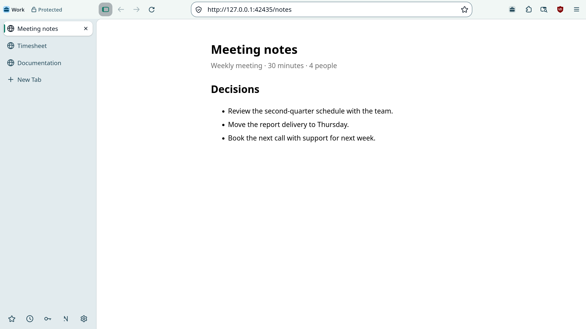

<p align="center">
  <a href="https://nulavio.net/en/">
    <picture>
      <source media="(prefers-color-scheme: dark)" srcset="docs/brand/assets/logo/nulavio-lockup-horizontal-on-dark.svg">
      
    </picture>
  </a>
</p>

<p align="center"><strong>The Linux browser that is protected from the start.</strong></p>

<p align="center">
  <a href="https://github.com/nulavio/nulavio/actions/workflows/ci.yml"></a>
  <a href="LICENSE"></a>
  
  
  <a href="https://github.com/nulavio/nulavio/releases/latest"></a>
  <a href="https://scorecard.dev/viewer/?uri=github.com/nulavio/nulavio"></a>
</p>

<p align="center">
  <a href="https://nulavio.net/en/">Website</a> ·
  <a href="#install">Install</a> ·
  <a href="#build-from-source">Build from source</a> ·
  <a href="#documentation">Documentation</a> ·
  <a href="https://github.com/nulavio/nulavio/discussions">Discussions</a> ·
  <a href="SECURITY.md">Security</a> ·
  <a href="README.pt-BR.md">Português</a>
</p>

<p align="center">
  <picture>
    <source media="(prefers-color-scheme: dark)" srcset="site/assets/shots/window-en-US-dark.webp">
    
  </picture>
</p>

Nulavio is an open-source desktop browser for Linux, built from Mozilla's signature-verified Firefox source. It blocks ads and trackers from the first launch, keeps each part of your life in its own profile, encrypts the profiles you protect, and sends nothing to servers of its own: there is no telemetry and no Nulavio account.

## Highlights

- **Protected before the first click.** uBlock Origin, Enhanced Tracking Protection in Strict mode, HTTPS-Only, Global Privacy Control and Google Safe Browsing are on in a new profile. Canvas and WebGL readings differ from site to site, and pages cannot see your extra fonts or your graphics card ([what a page can read](docs/research/fingerprinting.md)).
- **One profile for each part of your life.** Personal, work, banking and research profiles, each in its own browser instance with its own cookies, logins and extensions. Links from other apps and addresses you type open in the profile your rules say.
- **Profiles encrypted on disk, and you hold the key.** A protected profile opens with its password, a recovery code or your desktop login. There is no master key, not even for Nulavio ([ADR 0006](docs/adr/0006-nulavio-vault.md)).
- **You hear about changes made from outside.** Nulavio Guard compares each start with the last one: extensions, certificate authorities, security modules, protective settings, `user.js`. You undo or keep each change.
- **AI that goes only as far as you let it.** Connect Claude Code, Codex or any MCP client. Each agent works in a profile of its own, with the permissions you grant, an activity log and an emergency stop ([ADR 0007](docs/adr/0007-ai-bridge.md)).
- **Also built in:** your password manager (Proton Pass, Bitwarden, KeePassXC or the browser's own), search suggestions only from the engines you allow, your choice of DNS, downloads that never start a program from the browser, KDE Plasma and desktop portal integration, English and Portuguese.

## Status

**Alpha.** The first public alpha, [v160.0-0.1](https://github.com/nulavio/nulavio/releases/tag/v160.0-0.1) (Firefox 160.0), is out for **Fedora**, through a signed dnf repository; Ubuntu (APT) follows. Unlocking a profile with a phone or a FIDO2 security key comes after 1.0 and is shown as "not available yet" in the browser. The [release criteria](docs/product/release-criteria.md) list what is done and what is left, and the [roadmap](docs/product/roadmap.md) the phases.

Nulavio follows Firefox's release channel and aims to ship each Firefox security release within 24 hours, 72 at most ([update policy](docs/architecture/update-policy.md)).

## Install

On Fedora 44 or later, x86_64:

```sh
sudo dnf config-manager addrepo --from-repofile=https://packages.nulavio.net/rpm/nulavio.repo
sudo dnf install nulavio
```

Packages and the repository metadata are signed with the OpenPGP key `298A 9093 BAAB B26F 79BB  29F4 BF47 E5FA 9EDB 8DB1` ([public key](https://nulavio.net/keys/nulavio-packages.asc)). Every [release](https://github.com/nulavio/nulavio/releases) comes with a CycloneDX SBOM and a signed `SHA256SUMS`. Other systems: [join the waitlist](https://nulavio.net/en/) and you get an e-mail when yours is supported.

## Build from source

Requirements: Linux x86_64, about 25 GB of disk, and a [Google Safe Browsing API key](docs/architecture/build.md#google-safe-browsing-key) in `~/.config/nulavio-build/google-safebrowsing.key`. The source download, its signature check, the branding and the patches run on the host before the container starts, so the host needs Python 3.11 or later, `git`, GnuPG, `tar`, ImageMagick 7 with SVG support (librsvg) and rootless Podman. On Fedora:

```sh
sudo dnf install python3 git-core gnupg2 tar ImageMagick librsvg2 podman
```

The build itself runs in a disposable container limited to 16 GiB of memory and two processors; on the reference laptop a full release build takes about 2 h 20 min.

```sh
git clone https://github.com/nulavio/nulavio.git && cd nulavio
scripts/build/build_nulavio.sh 160.0
```

The script checks Mozilla's signed checksums before it builds anything, applies the [patch stack](browser/patches/series), and writes `nulavio-160.0.en-US.linux-x86_64.tar.xz`. Packaging, signing and the release rehearsal are described in [build](docs/architecture/build.md) and the [update policy](docs/architecture/update-policy.md).

### Try the preview without building

The preview launcher (Track A) runs your distribution's unmodified Firefox with Nulavio's isolated, hardened profile. It needs Python 3.11 or later and a distribution Firefox 140 or later (not the Snap):

```sh
bin/nulavio setup     # shows the plan and asks before creating anything
bin/nulavio run       # add a URL, --private, --temporary or --confined
bin/nulavio doctor    # checks the environment and the profile
```

## Tests

```sh
python3 -I tests/run.py unit          # no engine, no network
python3 -I tests/run.py integration   # the real engine, headless
```

The integration suite drives the real browser through Marionette: 363 tests on the Firefox 160 build, the ones that need the network, a phone or a visible window run on request.

## Documentation

| Area | Where |
|---|---|
| Decisions | [ADRs](docs/adr/): engine, search, profiles and routing, Connect, phone unlock, Vault, AI Bridge |
| Product | [vision](docs/product/vision.md) · [requirements](docs/product/requirements.md) · [roadmap](docs/product/roadmap.md) · [release criteria](docs/product/release-criteria.md) |
| Architecture | [overview](docs/architecture/overview.md) · [build](docs/architecture/build.md) · [update policy](docs/architecture/update-policy.md) · [trust boundaries](docs/architecture/trust-boundaries.md) |
| Security | [threat model](docs/security/threat-model.md) · [hardening](docs/security/hardening.md) · [residual risks](docs/security/residual-risks.md) · [changelog](docs/security/changelog.md) |
| Design | [design system](docs/design/design-system.md) · [UX principles](docs/design/ux-principles.md) · [accessibility](docs/design/accessibility.md) |
| Process | [contributing](CONTRIBUTING.md) · [pull requests](docs/process/pull-requests.md) |

## Security

Report a vulnerability through GitHub's [private vulnerability reporting](https://github.com/nulavio/nulavio/security/advisories/new) or to **security@nulavio.net**. [SECURITY.md](SECURITY.md) says what is in scope and how reports are handled. Firefox engine bugs go to Mozilla.

A browser cannot protect you from malware that already runs as your user or as root. Nulavio reduces what is exposed and reports some tampering; it does not make a computer "infostealer-proof". The [residual risks](docs/security/residual-risks.md) say what each protection does not do.

## Contributing

Read [CONTRIBUTING.md](CONTRIBUTING.md). In short: conventional commits signed off (`git commit -s`), one change per pull request, and a description that says how it was verified and what was not. Changes reach `main` only through a pull request with green CI.

## License and trademarks

Code under the [Mozilla Public License 2.0](LICENSE); brand assets as described in [LICENSES.md](LICENSES.md). "Nulavio" is not a registered trademark yet. Nulavio is not affiliated with Mozilla; Firefox is a trademark of the Mozilla Foundation.
