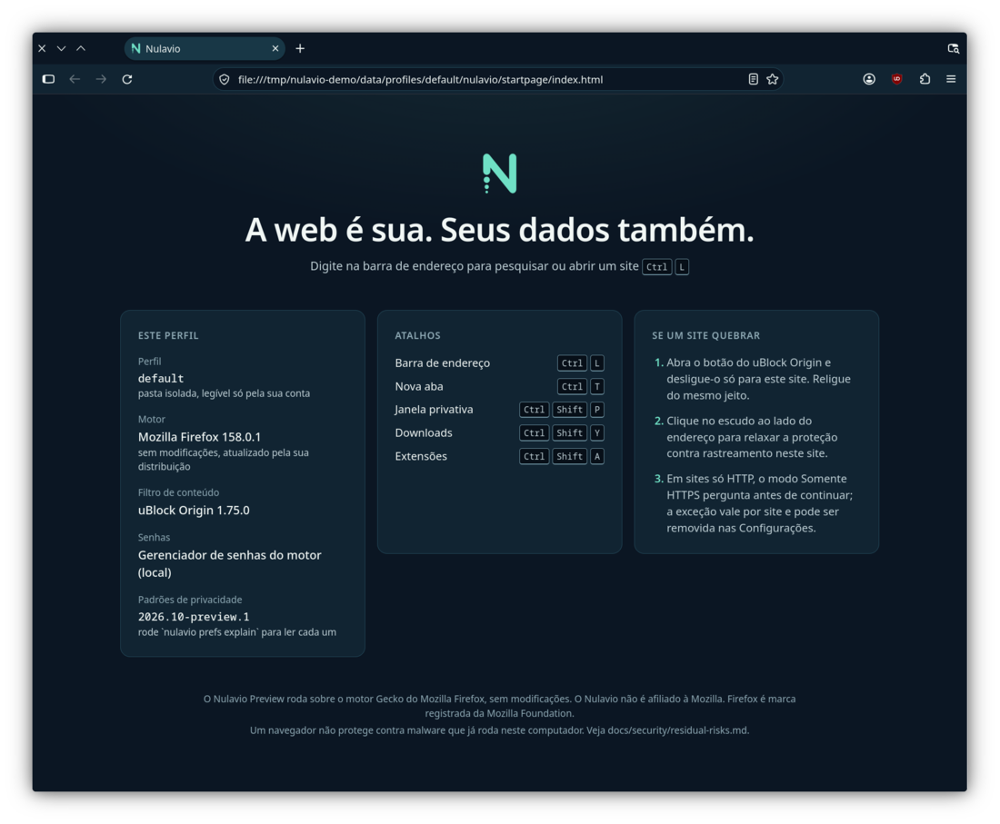
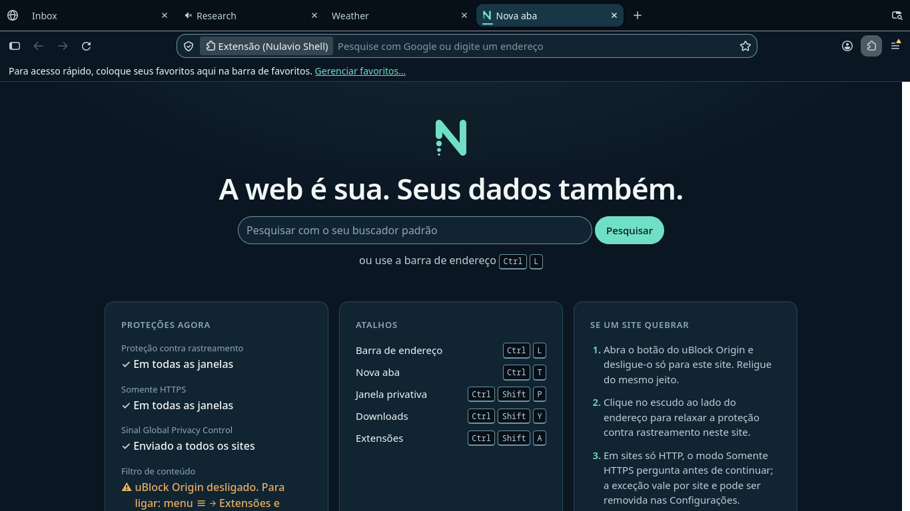
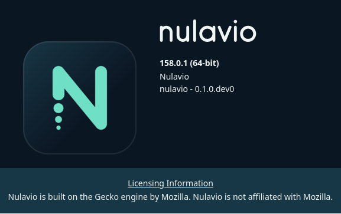

<p align="center"></p>

<p align="center"><b>Your web. Your rules.</b> · <i>A web é sua. Seus dados também.</i></p>

Nulavio is an open-source, Linux-first desktop browser built on Mozilla's Gecko engine. It focuses on privacy by default, ad and tracker blocking, and safe use of the password manager you already trust. It is honest about what a browser can and cannot protect.

> **Status: Phase 0 complete, Phase 1 in progress. This is a preview, not a release.** Website: [nulavio.net](https://nulavio.net) · security reports: security@nulavio.net
> The *Nulavio Preview* (Track A) is a launcher and isolated, hardened profile layer on top of your distribution's **unmodified** Firefox. The branded source build (Track B) is a development spike ([build](docs/architecture/build.md)). It is not a release and lacks a Safe Browsing key. See [ADR 0001](docs/adr/0001-engine-selection.md).



## What works today (verified)

Verified on Fedora 44 KDE Plasma 6.7.5 (Wayland), Firefox 158.0.1. Each item has an automated test or recorded evidence.

- Isolated profile in `~/.local/share/nulavio/profiles/<name>` (0700/0600). Your Firefox profiles are never touched.
- Upstream sandbox active: seccomp-bpf plus user namespaces on every web-content process. Site isolation is on.
- 27 documented privacy/security defaults (`nulavio prefs explain`): telemetry off, Enhanced Tracking Protection Strict, HTTPS-Only with revocable per-site exceptions, Global Privacy Control, no speculative connections, no search suggestions or trending searches sent while you type. Every one of them can be undone.
- Ad blocking with **uBlock Origin**, pinned by SHA-256. Blocking is tested and reversible.
- Official **Proton Pass**, **KeePassXC-Browser** and **Bitwarden** extensions install, run and render their UI. **Proton Pass signs in and autofills real sites** (verified on the maintainer's Fedora KDE desktop). **KeePassXC pairing and autofill work end to end** (automated, in CI). Bitwarden logins are not yet tested with a real account (see [limits](docs/security/residual-risks.md)).
- One credential provider at a time (`nulavio provider set …`), reversible, never deleting saved logins.
- **Nulavio Guard** audits the profile before every launch and refuses to start a profile with weakened sandbox, signature or TLS settings.
- `nulavio doctor`: engine, sandbox prerequisites, Secret Service/KWallet, native messaging hosts, profile permissions, extension inventory.
- Desktop identity on Wayland: app_id `nulavio-preview`, own icon, local start page in pt-BR/EN, light and dark.
- Nothing is sent to Nulavio. There is no Nulavio server.
- Verified on **Ubuntu userspace** too (Firefox from Mozilla's APT repository): 15/15 integration tests.

**Track B (development build):** `scripts/build/build_nulavio.sh 158.0.1` builds a Nulavio-branded browser from signature-verified Firefox source in a rootless container. It takes about 52 min and 23 GB on the reference laptop. With a Google Safe Browsing key (kept outside the repository), the build passes all 59 integration tests (4 of them reach the network and run on request), including an end-to-end phishing-protection test. Download reputation is not available to non-partner keys (residual risk R15). The build includes the **Nulavio Shell**: a new tab with search and the live state of each protection, and a warning page for downloaded installers and scripts (Show in folder / Delete, no Open). It ships in English and Portuguese and follows the desktop language. **Search** defaults to DuckDuckGo in normal and private windows, with Brave Search and Mojeek ready as `@brave` and `@mojeek`, your own SearXNG instance or any engine you add; what you type is sent to a provider while typing only if you switch suggestions on for that provider ([ADR 0002](docs/adr/0002-nulavio-search.md)). **Profiles** get a selector on the toolbar (Alt+Shift+P): switch with one click, start from Personal, Work, Banking or Research templates; each profile keeps its own cookies, passwords and extensions ([ADR 0003](docs/adr/0003-nulavio-profiles-and-routing.md)). Its window uses **Nulavio Horizon**, its own theme for the tab strip, toolbar and address bar, in light and dark ([design](docs/design/architecture.md)). See [build](docs/architecture/build.md).



<p align="center"></p>

## Quick start (preview)

Requirements: Linux x86_64, Python ≥ 3.11, a distribution Firefox ≥ 140 (Fedora RPM, or the Mozilla APT package on Debian/Ubuntu; **not** the Snap). No other dependencies.

```sh
git clone <this repo> nulavio && cd nulavio
bin/nulavio setup            # shows the full plan, asks before creating anything
bin/nulavio run              # start; add a URL or --private
bin/nulavio doctor           # check your environment and profile
bin/nulavio desktop install  # optional: menu entry + icons under ~/.local/share (no root)
```

Other commands: `nulavio provider set proton-pass --install-extension`, `nulavio extensions list`, `nulavio prefs explain`, `nulavio theme off`, `nulavio profile list`, `nulavio desktop uninstall`.

## Tests

```sh
python3 -I tests/run.py unit                                  # ~1 s, no engine, no network
python3 -I tests/run.py integration                           # headless engine, ~15 s
NULAVIO_NETWORK_TESTS=1 python3 -I tests/run.py integration   # + official password-manager extensions
```

## Repository layout

| Path | What |
|---|---|
| `bin/nulavio`, `launcher/` | Preview launcher (Python stdlib only) |
| `browser/config/` | Annotated prefs, providers, Guard rules (the single configuration source for Tracks A and B) |
| `browser/distribution/extensions.lock.json` | Pinned extensions (version, URL, SHA-256, reviewed permissions) |
| `browser/startpage/`, `browser/theme/` | Local start page and preview chrome theme |
| `docs/` | ADR, product, architecture, security, brand, research |
| `scripts/brand/` | Generators for tokens, logo, icons, mockups; contrast checker |
| `scripts/upstream/`, `scripts/release/` | Source-release verification, lock refresh, SBOM |
| `tests/` | Unit and integration suites; minimal Marionette client |
| `sbom/` | CycloneDX SBOM of the preview |

## Documentation

- Decision: [ADR 0001 — engine selection](docs/adr/0001-engine-selection.md)
- Product: [vision](docs/product/vision.md) · [requirements](docs/product/requirements.md) · [roadmap](docs/product/roadmap.md) · [release criteria](docs/product/release-criteria.md)
- Architecture: [overview](docs/architecture/overview.md) · [trust boundaries](docs/architecture/trust-boundaries.md) · [password providers](docs/architecture/password-providers.md) · [extension model](docs/architecture/extension-model.md) · [update policy](docs/architecture/update-policy.md)
- Security: [threat model](docs/security/threat-model.md) · [threat matrix](docs/security/threat-matrix.md) · [hardening](docs/security/hardening.md) · [residual risks](docs/security/residual-risks.md) · [SECURITY.md](SECURITY.md)
- Brand: [strategy](docs/brand/strategy.md) · [explorations](docs/brand/explorations.md) · [guidelines](docs/brand/guidelines.md) · [UX flows](docs/brand/ux-flows.md)
- Research: [compatibility matrix](docs/research/compatibility-matrix.md)

## Honest limits

A browser cannot protect you from malware that already runs on your computer as your user or as root. Nulavio reduces what is exposed and detects some tampering, but it is not "infostealer-proof". Read [residual risks](docs/security/residual-risks.md).

## Trademarks and licences

Code: [MPL-2.0](LICENSE). Brand assets: see [LICENSES.md](LICENSES.md). "Nulavio" is a candidate name and is **not registered**; the project domain is `nulavio.net` ([status](docs/brand/strategy.md#trademark-and-availability-status)). Nulavio is not affiliated with Mozilla. Firefox is a trademark of the Mozilla Foundation.

---

### Resumo em português

O Nulavio é um navegador open-source para Linux, baseado no motor Gecko. Ele prioriza privacidade por padrão, bloqueio de anúncios e rastreadores e integração segura com gerenciadores de senhas, sendo transparente sobre seus limites. Hoje existe uma **prévia** (Trilha A): um launcher e um perfil isolado e endurecido sobre o Firefox **sem modificações** da sua distribuição. Ela foi testada no Fedora 44 KDE (Wayland), com sandbox verificado, uBlock Origin fixado por hash, HTTPS-Only e as extensões oficiais do Proton Pass, KeePassXC e Bitwarden carregando. O build próprio com a marca Nulavio (Trilha B) é a próxima etapa. Comece com `bin/nulavio setup`.
