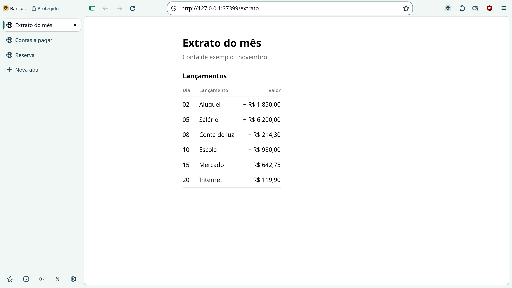

<p align="center">
  <a href="https://nulavio.net/">
    <picture>
      <source media="(prefers-color-scheme: dark)" srcset="docs/brand/assets/logo/nulavio-lockup-horizontal-on-dark.svg">
      
    </picture>
  </a>
</p>

<p align="center"><strong>O navegador para Linux que já vem protegido.</strong></p>

<p align="center">
  <a href="https://github.com/nulavio/nulavio/actions/workflows/ci.yml"></a>
  <a href="LICENSE"></a>
  
  
  <a href="https://github.com/nulavio/nulavio/releases/latest"></a>
  <a href="https://scorecard.dev/viewer/?uri=github.com/nulavio/nulavio"></a>
  <a href="https://www.bestpractices.dev/projects/16551"></a>
</p>

<p align="center">
  <a href="https://nulavio.net/">Site</a> ·
  <a href="#instalar">Instalar</a> ·
  <a href="#compilar-a-partir-do-código">Compilar</a> ·
  <a href="#documentação">Documentação</a> ·
  <a href="https://github.com/nulavio/nulavio/discussions">Discussões</a> ·
  <a href="SECURITY.md">Segurança</a> ·
  <a href="README.md">English</a>
</p>

<p align="center">
  <picture>
    <source media="(prefers-color-scheme: dark)" srcset="site/assets/shots/window-pt-BR-dark.webp">
    
  </picture>
</p>

O Nulavio é um navegador de código aberto para Linux, compilado a partir do código-fonte do Firefox com a assinatura da Mozilla conferida. Ele bloqueia rastreadores desde a primeira abertura e anúncios assim que o uBlock Origin se instala e carrega as listas dele, mantém cada parte da sua vida num perfil próprio, cifra os perfis que você protege e não envia nada a servidores próprios: não há telemetria nem conta Nulavio.

## Destaques

- **Protegido antes do primeiro clique.** uBlock Origin com avisos de cookies, de newsletter e de notificações escondidos, proteção contra rastreamento no modo Estrito, só HTTPS, Global Privacy Control e Google Safe Browsing já vêm ligados num perfil novo. As leituras de canvas e WebGL mudam de um site para outro, e as páginas não veem suas fontes extras nem a sua placa de vídeo ([o que uma página consegue ler](docs/research/fingerprinting.md)).
- **Um perfil para cada parte da sua vida.** Pessoal, trabalho, banco e pesquisa, cada um numa instância própria, com seus cookies, logins e extensões. Links de outros programas e endereços digitados abrem no perfil que as suas regras mandarem.
- **Perfis cifrados no disco, e a chave é sua.** Um perfil protegido abre com a senha dele, um código de recuperação ou o login do computador. Não existe chave mestra, nem para o Nulavio ([ADR 0006](docs/adr/0006-nulavio-vault.md)).
- **Você fica sabendo do que mudou por fora.** O Nulavio Guard compara cada abertura com a anterior: extensões, autoridades certificadoras, módulos de segurança, configurações de proteção, `user.js`. Você mantém cada mudança, ou a desfaz quando o Guard consegue; no caso do `user.js`, ele mostra o arquivo para você corrigir.
- **IA que vai só até onde você deixa.** Conecte Claude Code, Codex ou qualquer cliente MCP. Cada agente trabalha num perfil só dele, com as permissões que você der, registro de atividade e parada de emergência ([ADR 0007](docs/adr/0007-ai-bridge.md)).
- **E mais:** o seu gerenciador de senhas (Proton Pass, Bitwarden, KeePassXC ou o do próprio navegador), sugestões de busca só dos buscadores que você permitir, DNS à sua escolha, downloads que nunca abrem um programa pelo navegador, links que abrem a página num trecho destacado (com uma versão limpa, sem parâmetros de rastreamento; não em PDFs), tela dividida (duas abas lado a lado, pelo menu da aba; a barra de endereço diz o site do lado em foco), grupos de abas (com nome e cor, nunca nas cores que indicam um alerta; voltam com a sessão), integração com o KDE Plasma e os portais do desktop, português e inglês.

## Status

**Alpha.** A alpha pública, agora na <!--release-->[v161.0-0.1](https://github.com/nulavio/nulavio/releases/tag/v161.0-0.1)<!--/release-->, já saiu para o **Fedora** e o **Ubuntu**, por repositórios dnf e APT assinados. Um perfil pode ser desbloqueado pelo celular com o app Nulavio Companion para Android, que vem com cada release (ainda não está no F-Droid); a chave de segurança FIDO2 fica para depois da 1.0 e aparece no navegador como "ainda não disponível". Os [critérios de release](docs/product/release-criteria.md) mostram o que está pronto e o que falta, e o [roadmap](docs/product/roadmap.md), as fases.

O Nulavio acompanha o canal de releases do Firefox e busca publicar cada atualização de segurança do Firefox em até 24 horas, 72 no máximo ([política de atualização](docs/architecture/update-policy.md)).

## Instalar

No Fedora 44 ou mais novo, x86_64:

```sh
sudo dnf config-manager addrepo --from-repofile=https://nulavio.net/rpm/nulavio.repo
sudo dnf install nulavio
```

No Ubuntu 24.04 ou mais novo, x86_64:

```sh
(d=$(mktemp -d) && cd "$d" &&
  curl -fsSLO --proto '=https' https://nulavio.net/apt/nulavio.sources &&
  echo 'f77857a1515bcf9cb07a5e213f0525e36784e1d47bafb700f9d3e158fc537745  nulavio.sources' | sha256sum --check &&
  sudo install -m 0644 nulavio.sources /etc/apt/sources.list.d/ &&
  sudo apt-get -o APT::Update::Error-Mode=any update &&
  sudo apt install nulavio)
```

Os passos rodam num subshell, então o seu terminal fica na pasta em que estava. Eles rodam numa pasta nova que só a sua conta abre (`mktemp -d`; eles param se ela não puder ser criada), então nenhuma outra conta troca o arquivo entre a verificação e a instalação. O `sha256sum --check` os interrompe se o arquivo não tiver exatamente esse SHA-256, e o `Error-Mode=any` os interrompe quando o apt não consegue atualizar um repositório, em vez de instalar pela lista que já tinha. O arquivo traz a chave pública citada logo abaixo, e o apt só aceita do repositório do Nulavio o que ela assinou; como em qualquer fonte do apt, porém, outro repositório que você adicionou e que ofereça um `nulavio` mais novo levaria a melhor ([R83](docs/security/residual-risks.md)).

Os pacotes e os metadados do repositório são assinados com a chave OpenPGP `298A 9093 BAAB B26F 79BB  29F4 BF47 E5FA 9EDB 8DB1` ([chave pública](https://nulavio.net/keys/nulavio-packages.asc)). Cada [release](https://github.com/nulavio/nulavio/releases) vem com um SBOM CycloneDX e um `SHA256SUMS` assinado. Outros sistemas: [entre na lista de espera](https://nulavio.net/) e você recebe um e-mail quando o seu for suportado.

## Compilar a partir do código

Requisitos: Linux x86_64, cerca de 25 GB de disco e uma [chave da API do Google Safe Browsing](docs/architecture/build.md#google-safe-browsing-key) em `~/.config/nulavio-build/google-safebrowsing.key`. O download do código, a conferência da assinatura, a marca e os patches rodam no próprio computador, antes do container. Por isso ele precisa de Python 3.11 ou mais novo, `git`, GnuPG, `tar`, ImageMagick 7 com suporte a SVG (librsvg) e Podman sem root. No Fedora:

```sh
sudo dnf install python3 git-core gnupg2 tar ImageMagick librsvg2 podman
```

O build em si roda num container descartável, limitado a 16 GiB de memória e dois processadores; no laptop de referência, um build de release completo leva cerca de 2 h 20 min.

```sh
git clone https://github.com/nulavio/nulavio.git && cd nulavio
scripts/build/build_nulavio.sh 161.0
```

O script confere os checksums assinados pela Mozilla antes de compilar qualquer coisa, aplica a [pilha de patches](browser/patches/series) e gera `nulavio-161.0.en-US.linux-x86_64.tar.xz`. Empacotamento, assinatura e o ensaio de release estão descritos em [build](docs/architecture/build.md) e na [política de atualização](docs/architecture/update-policy.md).

### Se você usava a prévia

A prévia, que rodava o perfil do Nulavio sobre o Firefox da sua distribuição (`bin/nulavio setup` e `run`), não é mais oferecida: instale o [pacote](#instalar). `bin/nulavio setup` e `run` agora recusam um motor que não seja o build do Nulavio. Nada é apagado: os perfis da prévia ficam em `~/.local/share/nulavio/profiles/`, e o navegador do pacote não os abre (os perfis dele ficam em `~/.config/nulavio/nulavio`). Para trazer os favoritos e as senhas salvas de um perfil:

1. Ache a pasta do perfil: `bin/nulavio profile path default` mostra onde ela está (o nome de outro perfil no lugar de `default`; ela muda do caminho abaixo se você definiu `XDG_DATA_HOME` ou `NULAVIO_HOME`).
2. Abra o perfil da prévia no Firefox da distribuição, com esse Firefox fechado: `firefox --new-instance --profile ~/.local/share/nulavio/profiles/default` (o nome de outro perfil no lugar de `default`). Um perfil criptografado (`nulavio vault`) é destravado antes com `bin/nulavio vault unlock default` e travado de novo depois com `bin/nulavio vault lock default`.
3. Favoritos: Favoritos → Gerenciar favoritos → Importar e backup → Exportar favoritos para HTML. Senhas: Senhas (`about:logins`) → ⋯ → Exportar senhas. Esse arquivo não é criptografado: deixe-o fora de pastas compartilhadas.
4. No Nulavio: Favoritos → Gerenciar favoritos → Importar e backup → Importar favoritos de HTML; Senhas → ⋯ → Importar de um arquivo. Depois apague o arquivo de senhas exportado.

A extensão de um gerenciador de senhas (Proton Pass, Bitwarden, KeePassXC) guarda o cofre na própria conta ou no próprio banco de dados: entre de novo no Nulavio, não há o que exportar. Se você rodou `bin/nulavio desktop install`, a entrada do menu abre a prévia, que agora se recusa a abrir, e o comando saiu (#465): apague `~/.local/share/applications/nulavio-preview.desktop` e os ícones `nulavio-preview.png` e `nulavio-preview.svg` em `~/.local/share/icons/hicolor/` (em `$XDG_DATA_HOME` no lugar de `~/.local/share`, se você o tinha definido). Quando não precisar mais dos perfis da prévia, apague `~/.local/share/nulavio/profiles/`.

## Testes

```sh
python3 -I tests/run.py unit          # sem motor, sem rede
python3 -I tests/run.py integration   # o motor de verdade, sem janela
```

A suíte de integração controla o navegador de verdade pelo Marionette; os testes que precisam de rede, de um celular ou de uma janela visível rodam sob demanda.

## Documentação

A documentação técnica está em inglês.

| Área | Onde |
|---|---|
| Decisões | [ADRs](docs/adr/): motor, busca, perfis e roteamento, Connect, desbloqueio pelo celular, Vault, AI Bridge |
| Produto | [visão](docs/product/vision.md) · [requisitos](docs/product/requirements.md) · [roadmap](docs/product/roadmap.md) · [critérios de release](docs/product/release-criteria.md) |
| Arquitetura | [visão geral](docs/architecture/overview.md) · [build](docs/architecture/build.md) · [política de atualização](docs/architecture/update-policy.md) · [fronteiras de confiança](docs/architecture/trust-boundaries.md) · [desempenho](docs/architecture/performance.md) |
| Segurança | [modelo de ameaças](docs/security/threat-model.md) · [endurecimento](docs/security/hardening.md) · [o que um perfil novo contata](docs/security/new-profile-connections.md) · [riscos residuais](docs/security/residual-risks.md) · [assurance case](docs/security/assurance-case.md) · [changelog](docs/security/changelog.md) |
| Design | [design system](docs/design/design-system.md) · [princípios de UX](docs/design/ux-principles.md) · [acessibilidade](docs/design/accessibility.md) |
| Processo | [como contribuir](CONTRIBUTING.md) · [pull requests](docs/process/pull-requests.md) · [governança](GOVERNANCE.md) · [código de conduta](CODE_OF_CONDUCT.md) · [notas de versão](CHANGELOG.md) |

## Segurança

Relate uma vulnerabilidade pelo [relatório privado do GitHub](https://github.com/nulavio/nulavio/security/advisories/new) ou para **security@nulavio.net**. O [SECURITY.md](SECURITY.md) diz o que está no escopo e como os relatórios são tratados. Falhas do motor do Firefox vão para a Mozilla.

Um navegador não protege contra um programa malicioso que já roda com o seu usuário ou como root. O Nulavio reduz o que fica exposto e avisa sobre algumas alterações; ele não torna um computador imune a ladrões de dados. Os [riscos residuais](docs/security/residual-risks.md) dizem o que cada proteção não faz.

## Como contribuir

Leia o [CONTRIBUTING.md](CONTRIBUTING.md). Em resumo: commits convencionais com sign-off (`git commit -s`), uma mudança por pull request e uma descrição que diga como foi verificada e o que não foi. As mudanças só entram no `main` por pull request com o CI verde.

## Apoio

- **[LESIS](https://lesis.lat)** oferece ao Nulavio, sem custo, sua plataforma de vulnerabilidades para varreduras automáticas de código e segurança neste repositório. Os achados seguem o [processo de segurança](SECURITY.md).
- **[CodeRabbit](https://coderabbit.ai)** oferece revisões automáticas de pull request no plano para código aberto (consultivas; veja [pull requests](docs/process/pull-requests.md)).

## Licença e marcas

Código sob a [Mozilla Public License 2.0](LICENSE); elementos de marca e regras de uso em [LICENSES.md](LICENSES.md). O Nulavio não tem vínculo com a Mozilla; Firefox é marca da Mozilla Foundation.
