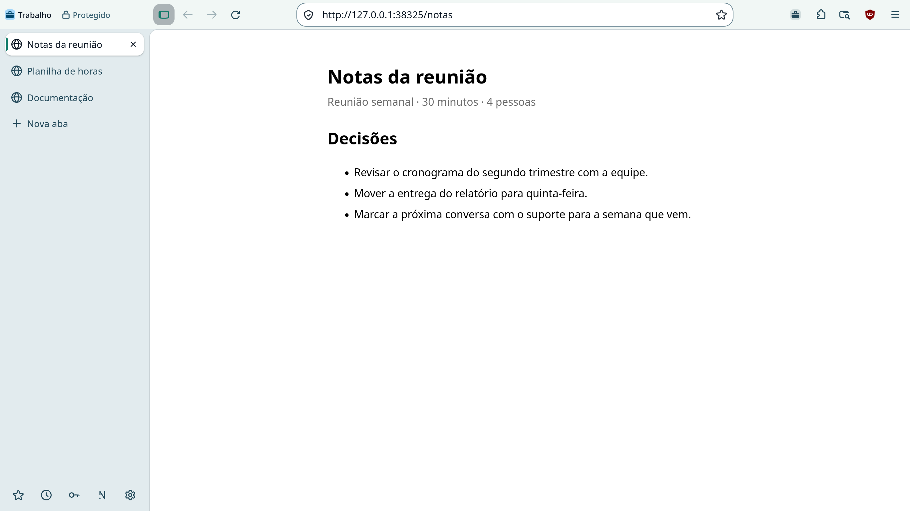

<p align="center">
  <a href="https://nulavio.net/">
    <picture>
      <source media="(prefers-color-scheme: dark)" srcset="docs/brand/assets/logo/nulavio-lockup-horizontal-on-dark.svg">
      
    </picture>
  </a>
</p>

<p align="center"><strong>O navegador para Linux que já vem protegido.</strong></p>

<p align="center">
  <a href="https://github.com/nulavio/nulavio/actions/workflows/ci.yml"></a>
  <a href="LICENSE"></a>
  
  
  <a href="https://github.com/nulavio/nulavio/releases/latest"></a>
  <a href="https://scorecard.dev/viewer/?uri=github.com/nulavio/nulavio"></a>
  <a href="https://www.bestpractices.dev/projects/16551"></a>
</p>

<p align="center">
  <a href="https://nulavio.net/">Site</a> ·
  <a href="#instalar">Instalar</a> ·
  <a href="#compilar-a-partir-do-código">Compilar</a> ·
  <a href="#documentação">Documentação</a> ·
  <a href="https://github.com/nulavio/nulavio/discussions">Discussões</a> ·
  <a href="SECURITY.md">Segurança</a> ·
  <a href="README.md">English</a>
</p>

<p align="center">
  <picture>
    <source media="(prefers-color-scheme: dark)" srcset="site/assets/shots/window-pt-BR-dark.webp">
    
  </picture>
</p>

O Nulavio é um navegador de código aberto para Linux, compilado a partir do código-fonte do Firefox com a assinatura da Mozilla conferida. Ele bloqueia anúncios e rastreadores desde a primeira abertura, mantém cada parte da sua vida num perfil próprio, cifra os perfis que você protege e não envia nada a servidores próprios: não há telemetria nem conta Nulavio.

## Destaques

- **Protegido antes do primeiro clique.** uBlock Origin, proteção contra rastreamento no modo Estrito, só HTTPS, Global Privacy Control e Google Safe Browsing já vêm ligados num perfil novo. As leituras de canvas e WebGL mudam de um site para outro, e as páginas não veem suas fontes extras nem a sua placa de vídeo ([o que uma página consegue ler](docs/research/fingerprinting.md)).
- **Um perfil para cada parte da sua vida.** Pessoal, trabalho, banco e pesquisa, cada um numa instância própria, com seus cookies, logins e extensões. Links de outros programas e endereços digitados abrem no perfil que as suas regras mandarem.
- **Perfis cifrados no disco, e a chave é sua.** Um perfil protegido abre com a senha dele, um código de recuperação ou o login do computador. Não existe chave mestra, nem para o Nulavio ([ADR 0006](docs/adr/0006-nulavio-vault.md)).
- **Você fica sabendo do que mudou por fora.** O Nulavio Guard compara cada abertura com a anterior: extensões, autoridades certificadoras, módulos de segurança, configurações de proteção, `user.js`. Você desfaz ou mantém cada mudança.
- **IA que vai só até onde você deixa.** Conecte Claude Code, Codex ou qualquer cliente MCP. Cada agente trabalha num perfil só dele, com as permissões que você der, registro de atividade e parada de emergência ([ADR 0007](docs/adr/0007-ai-bridge.md)).
- **E mais:** o seu gerenciador de senhas (Proton Pass, Bitwarden, KeePassXC ou o do próprio navegador), sugestões de busca só dos buscadores que você permitir, DNS à sua escolha, downloads que nunca abrem um programa pelo navegador, integração com o KDE Plasma e os portais do desktop, português e inglês.

## Status

**Alpha.** A alpha pública, agora na [v160.0-0.2](https://github.com/nulavio/nulavio/releases/tag/v160.0-0.2) (Firefox 160.0, uma atualização de segurança da v160.0-0.1), já saiu para o **Fedora**, por um repositório dnf assinado; o Ubuntu (APT) vem depois. Desbloquear um perfil pelo celular chega no próximo release, junto com o app Nulavio Companion no F-Droid; a chave de segurança FIDO2 fica para depois da 1.0 e aparece no navegador como "ainda não disponível". Os [critérios de release](docs/product/release-criteria.md) mostram o que está pronto e o que falta, e o [roadmap](docs/product/roadmap.md), as fases.

O Nulavio acompanha o canal de releases do Firefox e busca publicar cada atualização de segurança do Firefox em até 24 horas, 72 no máximo ([política de atualização](docs/architecture/update-policy.md)).

## Instalar

No Fedora 44 ou mais novo, x86_64:

```sh
sudo dnf config-manager addrepo --from-repofile=https://nulavio.net/rpm/nulavio.repo
sudo dnf install nulavio
```

Os pacotes e os metadados do repositório são assinados com a chave OpenPGP `298A 9093 BAAB B26F 79BB  29F4 BF47 E5FA 9EDB 8DB1` ([chave pública](https://nulavio.net/keys/nulavio-packages.asc)). Cada [release](https://github.com/nulavio/nulavio/releases) vem com um SBOM CycloneDX e um `SHA256SUMS` assinado. Outros sistemas: [entre na lista de espera](https://nulavio.net/) e você recebe um e-mail quando o seu for suportado.

## Compilar a partir do código

Requisitos: Linux x86_64, cerca de 25 GB de disco e uma [chave da API do Google Safe Browsing](docs/architecture/build.md#google-safe-browsing-key) em `~/.config/nulavio-build/google-safebrowsing.key`. O download do código, a conferência da assinatura, a marca e os patches rodam no próprio computador, antes do container. Por isso ele precisa de Python 3.11 ou mais novo, `git`, GnuPG, `tar`, ImageMagick 7 com suporte a SVG (librsvg) e Podman sem root. No Fedora:

```sh
sudo dnf install python3 git-core gnupg2 tar ImageMagick librsvg2 podman
```

O build em si roda num container descartável, limitado a 16 GiB de memória e dois processadores; no laptop de referência, um build de release completo leva cerca de 2 h 20 min.

```sh
git clone https://github.com/nulavio/nulavio.git && cd nulavio
scripts/build/build_nulavio.sh 160.0
```

O script confere os checksums assinados pela Mozilla antes de compilar qualquer coisa, aplica a [pilha de patches](browser/patches/series) e gera `nulavio-160.0.en-US.linux-x86_64.tar.xz`. Empacotamento, assinatura e o ensaio de release estão descritos em [build](docs/architecture/build.md) e na [política de atualização](docs/architecture/update-policy.md).

### Experimentar sem compilar

O launcher de prévia (Track A) roda o Firefox da sua distribuição, sem modificações, com o perfil isolado e endurecido do Nulavio. Precisa de Python 3.11 ou mais novo e de um Firefox da distribuição 140 ou mais novo (não o Snap):

```sh
bin/nulavio setup     # mostra o plano e pergunta antes de criar qualquer coisa
bin/nulavio run       # aceita uma URL, --private, --temporary ou --confined
bin/nulavio doctor    # confere o ambiente e o perfil
```

## Testes

```sh
python3 -I tests/run.py unit          # sem motor, sem rede
python3 -I tests/run.py integration   # o motor de verdade, sem janela
```

A suíte de integração controla o navegador de verdade pelo Marionette: 363 testes no build do Firefox 160; os que precisam de rede, de um celular ou de uma janela visível rodam sob demanda.

## Documentação

A documentação técnica está em inglês.

| Área | Onde |
|---|---|
| Decisões | [ADRs](docs/adr/): motor, busca, perfis e roteamento, Connect, desbloqueio pelo celular, Vault, AI Bridge |
| Produto | [visão](docs/product/vision.md) · [requisitos](docs/product/requirements.md) · [roadmap](docs/product/roadmap.md) · [critérios de release](docs/product/release-criteria.md) |
| Arquitetura | [visão geral](docs/architecture/overview.md) · [build](docs/architecture/build.md) · [política de atualização](docs/architecture/update-policy.md) · [fronteiras de confiança](docs/architecture/trust-boundaries.md) |
| Segurança | [modelo de ameaças](docs/security/threat-model.md) · [endurecimento](docs/security/hardening.md) · [o que um perfil novo contata](docs/security/new-profile-connections.md) · [riscos residuais](docs/security/residual-risks.md) · [assurance case](docs/security/assurance-case.md) · [changelog](docs/security/changelog.md) |
| Design | [design system](docs/design/design-system.md) · [princípios de UX](docs/design/ux-principles.md) · [acessibilidade](docs/design/accessibility.md) |
| Processo | [como contribuir](CONTRIBUTING.md) · [pull requests](docs/process/pull-requests.md) · [governança](GOVERNANCE.md) · [código de conduta](CODE_OF_CONDUCT.md) · [notas de versão](CHANGELOG.md) |

## Segurança

Relate uma vulnerabilidade pelo [relatório privado do GitHub](https://github.com/nulavio/nulavio/security/advisories/new) ou para **security@nulavio.net**. O [SECURITY.md](SECURITY.md) diz o que está no escopo e como os relatórios são tratados. Falhas do motor do Firefox vão para a Mozilla.

Um navegador não protege contra um programa malicioso que já roda com o seu usuário ou como root. O Nulavio reduz o que fica exposto e avisa sobre algumas alterações; ele não torna um computador imune a ladrões de dados. Os [riscos residuais](docs/security/residual-risks.md) dizem o que cada proteção não faz.

## Como contribuir

Leia o [CONTRIBUTING.md](CONTRIBUTING.md). Em resumo: commits convencionais com sign-off (`git commit -s`), uma mudança por pull request e uma descrição que diga como foi verificada e o que não foi. As mudanças só entram no `main` por pull request com o CI verde.

## Apoio

- **[LESIS](https://lesis.lat)** oferece ao Nulavio, sem custo, sua plataforma de vulnerabilidades. Varreduras automáticas de código rodam neste repositório, e uma varredura de segredos vazados não encontrou nada (11/11/2026). Os achados seguem o [processo de segurança](SECURITY.md) de sempre.

## Licença e marcas

Código sob a [Mozilla Public License 2.0](LICENSE); os elementos de marca, como descrito em [LICENSES.md](LICENSES.md). "Nulavio" ainda não é marca registrada. O Nulavio não tem vínculo com a Mozilla; Firefox é marca da Mozilla Foundation.
