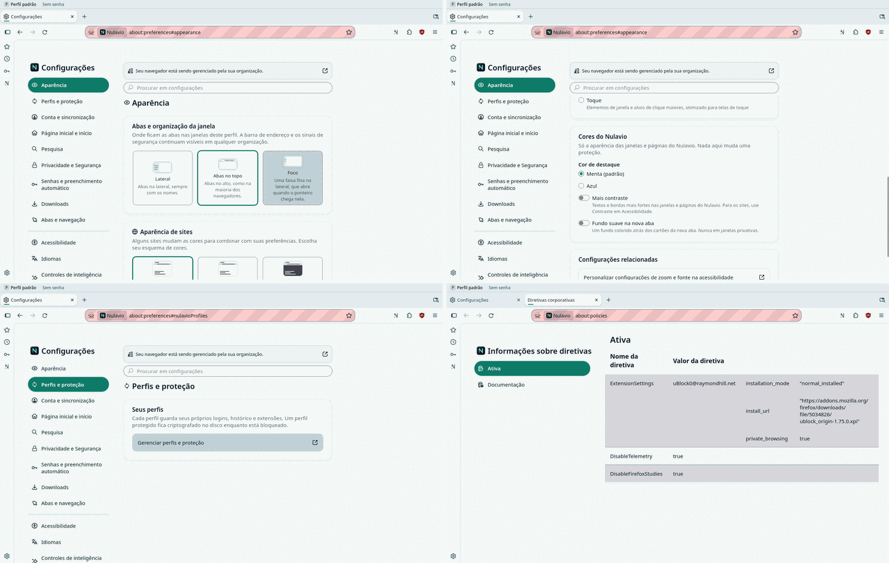
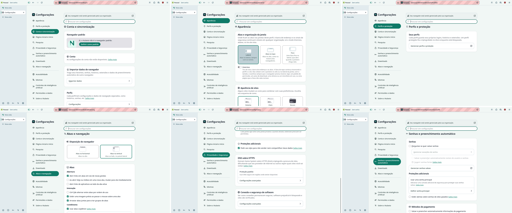
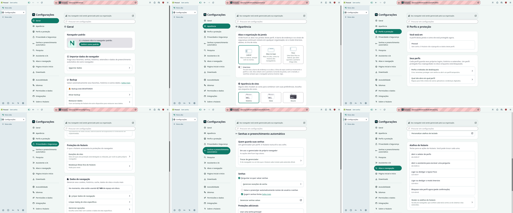
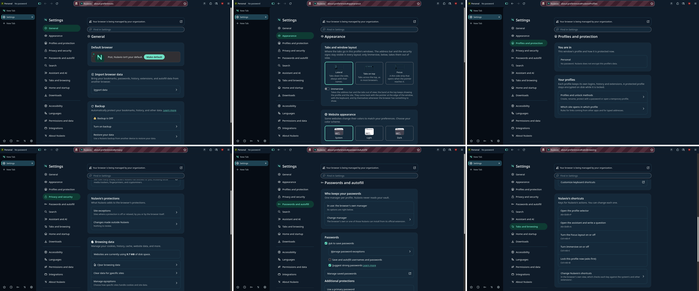

# ADR 0008 — One settings page: Nulavio's options inside the engine's about:preferences

- **Status:** Accepted (2026-11-12): the maintainer follows the recommendations listed under "What was undecided". The proof of concept and slice 1 (the host hardened, the journey's navigation, every way in) work on the engine, below; ADR 0011 carries the rest.
- **Related:** [references](../design/references/2026-11/README.md), the frontend audit of 2026-11 (pull request #41), [ADR 0003](0003-nulavio-profiles-and-routing.md), [ADR 0007](0007-ai-bridge.md), [UX principles](../design/ux-principles.md).

## Context

Nulavio has two settings pages. The engine's `about:preferences` holds search, privacy, passwords, appearance, tabs, languages and the rest. "Configurações do Nulavio" is a page of the Shell add-on (`moz-extension://…/settings/settings.html`) with layout, appearance, shortcuts, search, passwords, site exceptions, DNS, profiles, routing, AI and integrations. Seen on 2026-11-11 (160.0-0.2, `main` at `388800e`, pt-BR):

- Two navigations, two card styles, two type scales. "Aparência" exists in both. "Pesquisa" in one is "Busca" in the other. "Senhas e preenchimento automático" in one, "Senhas" in the other.
- The address bar calls Nulavio's page "Extensão (Nulavio Shell)". It reads as an add-on, because it is one.
- The engine's page opens on "Conta e sincronização", which Nulavio has turned off, and offers "Controles de inteligência artificial" and "Firefox Labs" for features Nulavio has turned off.
- A person who wants to hide the tab strip has to guess which page owns that.

The options were grouped by who wrote the code. The person does not care who wrote it.

What others do, seen on the same day: **Zen** puts its panes into `about:preferences` (one page; it does so with engine patches, and its panes use an older widget set than the page around them). **Floorp** keeps a separate "Hub" and a banner that sends people there: the same split Nulavio has. **Helium** extends its engine's settings page in place.

Firefox 160's settings page is built from data: a pane is a list of groups (`SettingPaneManager`), a group is a list of controls (`SettingGroupManager`), a control reads and writes a `Preferences` setting, and the engine's own widgets draw them (`moz-visual-picker`, `moz-toggle`, `moz-radio-group`, `moz-box-link`…). The page's search indexes whatever is registered.

## Options

| Option | For | Against |
|---|---|---|
| A. **Native panes and groups registered by a privileged Shell module** | One page, one look, the engine's own widgets and search; no engine patch; ships through `dev_sync` and a normal build alike; the engine's panes keep their code | Depends on the page's internal registry (`SettingPaneManager`, `SettingGroupManager`), which can change between engine releases; complex screens (profiles, agents) need custom elements |
| B. Engine patch that adds the panes to `preferences.xhtml` (Zen's way) | Same result for the person | A patch to carry on every engine update, against the patch policy ("prefer prefs, policies, branding or built-in add-ons over patches"); every copy change needs an engine build |
| C. A Nulavio hub that absorbs the engine's options and replaces `about:preferences` | Full control of the look | Re-implements hundreds of engine settings, including security ones; each engine release can add or change one silently; a missed option is a protection people cannot reach; the largest surface to keep honest |
| D. Keep two pages, restyle and cross-link | Cheap | Still two places (Floorp's banner). Does not answer the complaint |

## Decision

1. **A.** The Shell registers its settings in `about:preferences` as native groups and panes. `about:preferences` is the one settings page. The add-on page is retired section by section and then removed.
2. **Mechanism.** `NulavioSettings.sys.mjs` observes `chrome-document-global-created`. For a system-principal `about:preferences` (or `about:settings`) document, and nothing else, it imports `settings/native/panes.mjs` into that document's own global at `DOMContentLoaded`, before the page's own listener, through the window's own module loader (`win.ChromeUtils.importESModule(…, { global: "current" })`, a fixed `resource://` address). No script loader and no evaluated text: the Shell's rule against `loadSubScript` stands. The module calls the same registry the engine's panes call. Words are Fluent (`l10n/<locale>/nulavio/settings.ftl`, registered as an `L10nFileSource`), en-US and pt-BR together.
3. **One seam.** The page registers its own panes right after our module runs, so an engine pane that gains a Nulavio group is edited as it is registered (a wrapper around `SettingPaneManager.registerPane`). That is the only place the page's code is intercepted, and `test_settings_native` fails if the seam stops working.
4. **What happens when it fails, stated as a contract and not as a promise.**
   - *Before anything is registered* (the module cannot load, the registry is missing or has another shape, the page already registered its panes): a preflight checks the registry's functions and stores first; nothing is changed and the page is the engine's stock page.
   - *While registering*: every Nulavio setting, group, pane and navigation entry is added inside one guarded step that records what it added; on an exception the wrapper is removed, what was added is unregistered, the engine's navigation goes back to its order, an engine group that had been edited gets its rows back, and the page continues as the engine's. A Nulavio option that could not be shown is still reachable from the band and the profile menu, which open the Shell's own pages.
   - *While the engine registers a pane that gains a Nulavio group*: if the edit of that pane throws, the engine's pane is registered as it was.
   - *After the page is built*: a value read from a Shell module is not drawn until the read answered, so a control never shows a default as if it were the person's choice; a read that failed leaves its controls out and says so in words in their group. An answer that a later read overtook is dropped.
   - Nothing of the engine is hidden before Nulavio's part is in place, in any of these.
   Slice 1 implements all of them; `test_settings_native` breaks the registry halfway and a read on purpose.
5. **Organised by what the person is doing**, not by origin. A Nulavio group goes into the engine pane it belongs to; a pane is new only when the engine has no home for it. The order is the journey: settle in, how it looks, who you are, what protects you, what helps you, how you browse. As built in slice 1:

   | Order | Pane | Engine groups | Nulavio groups |
   |---|---|---|---|
   | 1 | Geral (the engine's first pane) | default browser, import, backup; "accounts are unavailable" last | — |
   | 2 | Aparência | website appearance, theme, density, related settings | **tabs and window layout with Immersive** (first), Nulavio colours |
   | 3 | Perfis e proteção (new) | — | where you are (this profile and its protection, read now); profiles and unlock methods; which site opens in which profile |
   | 4 | Privacidade e segurança | all of them, in their order | Nulavio's protections, after the engine's tracking protection: site exceptions, what changed outside Nulavio (the Guard's count, read now) |
   | 5 | Senhas e preenchimento automático | all of them | who keeps your passwords (the manager in use, read now), first |
   | 6 | Pesquisa | all of them | Nulavio's engines, after the default engine |
   | 7 | Assistente e IA: the engine's AI pane under that name (a pane of Nulavio's own only where the engine shows none) | all its controls; its opening card gives way | assistant, agents, activity, first |
   | 8 | Abas e navegação | all but the two-way layout picker | a pointer to Aparência where that picker was; Nulavio's keys, after the engine's keyboard group |
   | 9 | Página inicial, Downloads, Acessibilidade, Idiomas, Permissões e dados | as today | — |
   | 10 | Integrações (new) | — | desktop integrations |
   | 11 | Sobre o Nulavio | as today | — |

   Three things differ from the first draft of this table. The first pane is called "Geral", not "Início": the engine already has "Página inicial e início". Nulavio's keys are a group next to the engine's own keyboard group, not a pane of their own. DNS is not listed: see "What stays undecided".

6. **Nothing that is a protection moves or changes meaning.** The engine's privacy, security, permissions and password panes keep their code, order and wording, with the exceptions listed here. Nulavio adds groups next to them. Later steps took two more things of the engine out of view, both recorded in [ADR 0011](0011-nulavio-ui-native-not-an-extension.md): the engine's own DNS summary row in the privacy pane, where Nulavio's DNS group now says what is in effect, and the line "managed by your organization" while the only policies in effect are Nulavio's own ([R66](../security/residual-risks.md)). Four things of the engine gave way first, none of them a protection, each because it asked the same question twice: the two-way "Disposição do navegador" picker (Nulavio's three-way one in Aparência writes the same preference and more), the "Perfis" entry of the first pane (it opens the engine's profile pages, which know nothing of a profile's protection), the row of Aparência's "related settings" that sent people to the pane whose picker now points back, and the opening card of the engine's AI pane (a promise of "more controls soon" with the engine maker's mascot).
7. **Three ways to host a Nulavio section**, chosen per section:
   - *Declarative* (layout, colours, DNS choice, search consent, shortcuts list): settings and groups only. This is the default.
   - *Custom element* in a group (profiles list, routing rules, agents): a small web component registered by the same script, drawn with the engine's widgets and tokens.
   - *Not embedded*: the existing security moments (unlock, create a protected profile, agent request, Guard review) stay their own pages with the band naming them. Settings link to them; they are not settings.
8. **Entry points.** Every "Configurações" entry of the Shell (new tab, first run, profile menu, quick action) opens `about:preferences`, at the pane it names, in the window that asked. A Shell page cannot link to that address, so it goes through one bridge (`nulavioPersonalise.openSettings`) that takes a name from a fixed list and never an address. The Shell's own page (`settings/settings.html`) stops being a settings page with its own navigation. When this was written it held the detail screens not yet drawn natively; since [ADR 0011](0011-nulavio-ui-native-not-an-extension.md) only two remain there, the assistant's agents and activity and the integrations, each reached from its pane. Entry points that named one of the other screens (the band's protection and routing marks) now open the pane in `about:preferences`.

## What was undecided (maintainer; decided on 2026-11-12 as recommended)

DNS is built (ADR 0011, step 9), and so is the management line (ADR 0011, step 18). The panes of unavailable features are decided and **not built yet**: until they are, no pane is hidden.

- **DNS: two controls for one preference.** The engine's privacy pane has its own "DNS sobre HTTPS" group (four levels, the engine's words); Nulavio's first run and its detail screen ask the same thing as three choices in plain words, with Quad9 and Mullvad next to the engine's default. Both write `network.trr.mode`. Slice 1 leaves the engine's group alone (decision 6) and does not add a second control next to it, so the plain-words version is reachable from the first run only. Recommendation: put Nulavio's three choices where the engine's summary box is and keep the engine's advanced screen behind it; it replaces a group of a protection pane, so it waits for a decision.

- **"Seu navegador está sendo gerenciado pela sua organização."** Everyone sees it, because Nulavio ships its own `policies.json`. It is true and it trains people to ignore a line that would also be the only sign of a policy someone else added. Recommendation: keep the line only when the active policies differ from the ones Nulavio ships (the Guard already tracks policy changes), and say "Nulavio aplica N políticas próprias" in "Sobre" otherwise. It touches a security cue, so it is not changed without a decision.
- **"Conta e sincronização", "Controles de inteligência artificial", "Firefox Labs".** Recommendation: hide each only while the feature behind it is unavailable **as read at that moment** (accounts disabled by policy, every engine AI feature off, no experiment offered), never on the assumption that it is; a pane with one live control stays, and its address keeps working. Slice 1 does the smallest part of this: while `identity.fxaccounts.enabled` is false when the page is built, the first pane is named "Geral" and its "accounts are unavailable" group goes last; nothing is hidden, and with accounts on the pane keeps the engine's name. The assistant and the engine's AI controls are one pane, "Assistente e IA", with the assistant first and every engine control kept: two entries with "IA" in their names, one after the other, were the first thing a reader of the navigation would confuse (a point of the visual critique, checked on the captures).

## Consequences

- One address, one navigation, one search. A person finds "tabs on the side" under Aparência whoever wrote it.
- Nulavio's settings are drawn by the engine's widgets: its focus, contrast, forced-colours and RTL behaviour come with them, and the Shell's own form components shrink to the security moments.
- The Shell depends on the settings page's registry. It is not a public API. Each engine update needs the settings tests to pass before release; if the registry changes shape, the panes need porting (option B remains the fallback for that release).
- The injected script runs with the system principal, like the page it extends. It loads only from the Shell's own `resource://` path, never takes text from the web, and builds no markup from strings.
- `shared/options.json` and its test (no option may write a protection pref) keep applying: the same options, a different host.
- The retired add-on page removes about 2,000 lines of form code once every section is moved.

## Proof of concept (2026-11-11)

On the alpha's engine (Nulavio 160.0-0.2 build, `dev_sync`, no engine build), branch `agent/claude/feat-unified-settings`:

- `NulavioSettings.sys.mjs` (about 70 lines) and `settings/native/panes.mjs` (about 170 lines) register: the layout choice (Lateral, Abas no topo, Foco) as the first group of the engine's Aparência pane, drawn by `moz-visual-picker`; "Cores do Nulavio" (accent, more contrast, new-tab background) after the engine's density group; and a new "Perfis e proteção" pane with its navigation entry.
- Choosing "Abas no topo" in that card moved the tabs of the real window (`sidebar.verticalTabs` false, checked in the window).
- pt-BR and en-US, light and dark: the same card style as the engine's groups; the previews follow the colour scheme.
- The page's search for "contraste" lists the engine's "Contraste de sites" and Nulavio's "Cores do Nulavio" in one result page.
- When the script threw (the first attempt did, on a pane that was not registered yet), the page opened as the engine's stock page.

- `tests/integration/test_settings_native.py` (three tests, on the package after `dev_sync`): the layout group is first in the engine's Aparência pane with every engine group still there in order; the card changes `sidebar.verticalTabs`; the words come in pt-BR and en-US. The same tests fail on the package without this change.

Not yet proven: the rollback of a failure halfway; session restore, `about:settings`, two windows and the back-forward cache; a custom element for the profiles list; the redirect of the old address; removal of the add-on page; the page under a screen reader.

## Slice 1 (2026-11-11)

On the alpha's engine (`dev_sync`, no engine build), branch `agent/claude/feat-settings-one-page`.

Before, the engine's page with the proof of concept's two additions:

After, in pt-BR (light) and en-US (dark):

- `settings/native/panes.mjs`: the preflight, one guarded registration with an undo, `source()` for values read from Shell modules, three new panes, eight groups, the navigation in the journey's order, the edits of five engine panes and one engine group.
- `NulavioSettings.sys.mjs`: `open`, `openFor` and `detail`, with the fixed lists of panes and of the old page's sections.
- `tests/integration/test_settings_native.py`, nine tests on the package after `dev_sync`: the navigation and the groups of every edited pane, with the protection panes losing nothing; the layout card and the Immersive switch; English; **the registry broken halfway leaves the engine's stock page, with nothing of Nulavio's left in the registry or the document**; the `about:settings` alias, a reload, leaving and coming back, and a second window; values read now (profile and protection, password manager following the engine's own checkbox, the Guard's count, a key) and **a read made to fail on purpose**; every way in, and the way back from a detail page in the same tab. Seven of the nine fail on the package without this slice.
- Seen and not changed: the engine's "related settings" row says "Página inicial do Firefox"; the management notice (below) is on every pane.

Not yet proven: session restore with the page open; the page under a screen reader; (a custom element for the profiles list: done, see [ADR 0011](0011-nulavio-ui-native-not-an-extension.md)); `stop()` with a settings page open (the page keeps Nulavio's part until it is reloaded); a throw inside the engine's own `registerPane` for a pane Nulavio edited, or while a control is drawn (both are after the guarded step, and no natural cause is known).

### Independent review of slice 1 (2026-11-11)

Reviewed from the source and the engine's own files by a second model (Codex, read-only): no HIGH, five MEDIUM, two LOW. Each was checked before it changed anything; all seven were true and are fixed in the slice.

| Point | Checked | Result |
|---|---|---|
| After an undo the page still held the removed pane's entries in its own category maps, and the link to Nulavio's words | True: `gCategoryInits` and `gCategoryModules` are the page's, and its search runs the init of every entry | The undo deletes both entries and removes the link; the test runs the search's own initialisation after a failure |
| Something the registry changes and then throws on escaped the undo: a pane was noted only after `registerPane` returned, a setting only after `addSetting` | True | Each addition is noted before it is made; a setup that throws halfway stops what it had started |
| The page could say "Nada para rever" before the Guard had checked this start, and kept a stale count | True: `findings()` is empty until the check, which waits for the windows to be back | The count is read after the Guard's check and follows `nulavio-guard-changed`; a profile the Guard does not watch says so |
| With the browser's manager off and a password extension the Shell does not know turned on, the row said "Nenhum gerenciador ligado" | True: the Shell only knows its own list | The row says what was read: the browser's manager is off, none of the known ones is on, another extension may be doing it |
| A profile renamed or protected, or a manager changed, in another tab left the old summary | True | Every read is made again when the person comes back to the tab; the profile and the password rows also follow their own changes |
| A reset of a key that failed was still announced as done | True | Announced only when the reset happened |
| The engine's old address of its layout picker (`#general-layout`) lost its target | True: the target is the group's `subcategory` | The pointer that replaced the picker carries it |

A visual critique from the captures was asked for twice (Antigravity, closed brief) and could not be had: the first run could not read the files, and the second read them as bytes and said so, marking every visual claim "not visible". Only what it took from the brief's own list of labels was usable, as a hypothesis: the two "IA" entries (merged, above) and the nearness of "Perfis e proteção", "Privacidade e Segurança" and "Permissões e dados" (left as it is: the second and third are the engine's names).

The review also showed that the first version of the failure test broke the page too early to prove much: it now breaks it twice, once in the group registry and once after a pane was registered, and checks the page's own maps. The tests fail at each of these points on the commit before the fixes.

## Independent review (2026-11-11)

Reviewed from the source by a second model (Codex, read-only); verdict "accept with changes". Each point was checked before it changed this record:

| Point | Checked | Result |
|---|---|---|
| The fail-open promise was universal; it holds only before registration | True: a throw halfway left the wrapper installed | Decision 4 rewritten as a contract; slice 1 implements it |
| The ordering against the page's own listener is observed, not a contract (session restore, the `about:settings` alias, two windows, a document from the back-forward cache) | True for the cases not run | Listed under "not yet proven"; each gets a test in slice 1 |
| Management, account and AI controls must not be hidden on assumptions | Agreed | Rewritten above; still the maintainer's decision |
| A setting backed by an async read shows its default until the read returns | True in `panes.mjs` (`layout` starts as "lateral") | Fixed in slice 1: nothing is marked or drawn until the read answered; a stale answer is dropped; a failed read says so |
| `stop()` leaves open settings pages extended; the layout subscription is tied to the window the tab was in | True | Slice 1 fixes the second (the subscription follows the tab); the first is listed under "not yet proven" |
| Search finds only what is rendered | True: a custom element must render its words to be found | A rule for decision 7's custom elements |

Found while answering the review: the first proof of concept used `loadSubScript`, which the Shell's own static check forbids. It now imports a module through the page's loader (decision 2), and the check passes.

## Implementation order

1. Done: the host hardened to the contract, the layout, colours and keys natively, the journey's navigation, a summary and a way in for every other section, every entry point, tests.
2. Done ([ADR 0011](0011-nulavio-ui-native-not-an-extension.md)): the old page's Layout, Aparência and Atalhos sections removed and their tests ported to the native controls.
3. Done (ADR 0011): search engines, site exceptions, the password manager choice and DNS natively.
4. Done (ADR 0011): profiles and protection, routing.
5. Done (ADR 0011) for what is a setting: the assistant's service and the emergency stop. Connecting an agent, its permissions and the activity record stay the Shell's own page, as do the consent dialogs.

Lists in steps 3 to 5 are registry lists, as the engine's own are (ADR 0011, decision 2); the custom elements first planned here were not needed.
6. Remove the add-on page.
