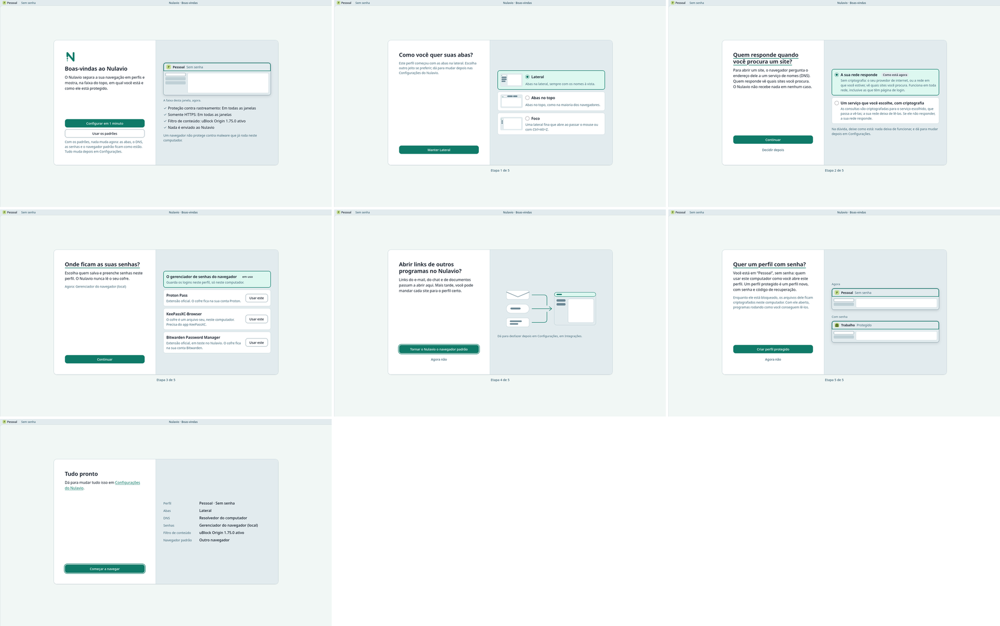
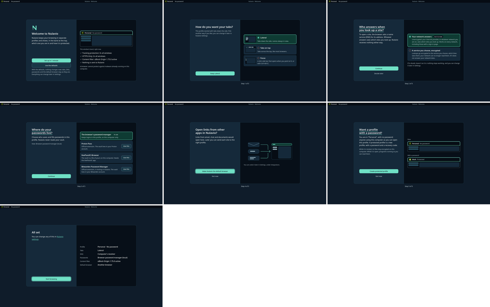
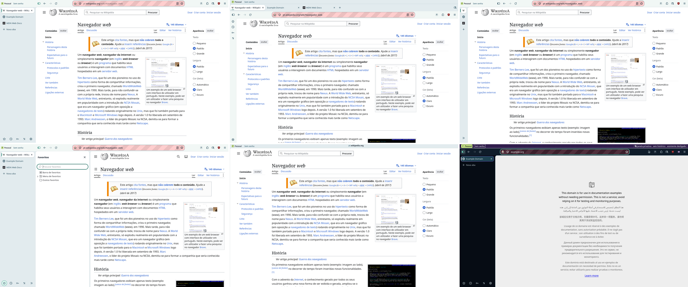
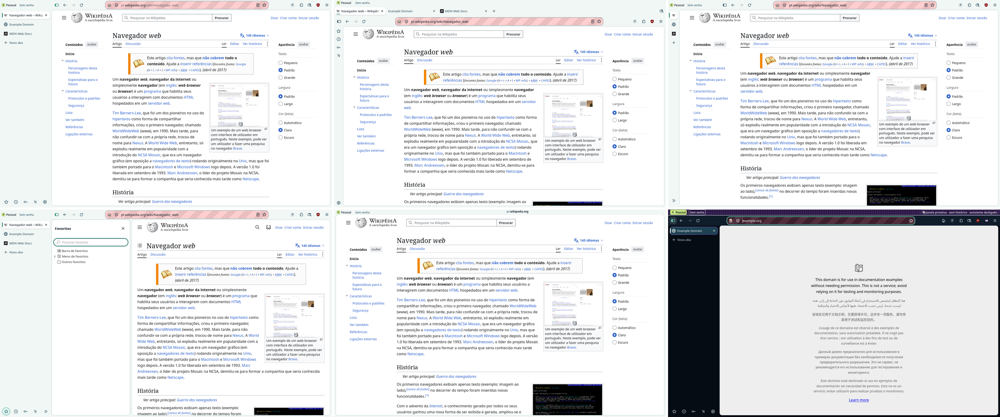
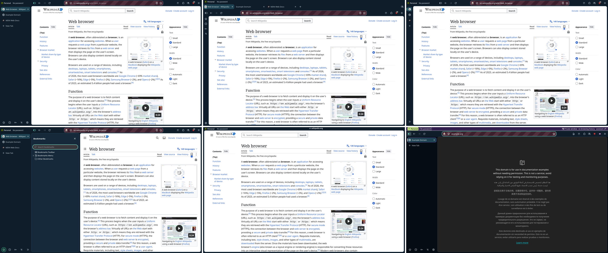

# ADR 0010 — Experience direction: one surface, the band as the constant, the first run as a stage

- **Status:** Accepted (2026-11-12): the maintainer follows the recommendations, so the principle "no floating content card" is withdrawn in the [UX principles](../design/ux-principles.md) and Imersivo stands under ADR 0009. Prototypes on the engine (below); the frame (direction A) is built into the theme in its own slice, below.
- **Related:** [references](../design/references/2026-11/README.md), [journeys](../design/journey-2026-11.md), [ADR 0008](0008-one-settings-page.md), [ADR 0009](0009-immersive-layout.md), [design system](../design/design-system.md), [UX principles](../design/ux-principles.md).

## Context

The maintainer used the alpha and found the experience poor: two settings pages, a first run that does not guide, a window that takes too much of the screen. The references (Zen, Helium) were run and captured, and the [journeys](../design/journey-2026-11.md) walked. Three directions for the window were then built on the alpha's engine (160.0-0.2 build, `dev_sync`, no engine build) and captured at 1440×900 in both themes and both languages.

## The three directions

Order in each sheet: today, A / B, C.

| | A. Uma superfície | B. Imersivo | C. Linha única |
|---|---|---|---|
| What it is | The whole frame in one tone, no separators; the page is a card with a radius and a thin outline. Every control stays where it is | The band's 24 px row stays, with the site's name in its middle; the toolbar and the tabs leave and come back over the page | Tabs on top share one row with the identity and the address field |
| Page area | 1207×847, 78.9 % (today 1215×855, 80.2 %: the card's 8 px margin costs 1.3 points) | 1423×867 on top of A, 95.2 %; 1440×876 without the card margin, 97.3 % | 1383×845, 90.2 % |
| The site's name | Whole address bar, as today | Host in the band, registrable part emphasised, "Não seguro" in words; the full address one key or one pointer move away | Address field squeezed to about 320 px; the path is cut with three tabs open |
| Profile and protection | Band, as today | Band, as today | Band, as today |
| Engine's tracking and permission icons | Visible | Out of view until the toolbar returns (ADR 0009, maintainer's decision) | Visible, but extension buttons fall into the overflow menu |
| What broke in the prototype | A double line where the card's outline meets the engine's own border | See ADR 0009's review table | The menu button lands on the first tab; a 46 px icon rail stays at the left; only works with tabs on top |
| Cost to finish | Theme only | A per-window controller and the security matrix again | Toolbar overflow is the engine's (CustomizableUI): a patch or a fragile override |

## Decision

1. **A is the look of the window in every layout.** One tone for the frame, the page as a card, no rule lines between the band, the toolbar and the tabs. The brand stays where it was: the route mark on the selected tab and the profile flag in the band. The principle "no floating content card" is withdrawn: it was written against a card that hides chrome, and this one hides nothing.
2. **B is offered on top of A as "Imersivo"**, off by default, under the conditions of ADR 0009. It is the answer to "a mode that hides what is not needed".
3. **C is dropped.** It gives less than B, squeezes the address field (which the principles say is the widest control), and can only be finished by fighting the engine's toolbar overflow. If a compact layout for tabs on top is wanted later, it starts from the engine's own compact density, not from this.
4. **The band is the constant.** In every direction, mode and page it is the one row drawn only by the browser: the profile, its protection, and, when the address bar is out of view, the site. Onboarding, settings and security moments point at it; nothing else in the product repeats its job.
5. **The first run is a stage.** In a genuinely new profile, while the first run's page is the selected tab, the window shows the band (naming it "Nulavio · Boas-vindas") and that page only: one card of a fixed size in the middle, one decision in it, the actions in one place. The first screen offers "Configurar em 1 minuto" and "Usar os padrões", with the defaults said in one line. The welcome lists only what is already true; whatever is still arriving is read again for the summary. Any other tab, a private window, a temporary profile and an AI Workspace are never staged, and the toolbar still returns to the pointer and the keyboard. Of those four, the suite tries another tab (`test_firstrun_stage` 04); the other three are in the code and have no test.
6. **Settings are one page** (ADR 0008).

The captures are of the first-run slice, which gave the card its two panes and the steps their content (the [design system](../design/design-system.md) has the rules, the [journeys](../design/journey-2026-11.md) what each step answers). The prototype this ADR was written with is kept for comparison: [light, pt-BR](../design/screenshots/experience-2026-11/stage-sheet-pt-light.png), [dark, en-US](../design/screenshots/experience-2026-11/stage-sheet-en-dark.png).

## Independent critique (2026-11-11)

A second model (Antigravity, from the captures only, closed brief) ranked A first as the default, B second and "yes" as an opt-in on top of A, C last. Its points were checked on the captures before use:

| Point | Checked | Result |
|---|---|---|
| The hidden tab list casts its shadow on the left edge of the page in B | True (the frame is `#ECF2F1` instead of `#F1F7F5` in the first 7 px) | Fixed: the shadow exists only while the list is over the page |
| In pt-BR the subdomain is not quieter than the site in the band | False: `pt.` is in the secondary colour in the capture | None |
| A double line at the card's corner in A; the band's border runs past the card's corners in B | True | Polish list of the window slice |
| C: the address field is cut, the menu lands on the first tab, an icon rail stays | True | Part of the reason C is dropped |
| Narrow the tab column to 196 px, the top row to 38 px, widen the address field | Not checked against 1366×768 at 150 % and the 24 px target rule | Candidates for the window slice, each with a measurement |

A second critique (same model, closed brief, 2026-11-11) looked at the first-run slice's captures next to Zen's and Helium's setup screens. Its final text names a button label that is in no capture and lists a reference image it was not given, so every point was checked on the images before use:

| Point | Checked | Result |
|---|---|---|
| In a short window (911×512) the panes stack and the actions fall below the fold | True | Fixed: stacked, the actions stay at the bottom of the window while the choice scrolls under them (`test_firstrun_stage` `test_09`) |
| The protected-profile step shows two thin strips in a large pane; the default-browser drawing is small | True | Both drawn larger: two small windows with their bands, a wider drawing |
| The last summary row wraps | True | The value is shorter; where to change it is said once, beside the summary |
| "Stray underlines" under three titles; the main button "grows" on two steps | False as defects: the underline is the reading-position focus and the larger outline is the standard focus ring; both are in the captures because a script moved the focus. After a real pointer click the title has no underline (checked on the DNS step) | None |
| The gap between the text and the actions in the left pane | By design, as in Zen's card (title at the top, action at the bottom) | None |
| The service list in the DNS step has no trade-off per service, as Helium's lists have | True | Open: it needs facts about each service that can be cited; today the option says who sees the lookups |
| In dark, the border of an option not chosen is faint | True; the fill still separates it from the pane and the radio has its own border | Open, with the theme slice |

## What this does not decide

- Anything about protections: none changes. Where a direction touches a security cue (B), the decision is the maintainer's and is in ADR 0009.
- Sounds: no reference played any, and nothing here could be heard on the private display. The rules are in the design system; the first sound ships only after the maintainer has heard it on a real desktop.
- Workspaces and a floating command field (Zen): seen, not prototyped. Profiles are Nulavio's isolated places and tab groups organise inside them; a third container needs its own case.

## Consequences

- The reference captures of the window change in one slice (A), on purpose.
- The first run's tests change: the page has one card at a time already; the window around it is new.
- `nulavio.proto.direction` existed only on the prototype branch. It is gone: A is the theme (see "The frame in the theme").

## The frame in the theme (2026-11-11)

Branch `agent/claude/feat-window-one-surface`. The prototype was twenty lines behind a pref in the band's sheet; this is the frame as the theme draws it, in every layout and state, on the alpha's engine by `dev_sync`.

Before:

After, pt-BR (light) and en-US (dark):

What changed from the prototype, each for a reason found on the engine or in the existing tests:

| Prototype | Now | Why |
|---|---|---|
| In the band's sheet, which is always on, behind `nulavio.proto.direction` | In the theme sheet (`horizon.css`), under `nulavio.horizon.enabled`; no pref of its own | "Pref off restores the upstream look" is a rule of the theme with a test; the frame is a look |
| Frame colours with `!important`, in every contrast mode | The theme's own colour block: default theme, normal contrast, no `!important` | The existing high-contrast test failed: the frame's tone overrode the system's contrast colours. The theme's rule against author `!important` exists for this |
| The neutral band recoloured by the frame's rule | The band's token (`band.bg`) is the toolbar's tone; the band's own sheet drops its rule line while neutral | The theme may not style security UI (rule 4 of the theme, with a test). A band that states something keeps its fill and its line |
| The splitter beside the tab column hidden | Kept, drawing no line | Hiding it removed the handle that resizes the tab column |
| A hairline and a shadow around the page | One hairline | Side by side with Zen and Helium at the corner, the two lines read as a heavier frame than either |
| The card only without a theme | Every theme gets the shape; only Nulavio's colours wait for "no theme" | A private window uses the engine's dark theme and had no card at all |
| Physical margins; none at the window's edge with the tabs on the right | Logical margins, on the sides that have no chrome | Right to left, and the tab column on the other side, were wrong |
| A side panel as a square white area down to the window's edge | A second card of the same shape; the splitter is the gap and still resizes | It was the one surface that did not follow the frame |
| The card in a window of any size | None in a window 600 px tall or less | The existing first-run test failed: on a 1280×800 screen at 150 % the layout choice's main action ended 7 px below the first screen. The margin gives the height back there |

`tests/integration/test_window_frame.py` (nine tests): one tone and the card's shape; the side panel as a card; a dialog of the tab still drawn over the toolbar; the margin with the tabs on either side, right to left, in Immersive, with tabs on top and in Foco; no card in full screen or in a short window; the splitters' highlight under the pointer; a private window keeps its band's fill and line and its own colours, with the card's shape; the system's contrast setting gives the edge the text colour.

### Independent review of the frame (2026-11-11)

Reviewed from the source and the engine's own style sheets by a second model (Codex, read-only): no HIGH, two MEDIUM, one LOW. Each was checked on the engine before it changed anything; all three were true.

| Point | Checked | Result |
|---|---|---|
| Clipping the tab box cut the 5 px by which the engine draws a tab's dialog over the toolbar | True, and it matters more than the review said: that overlap is where a site's prompt shows it is the browser's, because no page can draw there | The tab box keeps only the margin and is never clipped. The radius, the hairline and the clipping are on the content container, where the engine itself rounds and clips the page. A test opens a dialog and measures the overlap |
| Under a theme, the system's contrast setting did not reach the card's edge (the theme's rule was more specific) | True | Contrast is decided first; the theme's colour applies only at normal contrast. Tested in a private window |
| The splitters lost the highlight that shows where to drag | True: the engine fades it in under the pointer | They draw nothing at rest only. Tested with the pointer state forced |

Not determined by reading, and still open: the link's address at the bottom corner and overlay scrollbars against the rounded corners (the scrollbar insets the engine uses for its own rounding are set, for macOS); expand-on-hover of the tab column; Windows' high-contrast mode.

Not verified: a theme installed by the person (only the engine's private theme was run); the devtools docked in the window; a real desktop compositor (the captures are from a private X display with no window manager).

## Prototypes

Branch `agent/claude/proto-experience-directions`, on the alpha's engine by `dev_sync`:

- `nulavio.proto.direction = surface` draws A; with `nulavio.layout.immersive` it draws B. C was captured and its code removed.
- The stage: `NulavioWindow` marks the window (`nulavio-stage`) while the selected tab is the Shell's new tab and `NulavioPrivacy.firstRun()` is active; the page marks itself (`data-stage`) while a first-run card is its question. Measured at 1440×900: the card is 976×544 on every step (688×464 in the prototype); the page gets 1439×875; when the last step is answered the window is the ordinary one again.
- `tests/integration/test_firstrun_stage.py` (nine tests): the welcome owns the window and lists only true facts; the card keeps its place and size on every step, no pane cuts its content, and the ordinary window returns at the end; "Usar os padrões" ends it at once; another tab is never staged; the two panes, and the band drawn small says what the band says; DNS changes nothing before the main action; a password manager is chosen in the card; a protected profile is offered last and made in the Vault's steps; in a short window the panes stack. The existing first-run, new-tab, DNS, vault and layout suites pass with it.
