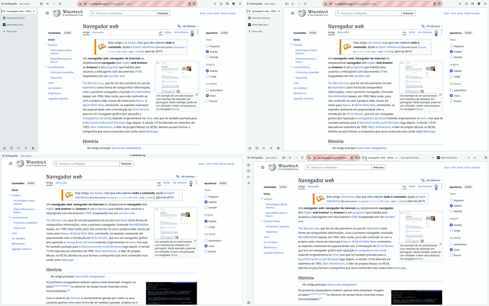
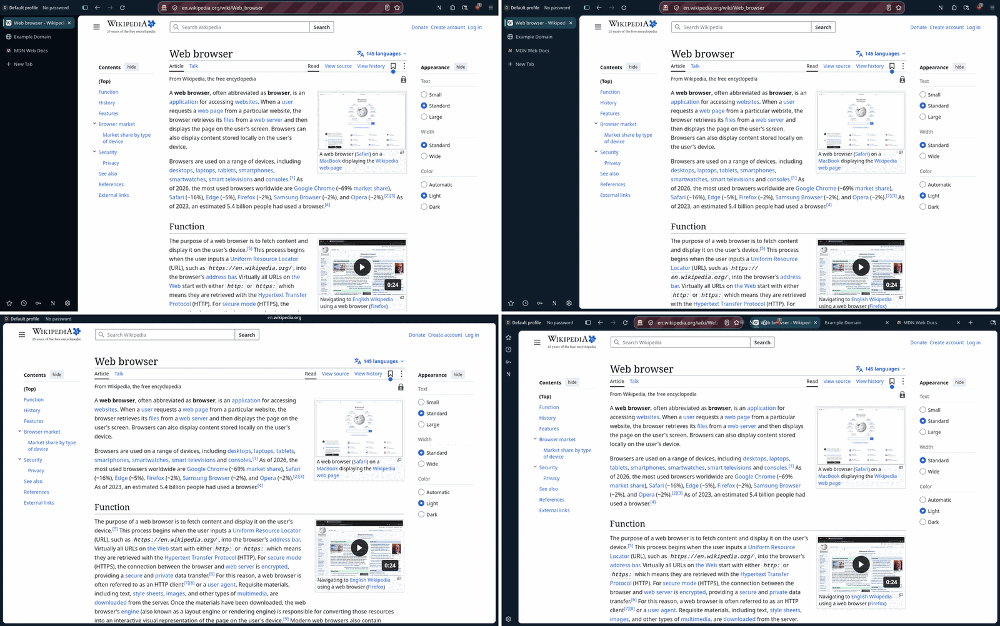
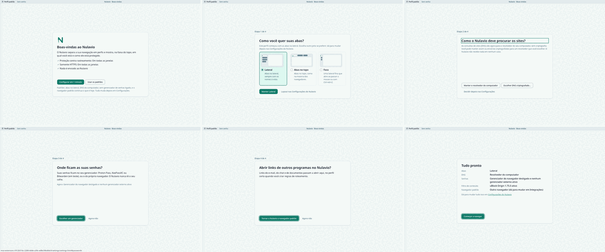
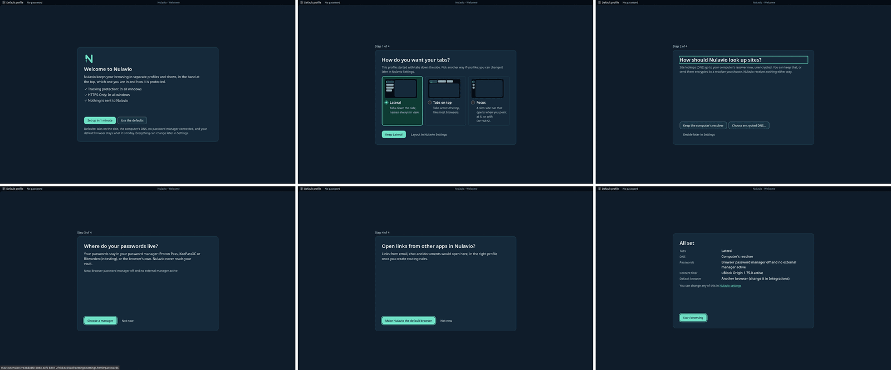

# ADR 0010 — Experience direction: one surface, the band as the constant, the first run as a stage

- **Status:** Proposed (2026-11-11), with prototypes on the engine (below). Not merged.
- **Related:** [references](../design/references/2026-11/README.md), [journeys](../design/journey-2026-11.md), [ADR 0008](0008-one-settings-page.md), [ADR 0009](0009-immersive-layout.md), [design system](../design/design-system.md), [UX principles](../design/ux-principles.md).

## Context

The maintainer used the alpha and found the experience poor: two settings pages, a first run that does not guide, a window that takes too much of the screen. The references (Zen, Helium) were run and captured, and the [journeys](../design/journey-2026-11.md) walked. Three directions for the window were then built on the alpha's engine (160.0-0.2 build, `dev_sync`, no engine build) and captured at 1440×900 in both themes and both languages.

## The three directions

Order in each sheet: today, A / B, C.

| | A. Uma superfície | B. Imersivo | C. Linha única |
|---|---|---|---|
| What it is | The whole frame in one tone, no separators; the page is a card with a radius and a thin outline. Every control stays where it is | The band's 24 px row stays, with the site's name in its middle; the toolbar and the tabs leave and come back over the page | Tabs on top share one row with the identity and the address field |
| Page area | 1207×847, 78.9 % (today 1215×855, 80.2 %: the card's 8 px margin costs 1.3 points) | 1423×867 on top of A, 95.2 %; 1440×876 without the card margin, 97.3 % | 1383×845, 90.2 % |
| The site's name | Whole address bar, as today | Host in the band, registrable part emphasised, "Não seguro" in words; the full address one key or one pointer move away | Address field squeezed to about 320 px; the path is cut with three tabs open |
| Profile and protection | Band, as today | Band, as today | Band, as today |
| Engine's tracking and permission icons | Visible | Out of view until the toolbar returns (ADR 0009, maintainer's decision) | Visible, but extension buttons fall into the overflow menu |
| What broke in the prototype | A double line where the card's outline meets the engine's own border | See ADR 0009's review table | The menu button lands on the first tab; a 46 px icon rail stays at the left; only works with tabs on top |
| Cost to finish | Theme only | A per-window controller and the security matrix again | Toolbar overflow is the engine's (CustomizableUI): a patch or a fragile override |

## Decision

1. **A is the look of the window in every layout.** One tone for the frame, the page as a card, no rule lines between the band, the toolbar and the tabs. The brand stays where it was: the route mark on the selected tab and the profile flag in the band. The principle "no floating content card" is withdrawn: it was written against a card that hides chrome, and this one hides nothing.
2. **B is offered on top of A as "Imersivo"**, off by default, under the conditions of ADR 0009. It is the answer to "a mode that hides what is not needed".
3. **C is dropped.** It gives less than B, squeezes the address field (which the principles say is the widest control), and can only be finished by fighting the engine's toolbar overflow. If a compact layout for tabs on top is wanted later, it starts from the engine's own compact density, not from this.
4. **The band is the constant.** In every direction, mode and page it is the one row drawn only by the browser: the profile, its protection, and, when the address bar is out of view, the site. Onboarding, settings and security moments point at it; nothing else in the product repeats its job.
5. **The first run is a stage.** In a genuinely new profile, while the first run's page is the selected tab, the window shows the band (naming it "Nulavio · Boas-vindas") and that page only: one card of a fixed size in the middle, one decision in it, the actions in one place. The first screen offers "Configurar em 1 minuto" and "Usar os padrões", with the defaults said in one line. The welcome lists only what is already true; whatever is still arriving is read again for the summary. Any other tab, a private window, a temporary profile and an AI Workspace are never staged, and the toolbar still returns to the pointer and the keyboard.
6. **Settings are one page** (ADR 0008).

## Independent critique (2026-11-11)

A second model (Antigravity, from the captures only, closed brief) ranked A first as the default, B second and "yes" as an opt-in on top of A, C last. Its points were checked on the captures before use:

| Point | Checked | Result |
|---|---|---|
| The hidden tab list casts its shadow on the left edge of the page in B | True (the frame is `#ECF2F1` instead of `#F1F7F5` in the first 7 px) | Fixed: the shadow exists only while the list is over the page |
| In pt-BR the subdomain is not quieter than the site in the band | False: `pt.` is in the secondary colour in the capture | None |
| A double line at the card's corner in A; the band's border runs past the card's corners in B | True | Polish list of the window slice |
| C: the address field is cut, the menu lands on the first tab, an icon rail stays | True | Part of the reason C is dropped |
| Narrow the tab column to 196 px, the top row to 38 px, widen the address field | Not checked against 1366×768 at 150 % and the 24 px target rule | Candidates for the window slice, each with a measurement |

## What this does not decide

- Anything about protections: none changes. Where a direction touches a security cue (B), the decision is the maintainer's and is in ADR 0009.
- Sounds: no reference played any, and nothing here could be heard on the private display. The rules are in the design system; the first sound ships only after the maintainer has heard it on a real desktop.
- Workspaces and a floating command field (Zen): seen, not prototyped. Profiles are Nulavio's isolated places and tab groups organise inside them; a third container needs its own case.

## Consequences

- The reference captures of the window change in one slice (A), on purpose.
- The first run's tests change: the page has one card at a time already; the window around it is new.
- `nulavio.proto.direction` exists only on the prototype branch. It is removed when A moves into the theme.

## Prototypes

Branch `agent/claude/proto-experience-directions`, on the alpha's engine by `dev_sync`:

- `nulavio.proto.direction = surface` draws A; with `nulavio.layout.immersive` it draws B. C was captured and its code removed.
- The stage: `NulavioWindow` marks the window (`nulavio-stage`) while the selected tab is the Shell's new tab and `NulavioPrivacy.firstRun()` is active; the page marks itself (`data-stage`) while a first-run card is its question. Measured: the card is 688×464 on every step; the page gets 1439×875; when the last step is answered the window is the ordinary one again.
- Not done: the stage has no tests yet, and the existing first-run tests were not run against it.
