# ADR 0011 — Nulavio's own interface reads as the browser, not as an extension

- **Status:** Proposed (2026-11-11). The maintainer asked for this direction on 2026-11-11; the first two steps are built (below). Not merged.
- **Related:** [ADR 0001](0001-engine-selection.md) (patch policy), [ADR 0008](0008-one-settings-page.md) (one settings page), [extension model](../architecture/extension-model.md).

## Context

The maintainer's question, after using the alpha: why is Nulavio's own interface an extension, with its settings in an extension page, when only the engine is someone else's? "Only the engine is needed; everything else should be ours to change."

What is an extension today, and what is not:

- **Not an extension in any sense that matters**: the identity band, the Vault, the Guard, profiles, routing, the layout and the theme. About 8,400 lines of privileged modules (`browser/shell/modules/*.sys.mjs`) and the theme sheet run as parts of the browser. The built-in add-on is how they are packaged and started.
- **An extension in what a person sees**: fifteen HTML pages (new tab, the Vault's screens, the Guard's review, the consent and warning pages, the old settings page). Each opens at `moz-extension://<random id>/…`, and the address bar labels it "Extensão (Nulavio Shell)". The engine does that for any page whose address belongs to an add-on (`browser-siteIdentity.js`: `WebExtensionPolicy.getByURI(uri)`, class `extensionPage`).

The split exists because of ADR 0001's patch policy ("patches only for what prefs, policies, branding or built-in add-ons cannot do": nine patches today; Zen carries 272). It was a maintenance decision, and it bought a second thing that is easy to miss: **the pages are not privileged**. They reach the modules only through declared interfaces whose arguments the engine validates, under a strict content security policy. A mistake in a page cannot run code as the browser.

## What was checked on the engine (Firefox 160)

| Route | Checked | Result |
|---|---|---|
| Settings drawn by the engine's own page | Built (ADR 0008, slices 1 and after) | Works with no patch. Runs with the page's own (system) privilege; draws no markup from strings and uses the engine's widgets |
| An `about:` address for a Shell page | The engine's own built-in add-on does it (`webcompat` registers `about:compat` from a process script, loading its page with the add-on's principal) | Possible with no patch, **but** the page's address becomes its base for relative links, so every page needs a `<base>` set by an inline script, allowed by a hash added to the content security policy (the engine's page does exactly that). Two of the Shell's own rules forbid it: no inline script, no change to the policy (`test_shell`) |
| The Shell's pages as privileged (`chrome:`) pages | Not built | Gives the address and removes the extension label, and removes the boundary described above: a page's mistake becomes the browser's |
| The label only | Read in the engine's source | One small engine patch could show the brand ("Nulavio", as on the settings page) for pages of the built-in Shell. The address would still be `moz-extension://…`. Needs an engine build to verify |

## Decision

1. **Everything that is a setting is drawn by the browser's settings page**, natively, until the Shell's settings page is gone (ADR 0008). This is where "one place, part of the browser" is fully reachable with no patch and no relaxed rule.
2. **Lists and editors are described by the page's own registry**, the way the engine describes its lists (containers, custom home pages): one setting whose rows come from `getControlConfig`, made of the engine's rows, buttons, fields and pickers, with clicks read from the row's button. Nothing is built from markup strings, and the page's search finds the words. Step 1 used a custom element for the list; step 2 found the registry does it and replaced it. A custom element stays the fallback for something the registry cannot describe; none is needed so far.
3. **One set of words for an action.** A button, a confirmation or an error says the same thing wherever it is offered: the settings page takes those words from the Shell's own messages (`_locales`), the ones the band, the menu and the Shell's pages use. Fluent (`settings.ftl`) holds what only this page says: its panes, groups and row descriptions.
4. **The security moments stay unprivileged pages**: unlock, create, the Guard's review, consent, warnings, the new tab. The band names them ("Nulavio · Desbloqueio"); that naming is drawn by privileged code and is the part a page cannot fake.
5. **How those pages look in the address bar is a separate, small question**, listed for the maintainer: the label patch, the `about:` addresses with one hashed inline script per page, or leaving it. They are not made privileged pages.
6. **Code moves into the engine tree only piece by piece**, when a piece cannot be done from a module, a theme sheet or the settings registry. Each such piece is a patch with its own reason, as today.

## What stays undecided (maintainer)

- **The address bar on the security moments.** Recommendation: the label patch first (it is one condition in one engine file, and the result reads like the browser's own pages); `about:` addresses only if the inline script and its hash are accepted as an exception to the Shell's rules. Either needs a real build to verify, so neither is done here.
- **Whether any Shell page should become privileged.** Recommendation: none. The boundary is a protection; removing it is the kind of change this project lists instead of making.

## Step 1 (2026-11-11): the profiles of the group, listed by the settings page

Branch `agent/claude/feat-settings-profiles-native`, on the alpha's engine by `dev_sync` (no engine build).

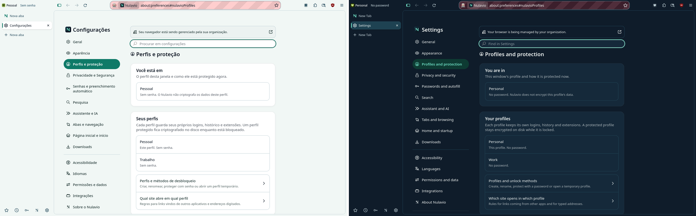

- `nulavio-profile-list`, at this step a custom element (replaced by a registry list in step 2, see decision 2): one row per profile with its protection as it is now ("Este perfil. Sem senha.", "Protegido e bloqueado: criptografado no disco."), built from the engine's rows with the DOM. The profile's name goes in as a Fluent argument, never as markup.
- It follows the group: a profile created, renamed, locked or removed elsewhere shows without a reload. A list that cannot be read is not drawn and the group says so.
- The page's own search finds a profile by its name.
- `test_settings_native` `test_06b` covers the list with unprotected profiles, the update without a reload, the search and the failed read. The rows of a protected profile (locked, unlocked) are drawn from the same read but no test creates a protected profile here yet.

Still the old page's after this step: creating, renaming, protecting and removing a profile, and the routing rules.

## Step 2 (2026-11-11): everything a person does with a profile, in the settings page

Branch `agent/claude/feat-settings-profile-actions`, on the alpha's engine by `dev_sync` (no engine build).

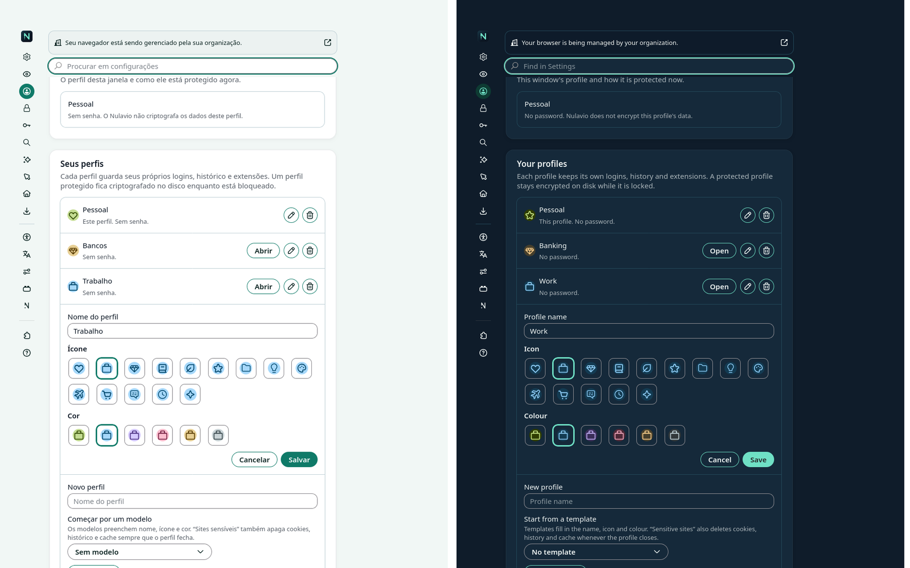

- **The list is a registry list** (decision 2). Each row shows the profile's own icon in its own colours (the engine's profile icons; tile and glyph from the design tokens, through the sheet Nulavio already gives the engine's pages) and the actions that profile can take now: open, or unlock when it is locked; lock now; the ways it unlocks; edit; delete. Each button's accessible name says whose it is ("Abrir Trabalho").
- **Editing opens under the row**: name, icon and colour, with the engine's visual picker (the profile's icon in every choice, each choice named), and the engine's Cancel/Save pair in the desktop's order. Only what changed is written.
- **A new profile is the last row of the list**: a template only fills a free name ("Trabalho 2") and never replaces a name the person typed; nothing exists before "Criar perfil".
- **Confirmations are the engine's own prompt**, with the Shell's words and Cancel as the default button: deleting a profile, and locking the profile in use (it closes its windows).
- **The Vault's moments stay the Vault's pages** (decision 4): unlocking, the ways a profile unlocks, and creating a protected profile (its recovery code is shown once) open those pages; the settings page never asks for a password.
- **Every change goes through `NulavioProfiles` and `NulavioVault`**, the modules the Shell's pages call, with the same checks; a refusal is said in the Shell's words for its code ("Esse nome já está em uso."). A group that cannot be used (a temporary profile, profiles turned off, a window started with `--profile`) says why and offers nothing.
- The Shell's old page keeps its profiles section by address only: it left that page's navigation and search, and its "Criar perfil" link in the routing rules opens the settings page.

**Independent review** (Codex gpt-6-astra, high effort, read-only, 2026-11-11; 0 high, 4 medium, 3 low). Each point was checked against the code before anything changed; all seven were true.

| Point | What was wrong | What changed |
|---|---|---|
| A save could put an old name back | The editor compared its fields with the profile as read now, not as it was when the editor opened: renamed elsewhere, a save of the colour alone sent the old name too | The editor keeps what it opened with and writes only what the person changed since. A field they did not touch follows the profile while the editor is open; one they changed keeps what they typed |
| A save closed another row's editor | The editor that was open when a save answered was closed, whichever it was | A save closes only its own editor |
| A click while an action ran was dropped unseen | One action at a time, and a second click did nothing, with its button still enabled | While an action runs, the list's buttons are disabled |
| Words that outlived what they said | "Trabalho está bloqueado." stayed after it was unlocked elsewhere | What an action said stays while the list stays as that action left it, and leaves when the list changes again |
| Focus after a deletion | The profile before the deleted one was found by object, lost when the list was read again under the prompt | Found by its key |
| A prompt taken away | A rejected prompt was an unhandled rejection | Nothing was confirmed: logged, and nothing happens |
| A length limit that limited nothing | `maxlength` on the engine's text field is not passed to its input | Removed; the module's own check answers ("Informe um nome (até 60 caracteres).") |

The review also named the weakest assertions (a colour only had to be non-empty): the tests now compare the row's and the picker's colours with the design tokens. `test_05b` covers the first four points. Not covered by a test: the focus after a deletion with the list re-read under the prompt, and a rejected prompt (the test driver cannot act while the engine's prompt is open).

`tests/integration/test_settings_profiles.py` (7 tests) acts as a person does and reads the result from the module: the actions per row and their names, opening and a refusal, the doors around the list; editing with a taken name, saving name, icon and colour, cancelling, writing only what changed; deleting with the prompt cancelled and then accepted; creating with and without a template; a group that cannot be used. The rows and actions of a **protected** profile are checked with a list the test gives the module and with the Vault's entries replaced: no protected profile is created there (that needs the Vault's tools), so locking and unlocking for real stay covered by the Vault's own tests.

Still the old page's after this step: the routing rules (step 4). Then search, passwords, exceptions and the assistant, and the removal of the old page's sections with their tests.

## Step 3 (2026-11-11): what the content filter blocks, one row away

Branch `agent/claude/feat-settings-filter-lists`.

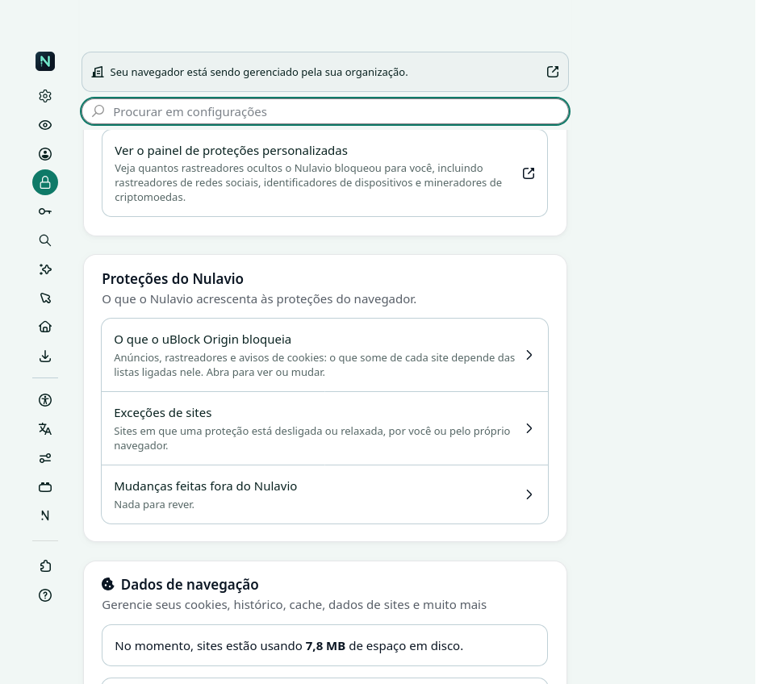

Ads, trackers and cookie notices are blocked by uBlock Origin's lists, and nothing in Settings led to them. "Privacidade e Segurança" now has a row that opens uBlock Origin's own "Filter lists" page. Nulavio reads only whether uBlock Origin is on (the add-on manager's answer, as before) and never its data: which lists are ticked is said on its page, not guessed here. With uBlock Origin off or missing, the row says so and opens "Extensões e temas". `test_settings_native` `test_06a` covers both states and the address the module opens.

Decided by the maintainer on 2026-11-12: the row shows the real state, read from uBlock Origin's own settings and never written (step 7).

## Step 4 (2026-11-11): which site opens in which profile

Branch `agent/claude/feat-settings-routing-native`.

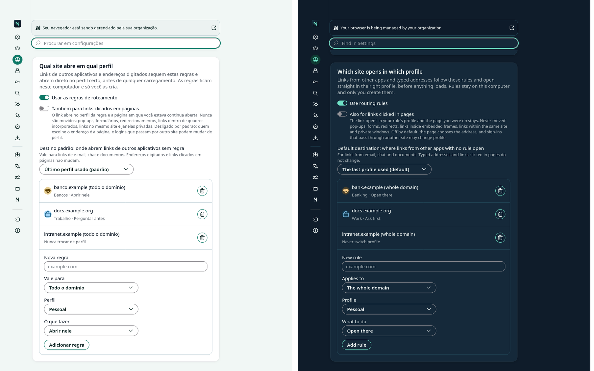

- The routing rules are a group of the profiles pane, under the profiles they point to: the two switches (use the rules; also for links clicked in pages, off unless the person turns it on), the default destination for links from other apps, the rules, and a new rule as the last row of the list.
- A rule's row shows the icon of the profile it opens in, the site, and what it does ("Bancos · Abrir nele"); a rule whose profile was deleted says so. A default destination that was deleted keeps its own disabled entry and a warning, as on the old page: a profile created later can take the same id and must never become the destination by itself.
- With one profile there is nowhere to send a site: the group says so and offers no empty form; the list above it is where a profile is made.
- Every change goes through `NulavioRouting`, which checks each rule as before; a refusal is said in the Shell's words ("Esse endereço de site não é válido.").
- The list and the working state share one small helper with the profiles (`workbench`: what the page holds while the person works, one action at a time, the bars).
- The old page's routing section left its navigation and search; it still opens by address, and the pages that explain a routed link ("As regras ficam em Configurações, em Perfis e proteção") already named this pane.

`tests/integration/test_settings_routing.py` (3 tests): a refused site, a rule added, "never switch" without a profile, a rule made elsewhere joining the list, a rule removed (and where the keyboard goes), a rule whose profile was deleted; the switches and what they disable; the default destination chosen, deleted and reset; one profile alone, then a second one.

Still the old page's after this step: search, passwords, exceptions (step 5), DNS and the assistant.

## Step 5 (2026-11-12): site exceptions

Branch `agent/claude/feat-settings-exceptions-native`.

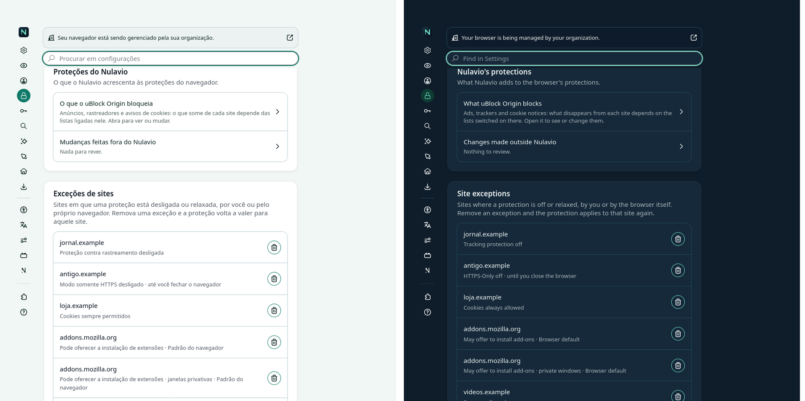

- "Exceções de sites" is a group of "Privacidade e Segurança", right under Nulavio's protections: one row per site where a protection is off or relaxed, with what is relaxed in words, for how long ("até você fechar o navegador"), where ("janelas privativas") and whether the browser itself put it there ("Padrão do navegador").
- Removing a row removes the permission from the engine's own store (`NulavioPrivacy.remove`), so the protection applies to that site again. A browser default is removed only after the engine's prompt has said the consequence, with Cancel as the default button.
- A row is found again by what it is (type and origin), never by its place in the list. With no exception left the list says that every protection applies to every site.
- uBlock Origin's own list of trusted sites stays its page; the row that opens it is in this group.
- The old page's exceptions section left its navigation and search; it still opens by address.

`tests/integration/test_settings_exceptions.py` (2 tests): exceptions made through the engine's permission manager are listed in words and join the list without a reload; removing one removes it from the engine and says so; one that is gone before the click is said in words; a browser default asks first (closed: kept; accepted: removed); none left.

Still the old page's after this step: search, passwords (step 6), DNS and the assistant.

## Step 6 (2026-11-12): who keeps the passwords, and the look-alike sites that were confirmed

Branch `agent/claude/feat-settings-passwords-native`.

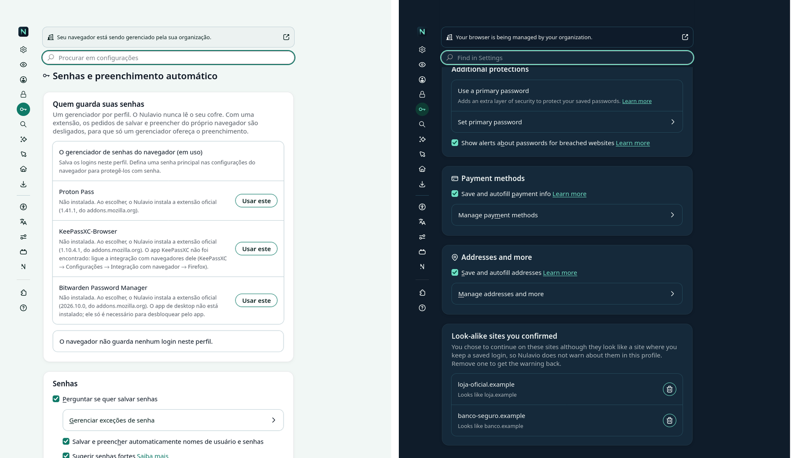

- "Quem guarda suas senhas" now holds the choice itself: one row per manager (the browser's own, and those Nulavio can install from their official extension) with what is true of it now (installed and its version, installed but off, not installed and what would be installed, a desktop app that is missing), and the count of logins the browser's own manager holds.
- Choosing a manager that is not installed asks first, in the engine's prompt, with the words that say what is installed, which version and from where; giving the job back to the browser asks too. These are steps, not dangers: the confirmation is the default button, as on the old page. `NulavioPasswords.choose` still pins and checks the file it installs.
- "Sites parecidos que você confirmou" lists the look-alike sites the person chose to continue on; removing one brings the warning back for it.
- The old page's passwords section left its navigation and search; it still opens by address.

`tests/integration/test_settings_passwords.py` (2 tests): the rows and their words for three states; a manager that is not installed (prompt closed: nothing asked of the module; accepted: chosen, the rows follow); one that is installed, chosen with no question; back to the browser's own, after a prompt; a refusal said in words; two confirmed sites, removed one by one. **No extension is installed by these tests**: the state shown is given to the module by the test, and what the page asks of `choose` is recorded. Installing for real stays covered by `test_passwords.py`.

Still the old page's: search, DNS and the assistant, and the removal of the old page's sections with their tests.

## Step 7 (2026-11-12): the row says whether cookie notices are hidden

Branch `agent/claude/feat-settings-filter-state`.

- `NulavioPrivacy.filterLists()` reads one thing of uBlock Origin's own settings, which lists are switched on, and answers whether one of its four cookie-notice lists is among them. It opens uBlock Origin's storage with the engine's own reader, reads, and closes; nothing in the module writes there. Lists are switched on and off on uBlock Origin's page, where the row leads.
- The row in "Proteções do Nulavio" says "Avisos de cookies: escondidos" or "à mostra" only when that was read. When it was not (uBlock Origin is still starting, or keeps its settings elsewhere), the row claims nothing about cookie notices and says what depends on the lists, as before.
- The words that promised Nulavio "never alters" uBlock Origin's data now say exactly what happens: it reads which lists are on, and changes nothing.
- **A defect found on the way, present since ADR 0008's first slice**: the engine hands a control's `getControlConfig` the config it returned the time before, so words chosen for one state stayed when a later state returned the config as it came. "Sem tecla" could stay after a key was set, and "o uBlock Origin não está ligado" after it was turned on again. Every control of this module now starts from the config its group declared (`fromFirst` in `setting()`), so no control can keep a previous state's words. `test_06a` turns uBlock Origin off and on again with the page open.

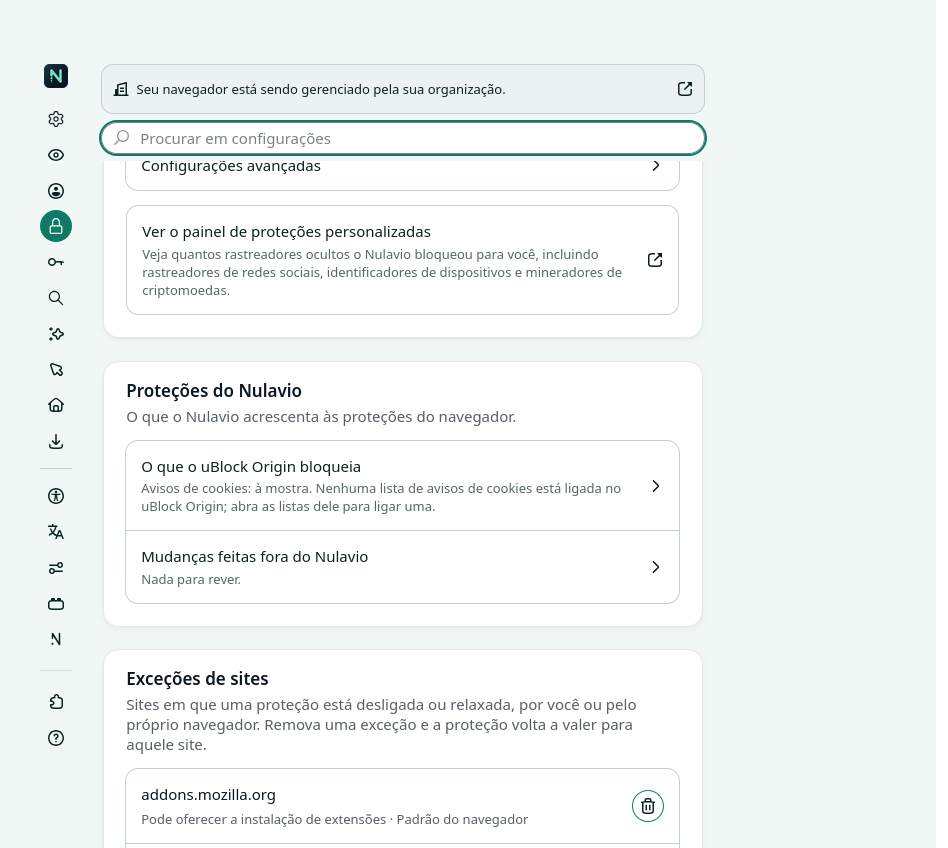

- **A test that failed one time in three, explained.** `test_settings_native` `test_05` opened a tab in a second window as soon as the window fired "load". Until a window's own start-up is over, the engine loads the window's home page into whatever tab is selected, so the settings page was sometimes never loaded there (a probe opening a window sixteen times showed the tab holding `about:home`, and no settings document created). The test now waits for the window's start-up, as a person's first click does; the page itself was not at fault. Thirty-two rounds of the probe and six runs of the test passed after the change.

`test_settings_native` `test_06a`: the module's answer equals what uBlock Origin's storage holds, and reading leaves it as it was; the row's three states (hidden, shown, not read) and off and on again. `test_experience_rules`: the four list names are uBlock Origin's own cookie-notice lists (compared with its registry when the tree has it), the storage is opened once and never written.

## Step 8 (2026-11-12): search, next to the engine's own controls

Branch `agent/claude/feat-settings-search-native`.

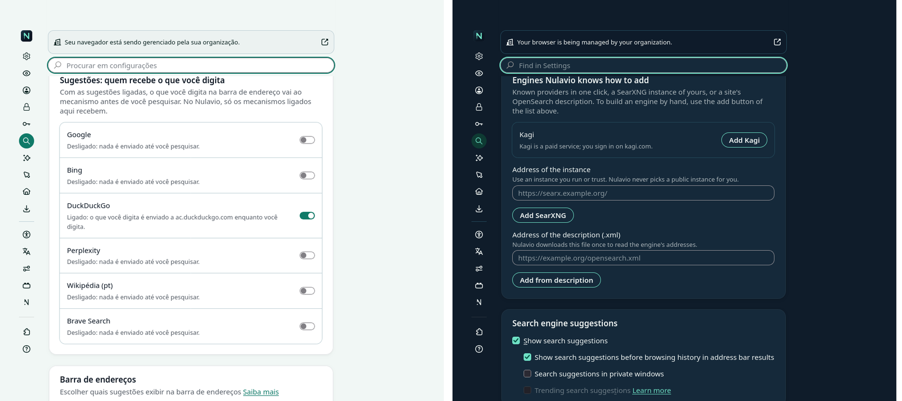

The engine's Search pane already chooses the default engine (also for private windows), lists the engines with their aliases, removes them and adds one by hand. The old page did those too, so the same thing could be done in two places. Only what Nulavio adds went into the pane, each part after the engine's group on the same subject:

- **"Sugestões: quem recebe o que você digita"**, after the engine's suggestions group: one switch per engine that offers suggestions, with what happens to typed text in words ("Ligado: o que você digita é enviado a ac.duckduckgo.com…", "Desligado: nada é enviado até você pesquisar."). The list is `NulavioSearch`'s (the engine's patch reads it before sending anything); the engine's own "show suggestions" box and these switches follow each other, as before.
- **"Mecanismos que o Nulavio sabe acrescentar"**, after the engine's list of engines: the known providers the person does not have yet (one click each), a SearXNG instance of their own, and a site's OpenSearch description. `NulavioSearch` checks each address as before (https, a real address) and a refusal is said in its words. An engine added here has its suggestions off, like any other.
- **Not carried over**: Nulavio's own "custom engine" form, its default-engine pickers, alias editor and remove buttons. The engine's own controls in this pane do them. One difference stays as it always was: the engine's own "add" dialog does not ask for https the way Nulavio's form did.
- The old page's search section left its navigation and search; it still opens by address.

`tests/integration/test_settings_search.py` (2 tests): the switches are the module's list, off in a new profile; one on and off again, with the engine's own switch following; switched on from the engine's group; a refusal in words; a provider added in one click; a SearXNG address refused twice and then accepted, with its suggestions off; an OpenSearch address handed to the module (replaced in the test: nothing is downloaded) and a failed download said in words.

## Step 9 (2026-11-12): DNS, in the engine's own group

Branch `agent/claude/feat-settings-dns-native`. The maintainer follows the recommendation of ADR 0008's DNS decision: Nulavio's choices in plain words in place of the engine's one-line summary, the engine's advanced screen behind.

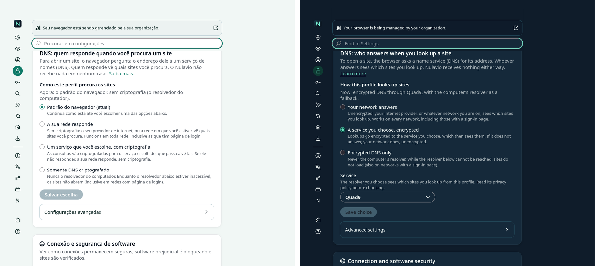

- The engine's DNS group in "Privacidade e Segurança" is edited in place: its one-line summary gives way to three choices ("A sua rede responde", "Um serviço que você escolhe, com criptografia", "Somente DNS criptografado"), each with its consequence in a sentence, and a line that says what is in effect now. The group is named for what it does ("DNS: quem responde quando você procura um site"); its "Configurações avançadas" button still opens the engine's own screen, untouched.
- While nothing was chosen, "Padrão do navegador (atual)" is listed and marked, and says what the default does right now; choosing it saves nothing. Once something was chosen it is no longer offered.
- A service is chosen from the list (or an https address of the person's own) where the form says who then sees the lookups.
- **Nothing is written before "Salvar escolha"**: a wrong choice can stop sites from opening, so a choice in the form is not a choice in effect. `NulavioPrivacy.setDns` checks it as before, and a refusal is said in its words. A change made on the engine's advanced screen shows here.
- If Nulavio's part fails halfway, the group is the engine's again, with its summary line and its own name (`test_04`).
- The old page's DNS section left its navigation and search, and with it the "this profile" group of that navigation: nothing of it is left on the old page's rail.

`tests/integration/test_settings_dns.py` (2 tests): nothing chosen (four options, nothing to save, the engine's summary gone and its advanced button there); a choice in the form leaves the prefs alone until saved; the computer's resolver saved; an encrypted service by name; only-encrypted with an address that is not https refused with nothing changed, then accepted; a change of the engine's prefs followed by the form.

## Step 10 (2026-11-12): the emergency stop and the assistant's service

Branch `agent/claude/feat-settings-assistant-native`.

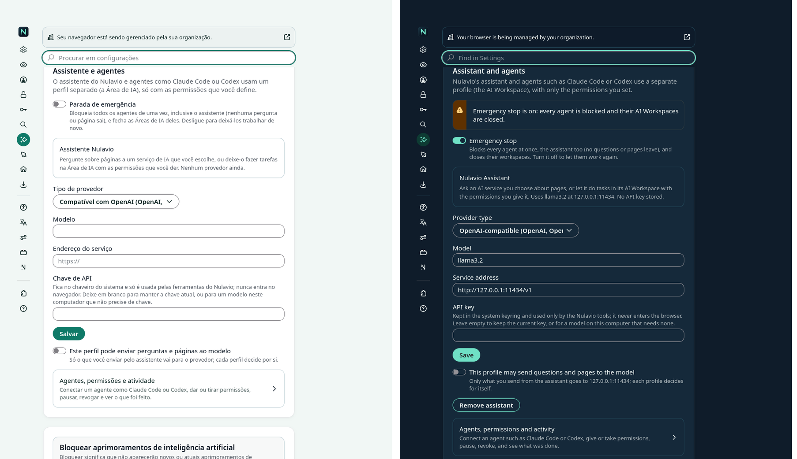

What is a setting went into the "Assistente e IA" pane; what is a moment of consent or a record stays the Shell's own page (decision 4).

- **In the pane**: the emergency stop, one switch, with a warning that stays while it is on; the assistant's service (provider type, model, address, API key) with what is saved in a sentence; whether this profile may send anything to that service, a switch of its own saved when it changes; removing the assistant, after the engine's prompt.
- **The API key** is typed in the engine's password field, handed to `NulavioAI.assistantConfigure` once with the save and dropped from the page at once, also when the save is refused. It is never read back: the field is empty and an empty field keeps the key there is. The module sends it to the system keyring through the Nulavio tools, as before.
- **Still the Shell's page**, behind "Agentes, permissões e atividade": connecting an agent (its configuration is shown once), each agent's permissions with their consent dialogs, pausing and revoking, and the activity record.
- **A window an agent drives** shows a sentence where the controls would be and none of them, not even the way to the agents' page. `NulavioAI` refuses every change asked from such a window whoever asks; that check is in the module and did not move.

`tests/integration/test_settings_assistant.py` (3 tests), with the real Nulavio tools for the stop and for a provider without a key: the stop on and off, with the module's state and the warning; an address refused in words with the typed key dropped; a local model saved; the profile's switch; a key handed to the module once and absent from the page afterwards (the module's entry replaced: no keyring here, `test_assistant_ui.py` covers the key with a stand-in keyring); removing the assistant, prompt closed and then accepted; an agent's window with no control.

Still to do: the old page keeps its own copies of the stop switch and of the assistant's form until its sections are removed.

## Step 11 (2026-11-12): the old page loses what the settings page draws

Branch `agent/claude/refactor-settings-old-sections`.

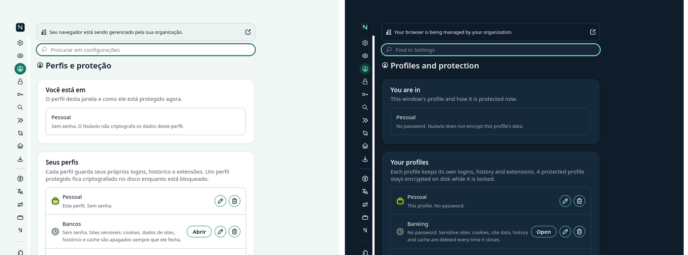

Six sections of the Shell's own page were still reachable by their address after steps 1 to 9, each a second copy of something the settings page draws: search, profiles, routing, passwords, site exceptions and DNS. They are removed, with their script (about 850 lines of `settings/settings.js`) and their 61 messages in each language.

- **An old address still answers.** `settings/settings.html#routing` (a bookmark, a tab left open, a link not yet rewritten) opens the settings page at the pane that holds it, in the same tab (`MOVED` in `settings/nav.js`, which `SECTIONS` in `NulavioSettings.sys.mjs` resolves). The address is replaced first, so going back lands on what the old page still holds and not on a second redirect.
- **What linked there goes straight to the settings page**: the band's protection and route buttons (`NulavioWindow`), "Gerenciar perfis" in the profile menu, "Editar regras" on the routing question and on the blocked page, and the link shown after a protected profile is created. A unit test keeps a Shell page from linking to a moved section without the bridge.
- **Two things the old list said and the new one did not** are said by the profile's row now, read from the same module: that a "sensitive sites" profile clears itself every time it closes (`kind`, which a locked profile cannot give, so a locked row says nothing about it), and that an unlocked protected profile locks again when its last window closes.
- **The fallback destination** is declared in `shared/options.json` at its new place (`settings/native/panes.mjs#nulavio-routing-fallback`, whose control carries the same `data-option`), and `test_personalisation` reads that file as it reads the pages.
- **Tests** that drove the old sections drive the settings page through one shared helper (`tests/lib/settings_page.py`): the DNS choice end to end against the local resolver, a tracking exception listed and removed, the password managers and the confirmed look-alike sites, an engine added, the routing rules, the in-page switch, the default destination and its deleted profile, deleting a profile with the engine's prompt, the colour migration, a temporary session, a locked and an unlocked protected profile. Two tests were of the old forms only and went with them (the alias field, the icon grid: `test_settings_search` and `test_settings_profiles` cover what replaced them); the alias rule itself is still tested on the module.

What the old page still holds: the agents (connecting one, permissions, consent, activity), the desktop integrations, and, until the next steps, Layout, Aparência and Atalhos by their address and its own copies of the emergency stop and of the assistant's form.

## Step 12 (2026-11-12): the old Aparência and Atalhos sections go, and the switches say why

Branch `agent/claude/refactor-settings-old-look`.

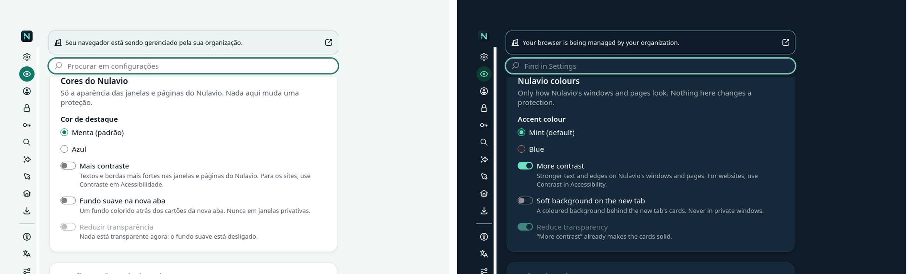

The settings page has drawn Nulavio's colours and keys since ADR 0008; the old sections stayed by their address and held three things the new group did not say. They are said there now, from the same reading (`NulavioPersonalise.state`), and the old sections are removed with their two scripts and 27 messages in each language.

- **"Mais contraste"** is shown on, and cannot be changed, while the system itself asks for high contrast or forced colours; its description gives that reason. Nothing is saved as the person's choice.
- **"Reduzir transparência"** is never a switch that changes nothing: with the soft background off it is disabled and says nothing is transparent; while the system asks for less transparency or "Mais contraste" is on, it is shown on with that reason.
- **An option an administrator locked** is disabled, and the group says once that some options are managed.
- **Density** is the engine's own group in the same pane ("Densidade da janela": Automático, Normal, Compacto, Toque), which writes the pref Nulavio's option wrote (`browser.uidensity`, cleared by Automático). `shared/options.json` declares the option with no control of Nulavio's; the other options are declared at their control in `settings/native/panes.mjs`, each carrying its `data-option`.
- **Keys**: the page lists each key as the engine has it, one button opens the engine's shortcuts view on the Shell's card, and one restores the defaults (and tells the background, so the profile button's name follows). The old page's link to every browser shortcut is the engine's own group below.

`test_appearance` (13 tests) and `test_shortcuts` (14) drive the settings page; what reaches a page of the Shell is read on what is left of the old page. Old addresses (`#appearance`, `#shortcuts`) open the settings page at their pane.

## Step 13 (2026-11-12): the assistant's form leaves the agents' page

Branch `agent/claude/refactor-settings-old-assistant`.

The form for the assistant's service (step 10 put it in the settings page) is removed from the Shell's page. Its old address (`settings.html#ai-assistant`) opens the "Assistente e IA" pane, and so do the assistant panel's own "settings" button and the message shown when the assistant was revoked. `test_assistant_ui` stores the key through the settings page with its stand-in keyring; `test_ai_ui` configures the assistant there and finds it listed with the other agents.

The emergency stop is still in two places, on purpose for now: the switch in the settings page (step 10) and the switch on the agents' page, next to the agents it stops. Removing the second makes stopping one step longer from the page where a person watches the agents; that is a protection's reach, so it is the maintainer's decision (recommendation: keep both; they write the same state through the same module and each follows the other).

What the Shell's own page holds after this: the agents (connecting one, permissions, consent, pause, revoke, the emergency stop, the activity record), the desktop integrations, and Layout by its address until its tests are ported.

