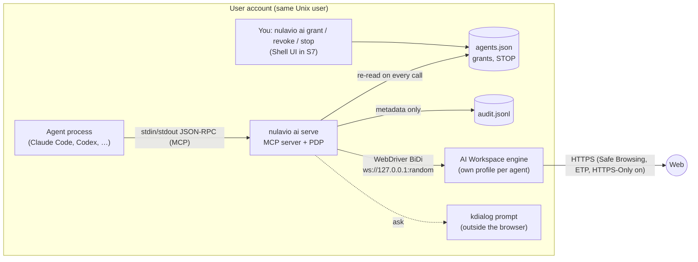

# AI Bridge: agents, permissions and the AI Workspace

Decision: [ADR 0007](../adr/0007-ai-bridge.md). Threats: [threat model for automation](../security/threat-model-ai.md). What works with which tool: [compatibility matrix](../ai/compatibility.md). How to connect an agent: [guide](../ai/connect-an-agent.md).

## Components

| Component (brief) | Where | State (S4) |
|---|---|---|
| Nulavio AI Bridge (MCP server) | `ai/mcp.py`, `nulavio ai serve` | Done: stdio, dual-era (2025 `initialize` and 2026-07-28 `_meta`), tools only |
| Agent Registry | `ai/registry.py`, `$XDG_STATE_HOME/nulavio/ai/agents.json` (0600) | Done: id, client, autonomy, grants, site list, workspace kind, token hash, revocation |
| Agent Session Manager | one bridge process = one session id; session-bound grants; client evidence | Sessions end with the process ("for this session" = for this task in stdio); explicit task handles later |
| Permission & Autonomy Manager (Policy Decision Point) | `ai/policy.py`, `registry.decide` | Done: presets, grants (forever / minutes / session), site list, stop switch, revocation, pause; "ask" in the browser (KDE dialog as fallback) |
| Browser Automation Controller | `ai/tools.py` | Done: 11 tools with per-call checks |
| Gecko Adapter | `ai/bidi.py`, `ai/websocket.py`, `ai/workspace.py` | Done: WebDriver BiDi over a local WebSocket; AI Workspace launch with protections on |
| Profile Access Coordinator | `ai/workspace.ProfileTarget`, `tools.Bridge` (engines per profile, tab owners), `registry.set_profiles/set_routes` | Done (S8): given profiles, routes per agent, refusal of locked or open profiles |
| Activity & Audit Manager | `ai/audit.py`, `nulavio ai audit`, Settings → AI & Automation | Done: metadata only, 30-day retention, clear; shown in Settings |
| Compatibility Adapters | — | A13 (raw BiDi mode; Playwright/CDP only where feasible) |

## Trust boundaries and flow

| Boundary | Crosses | Protection | Limit |
|---|---|---|---|
| AB1 Agent ↔ bridge | Tool calls and results | Token per agent (in its MCP config); schema validation; policy per call; no policy tools | Same-user processes can read the token and the policy file |
| AB2 Bridge ↔ engine | BiDi commands; the places on this computer and the local network the agent may reach now, which the Shell reads before it shows a page from a local address (#243) | Loopback only, random port, engine rejects `Origin` and foreign `Host`; the places are in a file in the Bridge's private state folder (0600, written atomically) whose path is in the engine's environment, and the Shell takes anything it cannot read as one as no place; in a Nulavio engine the Bridge uses the engine only once the Shell's check is on | Any same-user process can connect to the port while the workspace runs, and rewrite that file, as it can the policy (AB1) |
| AB3 Web page ↔ agent | Page text, element names, screenshots | Marked as untrusted in every result; content never reaches the PDP; tools cannot change policy | The model may still be misled into misusing what it is allowed to do |
| AB4 Agent workspace ↔ user profiles | Cookies, history, storage | Separate engine profile per agent; real profiles not reachable in S4 | — |

## Limits of each autonomy level

What each level can and cannot technically do, beyond the preset table in ADR 0007:

| Level | Can | Cannot (technical limit, not a hidden rule) |
|---|---|---|
| Restricted | Read pages, open public http(s) addresses, take screenshots in its own workspace | Act on pages without a yes in the dialog; reach the local network; run scripts |
| Assisted | Click and type; with a yes: submit forms, files, signed-in sessions | Run scripts, reach the local network, work in two places at once (a profile beside its AI Workspace, or two profiles) |
| Autonomous | Complete multi-step tasks, submit forms, use files and signed-in sessions without asking | Tell a form or a click that pays or changes an account from any other: no tool does, at any level (AI-T13, R88). Local network, two places at once (a profile beside its AI Workspace, or two profiles; one profile on its list alone asks nothing): ask until granted; scripts: ask, and run only once cookies/storage is granted too (while it is blocked, a script is refused before anything is asked, #725); cookies/storage: blocked until granted; the browser's internal pages: never (raw automation was removed, #463) |
| Full control | Everything without asking: actions on pages (forms that pay or change an account included), cookies and storage, the local network, the profiles in its list, scripts | The browser's internal pages (offered to no agent since raw automation was removed, [ADR 0007 amendment of 2026-11-17](../adr/0007-ai-bridge.md#amendment-2026-11-17-raw-automation-is-removed-453)); open a **locked** profile (needs the Vault key, never a permission); stop pages from doing what pages do; restrict what the agent process itself does outside the bridge |

Every capability Settings and `nulavio ai capabilities` offer is checked by a tool before it acts. Until 2026-11-25 they also offered `transactions` (purchases and payments), `account_settings`, `private_tabs`, `network` (network inspection) and `background`, which no tool checked: no tool opens a private tab or shows network traffic, nothing asked before work in the background, and a purchase or an account change is a click or a form, which `interact` and `submit_forms` govern (#714). They are no longer offered; a grant for one that a registry still holds stays in the file and counts for nothing (`policy.RETIRED_CAPABILITIES`).

A call is not asked a question that can only end in a refusal. Before its first question, the Bridge looks at what the call will ask next, in that order. That is entering a tab of one of the user's profiles (its signed-in session for the site, and `multiple_profiles` while another place is open), the tool's own permission, what the address needs (`local_resources`, the signed-in session in a profile), a script's `cookies_storage`, and a form sent with Enter (`type` with `submit`). The first one blocked for the agent there refuses the call through the same decision point, with nothing asked (#725, #730). Reading where a profile's tab is enters nothing, so an address agents never act on is refused there before any question too, as in the AI Workspace (#508). Each one is looked up for the site and place its own question would name, so nothing an answer could allow is refused. What a click or typing turns out to do is known only once the element is inspected, after the action's own question: a submit button, a link and Enter in a single-line field are asked about then, as before.

## Assistant stream contract (UX5)

`nulavio ai assistant` keeps its one-request, one-answer contract for every caller. The assistant's panel uses stream mode for Ask and Task. Stream mode uses the same process per call, the same arguments and the same pipe; there is no socket, helper or permission.

| Direction | What | Notes |
|---|---|---|
| Browser → tools | One JSON request line with `"stream": true` | stdin stays open until the terminal line; its end means "cancel" |
| Tools → browser | `start {recipient, model, chars}` | The size the panel showed; `chars` is null for a Task (known afterwards) |
| | `sending {turn}` | Just before each request goes; from then on it "may have arrived" |
| | `delta {text}` | Ask only; gathered for about 50 ms or 256 characters |
| | `step {index, tool, state, capability, reason, origin, ms}` | Task only; `started`, then `ok`, `denied`, `error` or `cancelled`; never the tool's output |
| | `approval {id, capability, expires}` | A permission request the run waits for; the module shows it once (panel card or request tab) |
| | Exactly one `done {…, cancelled, sent}` or `error {code, sent, retryAfter?, status?}` | `sent`: whether a request may have reached the provider |

Cancel paths:
- **The browser.** `callToolStream(...).cancel(grace)` sends SIGTERM, then SIGKILL after 2 s (Ask) or 20 s (Task).
- **The tools.** On the first SIGTERM they ignore further ones and raise `Cancelled`, a BaseException, so no `except Exception` swallows it. A watcher thread turns the end of stdin into SIGTERM.
- **The cleanup.** Removing the request files, closing the AI Workspace and ending the session's answers are never cut. Once the answer is in, or the workspace is closing, a stop waits, and the panel says the answer arrived first.
- **Lines.** SIGTERM is blocked while a line is written, so no half line reaches the browser.

The browser reader fails closed. It refuses a line that is not JSON or is over 1 MiB, and an end without a terminal line (`helper-failed`, or `task-unfinished` for a Task). An idle limit of 150 s per line is held while a permission request waits; the caps are 10 min (Ask) and 30 min (Task).

Session markers (UX5-I2): while `nulavio ai serve` runs, `<state>/ai/sessions/<session>.json` (0600) names the agent, its client and the serving pid; it is removed at the end. The band reads these files and checks `/proc/<pid>`, so it never starts a process, and a marker left by a killed process is ignored.

## Integration points

- **Engine**: no patch. The bridge uses the engine's standard BiDi endpoint. Normal profiles keep refusing remote-control flags.
- **Launcher**: `nulavio ai` subcommands, `paths` (state, data), `engine.find_engine`/`launch_env`, the baseline prefs. Installed tools use the engine of their own install (`engine.bundled_engine`), and a workspace refuses an engine that is not the Nulavio build (`engine.require_nulavio`), except under the test harness in a source checkout.
- **Shell (S7)**: Settings → AI & Automation reads and writes the same registry through the launcher; the activity indicator reads the audit.
- **Profiles and routing (S8)**: agent rules in Smart Profile Routing ("Codex opens localhost in Development"); access to a real profile is a separate grant per profile, and an unlock always comes from the user.

## UX evolution plan (Horizon)

Onboarding in three decisions: choose agent → choose autonomy → connect and finish (a test call proves it works). Everything else lives under Settings → AI & Automation.

| Screen (brief) | Slice | Notes |
|---|---|---|
| AI & Automation (overview), Connected Agents, Connect New Agent | **S7 done** | Settings section; the configuration is shown and copied, never written by Nulavio |
| Agent Detected | **S8 done** | Claude Code / Codex found with version; the exact command and the file it changes; run after the click |
| Choose Autonomy Level, Custom Permissions | **S7 done** | The four levels with one-line consequences; capability rows with allow/ask/block and duration |
| Full Control Warning | **S7 done; UX1** | The Shell's own text (`aiFullControlBody`: what turns on, and that the browser's internal pages are not included), never the tools' English; critical dialog variant with the agent's name; Cancel / Authorize full control (danger), Cancel focused |
| Raw automation opt-in | **Removed (#463)** | The switch is gone. An agent whose record still has the opt-in from an earlier version gets one notice in its row (`aiRawRemoved`), until the person acknowledges it (`forget-raw-automation`); the opt-in grants nothing meanwhile |
| Agent Permission Request | **S7 done; UX1** | `ai/request.html`: agent and level, action, risk callout (critical / warning / info), site, where the agent acts (its Área de IA or your profile), expiry as a clock time; Deny (filled primary, first, focused) / Allow once (secondary) / Allow until the agent disconnects (quiet); never in an AI Workspace. "Once" is for the call; "until the agent disconnects" is for the site and the place shown (`registry.grant_session` keeps those pairs), never the capability elsewhere |
| Authorized Profiles, Authorized Websites | **S7/S8 done** | Per-agent profiles and routes; site list |
| Agent Activity, Automation History | **S7 done** | From the audit, last 30 days, clearable; per-agent filter later |
| Active Agent Sessions | **S8 done** | "Connected now" per agent from connect/disconnect events |
| Background Automation | S7 | Explicit grant with duration |
| Revoke Agent Access, Emergency Stop, Pause | **S7 done; UX1** | Revoke confirmed; stop as a switch, and while it is on a warning callout at the top of the section with "Retomar"; pause/resume per agent; level badges "Nível: …" (Controle total warning-tinted with an icon, Autônomo warning outline, Pausado/Revogado neutral with an icon) |
| Agent Connection Error | S8 | Plain reasons: unknown token, revoked, engine missing (today in the agent's MCP log) |

Activity indicator: the AI Workspace window shows the engine's own remote-control marks (robot icon, striped toolbar) and a Nulavio bar the user cannot close (UX1). It names the agent, its level and where it acts: "Área de IA de <agente> · Nível: …", or "<agente> está usando o seu perfil <nome>" in one of the user's profiles (pref `nulavio.ai.target`). It has "Parar agente", which pauses that agent. The raw-automation bar and state went with raw automation (#463). The root attribute `nulavio-state` (`ai`, `ai-profile`) is there for the window theme. Resume, revoke and the emergency stop live in the user's own Settings, where the agent cannot click them; "Parar agente" can only stop.
