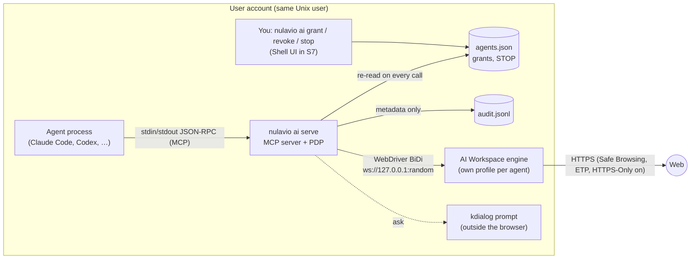

# AI Bridge: agents, permissions and the AI Workspace

Decision: [ADR 0007](../adr/0007-ai-bridge.md). Threats: [threat model for automation](../security/threat-model-ai.md). What works with which tool: [compatibility matrix](../ai/compatibility.md). How to connect an agent: [guide](../ai/connect-an-agent.md).

## Components

| Component (brief) | Where | State (S4) |
|---|---|---|
| Nulavio AI Bridge (MCP server) | `ai/mcp.py`, `nulavio ai serve` | Done: stdio, dual-era (2025 `initialize` and 2026-07-28 `_meta`), tools only |
| Agent Registry | `ai/registry.py`, `$XDG_STATE_HOME/nulavio/ai/agents.json` (0600) | Done: id, client, autonomy, grants, site list, workspace kind, token hash, revocation |
| Agent Session Manager | one bridge process = one session id; session-bound grants | Basic: sessions end with the process; task handles in S7 |
| Permission & Autonomy Manager (Policy Decision Point) | `ai/policy.py`, `registry.decide` | Done: presets, grants (forever / minutes / session), site list, stop switch, revocation, "ask" through a desktop dialog |
| Browser Automation Controller | `ai/tools.py` | Done: 11 tools with per-call checks |
| Gecko Adapter | `ai/bidi.py`, `ai/websocket.py`, `ai/workspace.py` | Done: WebDriver BiDi over a local WebSocket; AI Workspace launch with protections on |
| Profile Access Coordinator | — | S8 (real profiles, routing per agent, locked profiles) |
| Activity & Audit Manager | `ai/audit.py`, `nulavio ai audit` | Done: metadata only, rotation; UI in S7 |
| Compatibility Adapters | — | A13 (raw BiDi mode; Playwright/CDP only where feasible) |

## Trust boundaries and flow

| Boundary | Crosses | Protection | Limit |
|---|---|---|---|
| AB1 Agent ↔ bridge | Tool calls and results | Token per agent (in its MCP config); schema validation; policy per call; no policy tools | Same-user processes can read the token and the policy file |
| AB2 Bridge ↔ engine | BiDi commands | Loopback only, random port, engine rejects `Origin` and foreign `Host` | Any same-user process can connect to the port while the workspace runs |
| AB3 Web page ↔ agent | Page text, element names, screenshots | Marked as untrusted in every result; content never reaches the PDP; tools cannot change policy | The model may still be misled into misusing what it is allowed to do |
| AB4 Agent workspace ↔ user profiles | Cookies, history, storage | Separate engine profile per agent; real profiles not reachable in S4 | — |

## Limits of each autonomy level

What each level can and cannot technically do, beyond the preset table in ADR 0007:

| Level | Can | Cannot (technical limit, not a hidden rule) |
|---|---|---|
| Restricted | Read pages, open public http(s) addresses, take screenshots in its own workspace | Act on pages without a yes in the dialog; reach the local network; run scripts |
| Assisted | Click and type; with a yes: submit, files, signed-in sessions, purchases | Run scripts, reach the local network, see other profiles |
| Autonomous | Complete multi-step tasks, submit forms, use files and signed-in sessions without asking | Purchases and account changes, scripts, local network, other profiles: ask until granted; cookies/storage and debugging: blocked until granted |
| Full control | Everything the user selected, without asking | Open a **locked** profile (needs the Vault key, never a permission); stop pages from doing what pages do; restrict what the agent process itself does outside the bridge |

## Integration points

- **Engine**: no patch. The bridge uses the engine's standard BiDi endpoint. Normal profiles keep refusing remote-control flags.
- **Launcher**: `nulavio ai` subcommands, `paths` (state, data), `engine.find_engine`/`launch_env`, the baseline prefs.
- **Shell (S7)**: Settings → AI & Automation reads and writes the same registry through the launcher; the activity indicator reads the audit.
- **Profiles and routing (S8)**: agent rules in Smart Profile Routing ("Codex opens localhost in Development"); access to a real profile is a separate grant per profile, and an unlock always comes from the user.

## UX evolution plan (Horizon)

Onboarding in three decisions: choose agent → choose autonomy → connect and finish (a test call proves it works). Everything else lives under Settings → AI & Automation.

| Screen (brief) | Slice | Notes |
|---|---|---|
| AI & Automation (overview), Connected Agents, Connect New Agent, Agent Detected | S7/S8 | Detection of Claude Code/Codex binaries and their config paths; the exact snippet and file are shown before any change |
| Choose Autonomy Level, Custom Permissions | S7 | The four levels as cards with one-line consequences; capability rows with allow/ask/block and duration |
| Full Control Warning | S7 | The text of `policy.FULL_CONTROL_WARNING`; Cancel / Configure permissions / Authorize full control; shown once per agent, again only when the scope grows |
| Agent Permission Request | S7 | Replaces the kdialog prompt: exact action, site and agent; Allow once / for this task / for this session / Deny |
| Authorized Profiles, Authorized Websites | S8 | Per-agent profile grants; site list editor |
| Active Agent Sessions, Agent Activity, Automation History | S7 | From the audit; filters per agent and site |
| Background Automation | S7 | Explicit grant with duration |
| Revoke Agent Access, Emergency Stop | S7 | One click each; the toolbar indicator offers both |
| Agent Connection Error | S7 | Plain reasons: unknown token, revoked, engine missing |

Activity indicator: discreet toolbar chip in the AI Workspace window with agent name, profile, autonomy and current action; actions: view activity, pause, revoke, end task. Closing the indicator does not stop the agent.
