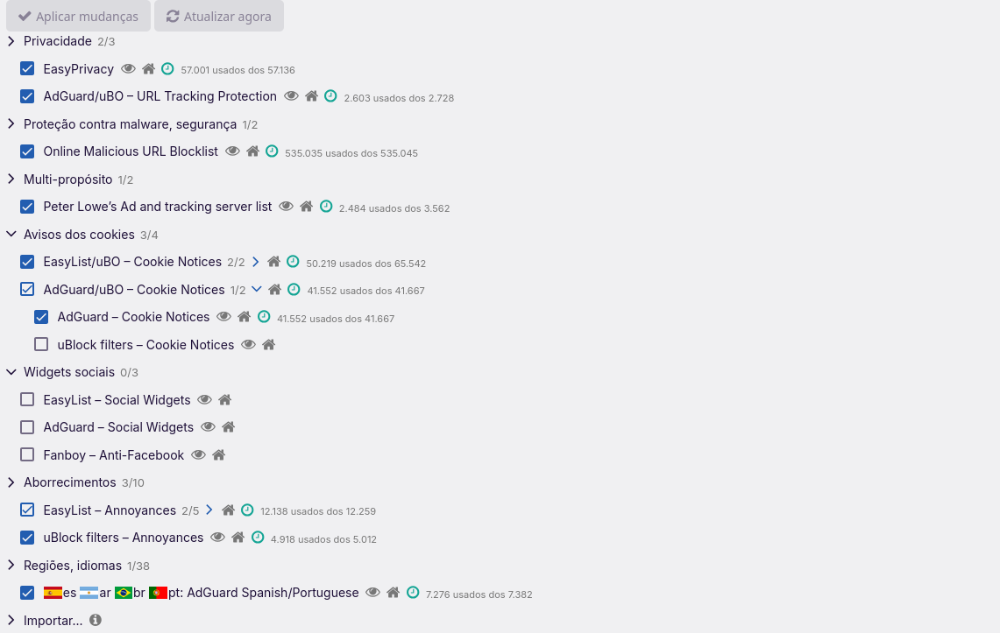

# Extension model

## Classes of extensions

| Class | Examples | Who installs | Source | Updates |
|---|---|---|---|---|
| Default (product) | uBlock Origin | Nulavio setup, disclosed in the plan the user confirms (`--no-ublock` opts out) | Pinned AMO file: SHA-256, size, host allow-list, plus Mozilla signature | Engine auto-update from AMO |
| Provider | Proton Pass, KeePassXC-Browser, Bitwarden | The user, explicitly (`--install-extension` or AMO) | Pinned AMO file (via Nulavio) or AMO directly | Engine auto-update from AMO |
| User | Anything from AMO | The user | AMO | Engine |
| Built-in (Track B) | Nulavio new tab, onboarding, privacy panel | Shipped inside the build | Part of the signed release | With the browser |

No extension is installed silently: everything Nulavio adds is listed in the setup plan or requires an explicit command.

## Facts verified on Firefox 158

- Only Mozilla-signed extensions load on release builds (`xpinstall.signatures.required` cannot be relaxed there; Guard blocks attempts in user prefs).
- A signed XPI placed at `<profile>/extensions/<id>.xpi` is handled per engine build. **Fedora's package** (`extensions.autoDisableScopes=0`) enables it at next start without a prompt. **Mozilla's own builds** (default 15, also Nulavio Track B) keep it disabled until the user approves it from the ☰ menu; the start page and `nulavio doctor` show "waiting for your approval". Nulavio never lowers the value, and Guard warns if a user pref does. On Fedora this is also a same-user tampering vector (residual risk R2).
- Language packs from the distribution (`/usr/lib64/firefox/langpacks/`) are Mozilla-signed. Nulavio copies the one matching the user's locale into the profile and refreshes it when the engine updates.
- Extensions do not run in private windows unless the user allows them per extension. For uBO, the user enables "Run in Private Windows" in Add-ons. Track B will set `private_browsing: true` for uBO via policy, disclosed at setup.
- The Marionette remote agent changes many prefs ("recommended prefs") unless `remote.prefs.recommended=false`. Tests set it to false so they exercise the real configuration.

## Permission review

- `extensions.lock.json` keeps the permissions a maintainer reviewed (`reviewed_permissions`). `scripts/upstream/refresh_extensions_lock.py` flags additions before the lock can change.
- Planned (Guard runtime): show high-risk permissions (`<all_urls>`, `cookies`, `webRequestBlocking`, `nativeMessaging`, `clipboardRead`, `privacy`) in plain language at install, and alert when the installed set changes outside the browser UI.

## The lists a new profile starts with

uBlock Origin's own defaults block ads, trackers and malware domains and leave every "annoyances" list off, cookie notices included. For a new profile Nulavio switches on the lists Helium switches on (`browser/distribution/content-filter.json`, the maintainer's decision of 2026-11-12): cookie notices (EasyList, its uBlock filters companion, and AdGuard's), EasyList's newsletter notices and notifications, uBlock filters – Annoyances, AdGuard – Ads and AdGuard/uBO – URL Tracking Protection. A notice is hidden, not answered: nothing is accepted on the person's behalf. More lists use more memory and break more pages than uBlock Origin's defaults; the person switches any of them off in uBlock Origin's "Filter lists", and it stays off.

- **A default, never a lock.** `distribution/policies.json` gives uBlock Origin, as managed storage, only `adminSettings.assetsBootstrapLocation`: its own list registry (`assets/assets.json` of the pinned package, copied unchanged into `browser/distribution/ublock-origin/`) with `"off": false` on those lists. uBlock Origin reads that registry once, when a profile has none, and selects what is not off. Every other managed key (`toOverwrite.filterLists`, `userSettings`, the rest of `adminSettings`) is applied at each start and would undo the person's choice in the dashboard, so none is used; a unit test keeps it that way.
- **No server of Nulavio's.** The registry travels inside `policies.json` as a `data:` address (`scripts/build/make_distribution.py`, `registry_address`, says why it has the form it has). A registry on a web server would let that server choose the filter lists of every new profile.
- **What it does not do.** A profile that already exists keeps its selection: there is no way to add a list there without overwriting, so the person ticks "Cookie notices" in uBlock Origin's "Filter lists" page. When uBlock Origin later fetches upstream's registry, the lists stay selected (`false` keeps them out of the stock default set, which is what uBlock Origin reconciles).
- **When the pin changes.** `refresh_extensions_lock.py --write` re-copies the registry, says when a default list is gone or already on upstream, and reads the new package for the code this rests on; the build stops if the copy is not the pinned version's. What to do when one of those speaks: [dependency updates](../security/dependency-updates.md#ublock-origins-default-lists). `tests/integration/test_content_filter.py` starts a new profile with the signed package: the lists are on beside the stock ones and the one for the person's language, a cookie notice is hidden, upstream's registry update keeps them, and a list switched off in the dashboard stays off after a restart.
- **Checked against Helium 0.21.2.1** (a fresh profile, read from its uBlock Origin 1.75.4, 2026-11-11): it also turns on AdGuard – Ads, AdGuard/uBO – URL Tracking Protection, AdGuard – Cookie Notices, EasyList – Newsletter Notices and Notifications, uBlock filters – Annoyances and two short lists of its own. It has no list against paywalls, and neither does Nulavio. Nulavio's set is Helium's without those two lists of its own; changing it is one line in `content-filter.json`.

## Track B mechanics (planned)

- `distribution/policies.json` → `ExtensionSettings`: uBO `normal_installed` (user can disable; not removable while the policy stands) with `private_browsing: true`. Everything else `allowed`. No `force_installed` for user-facing extensions.
- Built-in Nulavio UI as a built-in add-on (no AMO signing needed). The new tab overrides `about:newtab`.
- Keep Firefox's add-on application ID so AMO extensions remain compatible (legal/policy check pending, ADR open item 3).
