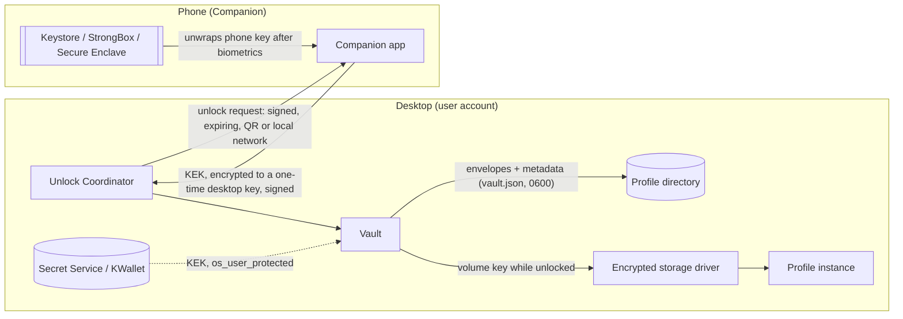
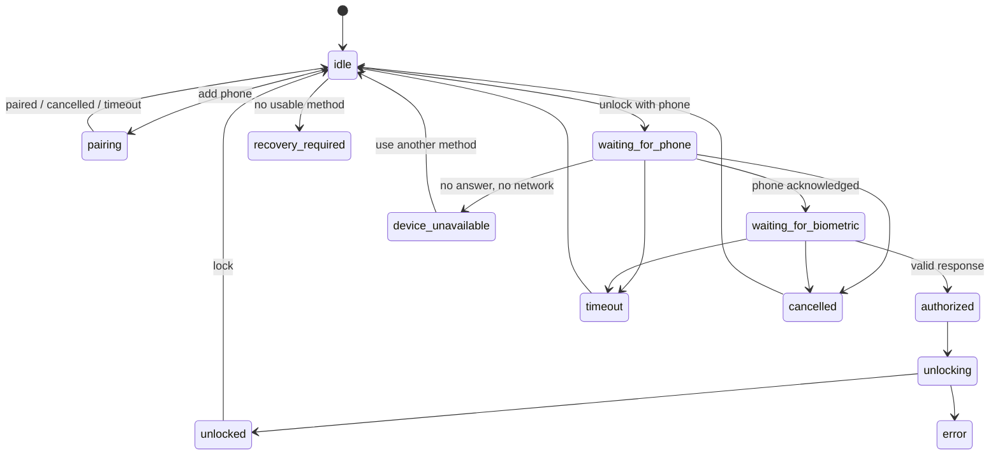

# Secure Profiles: Vault and unlock

Decisions: [ADR 0005](../adr/0005-phone-profile-unlock.md) (phone), [ADR 0006](../adr/0006-nulavio-vault.md) (keys). Threats: [threat model for unlock](../security/threat-model-unlock.md).

## Components

| Component | Responsibility | Where |
|---|---|---|
| Nulavio Vault | Profile DEK, envelopes, metadata, lock/unlock, recovery, rotation | `launcher/nulavio_launcher/vault/` |
| Unlock Coordinator | Which methods exist and are required, capability checks, state machine, timeouts, cancellation, no silent downgrade | same package (`coordinator.py`); UI in the Shell (S6) |
| Platform Key Provider | Password (Argon2id), recovery code, OS keyring (Secret Service), TPM (optional), later Windows DPAPI/Hello | `vault/providers.py` |
| Phone Unlock | Pairing, devices, protocol `nv1`, revocation | `vault/phone.py`; Android app (S11) |
| Hardware Key Provider | FIDO2 `hmac-secret` | S10 |

## Trust boundaries and key flow

| Boundary | Crosses | Protection |
|---|---|---|
| UB1 Desktop ↔ phone | Pairing and unlock messages | End-to-end encryption and signatures (`nv1`); QR secret plus a 6-digit comparison at pairing; 60-second requests, one-shot |
| UB2 Vault ↔ disk | Envelopes, metadata | AEAD with headers as associated data; atomic writes; metadata MAC after unlock; no DEK or KEK on disk |
| UB3 Vault ↔ OS keyring | A random KEK | Secret Service access control (none against same-user processes; shown as such) |
| UB4 Unlocked storage ↔ same-user processes | Profile files | **None** while unlocked (TB6); only locking protects |
| UB5 Phone app ↔ phone hardware | Phone private keys | Non-exportable hardware key, per-use biometrics or PIN |

## Phone protocol `nv1`

Primitives (libsodium): X25519 `scalarmult`, Ed25519 `sign_detached`, XChaCha20-Poly1305-IETF, BLAKE2b (`generichash`, 32 bytes). `KDF(k, label, parts…) = BLAKE2b(key=k, "nulavio/nv1/" ‖ label ‖ 0x00 ‖ len‖part ‖ …)`. Messages are canonical JSON (sorted keys) with base64url values.

### Identities

- Desktop: Ed25519 `Dsig` and X25519 `Dkx`, per installation, stored 0600 in the Vault directory.
- Phone: Ed25519 `Psig` and X25519 `Pkx`, generated on the phone, stored encrypted under the hardware key. `phone_id = BLAKE2b(Psig_pk)[0:16]`.

### Pairing (requires the profile unlocked: adding a method needs the DEK)

1. Desktop shows a QR: `{v:1, i: invite_id(16), k: de_pk, s: pair_secret(32), d: Dsig_pk, a: "host:port", e: expiry(+300 s)}`.
2. Phone → desktop `hello`: `{i, pe_pk, box: AEAD(k1, {Psig_pk, Pkx_pk, name})}`, with `shared = X25519(pe, de_pk)`, `k1 = KDF(pair_secret, "pair/k1", shared, i, de_pk, pe_pk)`. Only a device that read the QR can produce it.
3. Desktop → phone `accept`: `AEAD(k2, {Dkx_pk, desktop_name, sig_D})`, `T = BLAKE2b(i ‖ de_pk ‖ pe_pk ‖ Dsig_pk ‖ Psig_pk ‖ Pkx_pk ‖ name)`, `k2 = KDF(pair_secret, "pair/k2", shared, T)`, `sig_D = Ed25519(Dsig, "nv1/pair/desktop" ‖ T)`.
4. Both show `SAS = 6 digits from KDF(shared, "pair/sas", T)`; the user confirms they match.
5. Phone → desktop `confirm`: `AEAD(k3, {sig_P = Ed25519(Psig, "nv1/pair/phone" ‖ T)})`. The desktop stores `{phone_id, Psig_pk, Pkx_pk, name}` and creates the phone envelope.

### Phone envelope

`eph` fresh X25519; `Z = X25519(eph, Pkx_pk)`; `KEK = KDF(Z, "envelope/phone", profile_id, envelope_id, phone_id, eph_pk)`; store `{eph_pk, phone_id, nonce, AEAD(KEK, DEK)}`; wipe `eph`.

### Unlock

1. Desktop creates `R = {v:1, req_id(16), op:"unlock-profile", profile_id, profile_name, desktop_name, envelope_id, eph_pk, s_pk, expiry(+60 s)}` with a fresh session key `s`, signs it (`Ed25519(Dsig, "nv1/unlock/request" ‖ canonical(R))`) and shows it as a QR (and over the local network when the app is reachable).
2. Phone checks: paired desktop, signature, expiry (±120 s skew), `req_id` never seen, `envelope` is for this phone. It shows profile and desktop name, then asks for biometrics/PIN.
3. Phone computes `KEK` as above (with `Pkx`), then `rk = KDF(X25519(Pkx, s_pk), "unlock/response", BLAKE2b(R))` and sends `{req_id, phone_id, box: AEAD(rk, KEK, ad=req_id), sig_P = Ed25519(Psig, "nv1/unlock/response" ‖ BLAKE2b(R) ‖ box)}`.
4. Desktop accepts once, before expiry: verifies `sig_P`, derives `rk` with `s`, opens `KEK`, unwraps the DEK, checks `dek_check`, wipes `s` and `KEK`.

Replay: `s` and `req_id` are one-shot. Substitution: `sig_P` covers the request hash, and `rk` needs both the phone's and the session's private keys. Cancellation: dropping `s` makes any later answer useless.

## Unlock Coordinator states

A required method is never replaced by a weaker one silently: when the phone is unavailable, the user chooses another configured method; a policy "password + phone" has no single-method fallback except the recovery code.

## Defaults

| Default | Recommended | Optional |
|---|---|---|
| Profile isolation; encryption at rest for protected profiles; no DEK in clear; OS mechanisms used; Gecko protections untouched; no Nulavio telemetry; no remote service; no silent unlock or downgrade; real lock; recovery shown clearly | Unlock with phone (once S11 ships), recovery code, a second recovery method, auto-lock for sensitive profiles, re-authentication for protection changes and exports | Security key; password + phone; password + security key; stricter Banking policy; ephemeral profile; lock when the phone or key disconnects; relay services; hardware settings |

Without a working phone method: password or OS keyring with a recovery code; the browser never refuses to work for lack of a phone, and the UI never shows protection that is not in place.

## Onboarding (three decisions)

1. **Profile:** create or choose.
2. **Protection:** "Unlock with phone" (only once available), "Use a password", "Use a security key" (only when one is connected), "Protect with my computer login" (OS keyring). Each option says in one line what it protects against.
3. **Recovery and finish:** the recovery code is shown once; the user types back two groups to prove it was saved; optional second method.

Screens (S6): choose method, connect phone, QR, confirm pairing (6 digits), phone connected, test unlock, set up recovery, profile locked, request sent to phone, approve with biometrics (phone), phone unavailable, use another method, authorized devices, remove lost phone, change profile policy. Plain words only ("Unlock with phone", "Recover access", "Lock profile"); no protocol names.

## Effective protection matrix

| State | Copy of the profile taken offline | Other local users | Same-user malware, profile **locked** | Same-user malware, profile **unlocked** |
|---|---|---|---|---|
| `encrypted_at_rest` (any method below) | Protected | Protected | Depends on the method | **Not protected** |
| `os_user_protected` | Protected (unless the keyring is copied and the login password known) | Protected | **Not protected** (can read the unlocked keyring) | Not protected |
| `password_protected` | Protected by password strength (Argon2id) | Protected | Protected unless the password is captured | Not protected |
| `hardware_bound` | Protected (needs this TPM or that key) | Protected | TPM without PIN: not protected; security key: needs a touch/PIN | Not protected |
| `phone_approved` | **No protection** (approval only) | — | — | — |
| `phone_key_release_verified` | Protected | Protected | Protected (needs the phone and biometrics) | Not protected |
