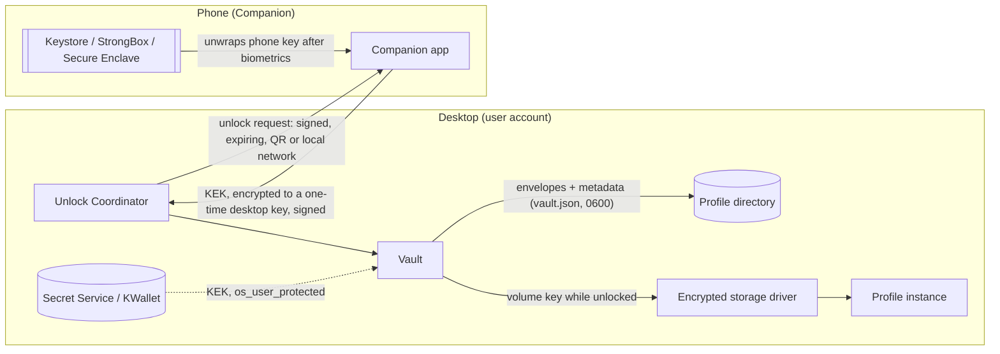
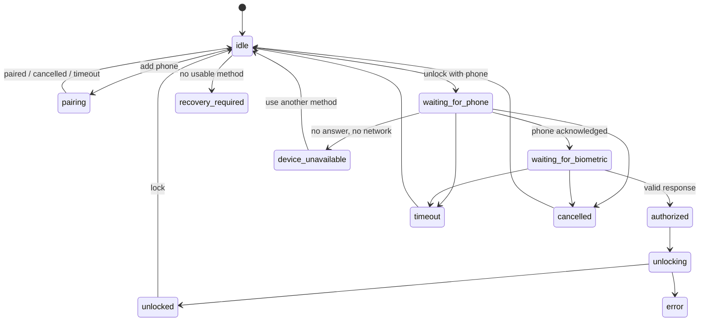

# Secure Profiles: Vault and unlock

Decisions: [ADR 0005](../adr/0005-phone-profile-unlock.md) (phone), [ADR 0006](../adr/0006-nulavio-vault.md) (keys). Threats: [threat model for unlock](../security/threat-model-unlock.md).

## Components

| Component | Responsibility | Where |
|---|---|---|
| Nulavio Vault | Profile DEK, envelopes, metadata, lock/unlock, recovery, rotation | `launcher/nulavio_launcher/vault/` (`core.py`; storage in `storage.py`, profiles in `profiles.py`, CLI `nulavio vault` in `cli.py`) |
| Unlock Coordinator | Which methods exist and are required, capability checks, state machine, timeouts, cancellation, no silent downgrade | same package (`coordinator.py`); UI in the Shell (S6) |
| Encrypted storage | One gocryptfs volume per profile, keyed from the DEK; read-only mount point while locked; generation mirror | `vault/storage.py`; the Shell reads the lock state (`browser/shell/modules/NulavioVaultState.sys.mjs`) |
| Platform Key Provider | Password (Argon2id), recovery code, OS keyring (Secret Service), TPM (optional), later Windows DPAPI/Hello | `vault/providers.py` |
| Phone Unlock | Pairing, devices, protocol `nv1`, revocation | `vault/phone.py`; Android app (S11) |
| Hardware Key Provider | FIDO2 `hmac-secret` | S10 |

## Trust boundaries and key flow

| Boundary | Crosses | Protection |
|---|---|---|
| UB1 Desktop ↔ phone | Pairing and unlock messages | End-to-end encryption and signatures (`nv1`); QR secret plus a 6-digit comparison at pairing; 60-second requests, one-shot |
| UB2 Vault ↔ disk | Envelopes, metadata | AEAD with headers as associated data; atomic writes; metadata MAC after unlock; no DEK or KEK on disk |
| UB3 Vault ↔ OS keyring | A random KEK | Secret Service access control (none against same-user processes; shown as such) |
| UB4 Unlocked storage ↔ same-user processes | Profile files | **None** while unlocked (TB6); only locking protects |
| UB5 Phone app ↔ phone hardware | Phone private keys | Non-exportable hardware key, per-use biometrics or PIN |

## Phone protocol `nv1`

Primitives (libsodium): X25519 `scalarmult`, Ed25519 `sign_detached`, XChaCha20-Poly1305-IETF, BLAKE2b (`generichash`, 32 bytes). `KDF(k, label, parts…) = BLAKE2b(key=k, "nulavio/nv1/" ‖ label ‖ 0x00 ‖ len‖part ‖ …)` with 4-byte big-endian lengths. Messages are canonical JSON (sorted keys, no spaces) with base64url values.

Implemented in `launcher/nulavio_launcher/vault/phone.py` (desktop) and `tests/lib/phone_reference.py` (phone, the executable spec the Android app must match); the version-1 fixture in `tests/fixtures/vault-v1/` includes artificial phone keys so the app can be checked against the same vault.

### Identities

- Desktop: Ed25519 `Dsig` and X25519 `Dkx`, per installation, stored 0600 in the Vault directory.
- Phone: Ed25519 `Psig` and X25519 `Pkx`, generated on the phone, stored encrypted under the hardware key. `phone_id = BLAKE2b(Psig_pk)[0:16]`.

### Pairing (requires the profile unlocked: adding a method needs the DEK)

1. Desktop shows a QR: `{v:1, i: invite_id(16), k: de_pk, s: pair_secret(32), d: Dsig_pk, a: "host:port", e: expiry(+300 s)}`.
2. Phone → desktop `hello`: `{i, pe_pk, box: AEAD(k1, {Psig_pk, Pkx_pk, name})}`, with `shared = X25519(pe, de_pk)`, `k1 = KDF(pair_secret, "pair/k1", shared, i, de_pk, pe_pk)`. Only a device that read the QR can produce it.
3. Desktop → phone `accept`: `AEAD(k2, {Dkx_pk, desktop_name, sig_D})`, `T = BLAKE2b(i ‖ de_pk ‖ pe_pk ‖ Dsig_pk ‖ Psig_pk ‖ Pkx_pk ‖ name)` (each part length-prefixed), `k2 = KDF(pair_secret, "pair/k2", shared, T)`, `sig_D = Ed25519(Dsig, "nv1/pair/desktop" ‖ T)`. Because `T` includes the desktop key the phone read in the QR, a substituted key already makes `accept` fail to decrypt. All boxes use the invite id as associated data.
4. Both show `SAS = first 4 bytes of KDF(shared, "pair/sas", T) mod 10^6`, as 6 digits; the user confirms they match.
5. Phone → desktop `confirm`: `AEAD(k3, {sig_P = Ed25519(Psig, "nv1/pair/phone" ‖ T)})` with `k3 = KDF(pair_secret, "pair/k3", shared, T)`. The desktop accepts it only if the user also confirmed the digits on the desktop; it then creates the phone envelope, which holds `{phone_id, Psig_pk, Pkx_pk, name}`.

An invite takes one `hello`: a second one, or one that fails to decrypt (no QR secret), ends the attempt. Pairing needs a new QR after a failure.

### Phone envelope

`eph` fresh X25519; `Z = X25519(eph, Pkx_pk)`; `KEK = KDF(Z, "envelope/phone/desktop-bound", profile_id, envelope_id, phone_id, eph_pk, Dsig_pk)`, where `Dsig_pk` is the signing key of the desktop that paired the phone and makes the envelope; store `{eph_pk, phone_id, dsig_pk, nonce, AEAD(KEK, DEK)}`; wipe `eph`.

The binding to `Dsig_pk` (audit V3, 2026-11-10): the phone derives `KEK` with the key of the desktop whose request it verified, so a request signed by any other desktop the phone is paired with, even one holding a copy of this `vault.json`, yields a key that opens nothing. The desktop asks only for envelopes bound to its own key. Envelopes made before the binding have no `dsig_pk`: the desktop reports `phone-needs-pairing`, and the phone is removed and connected again.

### Unlock

1. Desktop creates `R = {v:1, req_id(16), op:"unlock-profile", profile_id, profile_name, desktop_name, envelope_id, eph_pk, s_pk, expiry(+60 s)}` with a fresh session key `s`, signs it (`Ed25519(Dsig, "nv1/unlock/request" ‖ canonical(R))`) and shows it as a QR (and over the local network when the app is reachable).
2. Phone checks: paired desktop, signature, expiry (±120 s skew), an expiry no later than now + 180 s (one request's 60 s plus the skew; otherwise `bad-expiry`), `req_id` never seen, `envelope` is for this phone. It shows the profile name and the desktop's name **from its own pairing record** (the `desktop_name` in the request is not shown), then asks for biometrics/PIN.
3. Phone computes `KEK` as above (with `Pkx`, and the `Dsig_pk` of the desktop that signed `R`), then `rk = KDF(X25519(Pkx, s_pk), "unlock/response", BLAKE2b(R))` and sends `{req_id, phone_id, box: AEAD(rk, KEK, ad=req_id), sig_P = Ed25519(Psig, "nv1/unlock/response" ‖ BLAKE2b(R) ‖ canonical(box))}`. A refusal is `{req_id, phone_id, error, sig_P}` with the signature over `{"error": code}` instead of the box; codes: `declined`, `biometric-unavailable`, `device-locked` (anything else is shown as a generic phone error).
4. Desktop accepts once, before expiry: verifies `sig_P`, derives `rk` with `s`, opens `KEK`, unwraps the DEK, checks `dek_check`, wipes `s` and `KEK`. A response that is not signed by the phone named in the envelope is ignored without cancelling the request, so a stranger on the network cannot cancel the user's unlock.

Replay: `s` and `req_id` are one-shot; the desktop keeps the last 1024 request ids and the phone every id it answered. Substitution: `sig_P` covers the request hash, and `rk` needs both the phone's and the session's private keys. Cancellation: dropping `s` makes any later answer useless. One pending request per profile: a new request cancels the previous one.

Password + phone (`combined` envelope): the desktop stretches the password first, sends the request for that envelope, and opens it with `KDF(constant, "combined-kek", KEK_password, KEK_phone)`. Neither factor alone opens it, and a wrong password is only detected after the phone answered.

### Transport (S11)

The phone listens for one operation and announces it over mDNS; the desktop resolves that exact name through Avahi and connects out ([ADR 0005, transport amendment](../adr/0005-phone-profile-unlock.md#transport-amendment-2026-10-27)). Desktop side: `launcher/nulavio_launcher/vault/link.py` (canonical JSON lines of at most 16 KiB, instance names `nv1-p-…`/`nv1-u-…` from BLAKE2b of the invite or request id, `ResolveService` through `busctl` on the system bus) and `vault/phone_session.py`: each pairing or unlock runs in a short-lived helper (`nulavio vault phone-session`, request on stdin) that keeps the operation's secrets in memory only and is driven by the browser through a private UNIX socket in the runtime folder.

Browser API (`nulavio vault api`): `phone-pair-start {path, current}` (re-authenticates; needs a recovery code and one other method, ADR 0005 §6) and `phone-unlock-start {path, envelope?, password?}` return `{session, qr, expiry}`; `phone-session {session, action: status|confirm|cancel, match?}`. Session states: `waiting-for-phone`, `compare` (6 digits shown), `waiting-for-you`, `paired`, `unlocked`, `declined`, `expired`, `unreachable`, `cancelled`, `failed` (with a code). `capabilities` reports `phone` (Avahi reachable).

Tests: `tests/unit/test_phone_link.py` runs pairing and unlock over real TCP with the reference phone listening (`tests/lib/phone_link_ref.py`) against real encrypted profiles: success, digits that do not match on either side, wrong current secret, declined, a stranger answering first (ignored, then the phone unlocks), a phone that never answers; with `NULAVIO_LAN_TESTS=1`, the same through the machine's Avahi and `nulavio vault api`.

### Companion protocol library (S11)

`android/nv1` is the phone's side of `nv1` in plain Java, so it runs on Android and on the desktop JVM: X25519, Ed25519 and XChaCha20-Poly1305 from Tink (`tink-android`), keyed BLAKE2b from Bouncy Castle, no cryptography of Nulavio's own. Canonical JSON is written byte for byte as the desktop's `json.dumps(sort_keys=True, separators=(",", ":"), ensure_ascii=True)`, since signatures and hashes cover it. The phone object holds public state only (its public keys, paired desktops, answered request ids); its private keys come in as `Secrets` for the two steps that need them (confirming a pairing, answering a request) and are wiped after.

Checks: fixed vectors from the desktop's libsodium (`tests/fixtures/nv1-vectors.json`, written by `tests/lib/nv1_vectors.py`) for every primitive, the KDF, transcripts, the 6 digits, ids, mDNS names and canonical JSON; `tests/unit/test_companion_protocol.py` runs the Java phone (`PhoneCli`, test sources) against the Python desktop's own session code over a socket: pairing, an unlock that mounts a real encrypted profile, and the phone's refusals (replay, tampered request, unknown desktop, expired). Gradle and every dependency are pinned by checksum (`gradle/wrapper/gradle-wrapper.properties`, `gradle/verification-metadata.xml`); CI builds and tests it on every push.

## Unlock Coordinator states

A required method is never replaced by a weaker one silently: when the phone is unavailable, the user chooses another configured method; a policy "password + phone" has no single-method fallback except the recovery code.

## Defaults

| Default | Recommended | Optional |
|---|---|---|
| Profile isolation; encryption at rest for protected profiles; no DEK in clear; OS mechanisms used; Gecko protections untouched; no Nulavio telemetry; no remote service; no silent unlock or downgrade; real lock; recovery shown clearly | Unlock with phone (once S11 ships), recovery code, a second recovery method, auto-lock for sensitive profiles, re-authentication for protection changes and exports | Security key; password + phone; password + security key; stricter Banking policy; ephemeral profile; lock when the phone or key disconnects; relay services; hardware settings |

Without a working phone method: password or OS keyring with a recovery code; the browser never refuses to work for lack of a phone, and the UI never shows protection that is not in place.

## Onboarding (three decisions)

1. **Profile:** create or choose.
2. **Protection:** "Unlock with phone" (only once available), "Use a password", "Use a security key" (only when one is connected), "Protect with my computer login" (OS keyring). Each option says in one line what it protects against.
3. **Recovery and finish:** the recovery code is shown once; the user types back two groups to prove it was saved; optional second method.

Screens: choose method, set up recovery, profile locked, use another method, change protection (Settings) — **done in S6** (`browser/shell/vault/`); connect phone, QR, confirm pairing (6 digits), phone connected, request sent to phone, approve with biometrics (phone), phone unavailable, authorized devices, remove lost phone — with the Companion (S11). Plain words only ("Unlock with phone", "Recover access", "Lock profile"); no protocol names.

## Replacing the recovery code

A new recovery code exists only on the screen that shows it, so it replaces the old one in two phases (#187). `new-recovery-code` adds the new code's envelope and marks it as waiting (`pending_recovery` in `vault.json`, covered by the metadata MAC); both codes open the profile. Typing the new code back confirms it (`confirm-recovery-code`, with the new code as the current secret; in the browser, the two groups the page asks for, then the page sends the code it showed; on the command line, the whole code), and only then is the old envelope removed. Each phase is saved and recorded inside the volume like any other change. A replacement that was never confirmed is settled when the profile is next unlocked from locked: finished if that unlock used the new code, undone (the new envelope removed) otherwise. The unlock's answer says which (`recovery_code: finished | undone`), and the unlock page and `nulavio vault unlock` show it. `status` marks the waiting envelope `unconfirmed`; the browser's methods page does not list it. A second replacement before the first is confirmed drops the first new code and keeps the confirmed one.

## Effective protection matrix

| State | Copy of the profile taken offline | Other local users | Same-user malware, profile **locked** | Same-user malware, profile **unlocked** |
|---|---|---|---|---|
| `encrypted_at_rest` (any method below) | Protected | Protected | Depends on the method | **Not protected** |
| `os_user_protected` | Protected (unless the keyring is copied and the login password known) | Protected | **Not protected** (can read the unlocked keyring) | Not protected |
| `password_protected` | Protected by password strength (Argon2id) | Protected | Protected unless the password is captured | Not protected |
| `hardware_bound` | Protected (needs this TPM or that key) | Protected | TPM without PIN: not protected; security key: needs a touch/PIN | Not protected |
| `phone_approved` | **No protection** (approval only) | — | — | — |
| `phone_key_release_verified` | Protected | Protected | Protected (needs the phone and biometrics) | Not protected |
