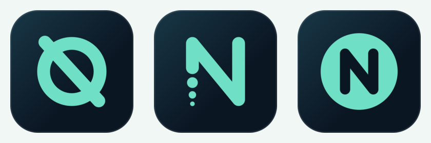
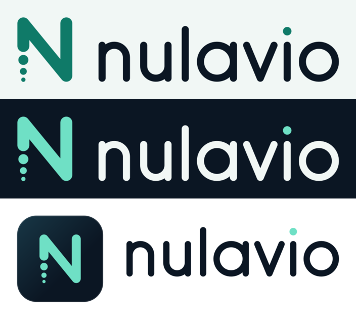
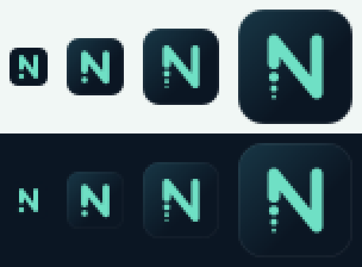

# Brand explorations

Three distinct directions were explored, then one was selected against weighted criteria. Contrast figures are WCAG 2.2 ratios computed with [`scripts/brand/contrast.py`](../../scripts/brand/contrast.py).

## A. Obsidian Current — sophisticated minimalism, navy, technical

**Concept.** Deep water at night: a dark, still surface with one clear signal moving through it. Precision instruments, nautical charts, terminal calm. The mint accent is the "signal" (the route, the active state); everything else recedes.

**Abstract references.** Night navigation charts; sonar displays; brushed obsidian; the single lit buoy on a dark sea; a quiet terminal at 2 a.m.

| Role | Name | HEX |
|---|---|---|
| Canvas (dark) | Deep Navy | `#0B1623` |
| Surface (dark) | Ocean Slate | `#183746` |
| Accent / signal | Mint Signal | `#6FE0C5` |
| Accent on light | Mint 700 | `#0F7A68` |
| Canvas (light) | Cloud White | `#F1F7F5` |
| Warning | Warning Amber | `#E7AE61` (text on light: `#8A5A10`) |
| Critical | Critical Red | `#E26D70` (text on light: `#A8323A`; on dark raised: `#EE8A8C`) |

**Pros.** Excellent dark-theme contrast (Mint on Deep Navy **11.40:1**, Cloud on Navy **16.79:1**). Distinct from competitors' hues: Firefox orange/purple, Brave orange, Proton and Tor purple, LibreWolf blue. Feels technical without hacker clichés. Strong small-icon silhouette (light mark on dark tile).

**Cons.** Navy is common in security branding, so the mint and the symbol must carry recognition. Mint is unusable as text on light backgrounds (**1.47:1**) and needs the darker Mint 700 there (**4.84:1**). Risk of feeling cold.

## B. Quiet Signal — warm, discreet privacy

**Concept.** A well-lit reading room: paper, ink, a sage plant, a clay cup. Privacy as comfort and personal space, not as defence.

**Abstract references.** Japanese stationery; linen paper; museum wall labels; library silence; ceramic glazes.

| Role | Name | HEX |
|---|---|---|
| Ink (text/dark canvas) | Ink | `#1E1F24` |
| Surface (dark) | Graphite | `#2D2F36` |
| Canvas (light) | Paper | `#F6F3EE` |
| Calm accent | Sage | `#9CC5A1` |
| Warm accent | Clay | `#C9845E` |
| Neutral | Fog | `#D9D6CF` |
| Warning | Ochre | `#C99A3E` |
| Critical | Brick | `#B4544A` |

**Pros.** Very approachable; Ink on Paper **14.86:1**; humane, editorial quality; stands out from "security blue".

**Cons.** Accents fail on light backgrounds (Sage **1.74:1**, Clay **2.73:1**, Ochre **2.32:1**) and would need darker twins. Brick on Paper is **4.40:1**, just under AA for text. Low energy at icon sizes. Reads as a notes or reading app more than a browser.

## C. Open Horizon — navigation, openness, autonomy

**Concept.** Dawn at sea: the moment the horizon becomes visible. Freedom of movement, an open web, optimism.

**Abstract references.** Sunrise gradients over water; nautical flags; aviation wayfinding; open maps.

| Role | Name | HEX |
|---|---|---|
| Ink / dark canvas | Midnight | `#0E1A2B` |
| Primary | Horizon Blue | `#2F6FE4` |
| Energy accent | Dawn Coral | `#FF8A65` |
| Light tint | Sky | `#CFE3FF` |
| Canvas (light) | Sand | `#F7F1E8` |
| Secondary | Sea Teal | `#1FA39A` |
| Warning | Signal Yellow | `#F2B33D` |
| Critical | Flare Red | `#E5484D` |

**Pros.** Energetic and friendly; strong storytelling (navigation, horizon); Coral on Midnight **7.55:1**.

**Cons.** Horizon Blue sits near Firefox, Edge, Chrome and LibreWolf blues. Blue on Sand is **4.14:1** and blue on Midnight **3.76:1**: both fail AA for text. Coral (**2.06:1**) and Teal (**2.77:1**) fail on light. A sunrise gradient drifts towards crypto/VPN aesthetics. Busy at 16 px.

## Selection

Scores 1–5, weighted.

| Criterion | Weight | A Obsidian Current | B Quiet Signal | C Open Horizon |
|---|---:|---:|---:|---:|
| Accessibility potential (AA in both themes with minimal twins) | 25% | 5 | 3 | 2 |
| Differentiation from browser competitors | 20% | 4 | 4 | 2 |
| Fit with personality (calm, precise, trustworthy, not hacker-cliché) | 20% | 5 | 4 | 3 |
| Small-icon legibility (16–24 px) | 15% | 5 | 3 | 3 |
| Linux desktop harmony (Breeze/Adwaita, light + dark) | 10% | 4 | 4 | 3 |
| Longevity (not trend-bound) | 10% | 4 | 5 | 2 |
| **Weighted total** | | **4.60** | **3.70** | **2.45** |

**Selected: A — Obsidian Current**, with two adjustments taken from the analysis:

1. Each accent and status colour has a **light-theme twin** that passes AA (Mint 700, Amber 700, Red 700), plus a critical-text twin for dark raised surfaces. All 29 token pairs pass ([tokens.json](tokens.json)).
2. Borrowed from B: the **"secure" state is neutral** (no green or mint), and warmth comes from generous spacing and soft radii rather than colour. Mint means "Nulavio / active / your route", never "safe".

## Logo studies

| Study | Idea | Verdict |
|---|---|---|
| **A — Null Course** | A zero ring crossed by a course line (Ø fused with N) | **Rejected:** reads as a prohibition sign and as a generic ad-blocker glyph; the null-set symbol is not ownable |
| **B — Vanishing Route** | An N drawn as one navigation route (round joins, like a plotted course). Its origin, the bottom of the first stroke, dissolves into three shrinking points: the route continues, the trail does not. It exits top-right towards an open horizon | **Selected** |
| **C — Null Disc** | An N cut from a disc (zero) | **Rejected:** generic letter-in-a-circle, weak distinctiveness, heavy at 16 px |

Why B: it fuses the brief's four ideas, N, null, route/navigation and the space beyond, with one gesture. It is not a shield, padlock, eye or globe. At 16 px it reduces cleanly to an N with one point, using pixel-tuned masters. An earlier variant dissolved the *end* of the route; at small sizes it read as "Ni" (N + i-dot). It was replaced by the dissolving *origin*, which also tells a better story: what is behind you fades.

