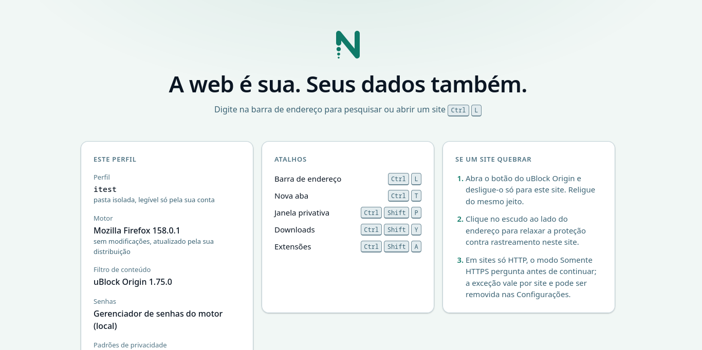
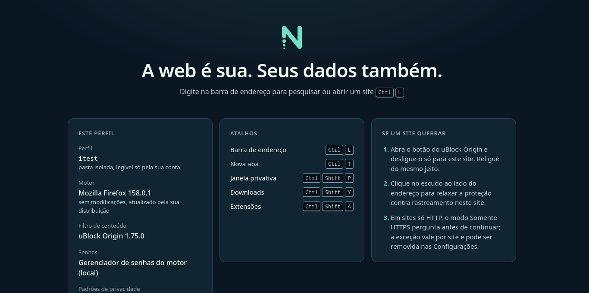
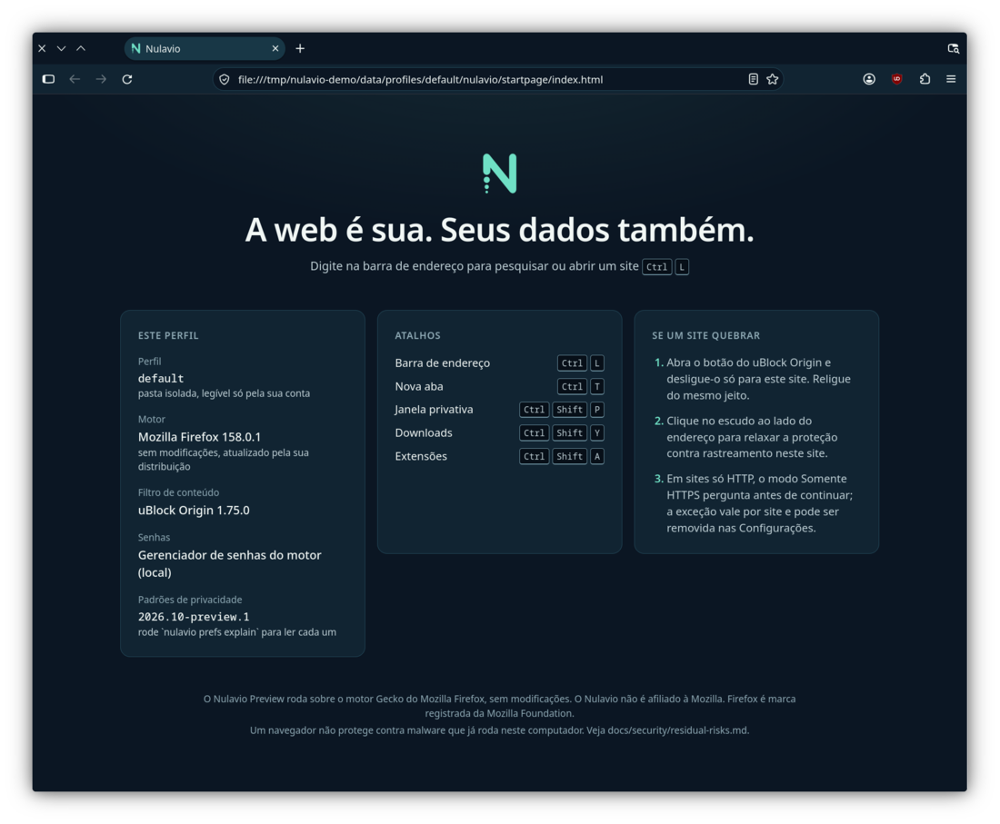

# Brand guidelines

Brand: **A — Obsidian Current**, UI system v2: **Farol** ([explorations](explorations.md)). Tokens: [tokens.json](tokens.json). Assets: [assets/](assets/). Everything here is generated by `scripts/brand/build_logo.py`, `build_icons.py` and `build_tokens.py` and is covered by tests.

## 1. The symbol — "Vanishing Route"

An **N** drawn as a single navigation route with round joins. Its origin (bottom of the first stroke) dissolves into three shrinking points; it exits at the top right towards an open horizon. *Browse forward. Leave no trail.*

| Asset | File | Use |
|---|---|---|
| App icon (tile) | `assets/icons/hicolor/scalable/apps/nulavio.svg`, PNG 16–512 | Launchers, docks, task managers, stores |
| Symbol, mint | `assets/logo/nulavio-symbol.svg` | On dark backgrounds (Deep Navy, Ocean Slate) |
| Symbol, Mint 700 | `assets/logo/nulavio-symbol-dark-on-light.svg` | On light backgrounds |
| Symbol, adaptive | `assets/logo/nulavio-symbol-adaptive.svg` | UI that follows the colour scheme (the browser window's tab, toolbar and sidebar icons): Mint 700, mint when the scheme is dark |
| Monochrome | `assets/logo/nulavio-mono-black.svg`, `nulavio-mono-white.svg` | Single-colour print, embossing, legal |
| Symbolic (desktop) | `assets/icons/hicolor/symbolic/apps/nulavio-symbolic.svg` | KDE/GNOME panels and menus; recoloured by the desktop (`ColorScheme-Text`, `currentColor`) |
| Wordmark | `assets/logo/nulavio-wordmark.svg` (navy), `-light.svg` (cloud), `-mono-black.svg` | Text-only contexts |
| Lockups | `assets/logo/nulavio-lockup-horizontal*.svg` | Website header, README, slides |
| Favicon | `assets/favicon/favicon.svg`, `favicon.ico` (16/32/48) | Web |

Small sizes use dedicated masters: **16 px** (`icons/masters/nulavio-16.svg`, 2 px stems on pixel centres, a single point) and **24 px** (`nulavio-24.svg`, heavier stroke, a single point). Larger sizes use the scalable source. See the [small-size review](assets/review/small-size-review.png).

## 2. Clear space and minimum sizes

- Unit **s** = the symbol's stroke width (10 units on the 96-unit grid, about 18% of the mark's height).
- **Clear space:** at least **2 s** on every side of the symbol, wordmark or lockup. For the tile, keep at least 1/8 of the tile size.
- **Minimum sizes**

| Asset | Digital | Print |
|---|---|---|
| App icon / tile | 16 px (use the 16 px master) | 6 mm |
| Bare symbol | 16 px tall | 5 mm |
| Wordmark | 64 px wide | 18 mm |
| Horizontal lockup | 112 px wide | 30 mm |

## 3. Colour usage

| Context | Symbol | Wordmark | Background |
|---|---|---|---|
| Dark UI / marketing | Mint Signal `#6FE0C5` | Cloud White `#F1F7F5` | Deep Navy `#0B1623` or Ocean Slate `#183746` |
| Light UI / documents | Mint 700 `#0F7A68` | Deep Navy `#0B1623` | Cloud White `#F1F7F5` or white |
| Single colour | Black or white | Same | Any with ≥ 3:1 contrast |
| App icon | Mint on navy tile (fixed, theme-independent) | — | Any |

Mint means **Nulavio / your route / active**. It **never means "safe"**: the secure state is neutral (`color.*.status.secure`), and warnings always pair colour with an icon and words.

## 4. Prohibited uses

1. Recolouring the symbol outside the palette, adding gradients to the mark, or adding glows, outlines or 3D effects.
2. Rotating, skewing, mirroring or stretching any asset.
3. Removing, adding or rearranging the three points above 24 px. Below 24 px, use only the official single-point masters.
4. Placing the mint symbol on light backgrounds (1.47:1 contrast); use Mint 700.
5. Typesetting the wordmark in a font, or changing its letter spacing.
6. Combining the mark with shields, padlocks, eyes, globes, crypto coins or VPN-style imagery.
7. Placing Mozilla, Firefox or any third-party logo next to the Nulavio mark as if endorsed.
8. Placing the bare symbol on busy photos. Use the tile.
9. Using "Nulavio" in a product name of a fork without permission once the mark is registered.

## 5. Typography

| Role | Typeface | Licence | Why |
|---|---|---|---|
| Browser chrome | **System UI font** (Noto Sans on KDE, Cantarell or Adwaita Sans on GNOME) | — | Respects desktop settings, scaling and accessibility |
| Brand, internal pages | **Inter** | SIL OFL 1.1 | Designed for screens, large x-height, tabular figures, variable weights. *Not bundled yet; falls back to the system font.* |
| Technical (URLs, hashes, keys) | **JetBrains Mono** | SIL OFL 1.1 | Clear `0/O`, `1/l/I` distinction |

Evaluated alternatives: **Atkinson Hyperlegible Next** (OFL; excellent letter differentiation; candidate for an accessibility reading mode); **IBM Plex Sans** (OFL; strongly associated with IBM); **Noto Sans** (OFL; broad scripts; used as fallback). The wordmark is custom-drawn geometry (monoline, round terminals, same stroke logic as the symbol) and needs no font.

Legacy type scale (px, API retained): 12 · 13 · 14 (UI body) · 16 (page body) · 20 · 24 · 32 · 44. Line height 1.5 for body and 1.2 for headings. New `type.{body,label,caption,title,section,code}` roles use 1 / .875 / .8125 / 1.5 / 1.25 / .875 rem, with existing medium/semibold weights and normal/tight line heights.

## 6. Layout tokens

Spacing on a 4 px base: 2 · 4 · 8 · 12 · 16 · 24 · 32 · 48 · 64. Radius: 4 · 6 · 10 · 14 · 20 · pill; app icon tile 22.5%. Elevation: 3 levels (`0 1px 2px`, `0 4px 12px`, `0 12px 32px`, navy-tinted shadows). Light shadows use navy at .14 opacity; dark shadows use black at .24 / .45 / .5. The existing `--nv-elevation-1/2/3` names switch by theme. Motion retains 120 / 180 / 280 ms and standard easing; enter is `cubic-bezier(0, 0, 0, 1)` and exit is `cubic-bezier(.3, 0, 1, 1)`. Reduced variants are 0 ms and linear; consumers apply them under `prefers-reduced-motion`. Security cues remain opaque and static.

## 7. Iconography

20 px grid, **1.75 px stroke**, round caps and joins, echoing the route. Outline style; fills only for small status dots. Status icons always come with a text label. No padlock as a "safe" badge: the address bar uses a neutral site-information icon for HTTPS and reserves labelled warnings for HTTP, mixed content and certificate errors.

## 8. States

| State | Treatment |
|---|---|
| Hover | Text colour at 8% over the surface |
| Pressed | 12% |
| Focus | 2 px ring in `color.*.focus`, 2 px offset; never removed |
| Disabled | 45% opacity, no pointer, still readable by screen readers |
| Loading | Skeleton blocks in `bg.sunken`; spinner only after 400 ms |
| Empty | One sentence explaining why it is empty plus one action |
| Error | `status.critical` icon + title + plain explanation + action + "what happens next" |
| Success | Quiet inline confirmation; no confetti |

## 9. Light and dark identity

Both themes come from the same semantic tokens. Dark is the brand's "home" (navy canvas, mint route); light uses Cloud White and Mint 700.

| Light | Dark |
|---|---|
|  |  |

Preview in a real KDE Plasma (Wayland) window, Track A chrome theme:

## 10. Farol system and contrast

`color.{light,dark}.band` defines the trusted band. Identity fills are lima, sky, violet, coral, sand and slate; `identity.on` and `identity.ring` are ink #070F18. Mint remains the brand/active accent. Identity uses a name or glyph plus the fill and ring; it never conveys security state alone. The drawing module keeps its existing `on` ink key. Persisted mint/rose migration is implemented by the profiles owner.

`color.*.security` reserves private plum with dots, temporary neutral with dashes, agent ink with a double frame/lines, raw automation red with diagonal stripes, and Guard amber. `security.pattern` names that grammar; consumers implement the shapes with words and glyphs, including forced-colour alternatives. `color.*.group` is the separate tab-group palette; legacy orange/purple/red remain muted. Selection and focus-on-accent use the existing accent/on pair. Scrims use ink at .55 opacity. Z-index roles follow the approved mockup: base 0, Guard 4, navigation 5, band 6, popover 30, security 40 (within the owning stacking context; engine warnings retain their precedence).

Frost is opt-in on Shell new-tab cards only: light white at .86, dark navy 850 at .88, 20 px blur. `translucency.frost.*.opacityFloor` is the minimum permitted alpha; the generator checks it against the surface alpha and requires an opaque fallback. Solid fallback is white/light and navy 850/dark. Reduced transparency, unsupported compositing and default chrome use the solid surface. No security signal uses translucency.

The single `nulavio.contrast` list declares every check. Opaque pairs use `fg`, `bg` and `min` token references/minimum ratio. Composited pairs add a nonempty `backdrops` list of opaque colour token references; optional `opacity` is a 0–1 number or a numeric-token path applied to the surface alpha. Foreground alpha is then composited over that result. Compositing happens in sRGB before WCAG relative luminance; ratio calculations retain fractional channels. Hex colours in the Markdown report are rounded for display only.

Run `python3 -I scripts/brand/contrast.py --report` for the complete expanded table or `--json` for the exact checked set, backdrop, opacity and measured ratio. Missing references, malformed colours/alpha and undeclared backdrops fail validation; ratios below the declared minimum fail the check. These checks cover declared combinations, not WCAG conformance of a rendered interface. Focus, scaling, state recognition and real-desktop rendering still require consumer-level verification.

The generator preserves existing font-size, spacing, radius, elevation and motion variable names. Any token path containing a `light`/`dark` segment requires the same typed counterpart. Page CSS supports system scheme and `data-theme` overrides; chrome colours use `light-dark()`, while theme-dependent shadows and numbers use media rules.
