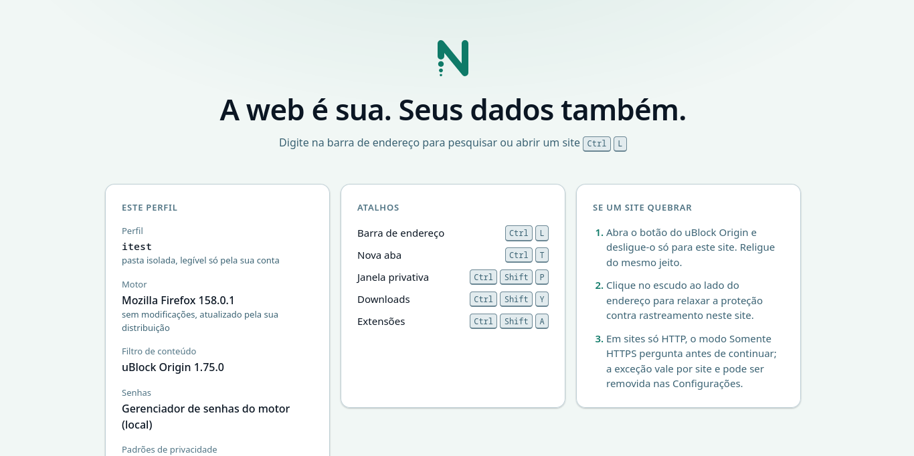
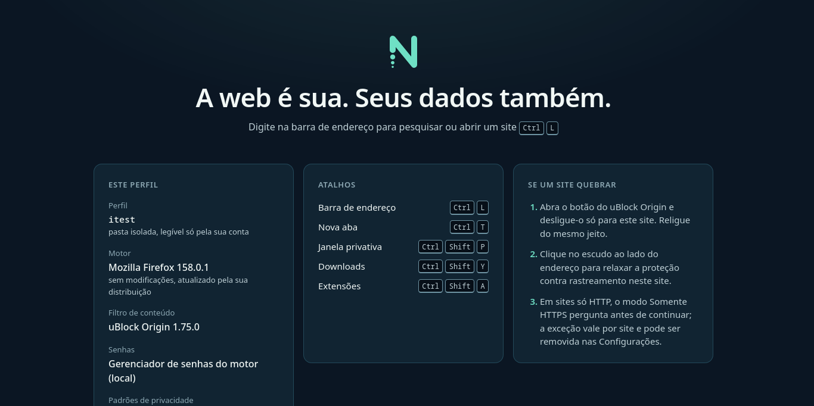
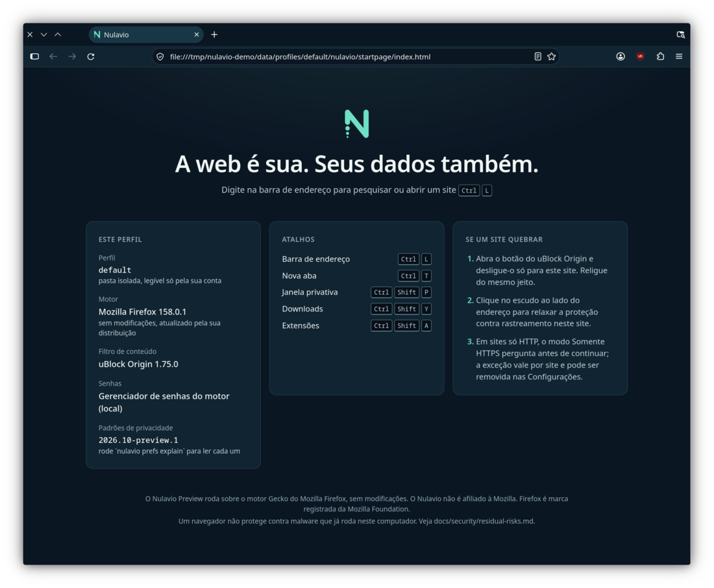

# Brand guidelines

Brand: **A — Obsidian Current**, UI system v2: **Farol** ([explorations](explorations.md)). Tokens: [tokens.json](tokens.json). Assets: [assets/](assets/). Everything here is generated by `scripts/brand/build_logo.py`, `build_icons.py`, `build_tokens.py` and `build_social.py` and is covered by tests.

Revised on 2026-11-27 (#175): the lockup writes the name with the symbol as its initial, the app icon draws the route larger in its tile, and the secure status artwork is neutral. The [brand review of 2026-11](review-2026-11.md) has the audit, the proposals and the maintainer's choice (proposal A); the [explorations](explorations.md#revision-2026-11-the-route-is-the-initial-175) say why.

## 1. The symbol — "Vanishing Route"

An **N** drawn as a single navigation route with round joins. Its origin (bottom of the first stroke) dissolves into three shrinking points; it exits at the top right towards an open horizon. *Browse forward. Leave no trail.*

| Asset | File | Use |
|---|---|---|
| App icon (tile) | `assets/icons/hicolor/scalable/apps/nulavio.svg`, PNG 16–512; the same tile in `assets/logo/nulavio-tile.svg` | Launchers, docks, task managers, stores |
| Symbol, mint | `assets/logo/nulavio-symbol.svg` | On dark backgrounds (Deep Navy, Ocean Slate) |
| Symbol, Mint 700 | `assets/logo/nulavio-symbol-dark-on-light.svg` | On light backgrounds |
| Symbol, adaptive | `assets/logo/nulavio-symbol-adaptive.svg` | UI that follows the colour scheme (the browser window's tab, toolbar and sidebar icons): Mint 700, mint when the scheme is dark |
| Monochrome | `assets/logo/nulavio-mono-black.svg`, `nulavio-mono-white.svg` | Single-colour print, embossing, legal |
| Symbolic (desktop) | `assets/icons/hicolor/symbolic/apps/nulavio-symbolic.svg` | KDE/GNOME panels and menus; recoloured by the desktop (`ColorScheme-Text`, `currentColor`) |
| Wordmark | `assets/logo/nulavio-wordmark.svg` (navy), `-light.svg` (cloud), `-mono-black.svg` | Text-only contexts |
| Lockup ("N" + "ulavio") | `assets/logo/nulavio-lockup-horizontal.svg` (Mint 700 and navy), `-on-dark.svg` (mint and cloud), `-mono-black.svg`, `-mono-white.svg` | Wherever the name is shown as a logo: website header and footer, README, link previews, social art, the About dialog |
| Companion adaptive icon | `android/app/src/main/res/drawable/ic_launcher_foreground.xml` (generated) on a Deep Navy layer | Android launchers, themed icons |
| Social art | `assets/social/` ([§11](#11-social-media-art)) | Profile avatar and header, post cards |
| Favicon | `assets/favicon/favicon.svg`, `favicon.ico` (16/32/48) | Web |

**The lockup.** The symbol is the name's capital: the route, at the wordmark's stroke and between its ascender and its baseline, with its three points under the first stem, then "ulavio". The symbol is never set beside the whole wordmark ("N nulavio"), and there is no lockup of the tile with the name. The one place the icon tile and the name appear together is an application's About dialog, which pairs every application's icon with its name; there the name is this lockup.

**The app icon.** From 32 px up the route is drawn 15 % larger than the symbol's own box, centred on the tile: 55 % of its width and 65 % of its height, the proportion of the 16 px master.

Small sizes use dedicated masters: **16 px** (`icons/masters/nulavio-16.svg`, 2 px stems on pixel centres, a single point) and **24 px** (`nulavio-24.svg`, heavier stroke, a single point). Larger sizes use the scalable source. See the [small-size review](assets/review/small-size-review.png).

## 2. Clear space and minimum sizes

- Unit **s** = the symbol's stroke width (10 units on the 96-unit grid, about 18% of the mark's height).
- **Clear space:** at least **2 s** on every side of the symbol and the wordmark. For the lockup, **s** is its letters' stroke (7 units of its 64-unit height, about 11 % of the height): at least 2 s on every side, measured from the outermost point of the trail on the left. For the tile, keep at least 1/8 of the tile size.
- **Minimum sizes**

| Asset | Digital | Print |
|---|---|---|
| App icon / tile | 16 px (use the 16 px master) | 6 mm |
| Bare symbol | 16 px tall | 5 mm |
| Wordmark | 64 px wide | 18 mm |
| Lockup | 89 px wide (letters as large as the old lockup's at 112 px) | 24 mm |

## 3. Colour usage

| Context | Symbol | Wordmark | Background |
|---|---|---|---|
| Dark UI / marketing | Mint Signal `#6FE0C5` | Cloud White `#F1F7F5` | Deep Navy `#0B1623` or Ocean Slate `#183746` |
| Light UI / documents | Mint 700 `#0F7A68` | Deep Navy `#0B1623` | Cloud White `#F1F7F5` or white |
| Lockup | The initial, its points and the dot of the "i" in the symbol's colour (row above) | "ulavio" in the wordmark's colour | As above |
| Single colour | Black or white | Same | Any with ≥ 3:1 contrast |
| App icon | Mint on navy tile (fixed, theme-independent) | — | Any |

Mint means **Nulavio / your route / active**. It **never means "safe"**: the secure state is neutral (`color.*.status.secure`), and warnings always pair colour with an icon and words.

## 4. Prohibited uses

1. Recolouring the symbol outside the palette, adding gradients to the mark, or adding glows, outlines or 3D effects.
2. Rotating, skewing, mirroring or stretching any asset.
3. Removing, adding or rearranging the three points above 24 px, in the symbol or under the lockup's initial. Below 24 px, use only the official single-point masters.
4. Placing the mint symbol on light backgrounds (1.47:1 contrast); use Mint 700.
5. Typesetting the wordmark or the lockup in a font, or changing their letter spacing.
6. Setting the symbol or the app icon beside the whole wordmark ("N nulavio"), or replacing the lockup's initial with a typed capital.
7. Combining the mark with shields, padlocks, eyes, globes, crypto coins or VPN-style imagery. (The Settings privacy status replaces the engine's own shield picture with a neutral one: it is that page's status artwork, never shown with the mark.)
8. Placing Mozilla, Firefox or any third-party logo next to the Nulavio mark as if endorsed.
9. Placing the bare symbol on busy photos. Use the tile.
10. Using "Nulavio" in the product name of a fork without permission.

## 5. Typography

| Role | Typeface | Licence | Why |
|---|---|---|---|
| Browser chrome | **System UI font** (Noto Sans on KDE, Cantarell or Adwaita Sans on GNOME) | — | Respects desktop settings, scaling and accessibility |
| Brand, internal pages | **Inter** | SIL OFL 1.1 | Designed for screens, large x-height, tabular figures, variable weights. *Not bundled yet; falls back to the system font.* |
| Technical (URLs, hashes, keys) | **JetBrains Mono** | SIL OFL 1.1 | Clear `0/O`, `1/l/I` distinction |

Evaluated alternatives: **Atkinson Hyperlegible Next** (OFL; excellent letter differentiation; candidate for an accessibility reading mode); **IBM Plex Sans** (OFL; strongly associated with IBM); **Noto Sans** (OFL; broad scripts; used as fallback). The wordmark is custom-drawn geometry (monoline, round terminals, same stroke logic as the symbol) and needs no font.

Legacy type scale (px, API retained): 12 · 13 · 14 (UI body) · 16 (page body) · 20 · 24 · 32 · 44. Line height 1.5 for body and 1.2 for headings. New `type.{body,label,caption,title,section,code}` roles use 1 / .875 / .8125 / 1.5 / 1.25 / .875 rem, with existing medium/semibold weights and normal/tight line heights.

## 6. Layout tokens

Spacing on a 4 px base: 2 · 4 · 8 · 12 · 16 · 24 · 32 · 48 · 64. Radius: 4 · 6 · 10 · 14 · 20 · pill; app icon tile 22.5%. Elevation: 3 levels (`0 1px 2px`, `0 4px 12px`, `0 12px 32px`, navy-tinted shadows). Light shadows use navy at .14 opacity; dark shadows use black at .24 / .45 / .5. The existing `--nv-elevation-1/2/3` names switch by theme. Motion retains 120 / 180 / 280 ms and standard easing; enter is `cubic-bezier(0, 0, 0, 1)` and exit is `cubic-bezier(.3, 0, 1, 1)`. Reduced variants are 0 ms and linear; consumers apply them under `prefers-reduced-motion`. Security cues remain opaque and static.

## 7. Iconography

20 px grid, **1.75 px stroke**, round caps and joins, echoing the route. Outline style; fills only for small status dots. Status icons always come with a text label. No padlock as a "safe" badge: the address bar uses a neutral site-information icon for HTTPS and reserves labelled warnings for HTTP, mixed content and certificate errors.

## 8. States

| State | Treatment |
|---|---|
| Hover | Text colour at 8% over the surface |
| Pressed | 12% |
| Focus | 2 px ring in `color.*.focus`, 2 px offset; never removed |
| Disabled | 45% opacity, no pointer, still readable by screen readers |
| Loading | Skeleton blocks in `bg.sunken`; spinner only after 400 ms |
| Empty | One sentence explaining why it is empty plus one action |
| Error | `status.critical` icon + title + plain explanation + action + "what happens next" |
| Success | Quiet inline confirmation; no confetti |

## 9. Light and dark identity

Both themes come from the same semantic tokens. Dark is the brand's "home" (navy canvas, mint route); light uses Cloud White and Mint 700.

| Light | Dark |
|---|---|
|  |  |

Preview in a real KDE Plasma (Wayland) window, Track A chrome theme:

## 10. Farol system and contrast

`color.{light,dark}.band` defines the trusted band. Identity fills are lima, sky, violet, coral, sand and slate; `identity.on` and `identity.ring` are ink #070F18. Mint remains the brand/active accent. Identity uses a name or glyph plus the fill and ring; it never conveys security state alone. The drawing module keeps its existing `on` ink key. Persisted mint/rose migration is implemented by the profiles owner.

`color.*.security` reserves private plum with dots, temporary neutral with dashes, agent ink with a double frame/lines, and Guard amber. (Raw automation's red with diagonal stripes went with raw automation, #463, #509.) `security.pattern` names that grammar; consumers implement the shapes with words and glyphs, including forced-colour alternatives. `color.*.group` is the separate tab-group palette; legacy orange/purple/red remain muted. Selection and focus-on-accent use the existing accent/on pair. Scrims use ink at .55 opacity. Z-index roles follow the approved mockup: base 0, Guard 4, navigation 5, band 6, popover 30, security 40 (within the owning stacking context; engine warnings retain their precedence).

Frost is opt-in on Shell new-tab cards only: light white at .86, dark navy 850 at .88, 20 px blur. `translucency.frost.*.opacityFloor` is the minimum permitted alpha; the generator checks it against the surface alpha and requires an opaque fallback. Solid fallback is white/light and navy 850/dark. Reduced transparency, unsupported compositing and default chrome use the solid surface. No security signal uses translucency.

The single `nulavio.contrast` list declares every check. Opaque pairs use `fg`, `bg` and `min` token references/minimum ratio. Composited pairs add a nonempty `backdrops` list of opaque colour token references; optional `opacity` is a 0–1 number or a numeric-token path applied to the surface alpha. Foreground alpha is then composited over that result. Compositing happens in sRGB before WCAG relative luminance; ratio calculations retain fractional channels. Hex colours in the Markdown report are rounded for display only.

Run `python3 -I scripts/brand/contrast.py --report` for the complete expanded table or `--json` for the exact checked set, backdrop, opacity and measured ratio. Missing references, malformed colours/alpha and undeclared backdrops fail validation; ratios below the declared minimum fail the check. These checks cover declared combinations, not WCAG conformance of a rendered interface. Focus, scaling, state recognition and real-desktop rendering still require consumer-level verification.

The generator preserves existing font-size, spacing, radius, elevation and motion variable names. Any token path containing a `light`/`dark` segment requires the same typed counterpart. Page CSS supports system scheme and `data-theme` overrides; chrome colours use `light-dark()`, while theme-dependent shadows and numbers use media rules.

## 11. Social media art

Generated by `python3 -I scripts/brand/build_social.py` from the marks above and the tokens, into [`assets/social/`](assets/social/). Text is set in Noto Sans (the brand's documented fallback while Inter is not bundled), on the dark scheme with the link preview's mint glow; no picture is drawn by hand or by a model.

| File | Size | Where it goes |
|---|---|---|
| `profile/avatar.png` | 400 × 400 | The X profile photo ([x.com/getnulavio](https://x.com/getnulavio)); also fits other circle crops. The tile's gradient runs full bleed, so a circle shows no corner, and the route is the app icon's |
| `profile/header-en.png`, `header-pt-BR.png` | 1500 × 500 | The X header. The name and the tagline sit right of the avatar's place (bottom left) and clear of the 60 px bands phones may crop |
| `posts/<format>-<lang>.png` | 16:9 1600 × 900, 1:1 1080 × 1080, 4:5 1080 × 1350, 9:16 1080 × 1920; `en` and `pt-BR` | Post cards: a kicker (announcement, release notes, feature), a title, a line of text and a footer. 9:16 keeps the top 250 px and the bottom 340 px clear for a story's own controls |
| `crop-check.png` | 1500 × 960 | The avatar in a circle at 400 and 48 px on black and white, at those sizes when the sheet is seen at its own, and the header with the avatar's place and the cropped bands drawn over it: this script's approximation, not X's own page |
| `github/social-preview.png` | 1280 × 640 | GitHub's social preview of the repository ([link previews](#link-previews) below) |
| `link-previews.png` | 1860 × 892 | The GitHub image and the site's two link-preview images side by side: 600 px wide; 300 px wide with the centre square beside each; the centre crops of the GitHub image at 1.91:1 and 16:9 and of the site's English image at 16:9. This script's approximation, not a capture of a network |

A new post: write its text as JSON (`{"lang": "pt-BR", "kicker": "Novidades", "title": "…", "body": "…", "footer": "nulavio.net"}`) and run `python3 -I scripts/brand/build_social.py post --text post.json --out <dir>`. It writes the four formats, or none. A text that does not fit one of them, a rasteriser that fails, or a file that cannot be put in place (a directory of the same name, for one) leaves the directory as it was, and absent if it was absent. The files are made aside and moved in together, with the directory locked for the move: a second run into the same directory at that moment is refused. Only a run that is killed while it moves its files in can leave some of them.

- **What fits.** Lines are measured with Noto Sans' own advance widths, which the script holds. The title and the body wrap at spaces, and never at a no-break space (U+00A0), which keeps a number with its unit; a line break in them is a line (LF, CR LF, CR, or Unicode's line and paragraph separators), and white space around them is not. The kicker and the footer are one line each. A word, a kicker or a footer wider than the card is refused, and so is a text too tall for a format.
- **Which characters.** Basic Latin, Latin-1 (every letter of Portuguese and English) and common punctuation (dashes, curly quotes, the ellipsis, the bullet, €, ™). Another character is refused, because its width is not known to the script and a host without the glyph would draw it in another font; that includes white space other than the space, the tab, the no-break space and the line breaks above. Noto Sans has no arrows.
- **Which language.** `lang` is a language tag built as BCP 47 builds the common ones: a language, then at most one script, one region and variants (`en`, `pt-BR`, `es-419`, `zh-Hant-TW`). It goes into the file names and into `xml:lang`. A tag that is not built that way is refused; whether its subtags are registered is not checked.
- **For screen readers.** Each image is one picture (`role="img"`): its name is "Nulavio" and the title, its description is the rest of the visible text (the kicker, the body and the footer; the tagline on a header), and its language is declared on the image. The SVG files carry this; a network takes a PNG, so write the same text as the post's alternative text.

Uploading the avatar and the header, and posting, are the maintainer's (#176).

### Link previews

What a link to Nulavio shows when it is shared (#199). Two destinations, two compositions, one identity:

| Link | Image | Says | Made by |
|---|---|---|---|
| `github.com/nulavio/nulavio` | `assets/social/github/social-preview.png`, 1280 × 640, RGB without alpha, about 110 kB | The name as the picture, "An open-source browser for Linux." and `nulavio.net`. English, the repository's language: GitHub takes one image for every reader | `build_social.py` (the `.svg` beside it is the source) |
| `nulavio.net`, the pages in Portuguese without a picture of their own | `site/assets/og-pt.png`, 1200 × 630, about 140 kB | "A web é sua. Seus dados também.", the tagline, the waitlist and the address | `scripts/site/og-template.html`, captured at 1200 × 630 with `?lang=pt` (the command is at the top of that file) |
| `nulavio.net/en/`, the pages in English without a picture of their own | `site/assets/og-en.png`, 1200 × 630, about 130 kB | "Your web. Your rules.", the tagline, the waitlist and the address | The same template with `?lang=en` |

- **GitHub's image describes the project and promises nothing.** Its line says what the project is; no badge, no count, no claim about protection. It does not name the engine: [the rule](strategy.md) is that a mention of it comes with the notice that Nulavio is not affiliated with Mozilla, and a picture has no room for one. The site's images carry the landing's own headline and tagline. A change of either text is a change of copy: the maintainer approves it, and on the site it changes in both languages and in `LINK_PREVIEW` of `scripts/site/build_site.py`, which holds each image's alternative text (a test compares it with the template).
- **No capture of the browser yet.** The captures in `site/assets/shots/` are of a 159.0 build at commit f08daf3, taken on 2026-11-04 (their `manifest.json`), before the identity of #858 and several releases ago. A capture belongs in these images once `scripts/site/capture_site.py` has run on a current build; until then the right of the GitHub image holds a detail of the mark, its stem and points, in a quiet tone.
- **What is read stays inside a 96 px margin** on the GitHub image, which a centre crop to 1.91:1 or 16:9 keeps whole (the crops are the script's assumption of what a network may do, read from no network's documentation). The name is 640 px wide there and 264 px wide on the site's images, so that it is still read at 300 px. A centre square, should an app cut one for a small thumbnail, cuts the left-aligned text of all three: `link-previews.png` shows it, and nothing here claims otherwise.
- **Sizes.** GitHub's page on the social preview, read on 2026-11-27, asks for a PNG, JPG or GIF under 1 MB, at least 640 × 320 and 1280 × 640 for best display, and advises a solid background. The site's images stay under 300 kB, this project's own budget for a picture a crawler fetches (the site's test holds both to it).
- **Type.** The GitHub image is set in Noto Sans, as the rest of the social art. The template asks for Inter first and falls back to Noto Sans; the committed images were captured with Chromium on Fedora without Inter installed, so they are in Noto Sans too.
- **The site's tags.** The landing and the fingerprinting comparison write their own; `build_site.py` gives every other page that may be listed (download, engineering, waitlist, what's new) the image of its language with the page's own title, description and address, and none to a page behind `noindex`. `tests/unit/test_site.py` reads every built page for them.
- **Setting GitHub's image is the maintainer's**, a repository setting: the repository's page → **Settings** → "Social preview" → **Edit** → **Upload an image…** → `docs/brand/assets/social/github/social-preview.png`. On 2026-11-27 the repository still showed a 1200 × 630 copy of the site's earlier image, with the lockup from before #858. A file in the repository does not replace that setting.
- **After a change, check the real thing.** The file names of the site's images did not change, so every tag already published keeps working; a network shows its cached copy until it fetches the page again (days, on some). Share the link in a draft or a private chat on each network that matters and look; the sheet above is not that check.

