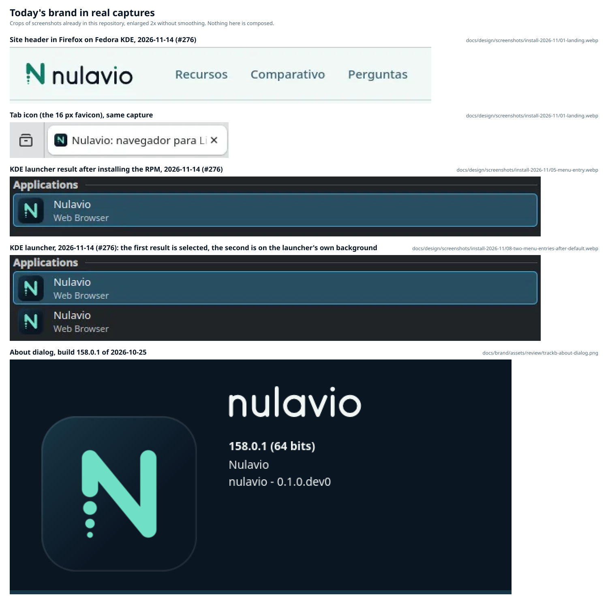
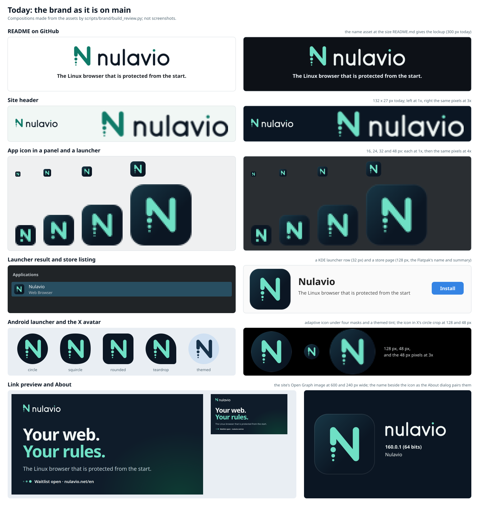
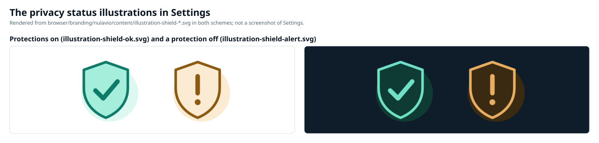
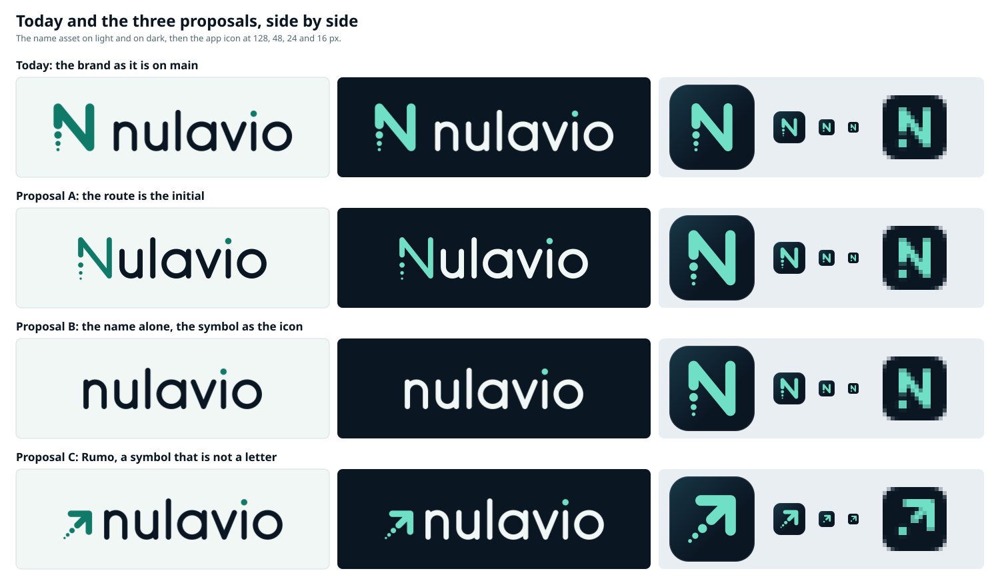
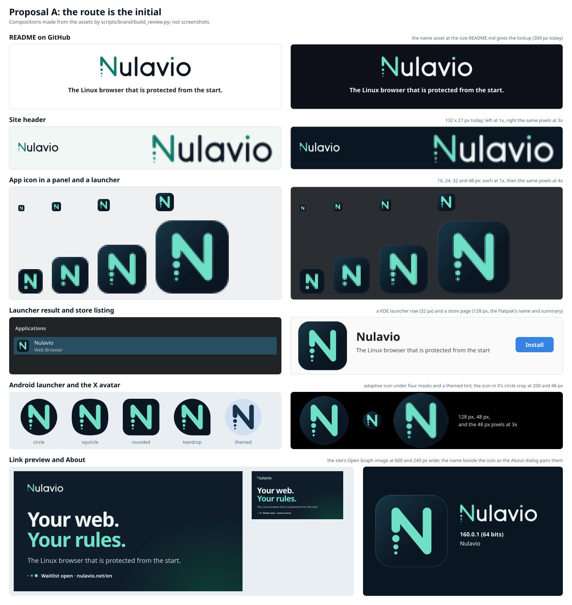
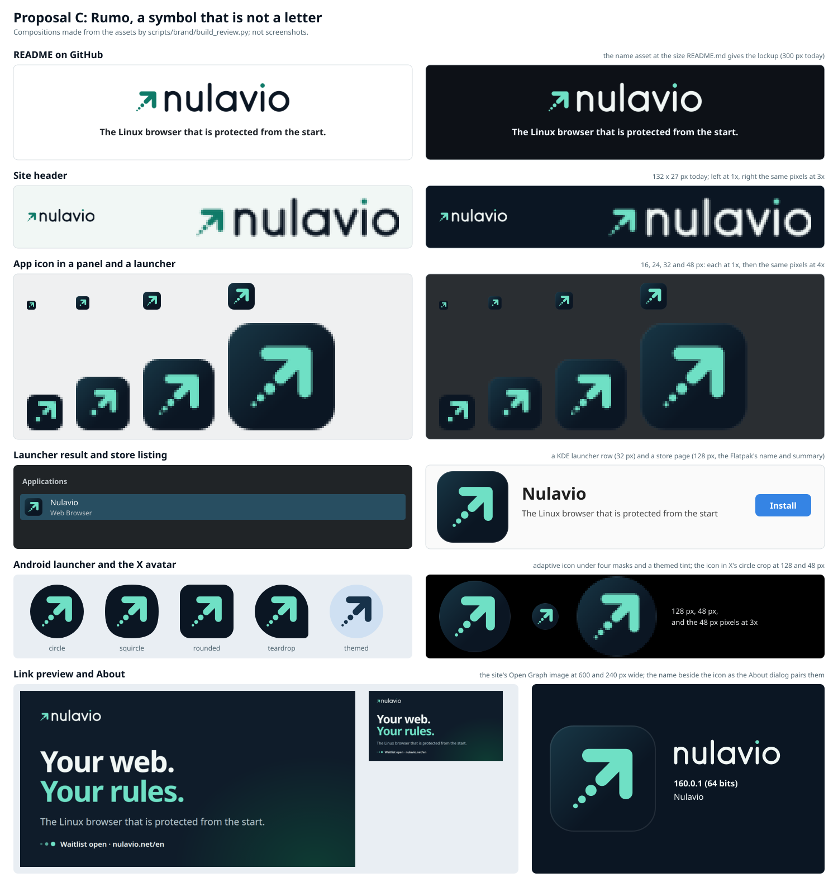
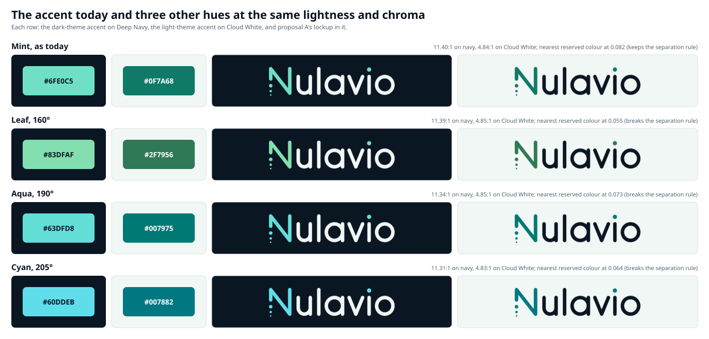

# Brand review, 2026-11

Status: **steps 1 to 3 of [#175](https://github.com/nulavio/nulavio/issues/175): the audit, the references and the proposals. Nothing has been chosen and nothing in the brand has changed.** The approved brand is still the one in the [guidelines](guidelines.md) and the [explorations](explorations.md). The maintainer chooses among the proposals ([what is asked](#4-what-the-maintainer-decides)); applying the choice is step 4 and is not done here.

Scope, decided by the maintainer on 2026-11-14 (recorded in the issue): a refresh. The lockup is fixed, the palette and the symbol are revised and the app icon is redrawn; the name and the brand's ideas (route, null, the trail that fades) stay.

## How this was made

- Looked at and measured on 2026-11-20, on `main` at `87b6644b`.
- Every image here is written by [`scripts/brand/build_review.py`](../../scripts/brand/build_review.py) (`--render`), and the proposed marks under [`assets/review/2026-11/proposals/`](assets/review/2026-11/proposals/) come from the same geometry as the approved ones in `build_logo.py`. None is drawn by hand. `tests/unit/test_brand_review.py` checks that the proposals are the generated ones, that no proposed lockup shows the initial twice, and that the numbers in the tables below are the measured ones.
- Two kinds of evidence, and each image says which it is:
  - **captured**: crops of screenshots that were already in this repository, with their date and source;
  - **composed**: the real asset files placed by the script at the size and on the background of the place they are used (a 16 px icon is a real 16 px render, shown again with its pixels enlarged). A composition is not a screenshot of GitHub, a desktop, a store or a social network.
- Contrast is the WCAG 2.2 ratio from [`scripts/brand/contrast.py`](../../scripts/brand/contrast.py); colour distance is OKLab, the measure the tokens already use for the accent.

## 1. Audit: today's brand where people meet it

| Where | Evidence | Kind |
|---|---|---|
| README, light and dark | lockup at the 300 px `README.md` gives it, on GitHub's two canvas colours | composed |
| Site header | crop of the landing in Firefox on Fedora KDE, 2026-11-14 (#276); lockup at 132 × 27 px at 1× and 3× | captured and composed |
| KDE panel and launcher, 16 to 48 px | crop of the launcher result after installing the RPM, 2026-11-14 (#276); the icon at 16, 24, 32 and 48 px on Breeze's light and dark | captured and composed |
| Tab icon (favicon) | crop of the same landing capture | captured |
| About dialog | capture of build 158.0.1, 2026-10-25 | captured (old build) |
| Store listing (GNOME Software, Flathub, F-Droid) | the 128 px icon beside the Flatpak's name and summary | composed |
| Android launcher (Companion) | the adaptive icon read from the app's resources, under four masks and a themed tint | composed |
| Link preview | the published `site/assets/og-en.png` at 600 and 240 px wide | composed from the real image |
| X profile ([x.com/getnulavio](https://x.com/getnulavio)) | the app icon in the circle crop at 128 and 48 px | composed |
| Settings privacy status | the two illustrations that replace the engine's shields | rendered from the files |

### What the audit found

1. **The initial is shown twice wherever the name is shown.** The horizontal lockup is the symbol, an N, beside the wordmark "nulavio". It is what the README (both languages), the site's header and footer and the link preview show; the About dialog pairs the icon tile with the wordmark the same way. It reads "N nulavio" in all of them.
2. **In the lockup the two parts do not look like one mark.** The symbol's stroke is 1.68 times the wordmark's (10 units beside 7 × 0.85), it is a capital beside lowercase letters, and on light it is a different colour (Mint 700 beside Deep Navy). So the N reads as a letter of its own in front of the word. This is a reading of the measurements, not a measurement.
3. **The trail, which is what makes this N the "Vanishing Route", is nearly gone at the sizes the lockup is used.** In the site header (132 px wide) the three points are 4.1, 2.8 and 1.8 px across; in a 240 px link preview the whole lockup is 47 px wide and the points are 1.5, 1.0 and 0.6 px. The 16 and 24 px icon masters keep one point by design. In most places people see a plain N with one fleck; mint on navy carries the recognition.
4. **On dark surfaces the icon's tile disappears.** The tile against the KDE launcher's background (`#202427`) is 1.16:1, and 1.25:1 at its lightest corner; against black it is 1.15:1 to 1.67:1. The N itself is 11.40:1 on the tile's navy. So on a dark desktop the icon is a mint N without a visible shape around it, as the launcher capture shows. That is acceptable, and it means the mark's size matters more than the tile's.
5. **The mark is smaller in the scalable icon than in the hand-tuned masters.** From 32 px up the N takes 48 % of the tile's width and 56 % of its height; in the 16 px master it takes 50 % and 62 %. In a store listing and in a circle crop the N fills under half the width.
6. **The Companion's adaptive icon is hand-written and slightly off centre.** `ic_launcher_foreground.xml` scales the mark by 0.8 about (54, 54) and then moves it by (6, 5), which puts the mark's centre at (55.2, 54.2) of the 108-unit canvas: 1.2 units to the right. It is small (about half a pixel on a 48 dp icon), and it shows that this file is not generated with the others.
7. **The colours hold.** Every pair the marks use passes (table below). None of the eight references uses teal: their colours sit at 18° to 35° (coral, orange, red), 94° (Mullvad's yellow), 251° to 264° (blue) and 284° to 314° (purple) of OKLCH hue, and mint is at 176°. Deep Navy is close to Mullvad's dark blue (0.100 in OKLab), so navy alone does not set Nulavio apart; mint does. Turning the accent to another hue is measured in [section 3](#the-palette); it is not recommended.
8. **One place shows mint meaning "safe", on a shield.** The Settings privacy status replaces the engine's own artwork with `illustration-shield-ok.svg`: a shield with a check mark in the mint scale (done on purpose in UX3G, "Nulavio shields on the privacy status"). The guidelines say mint never means "safe" (the secure state is neutral, `color.*.status.secure`) and the brand avoids shields. The warning shield in amber is consistent with the status colours.

9. **There is no art for social profiles yet.** No avatar or header file exists in the repository. The app icon works in X's circle crop because the circle lies inside the tile, so no corner shows; the N is then 48 % of the circle's width.

### Not observed

- The X profile as it is today: `x.com` answered an unauthenticated request with HTTP 402 on 2026-11-20, so the avatar and header in use were not seen.
- A real GNOME Software, Flathub or F-Droid listing: none is published yet (#88, #207). A real Android launcher: no device was used. These are compositions.
- GitHub's README rendering and a GNOME desktop were not captured; the README panel uses GitHub's canvas colours (`#FFFFFF`, `#0D1117`).
- The About dialog capture is from 2026-10-25 (build 158.0.1). The dialog of the current build was not captured again.

## 2. References, looked at on 2026-11-20

Each brand's own page was opened on that date and its mark was looked at from the files that page serves. They are described in words and linked; none of their marks is stored here. Names and marks belong to their owners. Colours marked "published" are stated on the page; "in the file" are fills read from the SVG; "sampled" are the dominant colour of the icon and approximate.

| Brand | Page | The mark | How the name is shown | Colour |
|---|---|---|---|---|
| Orion | [orionbrowser.com](https://orionbrowser.com/) | A white four-pointed star among smaller ones on a purple disc | Disc, then "Orion" in a geometric sans | Purple, sampled `#6646B3` |
| Arc | [arc.net](https://arc.net/) | Two overlapping round strokes, coral over blue, that read as an A | The mark alone. On this date the page is "A farewell to Arc" and says Arc is being retired in favour of Dia | Coral `#F25E6B`, blue `#0030EC`, in the file |
| Zen | [zen-browser.app](https://zen-browser.app/) | Three concentric rings on a cream tile (the site's icon) | Not looked at beyond the icon | Coral `#F76F53` on `#F2F0E3`, in the file |
| Mullvad | [mullvad.net/en/press](https://mullvad.net/en/press) | A mole in a yellow helmet on a dark blue disc; a round seal with the motto around it | Disc, then "MULLVAD VPN" in capitals | Published: blue `#294D73`, dark blue `#192E45`, yellow `#FFD524`, green `#44AD4D`, red `#E34039` |
| Proton | [proton.me/media/kit](https://proton.me/media/kit) | A "P" badge in a purple gradient | **The name alone as text; the letter badge is a separate file used as the icon** (`proton-text-…`, `proton-badge-…`) | Purple `#6D4AFF`, in the page |
| Brave | [brave.com/brave-branding-assets](https://brave.com/brave-branding-assets/) | A lion's face in an orange gradient, with an outline close to a shield | Lion, then "brave" in lowercase | Published: `#FB542B` |
| Vivaldi | [vivaldi.com/press](https://vivaldi.com/press/) | A white "V" on a red rounded tile | **Tile, then "VIVALDI" in spaced capitals: the initial twice, on purpose** | Red, sampled `#E93838` |
| Tor | [styleguide.torproject.org/brand-assets](https://styleguide.torproject.org/brand-assets/) | An onion; Tor Browser's icon is concentric half rings on a purple disc | **"Tor" with the onion drawn as its "o": the symbol is a letter of the wordmark** | Purple `#7E4798`, in the file |

What makes each one recognisable is one picture and one colour. Five of the eight have a picture that is not a letter (a star, rings, a mole, a lion, an onion), so a name beside it repeats nothing. Three have a letter (Arc's A, Proton's P, Vivaldi's V); Arc shows its mark alone. The other patterns answer #175 directly:

- **Proton** never puts its letter beside its name: the name stands alone, and the letter is the icon. That is proposal B.
- **Tor** draws its symbol as a letter of the name. That is proposal A.
- **Vivaldi** does repeat the initial. It works there because the V is inside a tile, like an app icon, and the name is in capitals of another weight, so it reads as "icon, then name". Nulavio's `nulavio-lockup-horizontal-tile.svg` is the nearest thing to it, and the bare-symbol lockup is not.

What Nulavio should avoid, from these and from its own rules:

- **Shields and padlocks.** Brave's outline is close to a shield; Nulavio's symbol is not one, but its Settings status illustration is (finding 8).
- **Green that means "safe".** Mullvad's palette has a green at 145° of hue. Mint is at 176°, and the tokens keep a distance between the accent and every status colour; the accent must not move towards that green, and must not be used for a "protected" state.
- **Purple, and orange or red.** Three of the eight are purple (Proton, Tor, Orion) and four are coral, orange or red (Arc, Zen, Brave, Vivaldi). Purple is also Nulavio's private-window colour.
- **Navy by itself.** It is the usual colour of security products; the mint and the symbol have to carry the brand.

## 3. Proposals

All three stop the initial from being shown twice, and each answers the same four parts: the lockup, the palette, the symbol and the app icon. They are shown in the same places as the audit.

### A. The route is the initial

- **Lockup.** The symbol takes the place of the wordmark's first letter: the route, at the wordmark's stroke and between its ascender and its baseline, then "ulavio". It reads "Nulavio", which is how the name is written in running text. The trail's three points sit under the first stem, the first as wide as the stroke. Files: `a-lockup-initial.svg`, `a-lockup-initial-on-dark.svg`.
- **Symbol.** Unchanged: the Vanishing Route stays the favicon, the Shell's glyph and the app icon.
- **App icon.** The same route drawn 15 % larger in its tile (55 % of the width, 65 % of the height), so the sizes from 32 px up match the proportion of the hand-tuned masters. The 16 and 24 px masters stay as they are. File: `ab-icon.svg`.
- **Palette.** Kept.
- **For.** One mark where there were two; the weights match; the symbol people already see in the window, the tab and the launcher is the one in the name; the smallest change to everything outside the lockup.
- **Against.** The wordmark is no longer all lowercase (the [strategy](strategy.md) says it is). In the site header the points are 2.9, 2.0 and 1.2 px, smaller than today's, so the trail is fainter in the name than in the icon. The N of the name is lighter than the N of the icon.
- **Touches.** The three lockup files and what uses them (README in both languages, the site's header and footer, the link-preview images), the scalable icon and its PNGs from 32 px, the Companion's adaptive icon, the guidelines and the strategy. The text-only wordmark can stay for contexts without colour.

### B. The name alone, the symbol as the icon

- **Lockup.** None. Where the name is shown, the approved wordmark stands alone (`nulavio-wordmark.svg`, `-light.svg`); where an icon is shown, the symbol stands alone. The two are not put side by side.
- **Symbol and app icon.** As in A.
- **Palette.** Kept.
- **For.** Nothing new is drawn for the name: the files exist and are approved. It is also the form option (a) of the issue can take at once.
- **Against.** The symbol never appears with the name, so people learn that the N in the launcher belongs to "nulavio" only from the app itself. The README and the site header lose the mint mark; only the dot of the "i" is mint. The About dialog still shows the icon beside the name, as every application's does.
- **Touches.** README, the site's header and footer and the link-preview images change the file they point to; the three lockup files are retired or kept for slides; the icon as in A.

### C. "Rumo": a symbol that is not a letter

- **Symbol.** A heading: the corner of a course that turns to the open top right, on a shaft whose origin dissolves into the same three points. The same stroke, joins, points and tile as today. Files: `c-symbol.svg`, `c-symbol-dark-on-light.svg`.
- **Lockup.** The new symbol, at a stroke close to the wordmark's, then the whole wordmark. Files: `c-lockup.svg`, `c-lockup-on-dark.svg`.
- **App icon.** The new symbol in the same tile, with 16 and 24 px masters that keep one point. Files: `c-icon.svg`, `c-icon-24.svg`, `c-icon-16.svg`.
- **Palette.** Kept.
- **For.** A symbol and a name that repeat nothing, the pattern five of the eight references use; "browse forward, leave no trail" is said by the picture itself.
- **Against.** An arrow to the top right is a common picture (it is also the usual glyph for "opens elsewhere"), so it is the least distinctive of the three. It gives up the N that the window, the tab, the start page and every published screenshot already show. It changes the most.
- **Touches.** Everything A touches, plus every place the bare symbol is used: the start page and the Shell's pages, the tab and toolbar glyphs, the private-window favicon, the symbolic icon, the site's mock window, and every screenshot and site capture that shows the N.

### The palette

The marks' own pairs, measured:

| Pair | Colours | Ratio | Needs |
|---|---|---:|---:|
| Symbol and initial on dark | `#6FE0C5` on `#0B1623` | 11.40:1 | 3:1 |
| Symbol and initial on GitHub's dark canvas | `#6FE0C5` on `#0D1117` | 11.85:1 | 3:1 |
| Symbol and initial on light | `#0F7A68` on `#F1F7F5` | 4.84:1 | 3:1 |
| Symbol and initial on white | `#0F7A68` on `#FFFFFF` | 5.24:1 | 3:1 |
| Wordmark on light | `#0B1623` on `#F1F7F5` | 16.79:1 | 4.5:1 |
| Wordmark on white | `#0B1623` on `#FFFFFF` | 18.21:1 | 4.5:1 |
| Wordmark on dark | `#F1F7F5` on `#0B1623` | 16.79:1 | 4.5:1 |
| Wordmark on GitHub's dark canvas | `#F1F7F5` on `#0D1117` | 17.45:1 | 4.5:1 |
| Mark on the icon tile's lightest corner | `#6FE0C5` on `#183746` | 7.85:1 | 3:1 |

The accent turned to three other hues at the same lightness and chroma, with the whole mint scale replaced in the tokens and every declared pair, every appearance variant and the accent-separation rule run again:

| Accent | Dark / light value | Hue | On navy | On Cloud White | Declared pairs failing | Nearest reserved colour (OKLab) |
|---|---|---:|---:|---:|---:|---|
| Mint, as today | `#6FE0C5` / `#0F7A68` | 176° | 11.40:1 | 4.84:1 | 0 of 302; 0 of 1208 with variants | `identity.edge.lima` at 0.082: holds |
| Leaf, 160° | `#83DFAF` / `#2F7956` | 160° | 11.39:1 | 4.85:1 | 0 of 302; 0 of 1208 with variants | `identity.edge.lima` at 0.055: **under the 0.08 rule** |
| Aqua, 190° | `#63DFD8` / `#007975` | 190° | 11.34:1 | 4.85:1 | 0 of 302; 0 of 1208 with variants | `status.secure` at 0.073: **under the 0.08 rule** |
| Cyan, 205° | `#60DDEB` / `#007882` | 205° | 11.31:1 | 4.83:1 | 0 of 302; 0 of 1208 with variants | `identity.sky` at 0.064: **under the 0.08 rule** |

Every candidate passes every contrast pair, so contrast does not decide. What decides is the rule the tokens already enforce (`build_tokens.SEPARATION_MIN`, 0.08): the accent stays apart from the colours that say who you are, what state things are in and that a window is private. Mint sits at that limit. Towards green it runs into the lima identity colour, and towards green is also towards "safe"; towards cyan it runs into the neutral secure colour and the sky identity colour. A different accent would mean moving those colours too, in every surface that uses them. **The review's conclusion is to keep Deep Navy, Mint and Mint 700 as they are**, and to change one use of them (finding 8).

## 4. What the maintainer decides

1. **The name: A, B or C.** Recommended: **A**. It is the only one that fixes the lockup and keeps the symbol in the name; it changes least outside the lockup.
2. **Whether to show the wordmark alone at once**, on the README and the site, while the choice is made (option (a) of the issue, which the decision of 2026-11-14 allows "if the review takes long"). It is B's form and needs nothing new drawn. It was not done in this pull request, because which form to take is this same choice, and because it changes the site, the link-preview images and the site captures. Recommended: skip it if the choice comes within a few days; otherwise do it.
3. **The app icon: the mark 15 % larger in its tile** (A and B). Recommended: yes.
4. **The palette: kept.** Recommended: yes.
5. **The Settings status illustration (finding 8):** draw the "protections on" picture in the neutral secure colour instead of mint, or keep it as an accepted exception with the reason recorded. Whether it stays a shield, which is the engine's own picture for that card, is part of the same decision. Recommended: the neutral colour, and keep the shape.

## 5. What is left of #175 after the choice

Step 4 of the issue, none of it done here:

- the chosen marks moved into `build_logo.py`, `build_icons.py` and the tokens, and every consumer updated (README in both languages, the site and its link-preview image, the Shell's pages and the start page, the browser's branding, packaging, the Companion's adaptive icon, generated instead of hand-written, and its F-Droid metadata);
- screenshots and site captures regenerated;
- the social art generated by a script from the same sources (avatar, X header, post templates in four formats and two languages) and checked in the networks' real crops;
- the guidelines, the explorations and the strategy updated with the decision, and the prohibited uses, clear space and minimum sizes reviewed for the new marks;
- this document's proposals and `tests/unit/test_brand_review.py` retired.
