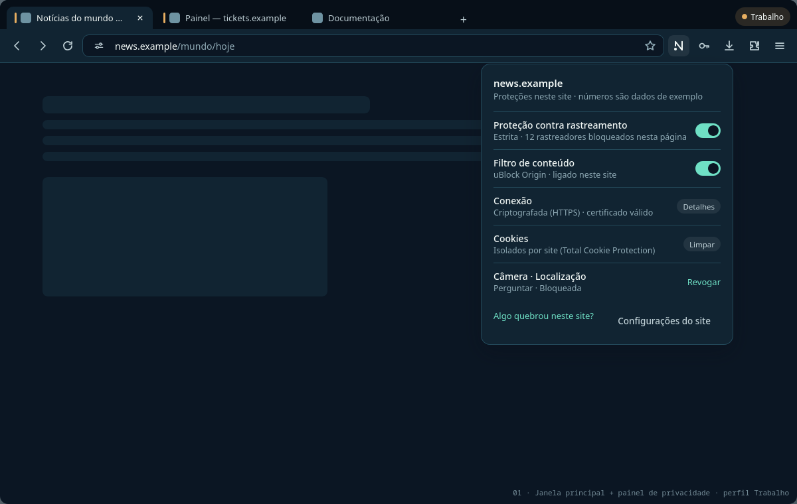

# UX flows

Status: **Prototype.** Flows and mockups define behaviour for the Track B built-in UI. In the Track A preview, parts exist as CLI commands, local pages or upstream engine UI, noted per flow. Mockups are HTML/CSS using the design tokens: [`mockups/index.html`](mockups/index.html), rendered by `scripts/brand/render_mockups.py`. Numbers in mockups are sample data.

## Principles applied

- Familiar layout for Firefox/Chrome users (tabs on top, URL bar, toolbar on the right). Conventional shortcuts: Ctrl+L, Ctrl+T, Ctrl+Shift+P, Ctrl+Shift+Y, Ctrl+Shift+A.
- Progressive disclosure: one sentence first, details on demand.
- Every warning has a safe primary action, an informed secondary action, and "why am I seeing this?".
- Never green-only "safe": the secure state is neutral; warnings use icon + words + colour.
- Keyboard: every control is reachable, and the focus ring (2 px, mint/mint-700) is never removed. Screen readers get labelled controls with no colour-only meaning. Layout respects scaling and Wayland fractional scaling (rem units, no fixed heights).

## Main window



```
┌ tabs: [| News — news.example ×] [| Tickets] [Docs] [+]          ( ● Trabalho ) ┐  ← profile pill + per-tab context bar
├ ‹ › ⟳  [⚙ news.example/mundo/hoje                         ☆]  [N] 🔑 ⤓ 🧩 ≡    ┤  ← N = privacy panel (Nulavio route)
│                                                     ┌ news.example ─────────────┐│
│                                                     │ Tracking protection  [on] ││
│                                                     │ Content filter       [on] ││
│                                                     │ Connection  HTTPS  Details││
│                                                     │ Cookies  isolated   Clear ││
│                                                     │ Camera·Location   Revoke  ││
│                                                     │ Something broke?  Settings││
│                                                     └───────────────────────────┘│
```

Address-bar security states: neutral site-info (HTTPS valid) · **"Not secure"** label + warning colour (HTTP) · full-page interstitial (certificate error) · "Requesting camera" pill (active permission request) · file / extension / internal page icons.

## A. First run

1. Launch shows a **one-screen welcome** ([mockup](assets/mockups/onboarding.png)): what is already on (blocking, HTTPS-Only, nothing sent to Nulavio) plus one honest limit.
2. "Continue": **import** (optional; from Firefox/Chromium profiles, on demand only).
3. **Passwords** (flow B).
4. **Done**: start page with the profile facts.

- *Customise* jumps to settings with the same explanations.
- *Skip* is always available. No step is mandatory.
- **Track A today:** `nulavio setup` prints the full plan (engine, profile path, defaults, filter with hash, provider, theme, "nothing is sent") and asks for confirmation. The start page shows the profile facts.

## B. Configure Proton Pass

1. Passwords step lists providers with **real status**: installed, not installed, or desktop app missing ([mockup](assets/mockups/provider-chooser.png)).
2. Pick **Proton Pass**. If missing, "Install official extension" shows the pinned version and source (AMO) and asks for one confirmation.
3. Explain: *engine save prompts turn off in this profile; saved logins are kept; you can switch back.*
4. The Proton Pass popup opens on its own sign-in screen. Nulavio never touches the vault.
5. Success: "Proton Pass will offer to fill on matching sites."

- Error states: install failed (network) → retry, plus "use the built-in manager for now". Extension disabled by the user → banner in Settings › Passwords.
- **Track A today:** `nulavio provider set proton-pass --install-extension`. Verified: install, signature, popup. Pending: login certification.
- **Track B (implemented, S17):** Settings › Passwords lists the browser's manager, Proton Pass, KeePassXC and Bitwarden with real state (installed, on, desktop app found) and how many logins the browser keeps (a count). Choosing an extension asks once, installs the version Nulavio pins from addons.mozilla.org (SHA-256 checked, Mozilla signature required), turns it on and turns the browser's own prompts off. Verified on the real engine (`test_passwords`; the download from AMO runs with `NULAVIO_NETWORK_TESTS=1`).

## C. Site blocked by mistake

1. Something looks broken. Open the **N** panel → "Something broke on this site?"
2. Two independent switches, each scoped **to this site only**: *Content filter* (uBO) and *Tracking protection*. The page reloads after a change.
3. Confirmation: "Filter off for news.example. Turn back on anytime from this panel." It is listed in Settings › Site exceptions.
4. Optional: "Report to the filter list maintainers" opens uBO's own reporter. Nulavio sends nothing.

- **Track B (implemented):** the address bar's site panel is the engine's own trust panel: what tracking protection blocked on the page (the engine's log, no invented numbers) and a per-site switch. Settings › Site exceptions lists every site where a protection is off, by the user or by the browser itself, each removable, and opens uBlock Origin's own trusted-sites page (its per-site switch stays in its button; Nulavio never edits its data).
- **Track A today:** uBO's toolbar popup (power button = per-site), Firefox's shield panel (per-site ETP). The start page explains both.

## D. Login on a suspicious domain

1. User focuses a password field on `paypa1-secure.example`.
2. A **local** check compares the origin with the user's saved-login sites: confusable characters, small edit distance, or added brand + keyword. Nothing leaves the machine.
3. On a match, an interstitial ([mockup](assets/mockups/suspicious-login.png)) offers: **Go to paypal.example** (primary) · Continue anyway · Why am I seeing this?
4. If the user continues, autofill stays off on that page; the user can still type.

- False-positive control: dismissal per site pair, remembered locally. The heuristic is never applied to the site's own saved origin.
- **Track B (implemented, S17):** an engine window actor (no content script in pages) notices the first focus on a password field in a top-level document; the parent takes the address from the engine and compares the site with the sites of the logins the browser's own manager keeps: confusable characters (Latin, Cyrillic, Greek look-alikes, "rn"/"m"), one edit (two for names of eight letters or more), the brand plus a login word, or the brand as a subdomain of another site. On a match the tab shows the warning page first: **Go to <real site>** (focused) · Continue · Why. Continuing is remembered for that pair of sites in this profile. Not done: autofill of third-party managers cannot be held back on that page, and their vaults are not read, so only logins kept by the browser's manager are compared ([R41](../security/residual-risks.md)).

## E. Potentially dangerous download

1. Download completes into `~/Downloads` (mode 0600). **No auto-open.**
2. For executable or installer types (AppImage, `.sh`, `.run`, `.desktop`, `.deb`, `.rpm`, `.flatpakref`, archives containing them), the panel shows a warning with **Show in folder** and **Delete**. There is no "Open" button for them ([mockup](assets/mockups/download-warning.png)).
3. Safe Browsing verdicts, when present, replace the generic text with the specific reason.

- **Track B (implemented, Nulavio Shell):** when such a download completes, a Nulavio page opens next to it (in a private window for private downloads) with the file name, size and source, the warning, **Show in folder** and **Delete**, and "Why am I seeing this?". There is no Open action. The mockup's placement inside the engine's downloads panel needs engine UI changes and is a later step. Archives are not inspected.
- **Track A today:** engine downloads panel; files saved privately; Safe Browsing on.

## F. Camera or microphone request

1. The page requests a device. A doorhanger names the site and device, and the URL bar shows a "Requesting camera" pill ([mockup](assets/mockups/camera-permission.png)).
2. Choices: **Allow** (this visit) · Block · "Remember for this site" (off by default).
3. While in use, an indicator stays visible. Revoke from the N panel or Settings.
4. Devices come through PipeWire and portals on Wayland (Fedora default).

- **Track A today:** engine prompts and indicators (PipeWire camera enabled by Fedora).

## G. Separate profile for work

1. Settings › Profiles › **New profile** → name ("Trabalho"), colour, optional provider (e.g. KeePassXC with the work database).
2. Each profile is a separate directory: cookies, extensions and history do not mix. A pill in the tab strip shows the active profile, and tabs carry its colour ([mockup](assets/mockups/main-window.png)).
3. A desktop entry per profile is optional.

- **Track A today:** `nulavio setup --profile work`, `nulavio run --profile work`.

## H. Turning off an integration

1. Settings › Passwords › **Disable integration** ([mockup](assets/mockups/settings-passwords.png)).
2. The explanation states what changes: engine prompts return; the extension is **not** removed; the vault is untouched.
3. Confirm, then "Undo" stays available in the same place.

- **Track A today:** `nulavio provider set builtin` (requires the profile to be closed; tested to be reversible).
- **Track B (implemented, S17):** Settings › Passwords › **Disable integration** (with confirmation) returns the prompts to the browser; the extension stays installed and its vault untouched.

## I. KWallet / Secret Service missing or failing

1. Settings › Passwords shows "System vault: **not found**" with a calm explanation: nothing depends on it for web passwords, and what it is (local app secrets, no per-app isolation) ([mockup](assets/mockups/settings-passwords.png)).
2. Actions: **Check again**, **Learn more**. No modal, no blocking.
3. If a future feature needs it (P1), the dependent feature alone shows as unavailable with the same explanation.

- **Track A today:** `nulavio doctor` reports the Secret Service provider (`ksecretd` on the reference machine) and KWallet status.

## States reference

| State | Example | Rule |
|---|---|---|
| Empty | No exceptions yet | One sentence + one action ("Sites you allow will appear here") |
| Loading | Provider status check | Skeleton; spinner only after 400 ms |
| Error | Extension install failed | What happened, what we did, what you can do, plus retry |
| Success | Provider switched | Inline confirmation + undo |
| Disabled | KeePassXC option without the app | Reason shown inline, with a link to set it up |
