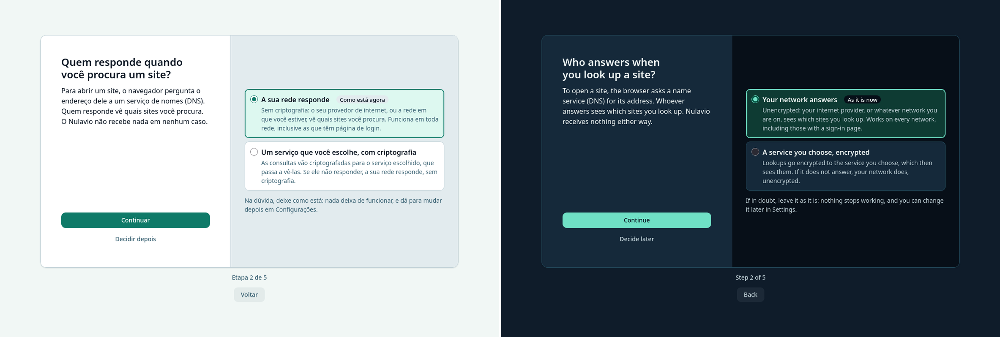
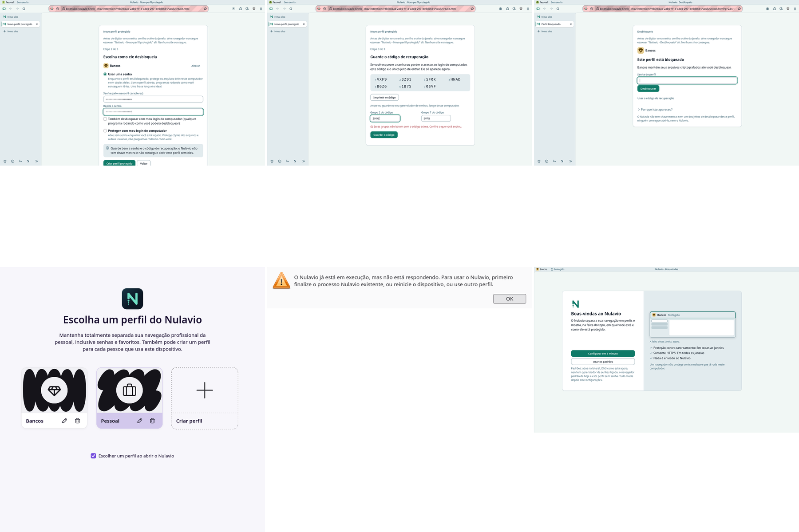

# The journeys, as they are and as they should be (2026-11)

Seven journeys a person takes with Nulavio, each walked on the alpha (160.0-0.2 build with `main` by `dev_sync`, 1440×900, pt-BR and en-US) and set against what was seen in the [references](references/2026-11/README.md). Three sources, kept apart:

- **Walked here**: driven with real pointer and keys on a private display, with captures.
- **New-user QA**: a second model (Codex) walked the journeys in a clean profile from a closed brief, with real clicks and its own captures. Its findings are numbered F1–F9 below. Each was checked before it was used; one was a limit of the test launcher and is marked.
- **Not walked**: said so. Nothing is inferred for those.

**How the browser was started matters, and the first round got it wrong.** The first captures and the new-user QA started the engine on a profile directory (`--profile`), as the test tools do. Started that way the engine's profile service is off: the band says "Perfil padrão", the new tab cannot name the profile, and no profile can be created or opened. The package starts the engine with no such flag. The second round (same day) did the same, in a throwaway home: the profile is "Pessoal", profiles work, and journeys 3 and 4 could be walked. Two things seen in the first round were artefacts of the test session and are marked below: the pink stripes on the address field (F3), and "Senhas" needing attention on the first frame (the automation turns the engine's password saving off; a person starts with it on).

The complaint that started this: "it looks like nobody thought about the journey". The table at the end says where that is true.

## 1. Install

**Not walked.** The browsers here ran from unpacked packages. What a person meets between the site and the first window (the repository file, the package manager's key prompt, the launcher entry) needs a clean machine or a container with a desktop session. What was walked is the first start as the package makes it (the engine with no flags, in an empty home): the first frame is the welcome below, in a 1280×810 window.

## 2. First use

| | |
|---|---|
| Today | The first window is a new tab: a search field, then a welcome card, then a status card. On the first frame the card says "Você já começa protegido" while the status says "Precisa de atenção: Filtro de conteúdo, Senhas" in the warning colour: the content filter is still being installed and is there about 20 s later (F1; walked here too). Four steps follow in the same card, which changes size and place between them (it moves down for the DNS step, where the symbol appears, and back up for the passwords step). The steps are layout, DNS, passwords, default browser. Nothing shows the band, profiles or protection, which is what the product is for |
| Where the person gets lost | Protected or not? (F1). "Resolvedor" and encrypted DNS with no recommendation in plain words (F2). Three password managers named with no reason to pick one. "Regras de roteamento" mentioned in the last step and never explained. The toolbar, the tab column and the page all compete while a question is being asked |
| References | Zen: the welcome owns the window, one decision per screen, the choice drawn as the thing itself. Helium: "Use defaults / Configure" on the first screen with the consequence of the default in one line; every option with its trade-off; a password-manager step |
| To be | **The first run is a stage** ([ADR 0010](../adr/0010-experience-direction.md)): the window shows the band and one card of a fixed size. First screen: what Nulavio is in one sentence that points at the band, then "Configurar em 1 minuto" or "Usar os padrões", with the defaults said in one line. Only facts that are already true are listed; something still arriving (the filter) is read again for the summary, where a real problem is reported as one. Each step keeps the card's place and size and its actions' place. Prototype on the engine: [light, pt-BR](screenshots/experience-2026-11/stage-sheet-pt-light.png), [dark, en-US](screenshots/experience-2026-11/stage-sheet-en-dark.png) |
| Built in the first-run slice | The card has two panes, as the references' setup cards do: on the left what is asked and, at the bottom, the actions; on the right the choice itself. The welcome draws this window small with its real band (the profile and its state are read, not drawn). DNS is asked as "Quem responde quando você procura um site?", with the option in use checked and marked "Como está agora", the encrypted service picked in the card, nothing changed before "Continuar", and one line of advice ("Na dúvida, deixe como está"). Password managers are rows with one line each and "Usar este" in the row; "Continuar" goes on with whatever is in use. The last question is "Quer um perfil com senha?" (journey 3). A second profile's welcome says "Perfil novo: …" and that its choices are its own. Captures: [light, pt-BR](screenshots/experience-2026-11/firstrun-sheet-pt-light.png), [dark, en-US](screenshots/experience-2026-11/firstrun-sheet-en-dark.png), [a short window](screenshots/experience-2026-11/firstrun-short-pt-light.png); tests in `test_firstrun_stage` |
| Way back (2026-11-12) | "Voltar", under the card next to "Etapa N de M", shows the step before again with what was answered there: the arrangement in use, the resolver in use checked, the password manager in use. Each answer applied at once and stays applied; the step is where it can be changed, with the same controls and rules as the first time. Going on from there walks the steps in order up to the first one not answered yet. Nothing changes by going back and looking.  |
| Still open | The window shows its full frame for a moment before the stage takes it, when a profile's first window opens |

## 3. Create and protect a profile

| | |
|---|---|
| Today | Reached from "Perfis" in Nulavio's settings, from the band's menu or from the profile manager. Creating, the recovery code, locking and unlocking exist as their own pages, named in the band ("Nulavio · Novo perfil protegido", "Nulavio · Desbloqueio") |
| Walked (second round) | Three steps: name and template; a password (at least 8 characters, typed twice), or the computer's login; the recovery code in 7 numbered groups, with two of them asked back before the page goes on. A wrong group is caught in words. The last screen says "Bancos está criptografado e bloqueado. Ele abre depois que você desbloquear." and offers "Abrir Bancos" |
| Where the person gets lost | **"Abrir Bancos" answered "Esse perfil está bloqueado. Desbloqueie primeiro." and stopped** (the page asked to switch to a profile it had just created locked). Fixed in the first-run slice: the button opens the profile's unlock page, as the profile menu and Settings do. The first run never said profiles exist; a person who read "Pessoal · Sem senha" in the band had no next step offered |
| To be | The first run's last question, "Quer um perfil com senha?", says what this profile is, what a protected one is in the Vault's own words, and opens the Vault's steps in their own tab (built). In the unified settings, "Perfis e proteção" is the second pane ([ADR 0008](../adr/0008-one-settings-page.md)). In a window started for one profile directory the question is not asked, and the manager link there should not be offered (F6, still open) |

## 4. Unlock

Order: the password step; the recovery code with a wrong group caught; the unlock page; the engine's chooser at a cold start; the error after choosing the locked profile there; the protected profile's own first window. The password and the code are of a throwaway profile that no longer exists.

| | |
|---|---|
| Walked (second round), from a running window | The profile menu, Settings and now the creation page open "Nulavio · Desbloqueio" in a tab: the profile's icon and name, one field, "Desbloquear", "Usar o código de recuperação". A wrong password is answered "Essa senha não desbloqueou o perfil." The right one opens the profile's own window, with "Bancos · Protegido" in its band and its own first run |
| Walked, from a cold start | **Once a second profile exists, every start opens the engine's own profile chooser, not Nulavio's.** It is the stock page: its own colours and drawings instead of the profiles' icons and colours, the engine's text ("Mantenha totalmente separada sua navegação profissional da pessoal…"), and nothing that says a profile is protected or locked. **Choosing the protected profile there gives a black window for about 15 s, then "O Nulavio já está em execução, mas não está respondendo", then the browser quits.** The locked profile's folder is an empty read-only directory until the Vault opens it, and nothing at start-up knows that. The only way in is to choose an unprotected profile first and unlock from its menu |
| Where the person gets lost | At the first start after creating the profile the product told them to create. Nothing on screen explains it |
| To be | Its own slice and a decision for the maintainer (see the table at the end): either Nulavio starts in the profile used last and the band's menu is the one place to switch and unlock, or Nulavio draws the chooser itself, with each profile's icon, colour and lock state, and a locked one leads to the unlock page. Until one of them is built, a locked profile must not be offered by a page that cannot open it |

## 5. Configure

| | |
|---|---|
| Today | Two pages: the engine's `about:preferences` and "Configurações do Nulavio". "Aparência" exists in both; "Pesquisa" in one is "Busca" in the other. The address bar calls Nulavio's page "Extensão (Nulavio Shell)" |
| New-user QA | Changing the search engine, the layout and the contrast took about 7 clicks and one miss: choosing "Foco" moves the settings navigation under the pointer (F4). "Mais contraste" says it is for Nulavio's windows and that site contrast is "nas configurações do navegador", without saying where (F5). A panel opened in the side bar was clipped behind the tab rail once (F9, not reproduced) |
| References | Zen puts its panes inside `about:preferences`. Floorp keeps a second hub with a banner pointing at it: the same split, and the clearest argument against it |
| To be | **One page** (ADR 0008): Nulavio's options are native groups inside the engine's panes, ordered by what the person is doing. Proven on the engine: the layout choice is the first card of "Aparência", and the page's search finds the engine's "Contraste de sites" and Nulavio's "Cores do Nulavio" together, which answers F5. F4 goes away with the page: the engine's settings navigation does not move with the tab layout |
| Built (slice 1) | Every "Configurações" of the Shell opens that one page. Its navigation follows the journey: Geral, Aparência, Perfis e proteção, Privacidade e segurança, Senhas, Pesquisa, Assistente e IA, then how you browse. Layout, Immersive, colours and Nulavio's keys are drawn by the page; each other section has a group in the pane it belongs to, which says what is true now (the profile and its protection, the password manager in use, how many changes wait for a review) and opens the detail screen in the same tab, with a way back. The layout is asked in one place: the engine's two-way picker in "Abas e navegação" gives way to a pointer to Aparência. Walked on the engine from the new tab to a detail screen and back: one tab, three clicks |

## 6. Daily use

| | |
|---|---|
| Today | Lateral gives the page 1216×856 of 1440×900, 80 %. The frame has three tones (band, toolbar, tab column). "Foco" collapses the tab column to icons (84 %); the names need a hover (F7) |
| References | Zen 85 % by default and 97 % compact; Helium about 99 % frameless. Both hide the address completely |
| Where the person gets lost | Not lost: crowded. The request is a mode that shows only what is needed |
| To be | **One surface** for the frame and the page as a card (direction A), and **Imersivo** as an opt-in mode on top (direction B, [ADR 0009](../adr/0009-immersive-layout.md)): the toolbar and the tabs leave, the band stays with the site's name, 97 % for the page. Prototypes: [light, pt-BR](screenshots/experience-2026-11/dir-sheet-pt-light.png), [dark, en-US](screenshots/experience-2026-11/dir-sheet-en-dark.png) |

Opening pages, switching tabs, a private window and back all worked for the new user without help (QA section 4).

## 7. Assistant

| | |
|---|---|
| Today | An "N" button in the toolbar opens the profile menu, not the assistant. The assistant is set up under "IA e automação" in Nulavio's settings: a provider form with "Compatível com OpenAI", service address, model and API key |
| New-user QA | The chat was not found in about 5 actions and 60–90 s (F8). The form assumes the person knows what a provider, a model and a key are |
| Where the person gets lost | At the first step: nothing says where the assistant is. Then at the form |
| To be | One entry with a name ("Assistente") in the side bar and in the quick actions. Opened with no provider, it says what it does, what leaves the computer and when (nothing before "Enviar"), and offers "Conectar um serviço" as a short sequence: pick a service from a list, paste the key, test. The raw fields stay under "Avançado". The consent rules of ADR 0007 do not change. Not prototyped in this round |

## New-user QA, second round (2026-11-11)

The same second model walked the journeys again as a first-time user, this time with the engine started as the package starts it, an empty home, a real pointer and keyboard, and no automation attached; it judged from screenshots only. Four journeys done, one not run (the defaults path in English). Each finding was checked before use:

| Finding | Checked | Result |
|---|---|---|
| First start to the summary: 10 clicks, 1 to 2 minutes; every step was understood as what it asks, DNS included ("the chosen service sees the lookups; the network answers if it fails") | The walk's screenshots | None needed |
| Creating, unlocking and opening a protected profile: 9 clicks, about a minute, no hesitation; "Abrir Bancos" led to the unlock page | Same | None needed (the fix of the first-run slice) |
| With Immersive on, the profile and the site stayed identifiable at every moment; the page got about 97 % of the window | Same | None needed |
| Ctrl+T and typing at once went nowhere while the first run was unfinished: the new tab showed the first run and the keyboard was in the page | True: the stage took the keyboard every time it was entered | Fixed: once per window; a tab opened later keeps the keyboard in the address field. `test_firstrun_stage` `test_04b` |
| At the second start a Guard alert said "1 mudança feita fora do Nulavio" without saying which | True, and the record says which: the content filter updated itself (uBlock Origin 1.75.0 to 1.76.0) between the two sessions | Open, the maintainer's decision: the Guard reports the browser's own automatic update of its own filter as a change made outside it, and the alert does not name it |
| A click on a service in the DNS step's list did not change it; the keyboard did | Not confirmed: the private display has no window manager (Alt+Tab did nothing there either) | Open: to be tried on a real desktop |

## Where nobody thought about the journey

| # | Moment | Journey | Evidence | Answered by |
|---|---|---|---|---|
| 1 | Two settings pages; the person guesses which one owns an option | Configure | walked; F5 | ADR 0008: one page with the journey's navigation and every way in (slice 1, built); the detail screens still to be drawn natively |
| 2 | "Protegido" beside a warning on the first frame | First use | walked; F1 (the filter part; "Senhas" was an artefact of the test session) | Only true facts on the welcome, the filter read again for the summary |
| 3 | The first run never shows profiles, protection or the band | First use, profile | walked | First-run slice: the welcome draws the band with the real profile; the last question offers a protected profile |
| 4 | The assistant cannot be found, then asks for a provider form | Assistant | F8 | To do |
| 5 | DNS asked in the vocabulary of the implementation | First use | F2 | First-run slice: plain words, the option in use marked, one line of advice |
| 6 | The page gets 80 % and there is no mode that gives more with the names kept | Daily use | measured | ADR 0009 prototype (97 %) |
| 7 | A link that leads to a refusal under `--profile` | Profile | F6 (launcher mode only) | To do (small) |
| 8 | The card and the navigation move under the pointer | First use, configure | walked; F4 | Stage (fixed card); ADR 0008 |
| 9 | Install: unknown | Install | not walked | Still not walked: it needs a clean machine or a container with a desktop session |
| 10 | The engine's chooser at every start once a second profile exists; a locked profile chosen there ends in an error and the browser quits | Unlock | walked (second round) | To do: own slice, maintainer's decision |
| 11 | "Abrir <perfil>" after creating a protected profile answered with an error | Profile | walked (second round) | Fixed in the first-run slice, with a test |
| 12 | Each new profile greets with "Boas-vindas ao Nulavio" again | Profile, first use | walked (second round) | First-run slice: "Perfil novo: …" |

The pink stripes on the address field in the QA captures (F3) are the engine's "under remote control" cue of the test session. A person never sees them; they are not a finding.
