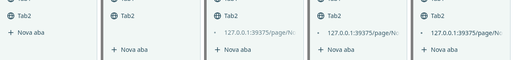
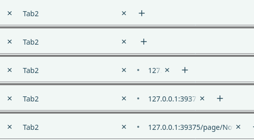
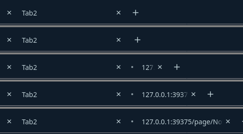

# Motion map of the window

Status: first version, 2026-11-18 ([#319](https://github.com/nulavio/nulavio/issues/319)). Built: two of the engine's own movements on the motion tokens (a sidebar panel, and the room tabs make for a dragged one), and the engine's security panels opening with no animation. Proposed and held: a tab's arrival in the vertical list, which missed the budget's p95 line on Xvfb and waits for a real-desktop measurement ([#555](https://github.com/nulavio/nulavio/issues/555)). Measured on Xvfb against `main`: nothing that existed got slower. Still to do, and the maintainer's: the measurement on a real KDE Plasma and a GNOME desktop ([steps](#on-a-real-desktop-the-maintainers-steps)), recordings, and captures of Zen, Arc and Orion.

This is every moment of the window that could move, what moves there, and why. It extends "UX7: motion and performance budget" in the [design system](design-system.md#ux7-motion-and-performance-budget-2026-11-04), whose tokens, budget and tests it uses. Where the two differ, UX7 wins.

## What movement is for

A movement in the window has one job: to show where something came from or where it went, so that a change is not a jump. A tab appears where it was opened. The sidebar narrows to the side it lives on. A panel that gives way to another is still the same panel.

The rules, all from UX7:

- **Tokens only.** Times and curves of what Nulavio adds or re-times come from `docs/brand/tokens.json`: `fast` 120 ms, `base` 180 ms, `expand` 220 ms, `collapse` 160 ms; curves `standard`, `enter` and `exit`. No new token was needed for this map. A movement of the engine that is left alone keeps the engine's values, and the map says which.
- **Arriving moves, leaving does not.** What closes is gone at once, so focus and the next click never wait for an animation. The exceptions are the engine's own: the launcher narrowing, a sidebar panel closing, and a tab closing with the tabs on top, where the strip has to close the gap under the pointer.
- **Opacity and position.** Nulavio adds movement only with `opacity` and `translate`, which the compositor draws without laying the window out again. The engine's width movements (launcher, horizontal tabs) are kept, not added to.
- **Security does not move.** The band, the fullscreen line, the seals and badges, warnings, critical and destructive dialogs get no movement. The engine's own security panels (the site's trust panel, its permissions, a permission prompt) used to take the engine's fade like any panel: they now open at once ([below](#the-engines-security-panels-open-at-once)).
- **Reduced motion: nothing moves.** Every movement here is inside `prefers-reduced-motion: no-preference`, or is one the engine skips by itself. What appears still appears, at once.
- **Measured against the frame budget**: [below](#measured).

## Patterns this map does not use

| Pattern | What it looks like | Why not here |
|---|---|---|
| Bounce and overshoot | A curve that passes its end and comes back; a spring | It draws the eye to the chrome, twice. The three curves end where they stop |
| Parallax | Layers that move at different speeds; a page that shifts under the toolbar | It moves content the person is reading, and costs a layout of the page per frame. Imersivo's toolbar moves over the page for that reason (ADR 0009) |
| Long delays and staggering | A wait before a movement; items arriving one after another | The interface feels slower than it is. Only two delays exist, and both are waits for intent: the 600 ms `hold` before chrome hides, and the engine's 200 ms before Foco's sidebar expands on hover |
| Motion that hides content | A fade or slide during which a label, an address or a state cannot be read | A tab's title is readable from the first frame it has any opacity; nothing here runs longer than 220 ms; nothing covers the page except the chrome the person called |
| Movement on leaving | A tab, toast or sheet that animates out | Focus would wait on it (UX7) |
| Looping decoration | Anything that moves with no change behind it | The window is still while idle: 0 reflows and 0 frames constructed in 60 s is a budget line |
| A layout animated over the page | Height or width animated where the page reflows at every frame | The measured cost is the page's, not the chrome's. The proposed tab arrival uses position, not height |
| Movement on a security cue | A band that slides, a warning that fades in | A cue that is still arriving cannot be trusted yet (UX principles, "Two grammars") |

## The map

"Engine" is Firefox's own movement. "Horizon" is the window theme (`browser/branding/nulavio/content/theme/horizon.css`). **Built here** marks what this change adds.

### Tabs

| Moment | What moves, and why | Times | Reduced motion | Checked by |
|---|---|---|---|---|
| A tab opens in the vertical list (Lateral, Foco) | Nothing: the engine shows the tab at once (it animates only the horizontal strip). **Proposed, held for a real-desktop measurement ([#555](https://github.com/nulavio/nulavio/issues/555)):** the tab's content arriving, opacity 0 → 1 and a 4 px step down into its row, with the row in place from the first frame; so that with five tabs or fifty the eye finds the new one. It was built and measured, missed the p95 line on Xvfb ([below](#measured)), and was taken out | proposed: `fast`, `enter` | — | `test_motion` 06 (nothing moves) |
| A tab opens with the tabs on top | The engine grows the tab's width. Kept as the engine has it. Putting it on the tokens (`fast`, `enter`) was built and measured, and taken out: [below](#measured) | engine: 100 ms, ease-out | The engine opens it at once | `test_motion` 07 |
| A tab closes in the vertical list | Nothing: the engine removes it at once and the list closes up. Kept. An exit would hold the next close button under the pointer for its length, which is where a second click lands. Building one would need an engine patch, since the node is gone before any style applies | — | — | `test_motion` 06 |
| A tab closes with the tabs on top | The engine shrinks the width so the strip closes the gap under the pointer. Kept as the engine has it, for the same reason | engine: 100 ms, ease-out | At once | `test_motion` 07 |
| A tab is dragged | The engine moves the other tabs aside to make room. **Built here:** on the tokens (it was 200 ms on the engine's own curve). | `base`, `standard` | The engine does not move them | `test_motion` 06 and 07 |
| A tab is selected | The route mark grows along its axis and the tab's surface changes colour (UX3F). The page is shown when it is ready, with no cross-fade: a fade would show two pages at once, and one of them could be another site | `fast`, `standard` | Off | `test_horizon` 12 |
| A tab loads | The engine's throbber in the tab, unchanged. With the option on, the page-loading line (#318) | engine; the line: twice `spin`, `standard` | The line is static | `test_load_line` |
| A group collapses or expands; a tab is pinned | The engine's. Nothing added | — | — | — |

### Sidebar

| Moment | What moves, and why | Times | Reduced motion | Checked by |
|---|---|---|---|---|
| The launcher narrows or widens | Its width, in the engine's view transition; the labels fade before the width moves (UX3G) | `collapse`, `expand`, `standard`; labels `fade` | The engine skips it | `test_motion` 02 |
| Foco: the launcher expands under the pointer | The same, after the engine's 200 ms wait for intent | `expand` | Skipped | `test_layout_presets` |
| A sidebar panel opens, closes, or gives way to another (history, bookmarks, the assistant) | The engine's view transition. **Built here:** on the same tokens as the launcher (they were 230, 190 and 130 ms, the last on a different curve), so the launcher and a panel next to it never move at two speeds | `expand`, `collapse`, `fast`; `standard` | Skipped | `test_motion` 08 |

### Toolbar, band and panels

| Moment | What moves, and why | Times | Reduced motion | Checked by |
|---|---|---|---|---|
| Imersivo: the toolbar and the tab list come and go | `translate` and `opacity`, over the page, which never reflows (ADR 0009) | in: `fast`, `enter`; out: `base`, `exit` after `hold` | Shown and hidden at once | `test_immersive` |
| The band, the fullscreen line, seals and badges | Nothing, ever | `security.duration` 0 | — | `test_motion_sheet`, `test_window_band` |
| The main menu, extensions, downloads and other arrow panels | The engine's, unchanged: it fades an arrow panel in over 180 ms (opacity; a slide too where the platform allows one, which on Linux is X11 with client-side decorations, not Wayland). In the test window (X11 on Xvfb) the main menu and the extensions panel opened with no transition running ([facts](../research/evidence/motion-map-2026-11-18/facts.json)) | engine: 180 ms | The engine's | `test_motion` 09 (the main menu keeps the engine's switch) |
| The site's trust panel (identity and the shield), the site's permissions, a permission prompt | Nothing. **Built here:** they are arrow panels too and took the same fade; they now open at once, in every window and on every desktop ([below](#the-engines-security-panels-open-at-once)) | none | — | `test_motion` 09 |
| The address bar | Its border and background answer hover and focus. It does not grow | `fast`, `standard` | Off | — |
| Buttons under the pointer | Background and border colour | `fast`, `standard` | Off | — |

### Pages of the Shell

| Moment | What moves, and why | Times | Reduced motion | Checked by |
|---|---|---|---|---|
| A new tab | The page fades in once it knows what to show; the profile's chip arrives | `fast`, `enter`; chip `base`, `enter` | Off | `test_motion` 04 |
| A profile switch | Nothing in the window. Another profile is another window of another process, opened by the desktop; its band is in place in its first frame, and its new tab carries the arrival above. A movement between the two windows would be the compositor's, and a movement of the band is ruled out | — | — | `test_motion` 04 |
| Settings: one section to another | Nothing, in the Shell's page and in the engine's. A section holds states and warnings, which do not move; the engine's settings page next to it switches at once; and someone going through sections with the keyboard reads the next one immediately | — | — | — |
| A dialog, the create sheet, a toast | They arrive; they leave at once. Warnings, critical and destructive ones never move | `base` or `fast`, `enter` | Instant | `test_motion` 03 and 05 |

### Not Nulavio's

A window opening, closing, minimising or moving between workspaces is the desktop's compositor. Scrolling and everything inside a page is the engine's and the page's (out of scope of #319).

## Reviewed against Zen, Arc and Orion

None of the three was run for this review: Arc and Orion do not run on the machine it was written on, and no capture of Zen was made. What follows is what their public pages say, read on 2026-11-18, with how far each source was read. It is a reading, not a measurement, and the captures the issue asks for are still to be made.

| Browser | What its sources say | How far it was checked | What Nulavio takes | What it leaves |
|---|---|---|---|---|
| Zen | `zen.view.compact.animate-sidebar`: "Animates the webpage moving in/out when compact mode is enabled/disabled. Enabled by default." `zen.view.compact.toolbar-hide-after-hover.duration`: the time until the toolbar and sidebar hide after the pointer leaves, 1000 by default ([flags](https://docs.zen-browser.app/guides/about-config-flags)) | The page was read. How its tabs open and close is not documented there, and was not seen | A hold before chrome hides (already `hold`, 600 ms, ADR 0009). A tab that is seen arriving in a vertical list is this map's own proposal (held, #555), not something read from Zen | The page moving with the sidebar: Imersivo's chrome moves over the page instead, so the page is never laid out during a movement. A switch per animation: the system's reduced-motion setting is the one switch |
| Arc | A horizontal swipe between Spaces, with an icon transition added to it in December 2023, according to a search result's summary of its [2023 release notes](https://resources.arc.net/hc/en-us/articles/20498377604887-Arc-for-macOS-2023-Release-Notes) | Not read: the page refused the request (HTTP 403) | Nothing built. That a change of place should read as one is why the profile's chip arrives on the new tab | A swipe between profiles: a Nulavio profile is a separate process and window, and the band that names it is a security cue, which does not slide |
| Orion | Its feedback board has threads titled "Add option to disable animations" ([10643](https://orionfeedback.org/d/10643-add-option-to-disable-animations)) and "Remove tab switch motion, allow users to disable it, or make it consistent" ([12412](https://orionfeedback.org/d/12412-remove-tab-switch-motion-allow-users-to-disable-it-or-make-it-consistent)). Kagi's help page says its products follow the system's "Reduce Motion" setting; it does not name Orion ([Kagi help](https://help.kagi.com/kagi/features/turning-off-animations.html)) | Only the threads' titles: their text did not load. The help page was read | The single switch, the system's. No movement of the page on a tab switch | — |

What can be said from this much: movement that people ask to switch off is movement of the page and movement on a switch they make all day. This map has neither. A proper review needs the three running side by side, with recordings; that is listed under [what is left](#what-is-left).

## The proposed arrival, frame by frame

The arrival is not in the build ([#555](https://github.com/nulavio/nulavio/issues/555)). These stills are of the branch that had it, at 1366×768, with the movement frozen at a moment of its time (the animation paused and set to that time, then captured). From the left: before the tab opens, then 0, 30, 60 and 120 ms.

In the vertical list, light and dark. The row is there at 0 ms and "Nova aba" has already moved down once; the title is readable at 30 ms (opacity 0.69, 1.2 px from its place):




With the tabs on top, from the top: before, then four moments of the engine's width movement (0, 25, 50 and 100 % of its time):





Without the arrival, which is how the build is, the vertical list shows its last frame at once; the tabs on top are the engine's and unchanged. The same probe confirmed what did not arrive again: a tab moved in the list, pinned, unpinned or selected, and the tabs already there when the launcher narrows.

## Measured

`scripts/research/frame_scene.py` on 2026-11-18, as UX7 describes it: headful on a private Xvfb (1920×1080, software WebRender), a fresh profile per run, this build and `main` alternating, 10 samples per scene and run. Both are development packages of the same engine (160.0, BuildID 20261116132313) and differ only in the Shell and theme: this change against `main` at `32fc58b3`. The files record the checkout as `0e33e88d`, a commit of this branch before it was squashed; its `browser/`, `scripts/research/` and `tests/integration/` are those of this change, except that `--layout` now reaches a run as an argument. Both had their `distribution/` removed, so no extension is installed, which is how UX7 reads the budget. The script gained five scenes for this map: a tab opening in the background, a tab closing, the main menu opening, and a sidebar panel (history) opening and closing; and `--layout top`, to measure with the tabs on top.

Frame intervals in ms, p95 and maximum, with the number of intervals. The budget for a movement is p95 ≤ 20 and max ≤ 50.

Lateral, the vertical list (5 runs, [perf-lateral.json](../research/evidence/motion-map-2026-11-18/perf-lateral.json)):

| Scene | This build | `main` | Budget |
|---|---|---|---|
| A tab opens (with the arrival, since taken out: #555) | p95 **34.2**, max 35.4 (395) | 16.8, 16.8 (12: nothing moves, so almost no frame is drawn) | **p95 over**; max within. Below |
| A tab closes | 16.8, 16.8 (19) | no frames | Within: instant on both |
| A sidebar panel opens (re-timed here) | p95 21.9, max 36.7 (804) | 21.3, 36.8 (850) | p95 over on both, the same. Below |
| A sidebar panel closes (re-timed here) | p95 33.6, max 35.2 (650) | 33.5, 35.2 (750) | p95 over on both, the same. Below |
| The main menu opens | 18.1, 35.2 (494) | 18.1, 35.3 (492) | Within |
| Sidebar collapse | 20.01, 21.3 (750) | 20.12, 23.8 (748) | p95 over the line by hundredths of a millisecond on both; UX7's own run read 18.4 on 2026-11-04 |
| Sidebar expand | 19.4, 21.4 (908) | 19.5, 22.5 (909) | Within |
| Tab switch | 18.9, 123.0 (539) | 18.8, 122.7 (540) | UX7's accepted exception, unchanged |
| A page loading (#397) | 34.8, 52.7 (3596) | 34.7, 53.5 (3598) | Unchanged (the line is off in a new profile) |
| Settings dialog | 17.4, 17.7 (677) | 17.4, 17.7 (678) | Within |
| Ctrl+T to the new tab's paint | p50 58, p95 66 | p50 57, p95 65 | Within (p95 ≤ 150) |
| 60 s idle | 0 reflows, 0 frames constructed | 0 and 0 | Within |

With the tabs on top (3 runs, [perf-top.json](../research/evidence/motion-map-2026-11-18/perf-top.json)), where this change adds nothing to a tab and the engine animates its width:

| Scene | This build | `main` |
|---|---|---|
| A tab opens (the engine's width) | p95 33.4, max 34.4 (185) | 33.2, 34.4 (185) |
| A tab closes (the engine's width) | 18.5, 32.7 (205) | 18.2, 32.0 (203) |
| A sidebar panel opens / closes | 21.7, 35.3 / 34.0, 35.7 | 22.4, 84.5 / 34.3, 36.8 |
| Sidebar collapse / expand | 19.2, 21.5 / 33.9, 36.4 | 19.7, 34.7 / 33.8, 36.0 |
| The main menu opens | 18.2, 34.6 | 17.9, 35.1 |
| Ctrl+T to the new tab's paint | p50 58, p95 65 | p50 58, p95 65 |

What the numbers say:

- **Nothing that existed got slower.** Every scene `main` has is the same on both builds, in both layouts, to within a millisecond at p95. The script's comparison flags one scene, the tab opening in Lateral, and that flag compares 395 intervals with 12: on `main` nothing moves there.
- **The arrival missed the p95 line on Xvfb, by one frame.** In 49 of 50 openings one of the first two intervals is doubled (33–35 ms); every interval after them is at the display's rate (18.5 ms at most), and the maximum, 35 ms, is inside the budget's 50. The likely cause, not proven here, is the frame in which the engine builds the new tab and lays the list out: on `main` that frame is drawn too, but nothing follows it, so no interval is recorded.
- **Engine movements on `main` show the same doubled frame under this renderer.** A sidebar panel closing reads p95 33.5, with a doubled frame at the start in 50 of 50 samples, both times Lateral was measured; the sidebar expanding with the tabs on top 33.8, in 28 of 30. The engine's own tab opening with the tabs on top is less steady: 33.2 in this run and 18.3 in an earlier one of the same `main`, with an early doubled frame in 6 of 30 samples. None of those is Nulavio's, and re-timing the panel changed none of it. This does not make the arrival pass; it says the line is one this renderer does not hold for a movement that starts with new content.
- **So the arrival was taken out.** The budget line was not met on the only measurement there is, and Xvfb cannot say whether a GPU draws that frame in time. The movement, its code and its test are kept in [#555](https://github.com/nulavio/nulavio/issues/555), to be put back only after a real desktop has measured it inside the budget. The build was not measured again after it was taken out: in the vertical list a tab now opens exactly as on `main`, with nothing of Nulavio's running.
- **One re-timing was built, measured and taken out.** With the engine's width movement of a horizontal tab on `fast` and `enter` (120 ms instead of 100), a tab opening read p95 49.5 and max 51.2 against 33.3 and 35.0 on `main`, in all three runs ([perf-top-width-on-tokens.json](../research/evidence/motion-map-2026-11-18/perf-top-width-on-tokens.json); two of those runs were noisy in other scenes, the third was not). The longer movement was still running when the engine did its work at the end of an opening. The engine's own timing stays.

Not measured: the room tabs make for a dragged one (the script cannot drag), and scrolling. The security panels opening at once are checked by what the engine reports (`test_motion` 09), not by frames. The script's verdict also fails a scene that recorded no frame, which is what a tab closing in the vertical list does on `main`: there, no frames is the right result.

## On a real desktop: the maintainer's steps

Xvfb says a change did not get slower. It does not say what a person sees on a GPU, under KWin or Mutter. These steps do, and take about 45 minutes per desktop. They serve two things: the check of what is built here, and the measurement the tab's arrival waits for (#555, with that branch as "this build"). The commands of step 4 were only ever run under Xvfb: on a visible desktop they are untried, and the first thing to check is that the windows open and the scenes record frames.

On KDE Plasma (Wayland), then on GNOME (a second machine, a live USB or a VM with GPU passthrough: a VM with software rendering only repeats the Xvfb numbers):

1. Have the two builds unpacked: this one and the previous release, each with its `nulavio/nulavio` and the same `distribution/` (the script refuses otherwise). Remove `distribution/` from both copies to read the budget without uBlock Origin's first-run work.
2. Close other applications; plug the laptop in; note the display's refresh rate (`kscreen-doctor -o` or GNOME Settings → Displays). The budget of 20 ms at p95 is written for 60 Hz.
3. Leave the system's animations on (Plasma: System Settings → Animations; GNOME: Accessibility → Seeing → Reduce Animation off). The script sets the browser's own preference, not the desktop's.
4. From the repository:

   ```sh
   NULAVIO_TEST_HEADFUL=1 NULAVIO_ENGINE=<this build>/nulavio/nulavio \
     python3 -I scripts/research/frame_scene.py --baseline-engine <previous>/nulavio/nulavio --runs 5 --out <dir>/lateral
   NULAVIO_TEST_HEADFUL=1 NULAVIO_ENGINE=<this build>/nulavio/nulavio \
     python3 -I scripts/research/frame_scene.py --baseline-engine <previous>/nulavio/nulavio --runs 3 --layout top --out <dir>/top
   ```

   Do not use the keyboard or pointer while a window of the run has the focus. On Xvfb the first run took about 25 minutes and the second about 14.
5. Read the last lines: `verdict` per build and `regressions`. `layerManager` in `perf.json` must say `WebRender`, not `WebRender (Software)`; otherwise the desktop is not using the GPU and the run is not the one wanted.
6. By eye, in a normal window of this build, with the system's animations on and then off: open ten tabs in the vertical list and with the tabs on top; close five; drag one; open and close the launcher, the history panel and the bookmarks panel; open the main menu; then the site's trust panel (the shield or the padlock), the site's permissions, and a permission prompt (a page that asks for the location). Nothing should bounce, lag behind the pointer, or move with the animations off. The three security panels must appear whole, with no fade, also when the main menu beside them fades.
7. Put both `perf.json` files (the engine's path replaced by `<build>`), the desktop, GPU and refresh rate in a comment on #555 (or on a new issue, if the run is not about the tab's arrival).

Scrolling a page is not a scene of the script yet: it is the engine's, and measuring it needs input events sent to a page, which the script does not do. It is listed under [what is left](#what-is-left).

## The engine's security panels open at once

UX7 says a security cue never moves. The engine's own security panels did: an arrow panel fades in, and the same rule covered the main menu and the panels that say where you are and ask for consent. Decided on 2026-11-18 (#319): they open with no animation, in every window, whatever the desktop would otherwise do.

How the engine decides, read in Firefox 160.0.1's source:

- `toolkit/themes/shared/popup.css`: `panel[type="arrow"]` starts at opacity 0 and transitions to 1 in 180 ms, outside reduced motion. Where the platform allows panel animations it also slides 70 px; on Linux that is X11 with client-side decorations and never Wayland (`widget/gtk/nsLookAndFeel.cpp`, `PanelAnimations`). So on a Wayland desktop the fade is what runs.
- `toolkit/content/widgets/panel.js`: as an arrow panel starts to show it sets `animate="open"` on itself, unless it already carries `animate="false"`. With `animate="false"` the sheet gives no transition time and full opacity. That attribute is the engine's own switch, per panel.

So the narrowest way is that attribute, on those panels only. The Shell sets it as the panel starts to show (`NulavioWindow`, a capturing listener on the window, which runs before the panel's own handler):

| Panel | What it is |
|---|---|
| `trustpanel-popup` | The site's trust panel: identity and protections in one, since the engine's `browser.urlbar.trustPanel.featureGate` (on in 160) |
| `identity-popup`, `protections-popup` | The separate identity panel and shield it replaced. Still in the engine, shown when that gate is off |
| `permission-popup` | The site's permissions |
| `notification-popup` | A permission prompt, and the engine's other consent prompts anchored on the address bar (an add-on's installation, a saved password) |

What this does not do: it sets no pref (`ui.panelAnimations` or any other would change every panel), adds no rule to a sheet, and selects no security surface in the theme, so Horizon's rule 4 stands as written. The main menu, the extensions panel and the others keep the engine's behaviour.

`test_motion` 09 opens the trust panel, the site's permissions and a prompt, and reads each from the moment it starts to show until it is open: `animate="false"`, input never held back for a transition, no transition time, full opacity, nothing animating. It opens the main menu too, which must still carry the engine's `animate="open"` and its transition time: that contrast is what shows the readings can tell a panel that moves from one that does not. The two older panels cannot be opened while the trust panel's gate is on, so they are covered by the list and not by the test.


## What is left

- The real-desktop measurement above, for KDE Plasma and GNOME: it is the maintainer's step, and it is written. With it, the tab switch (its 120 ms maximum on Xvfb is an accepted exception of the software compositor), and whether the tab's arrival may come back (#555).
- A scroll scene in `frame_scene.py`.
- Recordings before and after in both themes. The frames above are stills, taken with the movement frozen.
- Captures of Zen, Arc and Orion.
- A tab closing in the vertical list stays instant by decision. If that is ever revisited it is an engine patch, not a style.
