# References for the experience review (2026-11)

What was run and looked at before redesigning Nulavio's journey: onboarding, settings, compact and frameless modes, tabs and transitions in Zen, Helium and Floorp, next to Nulavio as it is today. Everything here was observed on this machine on 2026-11-11. What was not observed is listed at the end and is not used as evidence.

The screenshots are of third-party software, shown for comparison and commentary. Names and marks belong to their owners. Nothing from them ships in Nulavio.

## How they were run

Each browser came from its project's release page as a tarball, was unpacked in a scratch directory and ran with its own throwaway home and profile on a private X display (Xvfb, 1440×900). No system install, no Flatpak, no real profile. Firefox-based browsers were driven through Marionette, Helium through the DevTools protocol, and pointer and keys through XTest on that display only. Transitions were recorded with `x11grab` and cut into frame strips.

| Browser | Version | Engine | Licence | Source of the build | SHA-256 of the tarball |
|---|---|---|---|---|---|
| Zen | 1.24.1b (2026-11-06) | Gecko | MPL-2.0 | `zen-browser/desktop` release `zen.linux-x86_64.tar.xz` | `c592a31f…5cb9cd` |
| Helium | 0.21.2.1 (2026-11-10) | Chromium 157 | GPL-3.0 | `imputnet/helium-linux` release `helium-0.21.2.1-x86_64_linux.tar.xz` | `e55c253e…60b519` |
| Floorp | 12.21.1 (2026-11-04) | Gecko 159.0.1 | MPL-2.0 | `Floorp-Projects/Floorp` release `floorp-linux-x86_64.tar.xz` | recorded with the others in the scratch `SHA256SUMS` |
| Nulavio | 160.0-0.2 build + `main` at `388800e` by `dev_sync` | Gecko 160.0 | MPL-2.0 | this repository | n/a |

### What the licences allow

- **Zen and Floorp (MPL-2.0).** Nulavio's Shell is MPL-2.0 too, so a file may be reused if it keeps its licence header and the changes stay under the MPL. The rule adopted here is narrower: **read their code to learn how a behaviour is built, re-implement it in Nulavio's own modules, and copy no file, asset, name or copy**. If a file is ever taken, it is recorded in `LICENSES.md` with its origin and commit. Zen's compact mode (`ZenCompactMode.mjs`, `zen-compact-mode.css`) was read this way.
- **Helium (GPL-3.0).** No code or asset may be taken into an MPL-2.0 product. Only behaviour and layout ideas, seen from the outside, are used.
- **Trade dress.** No gradient video, mascot, icon set, wording or distinctive layout is copied. Patterns are re-derived from a Nulavio need.

## Zen

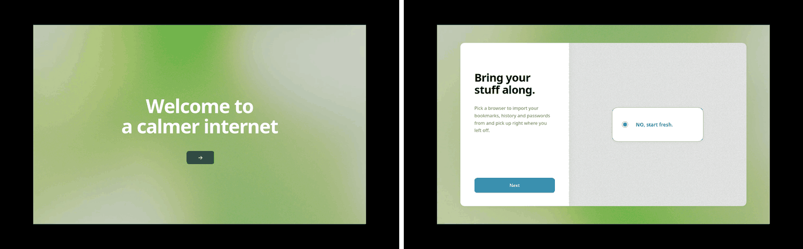
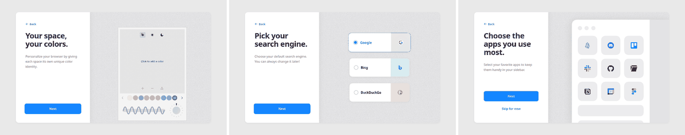
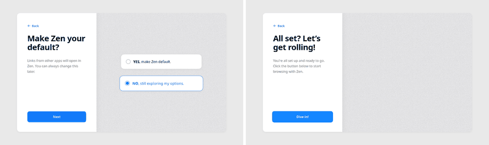

**Onboarding (7 screens).** The welcome fills the whole window: no tabs, no toolbar, one sentence and one button. Then a centred two-pane card: on the left a headline, one sentence and one primary button; on the right the choice itself (a radio card, a picker, a grid). One decision per screen: import, colour, search engine, pinned apps, default browser, done. "Back" is a small link at the top of the left pane; "Skip for now" appears only where skipping is a real choice.

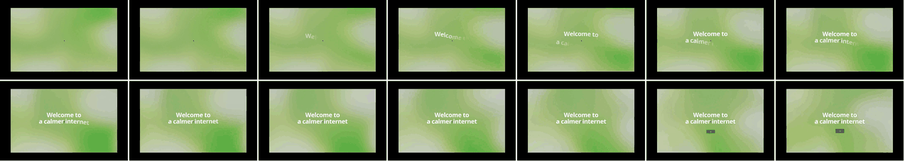

**Intro motion.** The background appears first, the headline arrives character by character over about 1 s, the button about 0.6 s later. About 2.5 s from first paint to the first control. Long for a tool; fine once in a lifetime.

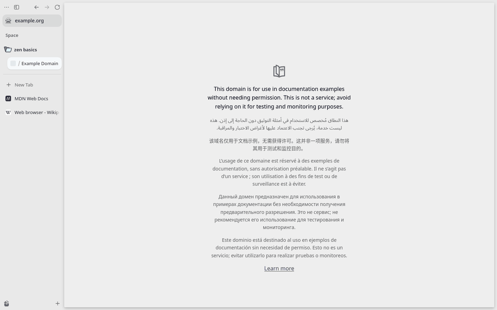

**Window.** One 186 px column holds everything: window buttons, back/forward/reload, the address field, a space label, folders, tabs, "New Tab" and the workspace switcher. The page is a card with an 8 px margin and its own radius. Page area: 1246×884 of 1440×900, **85 %**.

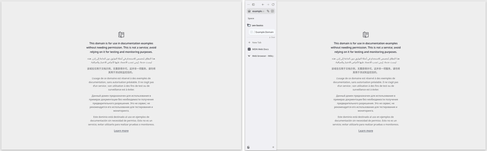
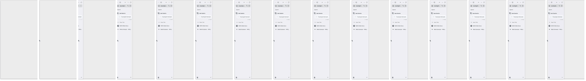

**Compact mode.** The column slides out and the page card takes the window (**97 %**). Moving the pointer to the left edge slides the column back in **over** the page: nothing reflows. From its source: the toolbox becomes `position: fixed` and animates `translate` (0.15 s ease; 0.25 s when toggled), stays 1 s after the pointer leaves (`toolbar-hide-after-hover.duration`), keeps open 150 ms while crossing gaps, and can "flash" for 0.8 s when a background tab opens so the person sees where it went.

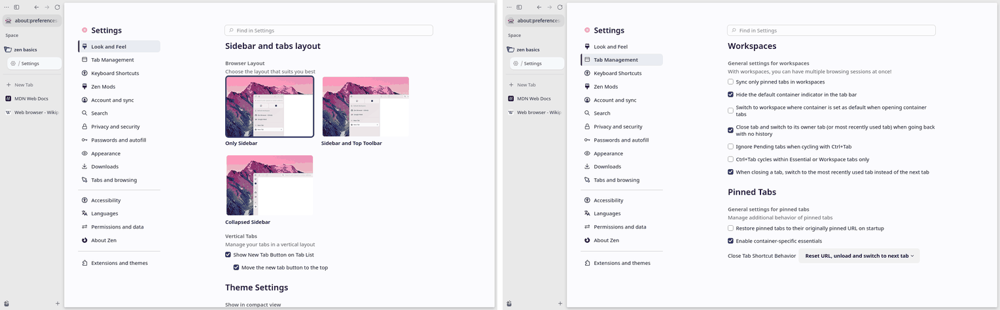

**Settings.** Zen has **one** settings page: Firefox's `about:preferences`, with its own entries ("Look and Feel", "Tab Management", "Keyboard Shortcuts", "Zen Mods") at the top of the same navigation. The layout choice is three pictures, not a list of switches. Keyboard shortcuts open a second page (`about:keyboard`).

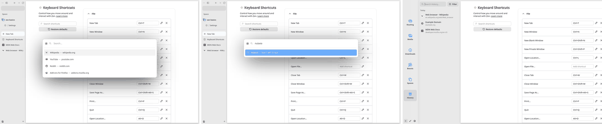

**New tab.** Ctrl+T opens a floating field in the middle of the window instead of an empty tab page; results appear under it. The button at the foot of the column swaps the tab list for a library (history, downloads, spaces).

**Copy**

1. A first run that owns the whole window, one decision per screen, with the choice shown as the thing itself.
2. One column for everything, so the page keeps the full height.
3. Compact mode as an overlay: the chrome covers the page when revealed, the page never jumps.
4. Hover timings: reveal fast (150 ms), leave slow (1 s), flash on events the person did not cause.
5. Product settings inside the engine's own settings page, first in its navigation.
6. Picture choices for layout.

**Avoid**

1. Its own panes still use the old checkbox lists while Firefox's panes next to them use the new cards: two looks in one page.
2. "Tab Management" is seven unrelated checkboxes under one heading.
3. The address field in the column shows only the host and no protection icon by default (`zen.urlbar.show-protections-icon = false`). Nulavio keeps the engine's trust indicators.
4. The intro's 2.5 s before the first control.
5. A second page for shortcuts.

## Helium

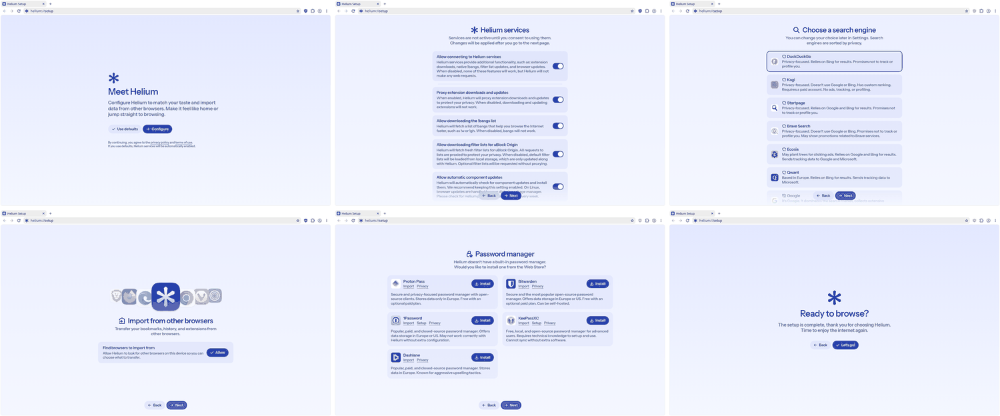

**Onboarding (6 screens).** A setup page with two exits on the first screen: "Use defaults" or "Configure", and one honest line under them ("If you use defaults, Helium services will be automatically enabled"). Then: services, each a switch with what it sends and what stops working without it; search engines, each with a one-line trade-off, good and bad ("Collects extensive personal data"); import, which asks before it looks for other browsers; password manager, since the browser has none ("Would you like to install one?", with Proton Pass, Bitwarden, KeePassXC and their trade-offs); done. Back and Next float at the bottom centre and never move.

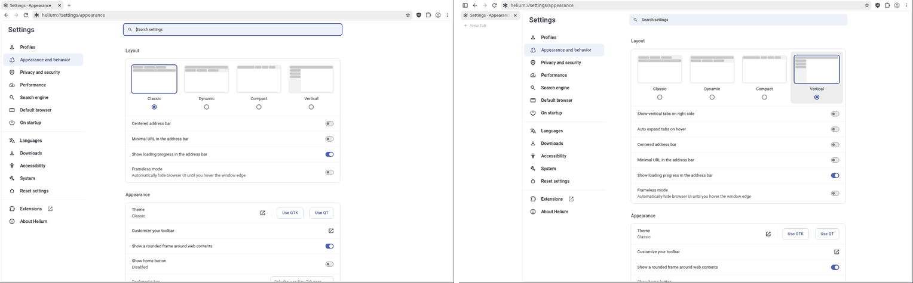

**Layout settings.** The first block of "Appearance and behavior" is four thumbnails: Classic, Dynamic, Compact (tabs and address field in one 39 px row) and Vertical. Options that only make sense for one layout appear when it is chosen ("Show vertical tabs on right side", "Auto expand tabs on hover").

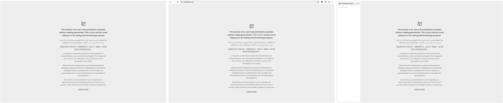
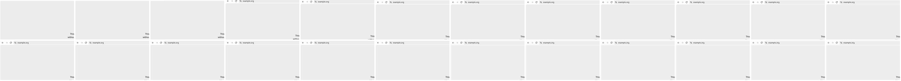

**Frameless mode.** "Automatically hide browser UI until you hover the window edge." The page takes the whole window with a rounded frame (**about 99 %**). The top edge brings the toolbar down in about 150 ms and it leaves as fast; the left edge brings the tab list over the page. While hidden, **nothing says which site this is**.

**Copy**

1. "Use defaults / Configure" on the first screen, with the consequence of the default in one line.
2. Every choice with its trade-off in a sentence, including what is bad about it.
3. A password-manager step: Nulavio has the same situation and the same three managers.
4. Asking before reading anything from the computer.
5. Layout as thumbnails, with dependent options appearing in place.
6. Back and Next in one fixed place.

**Avoid**

1. Hiding the address and the security state entirely. In Nulavio the origin must stay on screen (see "The origin while the chrome is hidden").
2. The services screen runs past the window and needs scrolling before "Next" makes sense.
3. A long flat list of switches in settings below the layout block.

## Floorp

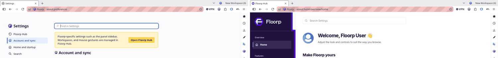

Floorp has **two** settings places: `about:preferences`, and "Floorp Hub" with its own navigation, colours and type. A yellow banner in the first sends people to the second. This is Nulavio's problem today, seen in someone else's product, and the clearest argument against a separate hub. Its default window also shows what too many permanent buttons look like: workspace switcher, VPN, account, a second sidebar of tools.

**Avoid:** everything on this capture. **Copy:** nothing from it.

## Nulavio today

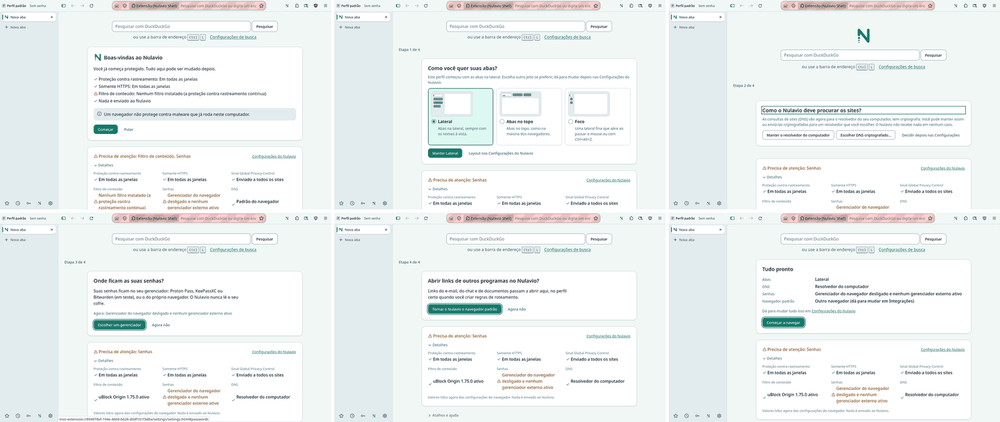

**First run.** A card inside the new tab, under a search field and above a status card. On the very first frame it warns "Filtro de conteúdo: Nenhum filtro instalado" because the content filter is still being installed (it is there about 20 s later), and the status card says "Precisa de atenção: Filtro de conteúdo, Senhas" in the warning colour through every step. The page jumps between steps (the symbol comes and goes, the field moves). The four steps are layout, DNS, passwords, default browser; nothing introduces profiles, protection or the band, which are what the product is for.

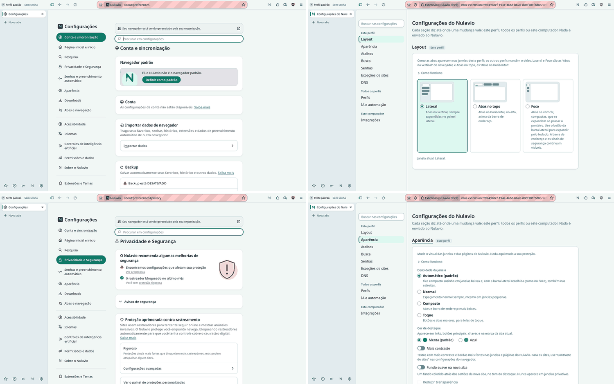

**Settings.** Two pages with two navigations and two looks. "Aparência" exists in both; "Pesquisa" in one is "Busca" in the other; "Senhas e preenchimento automático" in one and "Senhas" in the other. The engine's page says "Seu navegador está sendo gerenciado pela sua organização", "Backup está DESATIVADO" and "Firefox Labs"; the address bar calls Nulavio's own page "Extensão (Nulavio Shell)".

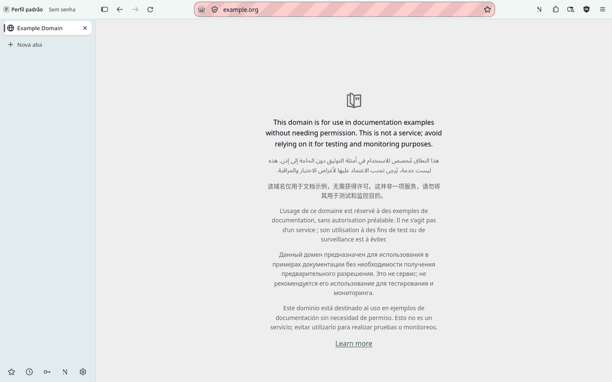

**Window.** A 44 px top row (identity and navigation) plus a 224 px column of tabs: the page gets 1216×856 of 1440×900, **80 %**. Zen gives 85 % by default and 97 % compact; Helium about 99 % frameless.

## The origin while the chrome is hidden

Both references hide the address field completely. A page shown with no browser chrome can draw a fake address bar, and the person has no way to tell. Nulavio's rule ("a layout never hides the trust indicators") stands, so its compact mode needs an answer the references do not have. Three were seen or follow from what was seen:

1. A thin strip that never hides, drawn by the browser, with the profile, the host and the security state (Nulavio already has the 3 px state line for fullscreen).
2. Showing the chrome by itself whenever the origin changes or a permission, download or warning appears (Zen's "flash").
3. Revealing on every keystroke toward the address field and on Esc.

Which of these ship is decided in the compact-mode ADR; hiding the origin with no cue is not an option.

## Not observed

- **Arc and Safari** do not run on Linux. Nothing about them is used as evidence. Prints from the maintainer would be needed.
- **Vivaldi** was not installed in this round.
- **Mobbin, Dribbble, CollectUI, Unsection, 21st.dev** need an account or are galleries of unverified mock-ups; none was opened. If a specific pattern is wanted from them, a print is enough.
- **Sounds.** None of the three browsers played or offers interface sounds in what was run, so there is no reference for them here.
- A real desktop session (window decorations, HiDPI, a compositor's own animations).
