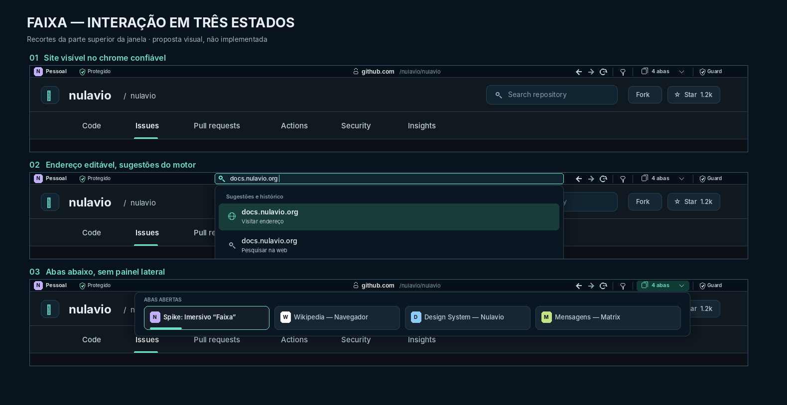
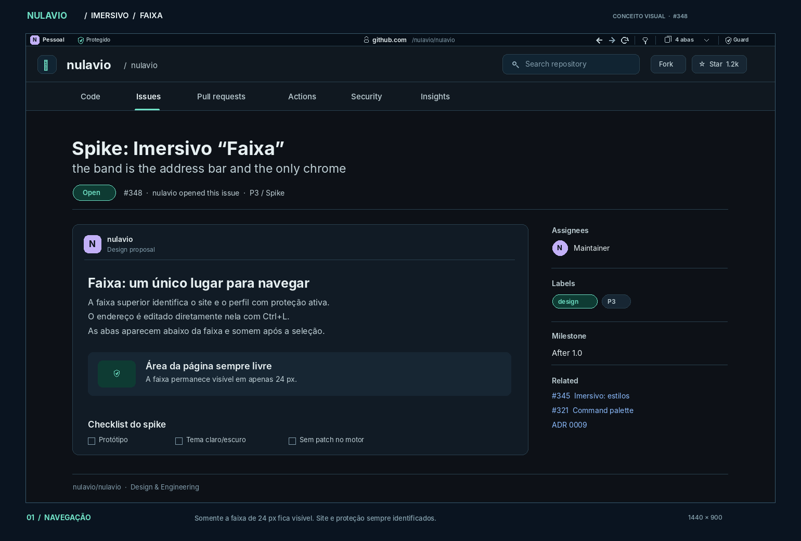
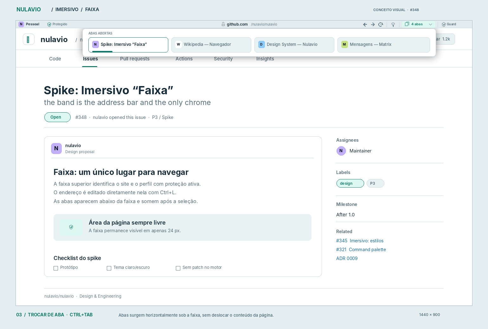

# Imersivo "Faixa": the maintainer's mockup (2026-11-14)

A visual concept for the third Imersivo style, the band as the address bar and the only chrome (#348, part of #345). Made by the maintainer with an image generator on 2026-11-14 and added here as the reference the spike starts from. It is a proposal, not a built screen: nothing in it is measured, and the page shown in it (a repository page) is only filler.

The maintainer's decision the same day: if #348 is a go, "Faixa" is the style a person gets when they turn Imersivo on. Where the mockup is silent or goes past ADR 0009 (the path next to the host, the engine's indicators, extension buttons, many tabs) is listed in #348.

## The three states

1. **The site.** The band is the only row: the profile and its protection on the left, the padlock, the host and the path in the middle, then back, forward, reload, the pin, the tab count and the Guard's seal.
2. **Typing an address.** Ctrl+L turns the band's middle into the address field, with the engine's suggestions under it.
3. **Switching tabs.** The tab count or Ctrl+Tab opens a strip of the open tabs under the band, over the page.

The same states, animated: [faixa-states.gif](faixa-states.gif).
