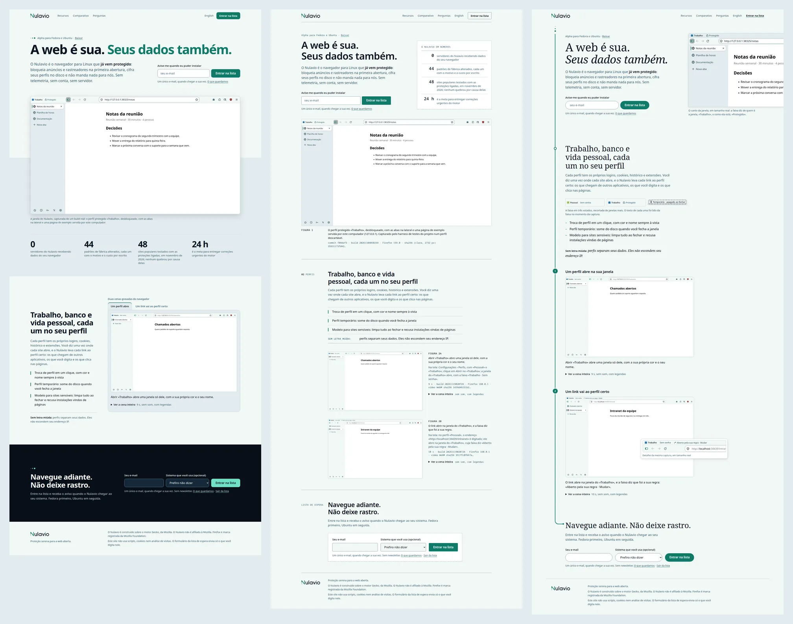
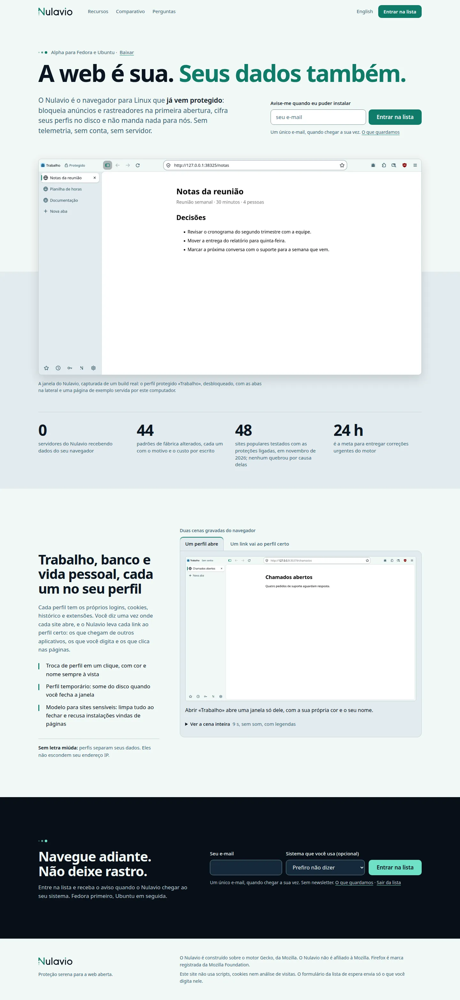
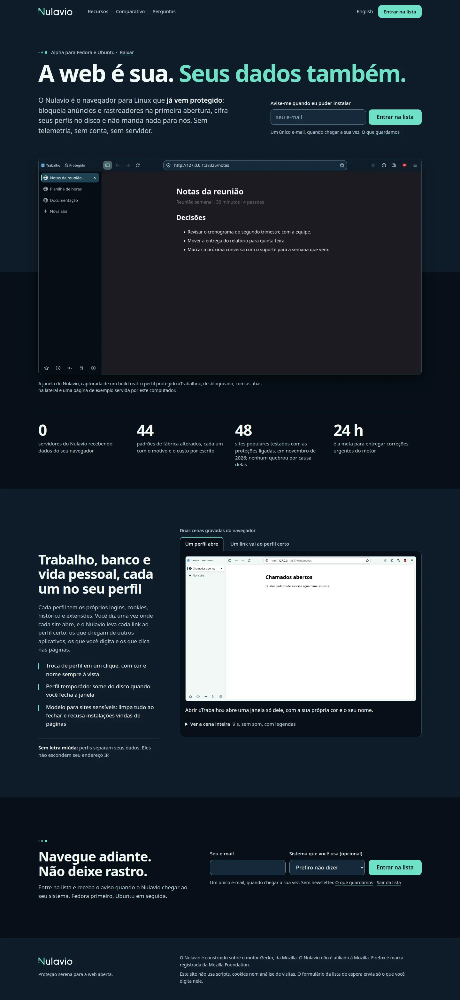
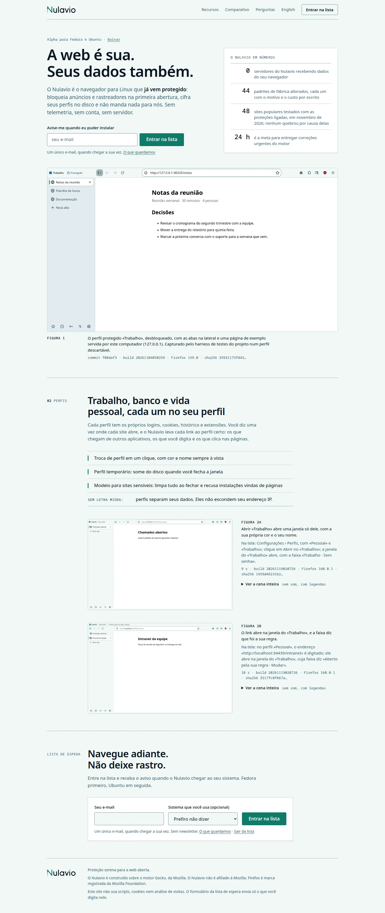
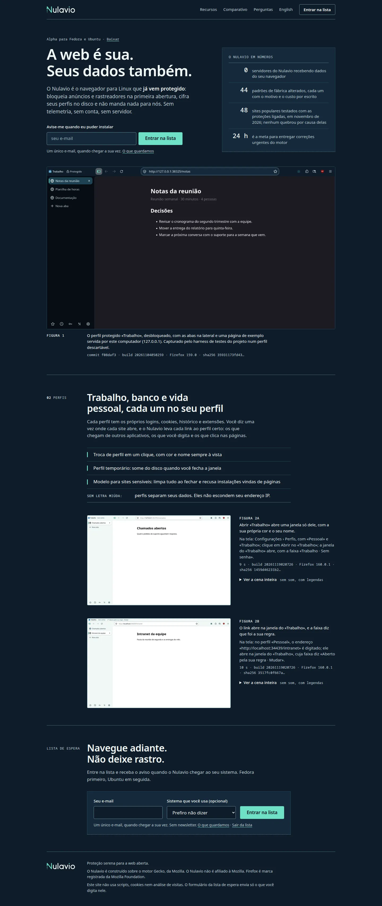
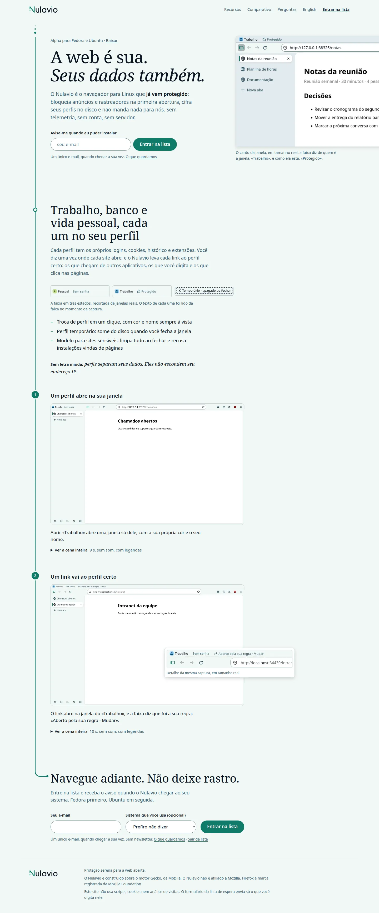
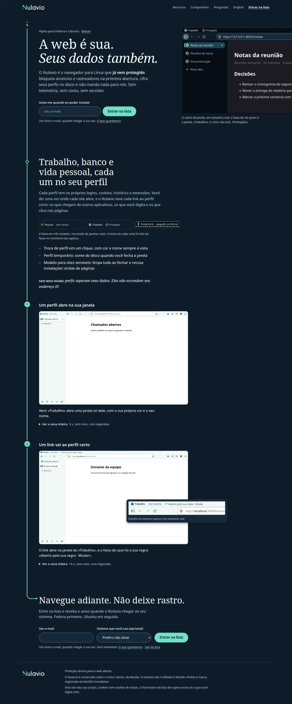
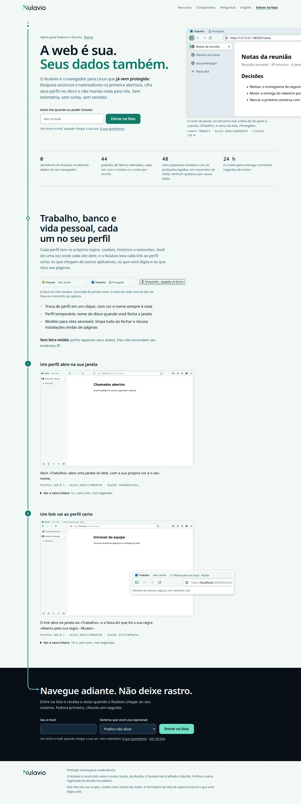
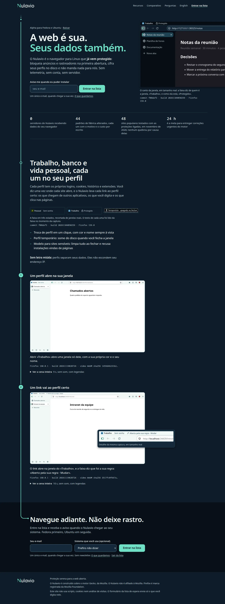

# nulavio.net redesign: moodboard, directions and the chosen one

Status: 2026-11-27, steps 1 and 2 of [#173](https://github.com/nulavio/nulavio/issues/173). The maintainer delegated the draft and the choice to the agents ("pode você mesmo fazer", recorded on the issue the same day): three directions were drawn, one was chosen with the reasons below, and **the maintainer can still change it**. Chosen: **«Rota», with two grafts** ([the choice](#the-choice)).

This document picks a look. What holds whatever the look (the page structure, the motion rules, the media rules, the budgets, the recording pipeline) is the specification of phase 1, in [pull request #859](https://github.com/nulavio/nulavio/pull/859) (`docs/design/site-redesign.md`); this pull request does not edit it, and the two things the mock-ups add to it are named under [what phase 2 needs](#what-phase-2-needs-from-it), for that document to take in or for the maintainer to refuse. No page under `site/` changes either: the mock-ups live in [mockups/site/](mockups/site/) and are not deployed.

Left to right: «Palco», «Recibo», «Rota». The same content in each: the landing's hero, the profiles section and the waitlist call, in pt-BR, with the copy of the landing as it is on `main` (`site/index.html`). What is new is only what the media say of themselves: each scene's caption and transcript, which are the ones in #859's manifest, and a line saying what each capture is.

## What the mock-ups are made of

Every mock-up is static HTML and CSS under the site's own rules, so that what is judged is what phase 2 can ship:

- no `<script>`, no `<style>`, no `style=""`, no inline handler, no resource from another origin, no `data:` URL: the checks `tests/unit/test_site.py` makes of the built pages. They were rendered behind the site's policy from `site/_headers` plus `media-src 'self'`, and a console message about the policy would have failed the render;
- every colour, space, radius and duration from [the tokens](../brand/tokens.json), through the generated `browser/startpage/tokens.css` that the site serves as `/assets/tokens.css`. The style sheets hold no literal colour;
- motion as the specification allows it: one entrance by opacity and at most 16 px, on the media only, as a scroll-driven animation under `prefers-reduced-motion: no-preference` and `@supports`, except «Palco»'s window in the first view, which rises once on load with `@keyframes`, as the specification also allows; the recorded loops, which play once and stop; colour transitions. Nothing else moves: a jump within the page is not scrolled smoothly;
- the media slot the maintainer decided on 2026-11-27: the loop of at most 5 s that stops by itself, in `<picture>` over its still frame; the whole scene as `<video controls preload="none">` with a captions track; the transcript; and the one "Sem letra miúda:" line per feature that `test_copy_is_honest` reads. The ids of the landing are kept (`hero-h`, `hero-email`, `profiles-h`, `join`, `join-email`, `join-os`).

The inputs, and the state they are in:

| Input | Where it comes from | In the mock-ups |
|---|---|---|
| Tokens | `browser/startpage/tokens.css` on `main` | Linked, not copied. [Pull request #858](https://github.com/nulavio/nulavio/pull/858) adds one token to it, which no mock-up uses |
| Lockup ("N" + "ulavio", proposal A of [#175](https://github.com/nulavio/nulavio/issues/175)) | #858 at commit `05dadc39` | The two files copied as they are there, to `mockups/site/brand/`, because `main` had the earlier lockup when the mock-ups were drawn. #858 has since merged, and the copies are byte for byte its files on `main`. Phase 2 uses `docs/brand/assets/logo/` |
| The window and the band | [site/assets/shots/](../../site/assets/shots/manifest.json) on `main`: commit `f08daf3`, build `20261104050259`, Firefox 159.0 | Linked, not copied |
| Two recorded scenes, pt-BR | #859 at commit `83a4e98b`: build `20261119020726`, Firefox 160.0.1 | The loop, the still frame, the WebM and the captions of `profile-opens` and `link-routed`, copied to `mockups/site/media/`, because #859 was not on `main` when the mock-ups were drawn. #859 has since merged with newer recordings (`docs/design/recordings/2026-11/`), which differ from these copies. The MP4 fallback is left out to keep the copy small. Two of their captions are on screen for less than #859's later rule allows (at most 20 characters a second), which #859's later recordings meet. Phase 2 records them again |

The copies, byte for byte the files of those pull requests (SHA-256):

| File | SHA-256 |
|---|---|
| `media/profile-opens-pt-BR-loop.webp` | `434dd2695b66bc458c10d2ec1f1a02e3c861b291d7e4e7b04d080843c98a5280` |
| `media/profile-opens-pt-BR-poster.webp` | `6c1d6e58f3a22c75a91f256af0bedc8957b7f3f9d4d832ebd02c711a40cd9a64` |
| `media/profile-opens-pt-BR.webm` | `1459d46231b266cc8423aa1ca21ab4dca0c68f6fe0df32f33b9189ef74bd2865` |
| `media/profile-opens-pt-BR.vtt` | `13da785fa789ba98daff333678c8a92844e8ad1fd6131ee5039f126b5f7b9fca` |
| `media/link-routed-pt-BR-loop.webp` | `f3f114bfdf5d5610d34d0e1650e3f367d88a9a0142c28b8853fcd2dd62cc9748` |
| `media/link-routed-pt-BR-poster.webp` | `c808e72377a6b7b16e5ddbea31a18baea421fd06ddef4db6f5ee8569d2b8690b` |
| `media/link-routed-pt-BR.webm` | `3517fc0f667ab93f7643536d4a6dba8cbdcebcd9e515bcd0fb538b18e71c422a` |
| `media/link-routed-pt-BR.vtt` | `57d050f7ce32491ecbe5cbb4902f9a5627b3d2b986d640503930f4bfa6069ff4` |
| `brand/nulavio-lockup-horizontal.svg` | `e61554b16564802d49d3db1f76ed6e0bca450ca9a22056c6cdae90733bee861e` |
| `brand/nulavio-lockup-horizontal-on-dark.svg` | `076f596c5df3f92cc4f49bf731699a4c1a568977eebb2be22628cef4621dac89` |

Three things about the captures shape everything below, and none of them is a direction's fault:

1. **They predate the brand of #858.** The window's own interface is the one before proposal A.
2. **The windows are mostly empty.** The fixture pages are a heading and a sentence, so three quarters of each capture is white.
3. **The recordings exist in the light scheme only.** On a dark page they are a white rectangle.

## Moodboard

Twelve sites, looked at on 2026-11-27 in a headless Chromium at 1440 × 900 with the light scheme, first load of the page named. The sizes, the fonts and the counts are what that one load reported: a site changes, and a different client gets a different page. No picture of them is kept in the repository; the links are the reference. Names and marks belong to their owners, and a site listed here is neither endorsed by Nulavio nor a partner of it.

| Site | What was seen | Taken | Left out |
|---|---|---|---|
| [Ladybird](https://ladybird.org/) | Left-aligned headline, 57 px at weight 300; the status in one plain sentence ("Alpha available now for macOS and Linux"); the real window under it, cut by the fold; three plain columns of facts; a dated news list. Four script requests | A headline on the left, the status said plainly, the real window right under it («Palco») | The sponsor wall |
| [Obsidian](https://obsidian.md/) | Dark; headline 60 px at weight 600 in the system font stack; a button that names the platform; the window under it, running past the fold. Thirteen requests in all | The system font as a deliberate choice: no font to host, no `font-src`. A whole landing in a handful of requests | Dark only |
| [Linear](https://linear.app/) | Dark; headline 64 px at weight 510, letter spacing −1.4 px, two lines on the left; the product large under it; then sections with the heading on the left and the text on the right. 417 requests, 315 of them scripts | The asymmetry: heading left, text right; tight spacing in large type | The weight, and scenes that only a script can play |
| [Vivaldi](https://vivaldi.com/) | Headline 64 px at weight 900 in `system-ui`, no font request at all; a composite of the window and a phone under it; "Powerful", "Personal", "Private" as alternating rows; a wall of quotes; a page about 11 000 px tall | One word per section as the rhythm of a long page | Quotes (Nulavio has none and invents none), a press strip, the length |
| [Orion](https://orionbrowser.com/) | "WebKit. Extensions. Privacy. Pick all three." at 60 px, weight 700; the product inside drawn laptop and phone frames; a grid of feature cards; "What people say" | A headline made of concrete things, as the landing's lead already is (blocks, encrypts, sends nothing) | Device frames around a capture, a card for every feature |
| [Mullvad Browser](https://mullvad.net/en/browser) | A navy page that is their brand; headline 75 px at weight 600 on the left and, on the right, a white card with four plain claims and one button. No picture of the product in the first view. Then questions as headings and a list of questions | The card of plain claims beside the headline («Recibo»'s numbers); a brand colour used as the page | Not showing the product; 47 script requests |
| [Brave](https://brave.com/) | Headline 80 px at weight 500, left-aligned, over three bordered cards; one site shown in Brave and in other browsers behind a slider; questions in an accordion | Showing the effect on a real page. For Nulavio that is a recording, not a slider | The slider (a script), the wordmark as a watermark, cards everywhere |
| [Helium](https://helium.computer/) | A small headline on the left; rows with a short text on the left and the product on the right; a slider; a list of questions | Rows of short text beside the capture («Palco»'s feature) | A particle effect drawn over the capture, the slider |
| [Tor Project](https://www.torproject.org/) | "Browse Privately. Explore Freely." as two short lines on a band in the brand's purple; drawings of characters beside each feature; a donation banner above everything | Two short sentences as the claim, as "A web é sua. Seus dados também." is; a band in the brand's colour for the one loud moment (the waitlist) | Drawings in place of the product; a banner that pushes the page down |
| [Zen](https://zen-browser.app/) | "welcome to a calmer internet" at 128 px in a serif, one word in italic and in colour; a cream page; the product as four videos that play by themselves in a loop with no controls | One typographic accent inside the headline («Rota») | Videos that start and loop by themselves: with no script they cannot honour reduced motion, and they never stop (WCAG 2.2.2). The cream page is theirs |
| [Things](https://culturedcode.com/things/) | A pale blue-grey page; the name at 24 px and a paragraph at 20 px in the system font; a plain "Watch Introduction Video" link | The video as something asked for by a plain link ("Ver a cena inteira"); a quiet scale where the paragraph does the talking | Everything centred; a sale banner |
| [iA Writer](https://ia.net/writer) | The product shown as its writing area, large and cropped, with real text at reading size, not as a small picture of a whole window. A page about 19 000 px tall | **Show the product at the size where its words can be read** («Rota»'s close-up) | The length |

Also looked at, with nothing taken: [Arc](https://arc.net/), which #173 names, was on that day a farewell page announcing the browser's end; [Raycast](https://www.raycast.com/), also named there, leads with an abstract render behind the headline, which is decoration in place of the product; [LibreWolf](https://librewolf.net/), [Zed](https://zed.dev/), [Ghostty](https://ghostty.org/) and [Tailscale](https://tailscale.com/).

What the twelve have in common, and where Nulavio differs:

- **The whole window under the headline is the convention**, and it works when the window is full of something. What is Nulavio's own in its window is [the band](visual-directions.md): a strip about 26 px tall that says whose window it is and how it is protected. In a whole window scaled to a web page it is a few pixels of text.
- **Motion is a script's job on almost all of them.** The two that use plain media either loop it for ever (Zen) or leave it behind a link (Things). The specification's loop that plays once is in neither group.
- **The system font is a real option**: Vivaldi, Obsidian and Things ship no font.

## The three directions

They differ in the layout, in the type and in how the product is shown, on purpose: three colourings of one layout would answer nothing.

| | «Palco» (stage) | «Recibo» (receipt) | «Rota» (route) |
|---|---|---|---|
| Idea | The real window is the subject, large, on a darker floor | The engineering pages' document, taken to the landing | The page is read along the symbol's route |
| Layout | A headline across the page, the offer under it in two columns, the window at full width; each feature is text beside a stage | A ruled page with a rail for section numbers; the numbers as a receipt beside the headline | One reading column beside a mint line that starts in the symbol's three points, has a stop for each scene and turns towards the waitlist |
| Type | The brand's sans, weight 700, tight, 73 px on one line | The brand's sans at weight 600 and 56 px; the mono for labels, numbers and provenance | A serif at weight 400, 64 px, the second sentence in italic. **Outside the brand's type system** ([guidelines §5](../brand/guidelines.md#5-typography)) |
| The product | The whole window at 1200 px; scenes one at a time on a stage 723 px wide, chosen by two tabs (radio buttons, no script) | Numbered figures 542 px wide, each with what it shows, its build and the hash of the file named; the transcript always visible | The corner of the window at its real size, cut by the edge of the page; the band alone in three states; each scene 736 px wide, and the routing scene with a detail of the same capture at real size |
| Motion | The window rises once (16 px); each scene's capture arrives; the loop | The loop, nothing else | The line is drawn, not animated; each scene's capture arrives; the loop |
| Waitlist | The brand's dark band | A form on the page, like a paper form | The line turns into the heading |
| Mock-up | [palco.html](mockups/site/palco.html) | [recibo.html](mockups/site/recibo.html) | [rota.html](mockups/site/rota.html) |

### «Palco»

| Light | Dark |
|---|---|
|  |  |

At 390 px: [light](assets/visual-direction/palco-390-light.webp), [dark](assets/visual-direction/palco-390-dark.webp).

What it does well: the first screen says what this is, what to do and what the product looks like; it is the closest to the landing as it is, so the cheapest to build. Where it falls short: hide the lockup and it could be many products' page; the mostly empty window is shown at the size that shows its emptiness most; and the band, the one thing that is Nulavio's own, cannot be read at any size it is shown (0.56 of its real size on the stage, 0.26 on a phone).

### «Recibo»

| Light | Dark |
|---|---|
|  |  |

At 390 px: [light](assets/visual-direction/recibo-390-light.webp), [dark](assets/visual-direction/recibo-390-dark.webp).

"Recibo" is the name `site/site.css` already gives the engineering pages' look; this is that look extended, not a new one. What it does well: it is the most honest of the three, with the transcript in view and each capture tied to a build and a hash; it has the least motion and the least to build. Where it falls short: it promotes least, and the maintainer asked for a site that helps promote; the captures are at their smallest (0.42 of real size); and it removes the difference between the two pages the site has today, the landing that sells and the document that proves.

### «Rota»

| Light | Dark |
|---|---|
|  |  |

At 390 px: [light](assets/visual-direction/rota-390-light.webp), [dark](assets/visual-direction/rota-390-dark.webp).

What it does well: with the lockup hidden it is still Nulavio's page, because the line is the symbol; the band can be read, on a desktop and on a phone, because the corner of the window, and a detail of the routing scene, are shown at their real size; and the captures' empty area is where the detail sits. Where it falls short: the serif is not the brand's; the right third of a wide screen is empty beside the text; the page is the tallest; and it is the newest skeleton, so the most to build.

## How they were rendered and reviewed

- **Rendered** with Playwright's Chromium (already on this machine, nothing installed), behind the site's policy with `media-src 'self'`, at 1440 and 390 px in light and dark, and at 1024, 768 and 320 px in light. The stills in this document were taken with reduced motion asked for, which also shows that path: the still frame instead of the loop, and no entrance. They are full pages; the 390 px ones were rendered at twice the density and are stored at 390 px.
- **Also rendered in Firefox 160.0** (Gecko, the engine's major version in Nulavio 160), headless with a throwaway profile, light and dark at 1440 and 390 px: the same layout as in Chromium in all four mock-ups. In those captures the band's pictures showed their alternative text; removing `loading="lazy"` from them in a copy made them appear, so it is the capture being taken before lazy pictures load, not a failure to load them.
- **The fonts that rendered** here: Noto Sans for the brand's family, Noto Sans Mono for the mono, Noto Serif for «Rota»'s serif. Inter and JetBrains Mono, which the tokens name first, are not installed on this machine and are not bundled by the site, so this is also what a Fedora visitor gets today.
- **Checked on the render**: no horizontal overflow at any of the five widths; every text and background pair that is painted, 6 to 13 per page and scheme, at 4.5:1 or more (3:1 for large type), the lowest 4.84:1; every keyboard stop with a visible ring, the two tabs of «Palco» included; no script, no inline style. In a pass with motion allowed: the loop is the picture chosen, each scene is opaque once in view, no byte of video is requested before play is pressed, and the video then plays muted with its captions showing.
- **Reviewed in rounds**, each direction at least twice, looking at the pictures and naming defects before fixing. What changed:
  - «Palco»: the text column now starts level with the stage; the floor is tied to the window's own height instead of a share of the hero's, which moved with the text; the waitlist's button sits in the row with its fields; between 1024 and 1280 px the text column is wider, because the heading broke into five lines.
  - «Recibo»: the figure captions follow the rail; every rule has the same width; the two scenes went from side by side, at 450 px, to one under the other with the caption beside them, at 542 px.
  - «Rota»: the page scrolled sideways at 390 px, and the close-up made the page wider than the viewport: the figure now ends at the viewport's edge and cuts the capture there; the band's three captures moved from a far column into the text they illustrate; the detail became a card of its own; under 1200 px it sits under the capture instead of over it; on a phone the detail ended in the middle of the words it is there to show ("Aberto pela sua re"), so under 768 px the cut now starts at them.
  - All: the entrance was on the whole figure, so captions, transcripts and «Palco»'s tabs moved with it; it is now on the picture alone, as in the specification's example.
  - After the first automated review of the pull request: the English link stays in view on a phone in «Recibo», «Rota» and the chosen form, as in «Palco» and on the landing; the waitlist's fields share a row only where the closed list shows its longest choice whole; the content lists keep their role in Safari (`role="list"`); each hash says which file it belongs to; no smooth scrolling.
- **The author's own scores**, on the ten-point list of the design skill used here (0 to 3 each, 2.5 to pass): «Palco» 2.4, «Recibo» 2.4, «Rota» 2.6, the chosen form 2.7. «Palco» loses on distinctiveness, «Recibo» on how the product is shown, «Rota» on type. They are one agent's judgment of its own work.

## The choice

**«Rota», set in the brand's own type, with the waitlist of «Palco» and the provenance of «Recibo».** Mock-up: [final.html](mockups/site/final.html) (it loads `rota.css` and then `final.css`, which is only the differences).

| Light | Dark |
|---|---|
|  |  |

At 390 px: [light](assets/visual-direction/final-390-light.webp), [dark](assets/visual-direction/final-390-dark.webp).

What the chosen form takes, and from where:

- from «Rota», the skeleton: the line with its origin, its stops and its turn; the window's corner at real size, and a scene's detail at real size beside the scene (drawn for the routing scene only; phase 2 gives each scene its own, item 2 below); the band shown alone;
- from the brand, the type: the headings in the brand's sans at weight 600, the second sentence in the accent colour instead of italic, and the product's control shape. No serif, so no new font, no hosted file and no `font-src`;
- from «Palco», the waitlist as the brand's dark home, edge to edge: the line runs into it and turns towards the form there. It is the page's one loud moment;
- from «Recibo», the provenance: one line in the mono under each capture with the commit or build it comes from and, under a scene, the start of its video's hash, named as such (the still and the loop are cut from that video; a capture that changes with the scheme has no single hash to show); and the numbers as the first stop on the route.

### Criteria

Scored 1 to 5 after rendering; the weights add to 100. This is one agent's judgment, written down so that it can be disputed line by line. Unlike the [Shell's directions](visual-directions.md), no independent judges scored these.

| Criterion | Weight | «Palco» | «Recibo» | «Rota» | Chosen |
|---|---:|---:|---:|---:|---:|
| Brand fit | 20 | 4 | 3.5 | 3.5 | 4.5 |
| How real recordings sit in it | 20 | 3 | 2 | 5 | 5 |
| Legibility, and contrast at WCAG 2.2 AA | 15 | 4 | 4 | 4 | 4.5 |
| Effort for phase 2 | 15 | 4 | 4 | 2.5 | 3 |
| Honest copy | 10 | 4 | 5 | 4.5 | 5 |
| Motion restraint | 10 | 4 | 5 | 4 | 4 |
| Performance budget | 10 | 5 | 5 | 5 | 5 |
| **Weighted, of 5** | | **3.90** | **3.80** | **4.03** | **4.43** |

- **Brand fit.** All four use only the tokens and the lockup as it is. «Palco» and «Recibo» add nothing that is only Nulavio's; «Recibo» also takes the engineering pages' voice away from them. «Rota» draws the symbol's idea, a route that starts in three points and leaves towards the open, but sets it in a serif the brand does not have. The chosen form keeps the first and drops the second.
- **Recordings.** Measured at 1440 px: a scene is shown at 0.56 of its real size in «Palco», 0.42 in «Recibo», 0.58 in «Rota»; on a phone at about 0.26 in all three. At those sizes the band's text, about 12 px in the window, is 3 to 7 px. Only «Rota» adds the same capture's detail at 1:1, where "Aberto pela sua regra · Mudar" can be read: 478 px of the capture on a desktop, and on a phone 304 px (234 px at 320) that start at those words, so that they fit whole. No file is edited for it: the detail is the still frame cut by CSS (`object-fit: none`, and `object-position` for where the cut starts).
- **Legibility and contrast.** The painted pairs pass in all four. The difference is what can be read inside the captures, and the serif: which serif a Linux visitor gets depends on the distribution.
- **Effort.** «Palco» and «Recibo» are close to style sheets the site already has. «Rota» is a new skeleton: the line across every section, the comparison table and the questions fitted to its lane, and the detail's position chosen per scene. The chosen form saves the type decision and nothing else.
- **Honest copy.** The copy is the landing's in all four. «Recibo» keeps every transcript in view; «Palco» hides one scene's transcript behind the other's tab. The close-up is itself a matter of honesty: it shows what the window says rather than describing it. The chosen form adds the provenance line.
- **Motion.** All four are inside the specification. «Recibo» has only the loops.
- **Performance.** The whole mock-up page, with both scenes' loops and still frames, is 145 to 187 KB as served, against a first-view budget of 1.5 MB. Largest contentful paint was not measured.

### Why this one

Nulavio's window differs from another browser's by a strip of words about 26 px tall. A direction that shows the whole window, however well, shows a browser; a direction that shows the window close shows Nulavio. That is the argument for «Rota», and the two measurements above are its evidence: on a phone, where a whole-window capture is a quarter of its size, «Rota»'s detail is still at 1:1. The line gives the page something of the brand that is not a colour, and it costs no motion and no file.

What it gives up is the cheapest build and the most familiar page. The serif, the one part of «Rota» that was not the brand's, is dropped rather than argued for.

### Open, and the maintainer's

- **The direction itself.** The choice was delegated, and it can be changed: «Palco» is the fallback if phase 2's effort matters more than the argument above.
- **A serif for the headings.** Options: (a) the brand's sans, as in the chosen form; (b) a serif from the system, as «Rota» is drawn, with no file to host and a different face on each distribution; (c) a serif hosted on the site, which is a new file, a licence to record, a change to the brand's type table and `font-src 'self'` in the policy, which #173 keeps to `media-src 'self'` unless the maintainer decides otherwise. Recommendation: (a). The brand has just been reviewed, and the route and the close-ups do not need a serif to work.
- **Hosting Inter and JetBrains Mono.** The tokens name them first and the site does not bundle them, so visitors get their system's fonts. Hosting them needs the same `font-src 'self'`. Recommendation: not in phase 2; it is the same decision in every direction.

## What phase 2 needs from it

1. **The skeleton in `site/landing.css`**: the lane and the line as custom properties (`--lane`, `--line-x`), drawn per section so that it is continuous; the origin under the header; one stop per feature heading and a numbered stop per scene; the turn at the waitlist. The comparison table and the questions sit in the lane; the line passes them.
2. **The close-up as a capture of its own.** The hero uses `window-crop-*`, which `capture_site.py` already makes. For the scenes, the detail is the still frame cut by CSS, with the place of the cut chosen per scene (the band for profiles and routing, the middle of the page for the unlock page and Guard) and per width (on a phone it starts at the words the scene is about, which the mock-up does by a pixel offset read off the capture; phase 2 takes that offset from the manifest). If a scene needs a zoom rather than a cut, `record_site.py compose` gains a second still at twice the density; that is a change to #859's pipeline, to be asked there.
3. **Recordings that suit a dark page and a small one**: each scene in the dark scheme too, chosen by `prefers-color-scheme` in the `<picture>`; fixture pages with more on them than a heading and a sentence; and the brand of #858, which the pipeline's next run gives.
4. **The checks the specification lists, plus these**: the detail's picture has an empty `alt` and the scene's own picture carries the text; the provenance line's build and hash come from the manifest at build time, as the engineering pages' figures do, never typed; the line and its stops are in the contrast pairs of `test_contrast_pairs_from_the_tokens` (they use `accent-default` on the canvas and on the sunken surface, and `accent-on` on `accent-default`, all already in it). With the browser's text at 200 % on a phone, the closed platform list cuts its longer choices («Prefiro não dizer», «Ubuntu ou Debian», «Outra distribuição Linux»; the open list shows them whole): those labels are the landing's copy, so phase 2 shortens them or accepts it.
5. **Three things seen in the motion pass.** A `<video>`'s `poster` and a captions `<track default>` are requested when the page loads, even inside a closed `
`: about 12 to 15 KB and 0.3 KB a scene, no video bytes. And an element with the scroll entrance is transparent until it enters the view, which a full-page capture or a print never does: phase 2's own screenshots and the print style sheet must ask for reduced motion or leave the entrance out. And a scene started and then hidden, by closing its «Ver a cena inteira» or, in «Palco», by choosing the other tab, plays on out of sight to its end: muted, 9 to 10 s, no loop, and with no script nothing can pause it on closing. Phase 2 keeps that, or puts the player outside the disclosure.
6. **Both languages.** Only pt-BR was drawn. `/en/` is to be rendered before it ships: some of its strings are longer ("Join the waitlist"), and its captures and recordings are other files with other cuts.
7. **Two additions to record in the specification.** The band shown alone inside the profiles section is media beyond the "text and two scenes" the specification gives that section, and the provenance line under each capture is new text in every media slot. Both are for #859's document to take in, or for the maintainer to refuse.
8. **A link preview that follows it** ([#199](https://github.com/nulavio/nulavio/issues/199)): the route's turn and the close-up are what the site's own preview art can take from this direction.

## Not verified

- Nothing was run in a Nulavio build: the system's Firefox 160.0 stands in for the engine. The scroll entrance in particular is to be checked on the build, as the specification already says.
- Largest contentful paint, and any measurement on a throttled mobile profile.
- A screen reader. The headings, the landmarks, the labels and the alternative text follow the landing's, and the two tabs of «Palco» are native radio buttons, but none of it was listened to.
- The English pages, print, and forced colours beyond «Palco»'s tabs. Enlarged text (the browser's text size at 125 to 200 %, Chromium, 320 to 720 px) was checked: no page scrolls sideways, and the headers and the form buttons wrap instead. The third automated review of the pull request found what those checks missed: with a minimum font size the headers run past the page; in forced colours the line disappears and only its turn stays; and at a larger text size the captures said to be «em tamanho real» grow with the text. Phase 2 is to hold all three ([#902](https://github.com/nulavio/nulavio/issues/902)). The last of the numbers, «é a meta para entregar correções urgentes do motor», is the landing's own text and reads with its subject last in document order ([#903](https://github.com/nulavio/nulavio/issues/903)).
- How the page looks with Inter and JetBrains Mono, which are not installed here.
- The six features, the comparison and the questions in the chosen skeleton: only the hero, one feature and the waitlist were drawn.
