# Visual directions for the Nulavio Shell

Status: **decided (2026-10-27): Farol**, with Maré's organisation and Névoa's flows, for the [UX redesign](../product/execution-plan.md#ux-redesign-programme-from-2026-10-27). It builds on Horizon (decided 2026-10-25, [below](#2026-10-25-horizon-the-first-window-theme)): the tokens, the ocean and mint palette and the route mark stay; the window structure, the security-state language and the page system change.

## 2026-10-27: the redesign direction

Input: the [audit](audit-2026-10-27.md) (107 findings) and the maintainer's brief. The brief names Zen as the main UX reference (organisation, focus, vertical tabs, compact mode, split view), Dia for the assistant, Arc for navigation and profiles, Opera Air for calm surfaces and Vivaldi for personalisation. It allows ideas only; nothing is copied. Three directions drew the same scenes: everyday window in light and dark, focus mode, assistant, the eight security states, and Settings. Each mockup is a renderable HTML file with its rationale (tokens, contrast pairs, implementation mechanism, risks, cost).

| Direction | Idea | Mockup |
|---|---|---|
| **Maré** | Horizon settled: vertical tabs with a profile header, restrained per-profile tint, solid surfaces | [mare.html](directions/2026-10/mare.html), [rationale](directions/2026-10/mare-rationale.json) |
| **Farol** | A band at the top of the window that only the browser draws: the profile's identity, its protection in words, the security seals and a trusted "Nulavio" header on Nulavio's own pages | [farol.html](directions/2026-10/farol.html), [rationale](directions/2026-10/farol-rationale.json) |
| **Névoa** | Calm and airy: collapsed tab strip by default, translucent surfaces with an opacity floor, progressive disclosure | [nevoa.html](directions/2026-10/nevoa.html), [rationale](directions/2026-10/nevoa-rationale.json) |

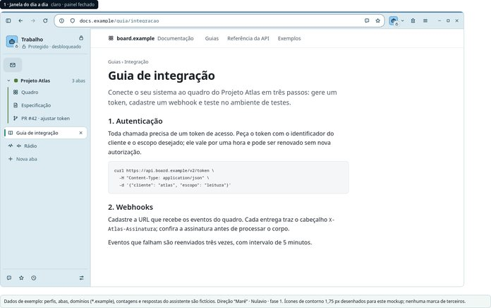
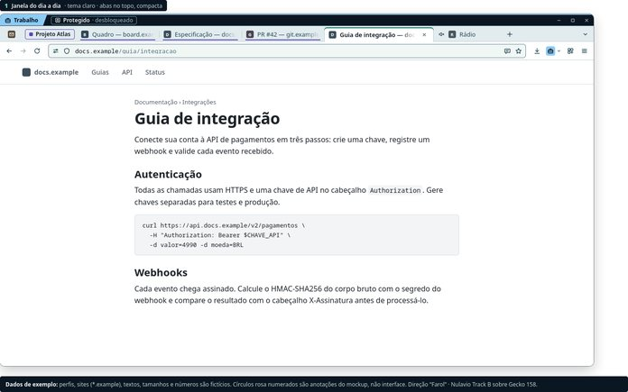
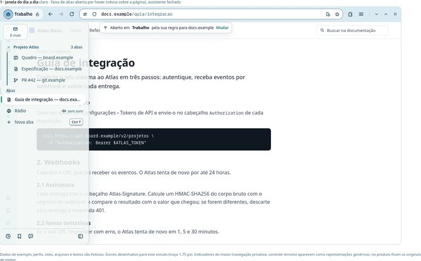

### Judging

Two independent judges looked at the rendered mockups and scored them from 1 to 5 under weighted criteria.

| Lens | Maré | Farol | Névoa |
|---|---:|---:|---:|
| UX, brand and cost (Zen/Dia/Arc/Opera/Vivaldi re-derived, originality, brand fit, 1366×768, pt-BR, rebase cost, translucency risk) | 3.57 | **3.71** | 3.60 |
| Security states and accessibility (8 states unmistakable and unhideable, safe action primary, ADR 0007, contrast, focus and targets, reduced motion/transparency/contrast, light/dark parity) | 3.90 | **4.10** | 3.95 |

Both judges chose Farol. Its band is a row the page cannot paint, so the host in the address bar is never cut by state badges, and Nulavio's pages get a trusted header without an engine patch.

Weaknesses they found:
- **Maré:** the identity was too faint to recognise at a glance, and the right-hand assistant panel would need a patch.
- **Névoa:** the blur failed in Gecko and page text showed through the tab strip; the private window was weak in dark.
- **All three:** they drew raw automation on a user profile, which ADR 0007 forbids.

### Decision: Farol, with grafts

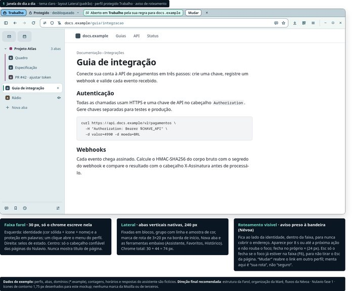

Mockup and rationale: [final.html](directions/2026-10/final.html), [final-rationale.json](directions/2026-10/final-rationale.json).

**From Farol**
- The band, 30 px with 24 px targets. On the left, the identity flag (solid fill, glyph, name) and the protection in words; on the right, the state seals. It never shows page content.
- The window controls are not moved. On KDE the server-side title bar sits above the band.
- The light theme uses a tonal band, not a black bar.

**From Maré**
- Native vertical tabs as the default layout, called "Lateral": 30 + 44 = 74 px of chrome. "Abas no topo" and "Foco" are presets; no preset hides the band or the address bar.
- The route mark: 16×2 px, 3×20 px in vertical tabs, stronger in light mode.
- A tab-group palette kept apart from identity and status colours.
- Inline status in Settings.

**From Névoa**
- Two grammars:
  - Calm surfaces are tonal, with 8–14 px radii, and may animate.
  - Security signals are opaque, with 4 px corners, pattern, glyph and word. They never animate, stay in a fixed place and are never translucent.
- The routing notice inside the band: "Aberto em Trabalho pela sua regra · Mudar".
- The consent-drift message in the assistant.
- The new tab "Você está em …", with facts in one line.

**Reserved patterns**, never used by identity colours:

| State | Pattern |
|---|---|
| Temporary | Dashed |
| Private window | Dotted plum, on Nulavio's own private chrome instead of Mozilla's purple |
| AI Workspace | Horizontal lines and a double frame |
| Raw automation | Diagonal stripes and a critical seal. Only inside an AI Workspace, with the agent and "Controle total" named |
| Guard | Amber seal with a count, and a bar whose primary is "Revisar mudanças" |
| Fullscreen | A 3 px line in the state's pattern |

**Identity palette**
- Mint leaves the palette, because it means Nulavio and active; it is replaced by lima `#C5E384`.
- Sand becomes `#FDCF8B`, away from the Guard amber.
- "Rosa" is renamed "coral".

**Other rules**
- The chrome is solid. Translucency is optional and limited to the new tab, with a "Reduzir transparência" setting.
- The assistant opens in the native sidebar panel next to the tab list. Before Send it shows the destination and the full request size, conversation included. Switching destination starts a new conversation.

Before the decision, two skeptical reviewers checked the final mockup (security and policy; accessibility, copy and feasibility on Firefox 159). Both of their reports were confirmed in the rendered pixels: 33 defects, all fixed. The mockup now has 160 contrast pairs with zero failures, and identity and state colours are at least ΔE OK 7.6 apart.

Two examples of what changed:
- **Quick actions.** They are drawn the way the engine renders them: one row per action after ">".
- **Downloads.** There is no "critical download" state, because Track B has no download reputation yet (R15).

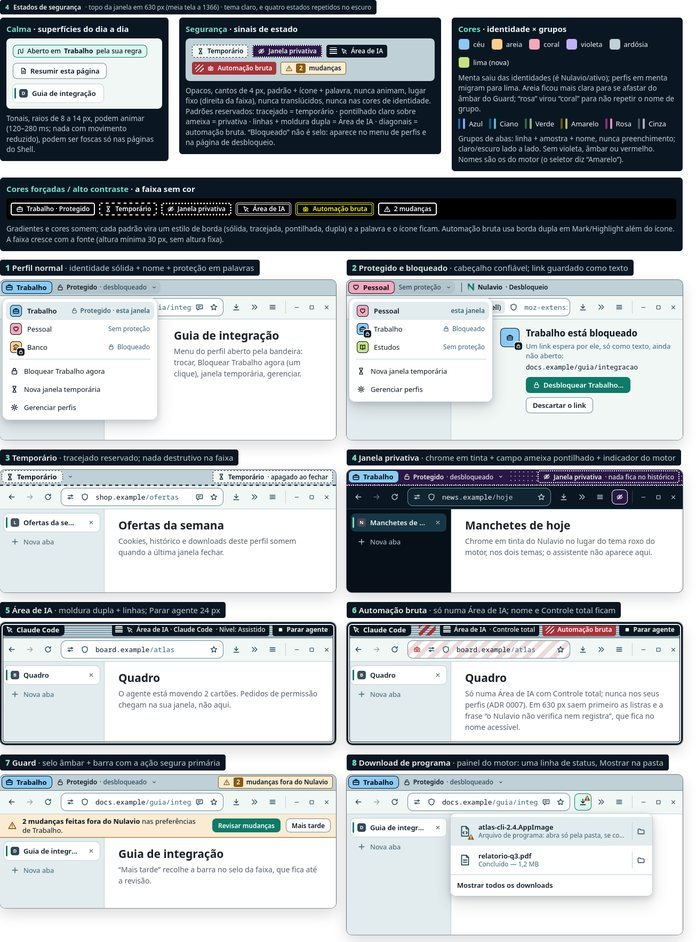

The decisions taken with this direction (D-UX1 to D-UX23) are listed in the [execution plan](../product/execution-plan.md#ux-redesign-programme-from-2026-10-27).

## 2026-10-25: Horizon, the first window theme

Status then: **decided (2026-10-25): Horizon**, with Monoline's density as the compact mode.

The brand itself was chosen earlier ([brand explorations](../brand/explorations.md): Obsidian Current). This page decides how the **browser window** looks. All three directions draw the same slice of the window: tab strip with a pinned tab, a muted tab and the selected tab; toolbar; address bar with the trust and tracking icons; extension buttons. Only tokens and geometry change. Generator: `scripts/brand/ui_directions.py`. It renders the PNGs below with headless Firefox and measures contrast on the pairs the chrome uses.

### The proposed palette, checked against the brand

The brief proposed Deep Ocean `#0C1822`, Slate `#193946`, Mint `#7BE5D0`, Cloud `#F1F7F8`, Amber `#E4AC68`. Each sits within ΔE76 1.5–4.5 of a brand primitive that already passes 29 (now 55) WCAG pairs:

| Proposed | Brand token | ΔE76 |
|---|---|---:|
| Deep Ocean `#0C1822` | navy.900 `#0B1623` | 2.5 |
| Slate `#193946` | navy.800 `#183746` | 1.7 |
| Mint `#7BE5D0` | mint.400 `#6FE0C5` | 4.5 |
| Cloud `#F1F7F8` | navy.50 `#F1F7F5` | 1.5 |
| Amber `#E4AC68` | amber.400 `#E7AE61` | 4.5 |

A difference of about 2.3 is the threshold at which people notice two colours differ. So the brief's palette is the brand palette. We keep the validated primitives instead of adding near-duplicates.

### A. Horizon: ocean and mint

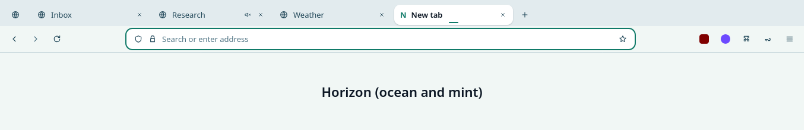
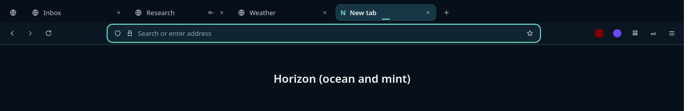

- Tones separate the areas, without lines: deep tab strip, lighter toolbar, raised selected tab.
- The selected tab carries a short mint **route mark**, the line from the Nulavio symbol. It is also the non-colour cue that makes the selection visible at 3:1 (WCAG 1.4.11).
- Address bar 36 px with a 14 px radius, 10 px elsewhere. That is geometric, against the 24 px pills of Firefox 158 ("Nova").
- **Trade-offs:** it relies on tone steps that sit close together in light mode; the route mark carries the selection. Blue-green chrome is common on Linux desktops (Breeze) and may blend in.

### B. Graphite and copper (no blue or green)

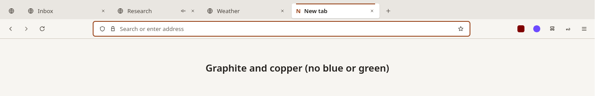
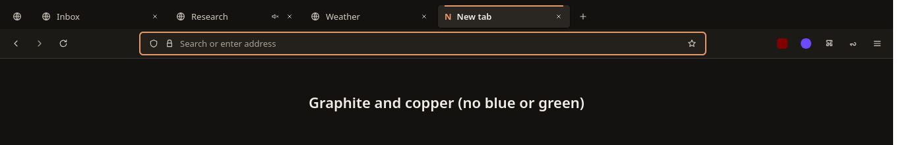

- Warm neutrals (paper and graphite), 4–6 px radii, a copper top line on the selected tab.
- **Trade-offs:** distinctive and calm, but it breaks with the logo and site (mint). Copper sits near amber (warning) and red (critical) in hue, so states would rely more on icons and words. It needs a second set of primitives and contrast pairs.

### C. Monoline: dense, neutral, accent only on focus

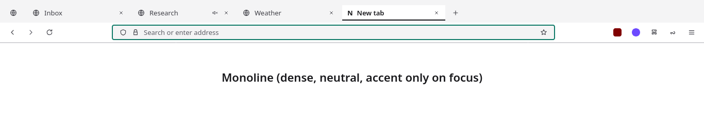
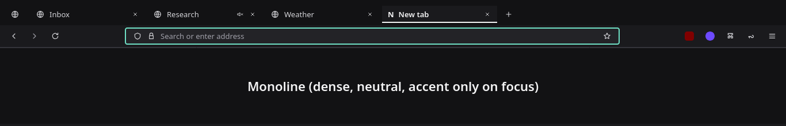

- 30 px tabs, square tabs with a hairline, flat address bar, mint only on keyboard focus.
- **Trade-offs:** best for 1366×768 and dense work, and the cheapest to carry, but the least memorable. It looks like many minimal themes, and the brand appears only on focus.

### Scoring

Contrast: all three pass **18/18** measured pairs in both themes; the lowest margin is the light placeholder text in each (5.1–5.9 against 4.5). Data: [`assets/directions/contrast.json`](assets/directions/contrast.json).

Scores are 1–5, weighted. The weights follow the brand selection and add implementation cost, because every Firefox release has to carry this.

| Criterion | Weight | Horizon | Graphite | Monoline |
|---|---:|---:|---:|---:|
| Accessibility (AA pairs, non-colour state cues, both themes) | 25% | 5 | 5 | 4 |
| Originality against other browsers (Firefox Nova pills, Chrome, Arc/Zen sidebars, Brave, Vivaldi page colours) | 20% | 4 | 4 | 2 |
| Brand fit (logo, tokens, site) | 20% | 5 | 2 | 3 |
| Implementation and rebase cost (upstream variables only?) | 15% | 5 | 4 | 5 |
| Small screens and density | 10% | 4 | 4 | 5 |
| Harmony with Breeze/Adwaita, light and dark | 10% | 4 | 4 | 4 |
| **Weighted** | | **4.60** | **3.85** | **3.65** |

### Decision

**Horizon**, because it is the brand already chosen and validated. It is implemented entirely by re-valuing upstream variables plus one decorative mark, which is why it was the cheapest to carry. Taken from Monoline: its sizes become the **compact density** (30 px tabs and field). Taken from Graphite: keep warm-neutral surfaces in mind for a future "paper" accent option. That option is not planned until there is demand.
