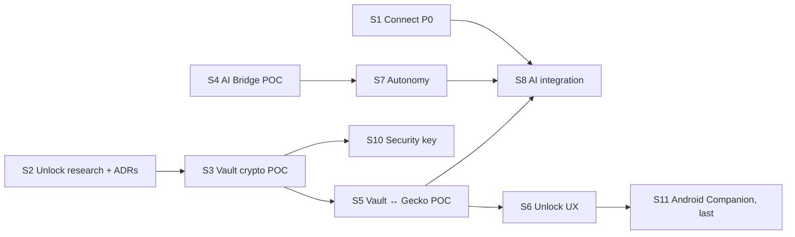

# Execution plan (from 2026-10-26)

How the open work is sequenced: the next steps already on the [roadmap](roadmap.md) plus two new programmes, **Secure Profiles: Vault and unlock** (phone, OS, password, security key) and **AI Bridge** (agents, autonomy, browser automation). Each slice is a vertical piece that ends with real tests; nothing is "done" while it is only UI or a mock.

## Project goal (set by the maintainer, 2026-10-26)

**Finish the whole project**: Nulavio 1.0 for Linux (Fedora KDE first, then Ubuntu), with Windows evaluated. Work proceeds slice by slice in the order below without pausing between slices; it stops only for something only the maintainer or a third party can provide.

Nulavio is complete when all of the following are verified (tests or recorded evidence), not just implemented:

1. Every roadmap phase's DoD (0–6, 2b, 2c, 2d) and the [release criteria](release-criteria.md) alpha gate.
2. Secure Profiles: encrypted profiles at rest with real lock/unlock; password, recovery code and OS methods; phone unlock with the Android Companion (F-Droid build); at least two recovery methods; protection states shown truthfully.
3. AI Bridge: real agents (Codex CLI, Claude Code) connected through the wizard; the four autonomy levels behave as granted; revocation and emergency stop; no access to locked profiles.
4. Packaging and updates: signed RPM in a signed repository, SBOM attached, update SLA rehearsed; Debian/Ubuntu package from the same engine build (patch 0006 reads the distribution's system directory).
5. Hardening: Guard runtime checks, regression suite over real sites, documentation of every residual risk.

| Needs the maintainer or a third party | When |
|---|---|
| Trademark searches (INPI, USPTO, EUIPO) | Before a public 1.0 |
| Google Safe Browsing quota review; download-protection access (R15) | Alpha gate |
| Signing keys for packages and the repository; F-Droid and Play Store accounts | Packaging (phase 6), S11 |
| Android SDK installation (approved: when S11 starts) and the test phone | S11 |
| A FIDO2 security key (D5) | S10 |
| Independent security audit (U11, A14) | Before 1.0 |
| Test vulnerability report to `security@nulavio.net` | Alpha gate |

## Where we are

| Area | State (verified) |
|---|---|
| Engine | Firefox 159.0 source build (Track B), 7 patches, rootless container build; Track A launcher over distribution Firefox |
| Shell | Built-in add-on with privileged modules: new tab, download warning, search, profiles, Smart Profile Routing (links from apps, typed addresses, link menu) |
| Profiles | Engine profile groups (`SelectableProfileService`); isolation by separate instances and directories; **no encryption at rest yet** |
| Guard | Launcher pre-launch audit (`guard.py`); refuses profiles with automation prefs (Marionette, remote agent) |
| Vault, unlock | **Nothing yet** |
| Automation | Marionette/WebDriver BiDi exist in the engine; Nulavio uses them only in tests on throwaway profiles |
| Tooling on the reference laptop | gocryptfs 2.6.1, cryptsetup, libsodium 1.0.22, TPM 2.0 (`/dev/tpmrm0`, user not in `tss`), Claude Code 2.1.308, Codex CLI 0.164.0, Node 24; no Android SDK, no FIDO tools, no Playwright |

## Workstreams

| Stream | Content | Spec |
|---|---|---|
| W1 Connect | Nulavio Connect P0 discovery + Integration Manager, default-browser offer | [ADR 0004](../adr/0004-nulavio-connect.md) |
| W2 Routing and profiles | Routing M5 (in-page navigation, after security review), Temporary profile | [ADR 0003](../adr/0003-nulavio-profiles-and-routing.md) |
| W3 Vault and unlock | Nulavio Vault, Unlock Coordinator, Platform Key Provider, Phone Unlock, Hardware Key Provider | [Brief](briefs/2026-10-26-profile-unlock.md); roadmap phase 2c; ADR `phone-profile-unlock` to be written in U2 |
| W4 AI Bridge | MCP server, agent registry, permission and autonomy manager, Gecko adapter, profile access, audit | [Brief](briefs/2026-10-26-ai-bridge.md); roadmap phase 2d; ADR to be written in A2 |
| W5 Existing phases | Privacy panel, password-provider certification, Guard runtime, packaging, alpha | [Roadmap](roadmap.md) phases 3–6 |

## Sequence

One slice per working session, in this order. Sizes are relative (S ≈ one session, M ≈ two, L ≈ three or more); they are not dates.

| # | Slice | Scope | Done when | Depends on | Size |
|---|---|---|---|---|---|
| S1 | **Connect P0** (W1) — **done 2026-10-26** | `nulavio integrations` (read-only discovery with evidence: Plasma Browser Integration, portals, Secret Service/KWallet, default browser and URL handlers), Integration Manager page, "make Nulavio the default browser" offered, never automatic | Discovery tests against fake and real D-Bus services on a private bus; nothing changes without a click | — | M |
| S2 | **Unlock research and decisions** (W3: U0–U3) — **done 2026-10-26** | Repository audit; compatibility report with official sources for WebAuthn hybrid + PRF (Windows/Linux × Android/iPhone, each cell SUPPORTED_AND_TESTED / DOCUMENTED_NOT_TESTED / EXPERIMENTAL / UNSUPPORTED / UNKNOWN), Companion app, approval-only; ADR `phone-profile-unlock`; ADR Vault key management (DEK, envelopes, metadata, rotation, crash consistency, recovery); anti-infostealer threat model for unlock; trust-boundary and key-flow diagrams; protection-state matrix (`encrypted_at_rest`, `os_user_protected`, `password_protected`, `hardware_bound`, `phone_approved`, `phone_key_release_verified`) | ADRs accepted by the maintainer; every compatibility claim has a source or a test | — | M |
| S3 | **Vault crypto POC** (W3: U4, U5 simulated) — **done 2026-10-26** ([ADR 0006, implementation](../adr/0006-nulavio-vault.md#implementation-s3-2026-10-26); 60 tests in `tests/unit/test_vault.py`, all 16 mandatory tests of the brief) | Standalone, artificial data only: random profile DEK, AEAD envelopes per unlock method, versioned metadata with domain separation, atomic writes; providers: password (Argon2id), recovery code (high entropy), OS keyring (Secret Service; reported as `os_user_protected`, not hardware); **phone protocol simulated** (desktop + a reference "phone" in the test suite): pairing with QR invitation + user confirmation, challenge bound to profile/device/operation/expiry, HPKE-style E2E release, replay and substitution rejected | All tests listed in the spec that do not need a real phone pass on Fedora KDE, including "copying the protected files does not recover the DEK" and "no plaintext secret after a crash" | S2 | L |
| S4 | **AI Bridge foundation** (W4: A0–A4, A7 first cut) — **done 2026-10-26** ([ADR 0007](../adr/0007-ai-bridge.md); real Claude Code connects and is held to its grants; Codex CLI tested end to end once the account's usage limit reset) | Audit; compatibility matrix (Nulavio MCP, WebDriver BiDi, Marionette, firefox-devtools-mcp, Playwright, CDP: documented vs implemented vs tested); ADR AI Bridge; threat model for automation and autonomy; **POC**: Nulavio MCP server (stdio) driving a throwaway *AI Workspace* profile (tabs, navigate, read page, accessibility snapshot, screenshot, click, type), with a policy decision point outside the model and per-capability grants (ask / allow for task / session / period / always / block) | Real clients connect and run tools: Claude Code and Codex CLI with throwaway configuration (no change to the user's agent configs); denied capabilities are denied; revocation stops new calls | — | L |
| S5 | **Vault ↔ Gecko profile POC** (W3: U8 spike) — **done 2026-10-26** ([ADR 0006, S5](../adr/0006-nulavio-vault.md#implementation-s5-2026-10-26-encrypted-profile-storage)) | Encrypted profile container for a throwaway profile (gocryptfs, already installed): unlock = derive the volume key from the DEK and mount before the engine starts; lock = end the instance and unmount; profile switching and routing respect locked profiles; no direct changes to Gecko storage files | A locked profile's files are unreadable at rest; unlock/lock cycles survive crashes; routing to a locked profile asks to unlock instead of opening | S3 | M |
| S6 | **Unlock UX** (W3: U9 first part) — **done 2026-10-26** ([ADR 0006, S6](../adr/0006-nulavio-vault.md#implementation-s6-2026-10-26-unlock-and-onboarding-in-the-browser)) | Onboarding with three decisions (profile, protection, recovery), locked-profile screen, recovery setup and test, "use another method", device list; Horizon components; only real operations (password, recovery code, OS keyring) | Every screen state (`idle` … `error`) reachable in tests; contrast and keyboard checks | S3, S5 | M |
| S7 | **AI Bridge autonomy** (W4: A5–A8) — **done 2026-10-26** ([ADR 0007, S7](../adr/0007-ai-bridge.md#implementation-s7-2026-10-26-autonomy-permission-requests-settings)) | Gecko adapter hardening; agent registry and sessions (identity, Unix-socket peer credentials + short-lived tokens); Restricted / Assisted / Autonomous / Full control; activity indicator, pause, revoke, emergency stop; audit log with retention | The A10 permission and autonomy tests pass, including "Autonomous does not ask for actions already granted" and "revoked agents stop" | S4 | L |
| S8 | **AI Bridge integration** (W4: A9–A11) — **done 2026-10-26** ([ADR 0007, S8](../adr/0007-ai-bridge.md#implementation-s8-2026-10-26-connect-wizard-profiles-and-routes)) | "Connect agent" wizard (detect, show exact config change, write only after approval), Secure Profiles and Smart Profile Routing per agent, locked-profile rules (unlock before task; delegation only as an explicit, documented extra unlock method), UX screens | Codex CLI and Claude Code connected through the wizard in a throwaway home; per-agent routing works; no access to a locked profile | S5, S7 | L |
| S10 | **Security key provider** (W3) | FIDO2 hmac-secret/PRF as an unlock method when the key supports it; capability detection; PIN/UV | A real key unlocks a test profile; a key without hmac-secret is refused clearly | S3; a key | S |
| S11 | **Phone Companion, Android POC** (W3: U6–U7), **last** — **built 2026-10-27; real-phone run open** ([ADR 0005](../adr/0005-phone-profile-unlock.md#implementation-s11-2026-10-27)) | Only after the S2 ADR is approved and the desktop side is done: small Android app (Keystore/StrongBox, BiometricPrompt-bound key use), pairing and unlock against the S3 protocol, revocation, lost-phone and recovery tests. Free-software build only (no Google Play Services, no Firebase push, no trackers) so it can ship on **F-Droid first**; Play Store later. Test device: Samsung Galaxy S24+ (Android 17) | Real device unlocks a test profile; replay/expired/unpaired/substituted cases fail; F-Droid build recipe reproducible | S2, S3, S5, S6 | L |
| S12 | **Temporary profile** (W2) — **done 2026-10-26** ([ADR 0003](../adr/0003-nulavio-profiles-and-routing.md#temporary-profile-implementation)) | A new, empty profile in its own instance, kept in memory where the system allows, deleted by the Nulavio tools when it exits; selector, Settings, `nulavio run --temporary` | Deleted after exit on the real engine; identity and storage note shown truthfully; nothing left outside its folder but the launcher log | — | S |
| S13 | **Guard runtime** (W5, phase 5) — **done 2026-10-26** ([hardening](../security/hardening.md#guard-at-run-time-what-it-catches-and-how-it-can-be-bypassed)) | Extension-set change alert (an extension added or changed while the browser was closed), profile integrity manifest (prefs that weaken protections, policies, `user.js`, native-messaging hosts), with a bypass analysis | Each check has a test that tampers with a closed profile and sees the alert; documented what same-user malware can still do | — | M |
| S14 | **Per-site privacy panel** (W5, phase 3) — **done 2026-10-26** (engine site panel verified; Settings → Site exceptions; Strict tracking protection fixed in the build) | Shell panel for the active site with the engine's real state: tracking protection and what it blocked (engine content-blocking log), HTTPS state, uBO on/off for the site (its own controls), permissions; no invented counters | Values match the engine's own on fixture pages; off switches reversible | — | M |
| S15 | **DoH choice and fingerprinting analysis** (W5, phase 3) — **done 2026-10-26** ([fingerprinting](../research/fingerprinting.md)) | Onboarding choice for DNS over HTTPS (off / engine default / a chosen resolver), explained; fingerprinting regression analysis against the engine's protections | Choice applied and reversible; the analysis recorded with sources | — | S |
| S16 | **Real-site regression suite** (W5, phase 3 DoD) — **done 2026-10-26** ([report](../research/site-regression-2026-10.md)) | 50 public sites, screenshot diff against a baseline, breakage triage with per-site fixes or recorded causes | A 50-site run recorded; breakage list with causes | S14 | M |
| S17 | **Password flows B and D** (W5, phase 4) — **done 2026-10-26** (Settings → Passwords; look-alike warning through an engine window actor) | Provider chooser (flow B) and suspicious-login interstitial (flow D) from [ux-flows](../brand/ux-flows.md); only the official extensions, no undocumented APIs | Integration tests with KeePassXC (container) and the built-in manager | — | M |
| S18 | **Packaging** (W5, phase 6) — **done 2026-10-26** except signing with the release key ([build](../architecture/build.md#packages-s18)) | RPM spec and a reproducible build in a rootless container; repository tooling ready for the maintainer's signing keys; DEB built with its own `libdir` (R25); SBOM attached | Package installs and starts in a clean Fedora and Ubuntu container; signing waits for keys | — | L |
| S19 | **Updates and security changelog** (W5, phase 6) — **done 2026-10-27** (watcher, workflow, rehearsal, [changelog](../security/changelog.md)); engine CVE fast path added 2026-10-27 in S25 | Update SLA automation (upstream release watch, rebuild, test, publish steps), security changelog format | A rehearsal from an upstream point release to a test package | S18 | M |
| S20 | **AI A12–A14** (W4) — **A12 and A13 done 2026-10-27** ([ADR 0007](../adr/0007-ai-bridge.md)); A14 hardening items done, Windows with U10 | Built-in assistant under the same policies (provider-agnostic, keys only from the user), raw BiDi mode described as unconfinable, hardening and multi-platform tests | A12 works with a user-supplied provider in tests without real keys; A13/A14 tests | S8 | L |
| S21 | **Connect P1/P2** (W1) — **done 2026-10-27** ([ADR 0004](../adr/0004-nulavio-connect.md)) | KRunner, KDE Connect send link, screen-cast status, passkeys status, notifications; MPRIS, activities, per-profile proxy | Each item tested on a private D-Bus with real or fake services | S1 | L |
| S22 | **Routing M5** (W2) — **done 2026-10-27** ([review](../security/routing-m5-review.md)) | Security review first (redirects, POST, scripted navigation), then automatic in-page routing if the review allows | Review recorded; tests for every refused case | — | M |
| S23 | **Phase 5 spikes** (W5) — **done 2026-10-27** ([report](../security/phase5-spikes.md)) | bubblewrap, Flatpak and the native-messaging portal, SELinux module; sensitive-sites container with clear-on-close | Each spike ends with a recorded decision and, where adopted, a test | — | L |
| S24 | **Alpha gate** — **walked 2026-10-27** ([result](release-criteria.md#alpha-gate-walk-through--2026-10-27-s24)): everything verifiable here passes; the release waits on maintainer items | Walk the [release criteria](release-criteria.md); collect the items only the maintainer can provide | Every criterion verified or listed as a maintainer item | all | M |
| S25 | **Security pipeline** (W5) — **built 2026-10-27**; the AI review is off until the maintainer adds a credential ([update policy](../architecture/update-policy.md), [dependency updates](../security/dependency-updates.md), [code scanning](../security/code-scanning.md), [pull requests](../process/pull-requests.md)) | Engine CVE fast path: urgency from Mozilla's advisories with a 24-hour target (72-hour deadline), one issue per release that @mentions the maintainer, verified bump, opt-in local timer that pre-builds staged releases. SCA: every pinned dependency checked daily against OSV.dev, the AMO blocklist and the registries; Dependabot; Gradle locking and checksum verification; base images pinned by digest; Companion SBOM. SAST and secrets: gitleaks, Opengrep with Nulavio's own rules, ShellCheck, zizmor and actionlint in CI and in `scripts/security/scan.sh`, optional pre-commit hook. Advisory AI review of pull requests (two jobs, read-only tools, deterministic comment), PR template, pre-push hook. CI minutes: the engine integration run is skipped when only Markdown changes | Unit tests for each part pass; `scan.sh` clean; the first urgent Firefox release after it (159.0) ready to sign within 24 hours (rehearsed by hand, before the fast-path scripts were merged); first real AI review checked against the list in pull-requests.md | S19 | L |
| later | W3 U10 (iOS, Windows evaluation) — **done 2026-10-27** ([report](../research/windows-ios-evaluation.md)); U11 (hardening, independent audit) | | | | |

S1, S2 and S4 have no dependencies on each other; the order above puts the open roadmap item first, then the security foundation, then the AI POC. The Android Companion is deliberately the last slice (maintainer's decision, 2026-10-26): every desktop part, including the simulated phone protocol, is built and tested first.

## Decisions (maintainer, 2026-10-26)

The maintainer accepted the recommendations below, with the Android changes noted in D4.

| # | Decision | Outcome | Affects |
|---|---|---|---|
| D1 | Crypto library outside the engine (the launcher is standard-library Python, which has no AEAD) | **libsodium through `ctypes`** (system package: XChaCha20-Poly1305, Argon2id, X25519; no pip dependency) | S3 |
| D2 | Encrypted profile storage on Linux | **gocryptfs** (installed, user space, per-profile, no root) | S5 |
| D3 | TPM-bound provider (`hardware_bound`) | **Optional, not now**: it needs your user in the `tss` group (sudo); the plan works without it | S3 (optional) |
| D4 | Phone | **Android last** (slice S11). Distribution **F-Droid first, Play Store later**, so the app must be free software with no Google Play Services, Firebase or trackers. Test device: **Samsung Galaxy S24+, Android 17**. Android SDK installed only when S11 starts (outside system directories). iOS stays in the architecture, never claimed without tests | S2 (protocol must not need push services), S11 |
| D5 | Security key | Not answered yet: S10 waits until a FIDO2 key with hmac-secret is available | S10 |
| D6 | AI Bridge implementation | **Nulavio's own MCP server** in standard-library Python; Mozilla's firefox-devtools-mcp evaluated in the matrix; Playwright only in a throwaway directory | S4 |
| D7 | Agent configuration | **Throwaway configuration in tests**; any change to the real Codex or Claude configuration is shown first and written only after approval | S4, S8 |

## Guardrails for every slice

- No secret in plain text on disk, in logs or in the clipboard; tests use artificial data and throwaway profiles only.
- Phone "approval" that does not take part in releasing the key is never presented as strong unlock; no backdoor or Nulavio master key; losing every factor means the data cannot be recovered, and the UI says so.
- No silent downgrade to a weaker unlock method; no remote service required for normal unlock.
- AI autonomy is the user's decision: granted capabilities are honoured without hidden confirmations; nothing is granted that was not; web pages and models cannot change grants; raw protocols are described as unconfinable by high-level policy.
- Gecko sandbox, site isolation, TLS, Safe Browsing and updates are never weakened for convenience; the Guard keeps refusing automation prefs on real profiles unless the user enables an explicit automation mode for that profile.
- Same-user malware with access to an unlocked profile is out of reach of any of this; documentation says so.

## Plan summary

- **Model and effort to execute:** Opus, high effort for S2, S3 and S5 (cryptographic design and key lifecycle; mistakes cost data or security); Opus, medium for S4, S7, S8 (integration work with a defined architecture); Sonnet, medium for S1 and S6 (bounded implementation on existing patterns).
- **Why:** the Vault and unlock work has irreversible failure modes (lost data, false protection); AI Bridge and Connect follow patterns already in the codebase (privileged modules, Shell pages, Marionette tests).
- **Open decisions:** only D5 (a security key) is open; D1–D4, D6 and D7 are decided. S13–S24 need no new decision before they start; S18 needs signing keys only for the signing step.
- **When to escalate to a more capable setup:** if S2 finds that no tested combination releases a key from the phone (hybrid PRF unavailable on Linux and Companion blocked), or if the encrypted-container approach cannot keep Gecko consistent across lock/unlock.
- **Ready to execute:** yes for S1–S8 and S12–S24 (S1–S8 and S12–S24 done; S24's open items belong to the maintainer). S10 needs a security key; S11 (Android) comes last by decision.

## UX redesign programme (from 2026-10-27)

The maintainer's brief: make the experience and look of Nulavio exceptional, with its own coherent identity on every surface, without weakening any protection.
- **Engine target:** Firefox 159.0.
- **Inputs:** the [audit](../design/audit-2026-10-27.md) (107 findings) and the [direction](../design/visual-directions.md): Farol, with Maré's organisation and Névoa's flows.
- **Done means:** each slice ends with tests green, a commit on `main`, a push, and CI green on the full SHA. Nothing is "done" while it is only a mockup.

| # | Slice | Scope | Done when | Size |
|---|---|---|---|---|
| UX0 | **Record** — done 2026-10-27 | Audit and findings, "before" captures, the three directions and the final one (HTML mockups, rationales, renders), the decision, revised UX principles, this programme | Docs tests green | S |
| UX1 | **Security, consent and honesty fixes** — **done 2026-10-28** ([CI](https://github.com/caiolombello/nulavio/actions/runs/40696267881), `8dd50fe5908aee17df464c21b1e7eafafde11496`) | See the list below | Real Track B package: 187 integration tests, 13 skips; 586 unit tests, 3 skips; Fedora/Ubuntu CI green | M–L |
| UX2 | **System** — **done 2026-10-28** ([CI](https://github.com/caiolombello/nulavio/actions/runs/40751057936), `0dd29501fff5156c1c3e10837ed7a12202f439c5`) | Tokens v2, component layers, real gallery and identity migration | 600 unit tests (1 skip), 194 real Track B integration tests (13 skips), 208/208 contrast pairs; Fedora/Ubuntu CI green | L |
| UX3 | **Window** | See the list below | Security-visibility matrix: each state × each preset × both themes; on screen, opacity 1, `elementFromPoint`, host not truncated | L |
| UX4 | **Shell pages** | See the list below | Integration tests per page state, both themes; every `data-state` captured | L |
| UX5 | **Assistant** (Dia-like, under ADR 0007) | See the list below | Assistant tests: chips, drift, private refusal, cancel, stream, truncation, approval in front | L |
| UX6 | **Safe personalisation** | See the list below | No option can turn a protection off (test over the option list); contrast pairs for every variant | M |
| UX7 | **Motion and finish** | See the list below | Captures and docs current; reduced-motion test; perf budget recorded | M |

**UX1 — Security, consent and honesty fixes**
- **Assistant.** It finds the page in 158+ (AI-01), together with consent bound to a tab (AI-02) and no assistant in private windows (AI-15). The emergency stop also stops Ask, and the approval tab opens in front.
- **Prefs.** Mozilla AI, promos, account and theme picker are turned off.
- **Agent request.** Deny is the primary action, and requests show risk tiers.
- **Full control.** The consent text is localised. Raw automation becomes separate and gets its own window state.
- **Other pages.** The DNS "keep" button; neutral focus on the 6-digit comparison; look-alike "continue" states its consequence and can be undone; the download warning follows severity and gets the light critical colour.
- **Contrast.** Address-bar results and the sidebar focus ring; a scheme-aware Nulavio symbol.

**UX2 — System**
- **Tokens v2:**
  - type roles in rem;
  - the band and the surfaces;
  - elevation that changes per theme;
  - motion easings, with their reduced-motion variants;
  - z-index, scrim, selection and focus on accent;
  - reserved `security.*` cues;
  - the tab-group palette;
  - the identity palette;
  - translucency with an opacity floor and a solid fallback.
- **Generator.** It fails on any token defined for one theme only.
- **Contrast checks v2.** Composited pairs, and the exact set of pairs checked.
- **Shell CSS.** Split into base, component and page layers, with a state matrix and prefers-contrast and forced-colours blocks.
- **Component gallery.** Pinned with pngdiff baselines.

**UX3 — Window**
- **The band.** A toolbar area registered by a privileged Shell module, holding the identity, protection, seals, the trusted header and the profile menu.
- **Horizon v2:**
  - the vertical list and the route mark;
  - tab groups, address-bar results, panels and the sidebar;
  - private-window chrome, and the AI Workspace and raw-automation frames;
  - the temporary seal and the fullscreen line;
  - the downloads program badge and the Guard bar.
- **Layout presets.** Set by prefs.
- **Sidebar tools.** Curated, with the bookmarks bar (D-UX13).

**UX3A — band and safety grammar (rebuilt and locally verified, 2026-10-29).**
The trusted identity/protection band, principal-derived system-page header,
composed temporary/private/agent/raw/Guard cues and compact fullscreen line are
implemented in `baa432b5b544597ecf908eb4054cb5553691f727`, on base
`cf548dfb19868c319f8164c6ba469b5e473fbeee`.
[Implementation and limits](../design/design-system.md#ux3a-trusted-band-and-window-safety-local-implementation-2026-10-28),
[initial verification](../design/screenshots/ux3a/verification.json),
[real rebuilt-package verification](../design/screenshots/ux3a/release-verification.json):
600 unit tests (1 skip), 207 integration tests (13 skips), 220 contrast pairs,
94 packaged-source matches and an independent automated review without
actionable findings. Publication and remote CI are separate gates.
This does not close UX3: tab groups, downloads badge/patch 0007, presets and
personalisation, Shell pages and assistant flows remain later work.

**UX3B — native groups (rebuilt and locally verified, 2026-10-29).**
On the exact published UX3A base `25e591d8ef8184a4aaf0da6b535bf7d86c1248d6`,
Horizon uses native group names, swatches and thin lines, preserving the active
route mark, native ARIA/navigation and stored colours. D-UX16 filters new
orange/purple/red choices; a selected legacy colour remains visibly named and
checked until replaced. A lifecycle-scoped editor getter limits default/new
colour selection; CSS alone cannot change its native nine-name candidate set.
[Implementation and limits](../design/design-system.md#ux3b-native-tab-groups-local-application-copy-verification-2026-10-29),
[local evidence](../design/screenshots/ux3b/verification.json).
The parent rebuilt Track B 159.0, matched 94 packaged-source entries and
corrected the review's native action contrast regression (1:1 before the fix).
The final full-suite repeat passed 218 integration tests (13 skips); 600 unit
tests (1 skip), the English 11-test group suite, 15 engine opt-in tests and 256
contrast combinations also passed. The initial full run's Vault creation
timeout and three cascading errors are retained with cause UNKNOWN: the
isolated create, all nine Vault tests and the bounded full repeat passed, which
does not establish a root-cause fix. No deadline or security assertion changed.
[Parent real-build report and captures](../design/screenshots/ux3b/release-verification.json)
also record the four actual native editor captures from a private Xvfb session.
Main publication and exact-SHA CI are separate post-commit gates.
Downloads/patch 0007, presets/onboarding, sidebar curation, Shell pages,
assistant flows and broad motion remain later slices; UX3 is not complete.
UX3A's separate [publication CI](https://github.com/caiolombello/nulavio/actions/runs/40819764438)
passed all six jobs, and the parent's additional local engine opt-in run passed
15/15 including live phishing blocking; its immutable release evidence is retained.

**UX3C — native downloads type badge (local implementation, 2026-10-29).**
On base `957a1bbe0693cc5ba4950b123686ec5d7201712d`, D-UX18 uses the native
warning triangle for program entries in the real privacy-scoped Downloads API
list. Membership persists across completion/cancel/error and panel
acknowledgement, and clears on last-item removal/list cleanup; native severe,
progress and all original patch-0007 guards remain intact. A detached-view
regression prevents stale indicator weak-map keys from creating a ghost badge.
[Implementation and lifecycle](../design/design-system.md#ux3c-native-downloads-type-warning-2026-10-29),
[actual rebuilt-package evidence and retained failed attempts](../design/screenshots/ux3c/verification.json).
The initial candidate stopped at local commit `550e812b059cdcc2fa68d8892fa0c5fb8a08729b`:
two full runs failed at Vault creation and remain preserved with their original
UNKNOWN classification. The parent reproduced a first-store initialization
race before encryption, added real-Gecko regressions and coordinated profile
and routing writers with identity reads. [Parent verification](../design/screenshots/ux3c/release-verification.json)
records the final real build: 99 packaged-source matches, 231 integration
tests (13 skips), 600 unit tests (1 skip), all nine indicator cases per locale,
15 engine opt-in tests and 256 contrast combinations passed. The full-run
fixture version and the later exact-private-window fixture strengthening are
recorded separately. Publication/CI are post-commit gates.
Presets/onboarding, sidebar curation, Shell/assistant flow redesigns and
later UX3 work remain open. No D-UX decision is reopened.

**UX3D — explicit native layout presets (rebuilt and locally verified, 2026-10-29).**
On base `419f5ec99137d601a885d66cbaab3780e27908e0`, Settings offers real
Lateral, Abas no topo and Foco through a fixed privileged allowlist. Selection
comes from Gecko159 prefs and actual per-window state; native controls update
it, and non-matching arrangements are Personalizado. Native session restore
and backup state retain expansion; independent profiles keep their own layout.
No startup/default/migration write, new shortcut, native patch or Horizon CSS
is added. An open assistant panel is preserved (D-UX22).
[Mechanisms and scope](../design/design-system.md#ux3d-explicit-native-layout-presets-2026-10-29),
[build, tests, retained failures and captures](../design/screenshots/ux3d/verification.json).
UX3C's separate [publication CI](https://github.com/caiolombello/nulavio/actions/runs/40903066116)
on `419f5ec99137d601a885d66cbaab3780e27908e0` passed all six jobs. For UX3D, the
parent fast-forward integrated `1165765b7c2564602ce800ccf838dc9d413619d0`,
rebuilt Track B 159.0 cleanly after reversing the stale pre-UX3C patch `0007` in
the main build tree, matched 98 packaged-source entries (`browser/omni.ja`
byte-identical to the child final build), and passed 241 integration tests
(13 skips), 601 unit tests (1 skip), 10 layout-preset tests per locale, 15
engine opt-in tests including live phishing blocking, all six security scans and
256 contrast combinations; an independent static review reported 0 P1/P2 and 4
P3 follow-ups ([parent verification](../design/screenshots/ux3d/release-verification.json)).
Publication/exact-SHA remote CI and human approval are separate gates. UX3 is
not complete: D-UX2's safe new-profile adoption/migration and first-run choice
belong to the next slice; D-UX13, D-UX17, D-UX23, extra sidebar curation,
Shell/assistant redesign, command palette and split view remain open.

**UX3E — Lateral for new profiles and the first-run choice (locally verified, 2026-11-02).** On base `5a98bd703233` (D-UX2):
- **New profiles.** A genuinely new profile starts in Lateral, and its first new tab asks once, in pt-BR and en-US, whether to keep it, with the three presets live and synced with Settings.
- **Existing profiles.** A profile with any earlier sign of use keeps its layout untouched and is never asked. Private windows, temporary profiles and Áreas de IA are never asked either.
- **Writes.** Only `sidebar.verticalTabs`, `sidebar.visibility` and two `nulavio.layout.*` markers, never over a locked pref.
- **UX3D follow-ups closed.** Resilient `onChanged` registration, and tabs moved between windows.
- **No patch.** No new patch, no new manifest permission, and no change to Vault, AI, Guard or downloads.

[Mechanisms](../design/design-system.md#ux3e-lateral-for-new-profiles-and-the-first-run-choice-2026-11-02).

Verified on a real incremental Track B 159.0 build (BuildID `20261102120448`), whose 98 Shell/branding entries match the source:

| Check | Result |
|---|---|
| Unit tests | 603 (3 skips) |
| Integration tests | 245 (13 skips) |
| `test_layout_presets` per locale | 14, including a real upgrade of a profile created by the 5a98bd7 build: it keeps Abas no topo, with no prompt |
| Contrast pairs | 256 |
| Generated tokens | current |
| ruff | clean |
| Security scans | all six |

Physical desktop checks, publication and exact-SHA CI are separate gates.

**UX3E QA follow-up (locally verified, 2026-11-02).** The functional QA of `20261102120448` (not fit: 1 high, 3 medium, 11 low) is answered on the same branch: a window closing mid-transition no longer wedges the layout queue (A-1); a `sidebar.*` policy keeps new profiles out of adoption on every run (M-1); the first window shows the choice and the "new tab has changed" notice no longer covers it, with Settings offering the pending choice too (M-2, the functional part of UX3F A3 taken unchanged); Foco expanded with the sidebar button stays Foco (M-3); lows B-2, B-3, B-7, B-8 and B-9. B-11 (150 % fold) stays open; B-1, B-4 to B-6, B-10 and B-12 to B-14 are recorded with reasons ([details](../design/design-system.md#ux3e-qa-follow-up-2026-11-02)). No new permission, pref writer or patch.

Verified on a real incremental Track B 159.0 build of `f3dfa89` (BuildID `20261102164518`, tarball sha256 `d61608f3…29edda2`), installed as a full application copy (distribution and tools), every suite run alone:

| Check | Result |
|---|---|
| Unit tests | 604 (3 skips) |
| Integration tests | 250 (13 skips); 3 failures: `test_ai_bridge` 13 and `test_horizon_groups` 11 fail the same way on the 8880bdd build here (environment), `test_temporary` 01 is intermittent under full-suite load (passes alone, 3 of 3) |
| `test_layout_presets` per locale | 19 in pt-BR and en-US, including the real upgrade from 5a98bd7; the new A-1, M-1, M-2, M-3 and low-severity tests fail on the 8880bdd build |
| Contrast pairs | 256 |
| Generated tokens | current |
| ruff | clean |
| Security scans | all six |

**UX3F — visual review against Zen, and polish (locally verified, 2026-11-02).** On base `8880bdd` (UX3E), from the visual QA of build 20261102120448:
- **Done.** A1 quiet neutral band (alert states unchanged), A2 Horizon on the engine's internal pages (`in-content.css`, Nulavio artwork, no "Firefox Suggest" heading, Labs hidden), A4 visual layout choice above the fold, A5 tighter vertical tabs with a 3 x 20 edge mark, 224 px Lateral and eased motion, M1, M4–M8, B2, B4, B5.
- **Mostly done.** A3: the first window shows the Shell's new tab with the choice, without the "new tab changed" notice, bookmarks bar or white page; the page is still served as a Shell extension page (address-bar chip and the engine's ~60 ms about:blank frame remain).
- **Partly / open.** M2 keeps the control edge at rest (WCAG 1.4.11), M3 content radius during the sidebar animation, B1 band label on system pages (kept as the trusted-surface label), B3 result pills.
- **Engine.** Patch 0008 (sidebar animation curve and collapse time via prefs). No new manifest permission, CSP unchanged, nothing in Vault, AI, Guard or downloads beyond colours.

[Mechanisms, item table and polish](../design/design-system.md#ux3f-visual-review-against-zen-and-polish-2026-11-02). Real 159.0 build 20261102153026: 246 integration (13 skips; the one failure is environmental and identical on 8880bdd), layout 15/15 per locale, 607 unit, 266 contrast pairs, six scans. The UX3E functional QA findings (A-1, M-1, M-2) stay in the UX3E round. Physical desktop checks (compositor, GNOME/KDE menus), publication and exact-SHA CI are separate gates.

**UX4 — Shell pages**
- **Settings.** Two panes, with search, scope labels and inline status.
- **New tab.** "Você está em …".
- **Profile menu.** It shows running and locked profiles, and creating a profile opens a create sheet.
- **Routing.** Current → target, unlock from routing, and the notice in the band.
- **Security moments.** One template, used for unlock, phone, look-alike, download, Guard and agent requests.
- **Vault.** An unlock-methods page and a recovery-code ceremony.

**UX5 — Assistant**
- **Context.** Chips bound to a tab; recipient and full size shown before Send; the drift message.
- **Conversation.** A session thread, Cancel and streaming.
- **Runs.** A run timeline with inline approval.
- **Answers.**
  - errors by cause;
  - truncation flags;
  - sources only on literal matches;
  - a safe Markdown subset.
- **Entry points.**
  - the selection menu;
  - a keyboard shortcut;
  - an address-bar keyword;
  - a quick action.
- **Visibility.** An agent-activity seal in the band.

**UX6 — Safe personalisation**
- **Presets.** Offered in onboarding and in Settings.
- **Appearance.** Density, contrast-checked accents, "Reduzir transparência" and "Mais contraste".
- **Shortcuts.** A link to about:keyboard, Nulavio commands the user can remap, and Nulavio quick actions after ">".
- **Routing.** The default destination for links from other apps.

**UX7 — Motion and finish**
- **Motion tokens applied.** Profile arrival on the band, the sidebar, sheets, chips and toasts; all off under reduced motion.
- **Measurement and captures.** A frame-time scene, and the capture matrix at 100/125/150 %.
- **Docs.** The design docs are refreshed.

### Decisions (maintainer, 2026-10-27: every recommendation accepted)

| # | Decision | Outcome |
|---|---|---|
| D-UX1 | Direction | Farol, with Maré's organisation and Névoa's flows |
| D-UX2 | Default layout for new profiles | "Lateral" (native vertical tabs), chosen again at first run; existing profiles keep theirs |
| D-UX3 | Mint as a profile colour | Removed (mint means Nulavio/active); mint profiles migrate to lima |
| D-UX4 | Raw automation and "Controle total" | Raw automation becomes a separate opt-in with its own confirmation (ADR 0007 amendment; it only tightens) |
| D-UX5 | Emergency stop and assistant pause | They also block questions and page text |
| D-UX6 | Assistant in private windows | Off entirely |
| D-UX7 | Mozilla AI features | Chatbot, smart tab groups, Link Preview key points, Smart Window and `extensions.ml` off by prefs; Link Preview itself off in v1 (background fetch with an identifying header) |
| D-UX8 | Mozilla account and Sync | Off for 1.0 (`identity.fxaccounts.enabled=false`) |
| D-UX9 | "Nulavio" label patch for the address bar | Not now: the band gives a trusted header without a patch |
| D-UX10 | Translucency | Solid chrome by default; optional ambience only on the new tab; "Reduzir transparência" setting |
| D-UX11 | Assistant streaming | Yes (backend change in UX5) |
| D-UX12 | pt-BR for "AI Workspace" | "Área de IA" |
| D-UX13 | Bookmarks bar | Shown only when there are bookmarks |
| D-UX14 | Track B rendered tests in CI | A self-hosted runner later (maintainer). Until then each slice runs the Track B suite locally and records it in the commit message |
| D-UX15 | Identity palette | Mint → lima `#C5E384`, sand → `#FDCF8B`, "rosa" renamed "coral" |
| D-UX16 | Tab-group colours | Orange, purple and red swatches hidden (too close to warning, private and critical); old groups drawn muted; engine colour names kept |
| D-UX17 | Page title in the KDE title bar | Kept (Alt+Tab and taskbar need it); option "Esconder o título da página na barra da janela" |
| D-UX18 | Downloads button | Warning triangle badge for programs (a hunk in patch 0007); no critical download state until download reputation exists (R15) |
| D-UX19 | Routing notice | Inside the band next to the profile flag |
| D-UX20 | Light band tone | navy 200 `#BFD0D6`, with a 1 px ring on identity flags |
| D-UX21 | Autonomy labels | "Nível: Restrito / Assistido / Autônomo / Controle total" |
| D-UX22 | Assistant next to the vertical tab list | No automatic collapse; Ctrl+Alt+Z and the Foco preset cover narrow windows |
| D-UX23 | Shortcuts for Foco and "Bloquear agora" | Chosen in UX6, after checking about:keyboard, KDE/GNOME and Orca |

### UX plan summary

- **Model and effort.**
  - Opus, high: UX1 and UX3 (policy behaviour and engine-chrome internals).
  - Opus, medium: UX2 and UX5.
  - Sonnet, medium: UX0, UX4, UX6 and UX7.
- **Escalate if** the band cannot be a registered toolbar area without patching `browser.xhtml`, the state seal cannot be made non-removable, or streaming through the tools subprocess needs an IPC redesign.
- **Needs the maintainer.** A Track B CI runner. Real-desktop passes that headless cannot do: the KDE title bar with the band, Orca, a real high-contrast theme, frame times with a visible window.
