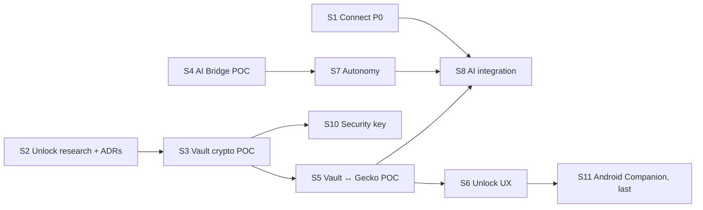

# Execution plan (from 2026-10-26)

How the open work is sequenced: the next steps already on the [roadmap](roadmap.md) plus two new programmes, **Secure Profiles: Vault and unlock** (phone, OS, password, security key) and **AI Bridge** (agents, autonomy, browser automation). Each slice is a vertical piece that ends with real tests; nothing is "done" while it is only UI or a mock.

## Project goal (set by the maintainer, 2026-10-26)

**Finish the whole project**: Nulavio 1.0 for Linux (Fedora KDE first, then Ubuntu), with Windows evaluated. Work proceeds slice by slice in the order below without pausing between slices; it stops only for something only the maintainer or a third party can provide.

Nulavio is complete when all of the following are verified (tests or recorded evidence), not just implemented:

1. Every roadmap phase's DoD (0–6, 2b, 2c, 2d) and the [release criteria](release-criteria.md) alpha gate.
2. Secure Profiles: encrypted profiles at rest with real lock/unlock; password, recovery code and OS methods; phone unlock with the Android Companion (F-Droid build); at least two recovery methods; protection states shown truthfully.
3. AI Bridge: real agents (Codex CLI, Claude Code) connected through the wizard; the four autonomy levels behave as granted; revocation and emergency stop; no access to locked profiles.
4. Packaging and updates: signed RPM in a signed repository, SBOM attached, update SLA rehearsed; Debian/Ubuntu package from the same engine build (patch 0006 reads the distribution's system directory).
5. Hardening: Guard runtime checks, regression suite over real sites, documentation of every residual risk.

| Needs the maintainer or a third party | When |
|---|---|
| Trademark searches (INPI, USPTO, EUIPO) | Before a public 1.0 |
| Google Safe Browsing quota review; download-protection access (R15) | Alpha gate |
| Signing keys for packages and the repository; F-Droid and Play Store accounts | Packaging (phase 6), S11 |
| Android SDK installation (approved: when S11 starts) and the test phone | S11 |
| A FIDO2 security key (D5) | S10 |
| Independent security audit (U11, A14) | Before 1.0 |
| Test vulnerability report to `security@nulavio.net` | Alpha gate |

## Where we are

| Area | State (verified) |
|---|---|
| Engine | Firefox 158.0.1 source build (Track B), 5 patches, rootless container build; Track A launcher over distribution Firefox |
| Shell | Built-in add-on with privileged modules: new tab, download warning, search, profiles, Smart Profile Routing (links from apps, typed addresses, link menu) |
| Profiles | Engine profile groups (`SelectableProfileService`); isolation by separate instances and directories; **no encryption at rest yet** |
| Guard | Launcher pre-launch audit (`guard.py`); refuses profiles with automation prefs (Marionette, remote agent) |
| Vault, unlock | **Nothing yet** |
| Automation | Marionette/WebDriver BiDi exist in the engine; Nulavio uses them only in tests on throwaway profiles |
| Tooling on the reference laptop | gocryptfs 2.6.1, cryptsetup, libsodium 1.0.22, TPM 2.0 (`/dev/tpmrm0`, user not in `tss`), Claude Code 2.1.308, Codex CLI 0.164.0, Node 24; no Android SDK, no FIDO tools, no Playwright |

## Workstreams

| Stream | Content | Spec |
|---|---|---|
| W1 Connect | Nulavio Connect P0 discovery + Integration Manager, default-browser offer | [ADR 0004](../adr/0004-nulavio-connect.md) |
| W2 Routing and profiles | Routing M5 (in-page navigation, after security review), Temporary profile | [ADR 0003](../adr/0003-nulavio-profiles-and-routing.md) |
| W3 Vault and unlock | Nulavio Vault, Unlock Coordinator, Platform Key Provider, Phone Unlock, Hardware Key Provider | [Brief](briefs/2026-10-26-profile-unlock.md); roadmap phase 2c; ADR `phone-profile-unlock` to be written in U2 |
| W4 AI Bridge | MCP server, agent registry, permission and autonomy manager, Gecko adapter, profile access, audit | [Brief](briefs/2026-10-26-ai-bridge.md); roadmap phase 2d; ADR to be written in A2 |
| W5 Existing phases | Privacy panel, password-provider certification, Guard runtime, packaging, alpha | [Roadmap](roadmap.md) phases 3–6 |

## Sequence

One slice per working session, in this order. Sizes are relative (S ≈ one session, M ≈ two, L ≈ three or more); they are not dates.

| # | Slice | Scope | Done when | Depends on | Size |
|---|---|---|---|---|---|
| S1 | **Connect P0** (W1) — **done 2026-10-26** | `nulavio integrations` (read-only discovery with evidence: Plasma Browser Integration, portals, Secret Service/KWallet, default browser and URL handlers), Integration Manager page, "make Nulavio the default browser" offered, never automatic | Discovery tests against fake and real D-Bus services on a private bus; nothing changes without a click | — | M |
| S2 | **Unlock research and decisions** (W3: U0–U3) — **done 2026-10-26** | Repository audit; compatibility report with official sources for WebAuthn hybrid + PRF (Windows/Linux × Android/iPhone, each cell SUPPORTED_AND_TESTED / DOCUMENTED_NOT_TESTED / EXPERIMENTAL / UNSUPPORTED / UNKNOWN), Companion app, approval-only; ADR `phone-profile-unlock`; ADR Vault key management (DEK, envelopes, metadata, rotation, crash consistency, recovery); anti-infostealer threat model for unlock; trust-boundary and key-flow diagrams; protection-state matrix (`encrypted_at_rest`, `os_user_protected`, `password_protected`, `hardware_bound`, `phone_approved`, `phone_key_release_verified`) | ADRs accepted by the maintainer; every compatibility claim has a source or a test | — | M |
| S3 | **Vault crypto POC** (W3: U4, U5 simulated) — **done 2026-10-26** ([ADR 0006, implementation](../adr/0006-nulavio-vault.md#implementation-s3-2026-10-26); 60 tests in `tests/unit/test_vault.py`, all 16 mandatory tests of the brief) | Standalone, artificial data only: random profile DEK, AEAD envelopes per unlock method, versioned metadata with domain separation, atomic writes; providers: password (Argon2id), recovery code (high entropy), OS keyring (Secret Service; reported as `os_user_protected`, not hardware); **phone protocol simulated** (desktop + a reference "phone" in the test suite): pairing with QR invitation + user confirmation, challenge bound to profile/device/operation/expiry, HPKE-style E2E release, replay and substitution rejected | All tests listed in the spec that do not need a real phone pass on Fedora KDE, including "copying the protected files does not recover the DEK" and "no plaintext secret after a crash" | S2 | L |
| S4 | **AI Bridge foundation** (W4: A0–A4, A7 first cut) — **done 2026-10-26** ([ADR 0007](../adr/0007-ai-bridge.md); real Claude Code connects and is held to its grants; Codex CLI tested end to end once the account's usage limit reset) | Audit; compatibility matrix (Nulavio MCP, WebDriver BiDi, Marionette, firefox-devtools-mcp, Playwright, CDP: documented vs implemented vs tested); ADR AI Bridge; threat model for automation and autonomy; **POC**: Nulavio MCP server (stdio) driving a throwaway *AI Workspace* profile (tabs, navigate, read page, accessibility snapshot, screenshot, click, type), with a policy decision point outside the model and per-capability grants (ask / allow for task / session / period / always / block) | Real clients connect and run tools: Claude Code and Codex CLI with throwaway configuration (no change to the user's agent configs); denied capabilities are denied; revocation stops new calls | — | L |
| S5 | **Vault ↔ Gecko profile POC** (W3: U8 spike) — **done 2026-10-26** ([ADR 0006, S5](../adr/0006-nulavio-vault.md#implementation-s5-2026-10-26-encrypted-profile-storage)) | Encrypted profile container for a throwaway profile (gocryptfs, already installed): unlock = derive the volume key from the DEK and mount before the engine starts; lock = end the instance and unmount; profile switching and routing respect locked profiles; no direct changes to Gecko storage files | A locked profile's files are unreadable at rest; unlock/lock cycles survive crashes; routing to a locked profile asks to unlock instead of opening | S3 | M |
| S6 | **Unlock UX** (W3: U9 first part) — **done 2026-10-26** ([ADR 0006, S6](../adr/0006-nulavio-vault.md#implementation-s6-2026-10-26-unlock-and-onboarding-in-the-browser)) | Onboarding with three decisions (profile, protection, recovery), locked-profile screen, recovery setup and test, "use another method", device list; Horizon components; only real operations (password, recovery code, OS keyring) | Every screen state (`idle` … `error`) reachable in tests; contrast and keyboard checks | S3, S5 | M |
| S7 | **AI Bridge autonomy** (W4: A5–A8) — **done 2026-10-26** ([ADR 0007, S7](../adr/0007-ai-bridge.md#implementation-s7-2026-10-26-autonomy-permission-requests-settings)) | Gecko adapter hardening; agent registry and sessions (identity, Unix-socket peer credentials + short-lived tokens); Restricted / Assisted / Autonomous / Full control; activity indicator, pause, revoke, emergency stop; audit log with retention | The A10 permission and autonomy tests pass, including "Autonomous does not ask for actions already granted" and "revoked agents stop" | S4 | L |
| S8 | **AI Bridge integration** (W4: A9–A11) — **done 2026-10-26** ([ADR 0007, S8](../adr/0007-ai-bridge.md#implementation-s8-2026-10-26-connect-wizard-profiles-and-routes)) | "Connect agent" wizard (detect, show exact config change, write only after approval), Secure Profiles and Smart Profile Routing per agent, locked-profile rules (unlock before task; delegation only as an explicit, documented extra unlock method), UX screens | Codex CLI and Claude Code connected through the wizard in a throwaway home; per-agent routing works; no access to a locked profile | S5, S7 | L |
| S10 | **Security key provider** (W3) | FIDO2 hmac-secret/PRF as an unlock method when the key supports it; capability detection; PIN/UV | A real key unlocks a test profile; a key without hmac-secret is refused clearly | S3; a key | S |
| S11 | **Phone Companion, Android POC** (W3: U6–U7), **last** | Only after the S2 ADR is approved and the desktop side is done: small Android app (Keystore/StrongBox, BiometricPrompt-bound key use), pairing and unlock against the S3 protocol, revocation, lost-phone and recovery tests. Free-software build only (no Google Play Services, no Firebase push, no trackers) so it can ship on **F-Droid first**; Play Store later. Test device: Samsung Galaxy S24+ (Android 17) | Real device unlocks a test profile; replay/expired/unpaired/substituted cases fail; F-Droid build recipe reproducible | S2, S3, S5, S6 | L |
| S12 | **Temporary profile** (W2) — **done 2026-10-26** ([ADR 0003](../adr/0003-nulavio-profiles-and-routing.md#temporary-profile-implementation)) | A new, empty profile in its own instance, kept in memory where the system allows, deleted by the Nulavio tools when it exits; selector, Settings, `nulavio run --temporary` | Deleted after exit on the real engine; identity and storage note shown truthfully; nothing left outside its folder but the launcher log | — | S |
| S13 | **Guard runtime** (W5, phase 5) — **done 2026-10-26** ([hardening](../security/hardening.md#guard-at-run-time-what-it-catches-and-how-it-can-be-bypassed)) | Extension-set change alert (an extension added or changed while the browser was closed), profile integrity manifest (prefs that weaken protections, policies, `user.js`, native-messaging hosts), with a bypass analysis | Each check has a test that tampers with a closed profile and sees the alert; documented what same-user malware can still do | — | M |
| S14 | **Per-site privacy panel** (W5, phase 3) — **done 2026-10-26** (engine site panel verified; Settings → Site exceptions; Strict tracking protection fixed in the build) | Shell panel for the active site with the engine's real state: tracking protection and what it blocked (engine content-blocking log), HTTPS state, uBO on/off for the site (its own controls), permissions; no invented counters | Values match the engine's own on fixture pages; off switches reversible | — | M |
| S15 | **DoH choice and fingerprinting analysis** (W5, phase 3) — **done 2026-10-26** ([fingerprinting](../research/fingerprinting.md)) | Onboarding choice for DNS over HTTPS (off / engine default / a chosen resolver), explained; fingerprinting regression analysis against the engine's protections | Choice applied and reversible; the analysis recorded with sources | — | S |
| S16 | **Real-site regression suite** (W5, phase 3 DoD) — **done 2026-10-26** ([report](../research/site-regression-2026-10.md)) | 50 public sites, screenshot diff against a baseline, breakage triage with per-site fixes or recorded causes | A 50-site run recorded; breakage list with causes | S14 | M |
| S17 | **Password flows B and D** (W5, phase 4) — **done 2026-10-26** (Settings → Passwords; look-alike warning through an engine window actor) | Provider chooser (flow B) and suspicious-login interstitial (flow D) from [ux-flows](../brand/ux-flows.md); only the official extensions, no undocumented APIs | Integration tests with KeePassXC (container) and the built-in manager | — | M |
| S18 | **Packaging** (W5, phase 6) — **done 2026-10-26** except signing with the release key ([build](../architecture/build.md#packages-s18)) | RPM spec and a reproducible build in a rootless container; repository tooling ready for the maintainer's signing keys; DEB built with its own `libdir` (R25); SBOM attached | Package installs and starts in a clean Fedora and Ubuntu container; signing waits for keys | — | L |
| S19 | **Updates and security changelog** (W5, phase 6) — **done 2026-10-27** (watcher, daily workflow, rehearsal, [changelog](../security/changelog.md)) | Update SLA automation (upstream release watch, rebuild, test, publish steps), security changelog format | A rehearsal from an upstream point release to a test package | S18 | M |
| S20 | **AI A12–A14** (W4) — **A12 and A13 done 2026-10-27** ([ADR 0007](../adr/0007-ai-bridge.md)); A14 hardening items done, Windows with U10 | Built-in assistant under the same policies (provider-agnostic, keys only from the user), raw BiDi mode described as unconfinable, hardening and multi-platform tests | A12 works with a user-supplied provider in tests without real keys; A13/A14 tests | S8 | L |
| S21 | **Connect P1/P2** (W1) — **done 2026-10-27** ([ADR 0004](../adr/0004-nulavio-connect.md)) | KRunner, KDE Connect send link, screen-cast status, passkeys status, notifications; MPRIS, activities, per-profile proxy | Each item tested on a private D-Bus with real or fake services | S1 | L |
| S22 | **Routing M5** (W2) | Security review first (redirects, POST, scripted navigation), then automatic in-page routing if the review allows | Review recorded; tests for every refused case | — | M |
| S23 | **Phase 5 spikes** (W5) | bubblewrap, Flatpak and the native-messaging portal, SELinux module; sensitive-sites container with clear-on-close | Each spike ends with a recorded decision and, where adopted, a test | — | L |
| S24 | **Alpha gate** | Walk the [release criteria](release-criteria.md); collect the items only the maintainer can provide | Every criterion verified or listed as a maintainer item | all | M |
| later | W3 U10 (iOS, Windows evaluation), U11 (hardening, independent audit) | | | | |

S1, S2 and S4 have no dependencies on each other; the order above puts the open roadmap item first, then the security foundation, then the AI POC. The Android Companion is deliberately the last slice (maintainer's decision, 2026-10-26): every desktop part, including the simulated phone protocol, is built and tested first.

## Decisions (maintainer, 2026-10-26)

The maintainer accepted the recommendations below, with the Android changes noted in D4.

| # | Decision | Outcome | Affects |
|---|---|---|---|
| D1 | Crypto library outside the engine (the launcher is standard-library Python, which has no AEAD) | **libsodium through `ctypes`** (system package: XChaCha20-Poly1305, Argon2id, X25519; no pip dependency) | S3 |
| D2 | Encrypted profile storage on Linux | **gocryptfs** (installed, user space, per-profile, no root) | S5 |
| D3 | TPM-bound provider (`hardware_bound`) | **Optional, not now**: it needs your user in the `tss` group (sudo); the plan works without it | S3 (optional) |
| D4 | Phone | **Android last** (slice S11). Distribution **F-Droid first, Play Store later**, so the app must be free software with no Google Play Services, Firebase or trackers. Test device: **Samsung Galaxy S24+, Android 17**. Android SDK installed only when S11 starts (outside system directories). iOS stays in the architecture, never claimed without tests | S2 (protocol must not need push services), S11 |
| D5 | Security key | Not answered yet: S10 waits until a FIDO2 key with hmac-secret is available | S10 |
| D6 | AI Bridge implementation | **Nulavio's own MCP server** in standard-library Python; Mozilla's firefox-devtools-mcp evaluated in the matrix; Playwright only in a throwaway directory | S4 |
| D7 | Agent configuration | **Throwaway configuration in tests**; any change to the real Codex or Claude configuration is shown first and written only after approval | S4, S8 |

## Guardrails for every slice

- No secret in plain text on disk, in logs or in the clipboard; tests use artificial data and throwaway profiles only.
- Phone "approval" that does not take part in releasing the key is never presented as strong unlock; no backdoor or Nulavio master key; losing every factor means the data cannot be recovered, and the UI says so.
- No silent downgrade to a weaker unlock method; no remote service required for normal unlock.
- AI autonomy is the user's decision: granted capabilities are honoured without hidden confirmations; nothing is granted that was not; web pages and models cannot change grants; raw protocols are described as unconfinable by high-level policy.
- Gecko sandbox, site isolation, TLS, Safe Browsing and updates are never weakened for convenience; the Guard keeps refusing automation prefs on real profiles unless the user enables an explicit automation mode for that profile.
- Same-user malware with access to an unlocked profile is out of reach of any of this; documentation says so.

## Plan summary

- **Model and effort to execute:** Opus, high effort for S2, S3 and S5 (cryptographic design and key lifecycle; mistakes cost data or security); Opus, medium for S4, S7, S8 (integration work with a defined architecture); Sonnet, medium for S1 and S6 (bounded implementation on existing patterns).
- **Why:** the Vault and unlock work has irreversible failure modes (lost data, false protection); AI Bridge and Connect follow patterns already in the codebase (privileged modules, Shell pages, Marionette tests).
- **Open decisions:** only D5 (a security key) is open; D1–D4, D6 and D7 are decided. S13–S24 need no new decision before they start; S18 needs signing keys only for the signing step.
- **When to escalate to a more capable setup:** if S2 finds that no tested combination releases a key from the phone (hybrid PRF unavailable on Linux and Companion blocked), or if the encrypted-container approach cannot keep Gecko consistent across lock/unlock.
- **Ready to execute:** yes for S1–S8 and S12–S24 (S1–S8 and S12–S21 done). S10 needs a security key; S11 (Android) comes last by decision.
