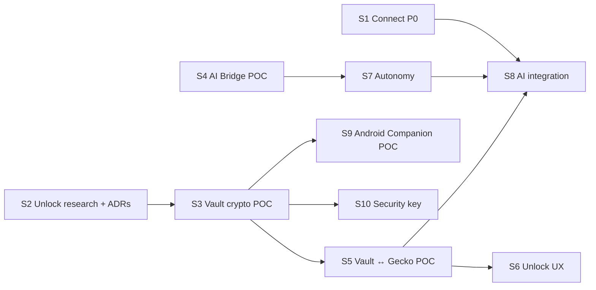

# Execution plan (from 2026-10-26)

How the open work is sequenced: the next steps already on the [roadmap](roadmap.md) plus two new programmes, **Secure Profiles: Vault and unlock** (phone, OS, password, security key) and **AI Bridge** (agents, autonomy, browser automation). Each slice is a vertical piece that ends with real tests; nothing is "done" while it is only UI or a mock.

## Where we are

| Area | State (verified) |
|---|---|
| Engine | Firefox 158.0.1 source build (Track B), 5 patches, rootless container build; Track A launcher over distribution Firefox |
| Shell | Built-in add-on with privileged modules: new tab, download warning, search, profiles, Smart Profile Routing (links from apps, typed addresses, link menu) |
| Profiles | Engine profile groups (`SelectableProfileService`); isolation by separate instances and directories; **no encryption at rest yet** |
| Guard | Launcher pre-launch audit (`guard.py`); refuses profiles with automation prefs (Marionette, remote agent) |
| Vault, unlock | **Nothing yet** |
| Automation | Marionette/WebDriver BiDi exist in the engine; Nulavio uses them only in tests on throwaway profiles |
| Tooling on the reference laptop | gocryptfs 2.6.1, cryptsetup, libsodium 1.0.22, TPM 2.0 (`/dev/tpmrm0`, user not in `tss`), Claude Code 2.1.308, Codex CLI 0.164.0, Node 24; no Android SDK, no FIDO tools, no Playwright |

## Workstreams

| Stream | Content | Spec |
|---|---|---|
| W1 Connect | Nulavio Connect P0 discovery + Integration Manager, default-browser offer | [ADR 0004](../adr/0004-nulavio-connect.md) |
| W2 Routing and profiles | Routing M5 (in-page navigation, after security review), Temporary profile | [ADR 0003](../adr/0003-nulavio-profiles-and-routing.md) |
| W3 Vault and unlock | Nulavio Vault, Unlock Coordinator, Platform Key Provider, Phone Unlock, Hardware Key Provider | [Brief](briefs/2026-10-26-profile-unlock.md); roadmap phase 2c; ADR `phone-profile-unlock` to be written in U2 |
| W4 AI Bridge | MCP server, agent registry, permission and autonomy manager, Gecko adapter, profile access, audit | [Brief](briefs/2026-10-26-ai-bridge.md); roadmap phase 2d; ADR to be written in A2 |
| W5 Existing phases | Privacy panel, password-provider certification, Guard runtime, packaging, alpha | [Roadmap](roadmap.md) phases 3–6 |

## Sequence

One slice per working session, in this order. Sizes are relative (S ≈ one session, M ≈ two, L ≈ three or more); they are not dates.

| # | Slice | Scope | Done when | Depends on | Size |
|---|---|---|---|---|---|
| S1 | **Connect P0** (W1) | `nulavio integrations` (read-only discovery with evidence: Plasma Browser Integration, portals, Secret Service/KWallet, default browser and URL handlers), Integration Manager page, "make Nulavio the default browser" offered, never automatic | Discovery tests against fake and real D-Bus services on a private bus; nothing changes without a click | — | M |
| S2 | **Unlock research and decisions** (W3: U0–U3) | Repository audit; compatibility report with official sources for WebAuthn hybrid + PRF (Windows/Linux × Android/iPhone, each cell SUPPORTED_AND_TESTED / DOCUMENTED_NOT_TESTED / EXPERIMENTAL / UNSUPPORTED / UNKNOWN), Companion app, approval-only; ADR `phone-profile-unlock`; ADR Vault key management (DEK, envelopes, metadata, rotation, crash consistency, recovery); anti-infostealer threat model for unlock; trust-boundary and key-flow diagrams; protection-state matrix (`encrypted_at_rest`, `os_user_protected`, `password_protected`, `hardware_bound`, `phone_approved`, `phone_key_release_verified`) | ADRs accepted by the maintainer; every compatibility claim has a source or a test | — | M |
| S3 | **Vault crypto POC** (W3: U4, U5 simulated) | Standalone, artificial data only: random profile DEK, AEAD envelopes per unlock method, versioned metadata with domain separation, atomic writes; providers: password (Argon2id), recovery code (high entropy), OS keyring (Secret Service; reported as `os_user_protected`, not hardware); **phone protocol simulated** (desktop + a reference "phone" in the test suite): pairing with QR invitation + user confirmation, challenge bound to profile/device/operation/expiry, HPKE-style E2E release, replay and substitution rejected | All tests listed in the spec that do not need a real phone pass on Fedora KDE, including "copying the protected files does not recover the DEK" and "no plaintext secret after a crash" | S2 | L |
| S4 | **AI Bridge foundation** (W4: A0–A4, A7 first cut) | Audit; compatibility matrix (Nulavio MCP, WebDriver BiDi, Marionette, firefox-devtools-mcp, Playwright, CDP: documented vs implemented vs tested); ADR AI Bridge; threat model for automation and autonomy; **POC**: Nulavio MCP server (stdio) driving a throwaway *AI Workspace* profile (tabs, navigate, read page, accessibility snapshot, screenshot, click, type), with a policy decision point outside the model and per-capability grants (ask / allow for task / session / period / always / block) | Real clients connect and run tools: Claude Code and Codex CLI with throwaway configuration (no change to the user's agent configs); denied capabilities are denied; revocation stops new calls | — | L |
| S5 | **Vault ↔ Gecko profile POC** (W3: U8 spike) | Encrypted profile container for a throwaway profile (gocryptfs, already installed): unlock = derive the volume key from the DEK and mount before the engine starts; lock = end the instance and unmount; profile switching and routing respect locked profiles; no direct changes to Gecko storage files | A locked profile's files are unreadable at rest; unlock/lock cycles survive crashes; routing to a locked profile asks to unlock instead of opening | S3 | M |
| S6 | **Unlock UX** (W3: U9 first part) | Onboarding with three decisions (profile, protection, recovery), locked-profile screen, recovery setup and test, "use another method", device list; Horizon components; only real operations (password, recovery code, OS keyring) | Every screen state (`idle` … `error`) reachable in tests; contrast and keyboard checks | S3, S5 | M |
| S7 | **AI Bridge autonomy** (W4: A5–A8) | Gecko adapter hardening; agent registry and sessions (identity, Unix-socket peer credentials + short-lived tokens); Restricted / Assisted / Autonomous / Full control; activity indicator, pause, revoke, emergency stop; audit log with retention | The A10 permission and autonomy tests pass, including "Autonomous does not ask for actions already granted" and "revoked agents stop" | S4 | L |
| S8 | **AI Bridge integration** (W4: A9–A11) | "Connect agent" wizard (detect, show exact config change, write only after approval), Secure Profiles and Smart Profile Routing per agent, locked-profile rules (unlock before task; delegation only as an explicit, documented extra unlock method), UX screens | Codex CLI and Claude Code connected through the wizard in a throwaway home; per-agent routing works; no access to a locked profile | S5, S7 | L |
| S9 | **Phone Companion, Android POC** (W3: U6–U7) | Only after the S2 ADR is approved: small Android app (Keystore/StrongBox, BiometricPrompt-bound key use), pairing and unlock against the S3 protocol, revocation, lost-phone and recovery tests | Real device unlocks a test profile; replay/expired/unpaired/substituted cases fail | S2, S3; device and SDK approval | L |
| S10 | **Security key provider** (W3) | FIDO2 hmac-secret/PRF as an unlock method when the key supports it; capability detection; PIN/UV | A real key unlocks a test profile; a key without hmac-secret is refused clearly | S3; a key | S |
| later | W2 Routing M5, Temporary profile; W3 U10 (iOS, Windows evaluation), U11 (hardening, independent audit); W4 A12 (integrated assistant, provider-agnostic, same policies), A13 (advanced compatibility), A14 (hardening, multi-platform); W5 phases 3–6 | | | | |

S1, S2 and S4 have no dependencies on each other; the order above puts the open roadmap item first, then the security foundation, then the AI POC.

## Decisions and resources needed from the maintainer

| # | Decision | Recommendation | Needed by |
|---|---|---|---|
| D1 | Crypto library outside the engine (the launcher is standard-library Python, which has no AEAD) | **libsodium through `ctypes`** (system package already installed: XChaCha20-Poly1305, Argon2id, X25519; no pip dependency). Alternatives: `pyca/cryptography` (new dependency), NSS (only inside the engine, but unlock happens before it starts) | S3 |
| D2 | Encrypted profile storage on Linux | **gocryptfs** (installed, user space, per-profile, no root) for the POC; LUKS file needs root; fscrypt needs filesystem setup | S5 |
| D3 | TPM-bound provider (`hardware_bound`) | Optional; needs adding your user to the `tss` group (sudo). Default plan works without it | S3 (optional) |
| D4 | Phone for the Companion POC | Which Android phone, and approval to install the Android SDK (several GB; outside system dirs). iOS stays in the architecture but is not claimed without tests | S9 |
| D5 | Security key | Whether you have a FIDO2 key with hmac-secret (YubiKey 5 has it) | S10 |
| D6 | AI Bridge implementation | Nulavio's own MCP server (standard-library Python, like the launcher), evaluating Mozilla's firefox-devtools-mcp (Node) in the matrix; Playwright installed only in a throwaway directory for compatibility tests | S4 |
| D7 | Agent configuration | Tests use throwaway configuration (`--mcp-config`, temporary homes). Any change to your real Codex or Claude configuration is shown first and written only after you approve it | S4, S8 |

## Guardrails for every slice

- No secret in plain text on disk, in logs or in the clipboard; tests use artificial data and throwaway profiles only.
- Phone "approval" that does not take part in releasing the key is never presented as strong unlock; no backdoor or Nulavio master key; losing every factor means the data cannot be recovered, and the UI says so.
- No silent downgrade to a weaker unlock method; no remote service required for normal unlock.
- AI autonomy is the user's decision: granted capabilities are honoured without hidden confirmations; nothing is granted that was not; web pages and models cannot change grants; raw protocols are described as unconfinable by high-level policy.
- Gecko sandbox, site isolation, TLS, Safe Browsing and updates are never weakened for convenience; the Guard keeps refusing automation prefs on real profiles unless the user enables an explicit automation mode for that profile.
- Same-user malware with access to an unlocked profile is out of reach of any of this; documentation says so.

## Plan summary

- **Model and effort to execute:** Opus, high effort for S2, S3 and S5 (cryptographic design and key lifecycle; mistakes cost data or security); Opus, medium for S4, S7, S8 (integration work with a defined architecture); Sonnet, medium for S1 and S6 (bounded implementation on existing patterns).
- **Why:** the Vault and unlock work has irreversible failure modes (lost data, false protection); AI Bridge and Connect follow patterns already in the codebase (privileged modules, Shell pages, Marionette tests).
- **Open decisions:** D1–D7 above; D1 and D2 block S3 and S5, the rest have defaults or come later.
- **When to escalate to a more capable setup:** if S2 finds that no tested combination releases a key from the phone (hybrid PRF unavailable on Linux and Companion blocked), or if the encrypted-container approach cannot keep Gecko consistent across lock/unlock.
- **Ready to execute:** yes for S1, S2 and S4. S3 needs D1 (recommendation available); S5 needs D2; S9 and S10 need hardware.
